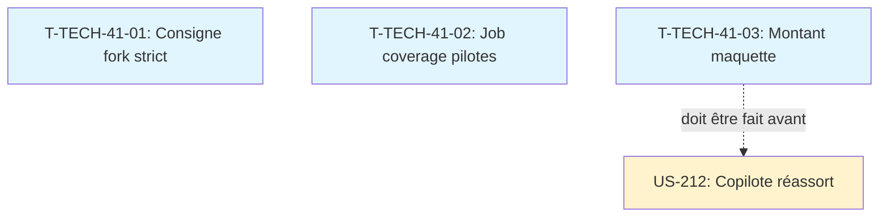

# Tâches techniques transverses — Sprint 41

> Actions issues de la rétrospective du sprint 40 et améliorations continues. Ces tâches ne rapportent pas de points mais améliorent la qualité et l'efficacité.

## Vue d'ensemble

| ID | Type | Tâche | Estimation | Dépend de | Statut |
|----|------|-------|------------|-----------|--------|
| T-TECH-41-01 | [DOC] | Consigne stricte pour le fork de décomposition | 0,25 h | - | 🔲 |
| T-TECH-41-02 | [OPS] | Job coverage dans la CI des plugins pilotes | 0,5 h | - | 🔲 |
| T-TECH-41-03 | [DOC] | Corriger le montant 1 017,35 € → 963,50 € HT dans la maquette Copilote | 0,25 h | - | 🔲 |

**Total estimé** : 1 h

---

## Détail des tâches

### T-TECH-41-01 : Consigne stricte pour le fork de décomposition
- **Type** : [DOC]
- **Estimation** : 0,25 h

**Contexte** : Le sprint 40 a révélé que le prompt du fork de décomposition n'était pas assez strict, ce qui a conduit à des débordements (implémentation au lieu de décomposition).

**Action** : Renforcer le prompt initial du fork de décomposition pour interdire explicitement :
- L'implémentation des stories
- L'écriture de code source, modification de tests, fichiers hors `project-management/sprints/` et `.bmad/sprint-status.yaml`
- La création de PR
- Le lancement de tests
- Terminer en < 30 tours

Mettre à jour `docs/sprint-decomposition-prompt-template.md` (à créer si n'existe pas).

### T-TECH-41-02 : Job coverage dans la CI des plugins pilotes
- **Type** : [OPS]
- **Estimation** : 0,5 h

**Contexte** : US-252 (sprint 40) a ajouté la couverture PHPUnit sur 3 plugins pilotes. Ce pattern doit être documenté pour être réutilisé dans US-253.

**Action** : Vérifier que les 3 plugins pilotes (copilot, passport, parc) ont bien le job coverage dans leur CI :
- Step « Publish coverage check run » avec env vars COV_RATE/COV_COVERED/COV_TOTAL
- Utilisation de PCOV
- Génération du fichier Clover XML
- Publication du check run « coverage »

Si manquant, l'ajouter. Documenter le pattern dans `docs/ci-coverage-pattern.md` pour US-253.

**Note** : Cette tâche est intégrée dans US-253 comme pattern de référence.

### T-TECH-41-03 : Corriger le montant de la maquette Copilote
- **Type** : [DOC]
- **Estimation** : 0,25 h

**Contexte** : La maquette Copilote sur le canevas Claude Design `G2StRQigRKD6SqNRoyHpkW` affiche le montant 1 017,35 € alors qu'il devrait être 963,50 € HT (montant de la dernière commande de Claire dans les fixtures).

**Action** : Corriger le montant dans la page Copilote du canevas Claude Design pour afficher 963,50 € HT.

**Dépendance** : Cette tâche DOIT être faite AVANT US-212 (le worker lit la maquette corrigée).

## Dépendances

## Notes

- T-TECH-41-01 : amélioration du processus de planification
- T-TECH-41-02 : intégré dans US-253 (pattern de référence)
- T-TECH-41-03 : BLOQUANT pour US-212 (le worker lit la maquette)
