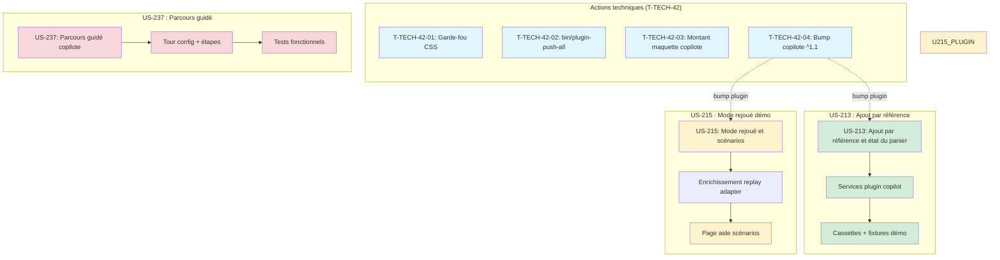

# Dépendances du Sprint 42

> Ce fichier documente les dépendances entre les stories et les tâches du sprint 42.

## Graphe des dépendances globales



## Dépendances inter-stories

| Story | Dépend de | Type | Notes |
|-------|-----------|------|-------|
| US-213 | T-TECH-42-04 | Souhaitable | Bump copilote ^1.1 avant d'ajouter les nouvelles cassettes |
| US-215 | T-TECH-42-04 | Souhaitable | Idem |
| US-237 | US-212 (S41) | Externe (done) | Parcours guidé nécessite le copilote fonctionnel |

## Dépendances intra-story

### US-213 : Ajout par référence et état du panier

Flux TDD strict :
1. Lecture ADR 0018 + cassettes existantes
2. RED-GREEN pour chaque scénario (ajout par référence, état du panier)
3. Cassettes démo FR/EN
4. Tests fonctionnels plugin + démo
5. Documentation

### US-215 : Mode rejoué de la démo publique

Flux séquentiel :
1. Analyse du replay adapter existant
2. Scénarios supplémentaires (cassettes)
3. Gestion des variantes de formulation
4. Page d'aide scénarios
5. Tests fonctionnels

### US-237 : Parcours guidé copilote

Flux séquentiel :
1. Lecture du système de tours existant
2. Configuration du parcours copilote
3. Tests fonctionnels
4. Captures

## Workers recommandés

| Worker | Stories | Parallélisme | Notes |
|--------|---------|--------------|-------|
| wtech | T-TECH-42-01 à 04 | Oui (4 tâches indépendantes) | Terminer T-TECH-42-04 AVANT US-213/US-215 |
| w213 | US-213 | Non (TDD strict) | Peut être parallèle avec w215 (fichiers disjoints) |
| w215 | US-215 | Non (séquentiel) | Peut être parallèle avec w213 |
| w237 | US-237 | Non (séquentiel) | Après wtech (le copilote doit être fonctionnel) |

## Contraintes

- **RAM** : Au plus 2 workers lancent des tests en même temps (8 Go RAM)
- **Ordre** : wtech d'abord (T-TECH-42-04 souhaitable avant US-213/US-215), puis w213 et w215 en parallèle, puis w237
- **Plugin** : Les modifications du plugin copilote (US-213) nécessitent un tag avant intégration démo

## Chemin critique

```
T-TECH-42-04 → US-213 (plugin + démo) → US-237 (parcours)
```

Le chemin critique passe par US-213 (5 pts) puis US-237 (3 pts). US-215 (3 pts) peut se faire en parallèle.
