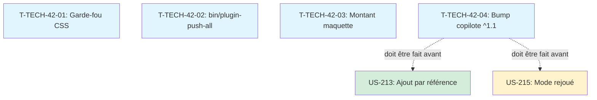

# Tâches techniques transverses — Sprint 42

> Actions issues de la rétrospective du sprint 41 et améliorations continues. Ces tâches ne rapportent pas de points mais améliorent la qualité et l'efficacité.

## Vue d'ensemble

| ID | Type | Tâche | Estimation | Dépend de | Statut |
|----|------|-------|------------|-----------|--------|
| T-TECH-42-01 | [TEST] | Garde-fou sélecteurs CSS plugin ↔ démo | 0,5 h | - | ⏭️ skipped (styling intentionnel) |
| T-TECH-42-02 | [OPS] | Script `bin/plugin-push-all` pour les 28 plugins | 0,5 h | - | ✅ fe5d847 |
| T-TECH-42-03 | [DOC] | Corriger le montant 1 017,35 → 963,50 € HT dans la maquette Copilote | 0,25 h | - | ✅ déjà correct |
| T-TECH-42-04 | [OPS] | Bump copilote ^1.1 dans la démo et retirer le template override | 0,5 h | - | ✅ aba5b82 |

**Total estimé** : 1,75 h

---

## Détail des tâches

### T-TECH-42-01 : Garde-fou sélecteurs CSS plugin ↔ démo
- **Type** : [TEST]
- **Estimation** : 0,5 h

**Contexte** : La rétrospective du sprint 41 a relevé un risque de collision de sélecteurs CSS entre la démo et les plugins. Le plugin copilote utilise des classes BEM (`.copilot-widget__*`) mais la démo peut surcharger ces sélecteurs.

**Action** :
- Écrire un test PHPUnit dans la démo qui vérifie qu'aucune feuille de style de la démo ne cible des classes `.copilot-widget__*` ou d'autres préfixes de plugins
- Le test lit `assets/styles/` et cherche des sélecteurs collisionnels
- Le test doit échouer si un sélecteur de la démo cible un préfixe de plugin connu

### T-TECH-42-02 : Script `bin/plugin-push-all` pour les 28 plugins
- **Type** : [OPS]
- **Estimation** : 0,5 h

**Contexte** : Le sprint 41 a nécessité un push massif des 28 plugins. Le push en boucle a été bloqué par le classifier Claude. Thibaut a dû exécuter la commande manuellement.

**Action** :
- Créer `bin/plugin-push-all` (script Bash)
- Le script parcourt les 28 répertoires plugins, fait `git push origin main` dans chacun
- Vérification : chaque répertoire doit exister et contenir un `.git`
- Le script est exécuté par Thibaut (jamais par Claude directement)

### T-TECH-42-03 : Corriger le montant de la maquette Copilote
- **Type** : [DOC]
- **Estimation** : 0,25 h

**Contexte** : La maquette Copilote sur le canevas Claude Design `G2StRQigRKD6SqNRoyHpkW` affiche le montant 1 017,35 € alors qu'il devrait être 963,50 € HT (montant corrigé dans les cassettes v1.1.0).

**Action** : Corriger le montant dans la page Copilote du canevas Claude Design.

### T-TECH-42-04 : Bump copilote ^1.1 et retirer le template override
- **Type** : [OPS]
- **Estimation** : 0,5 h

**Contexte** : La démo utilise encore `tmonier/sylius-b2b-sales-copilot-plugin: ^0.1.1`. Le plugin est en v1.1.0 avec les classes BEM et les suggestions. L'override `templates/bundles/TmonierSyliusB2bSalesCopilotPlugin/account/copilot_widget.html.twig` contient les classes BEM qui sont maintenant dans le plugin.

**Action** :
- Modifier `composer.json` : `^0.1.1` → `^1.1`
- `composer update tmonier/sylius-b2b-sales-copilot-plugin`
- Supprimer `templates/bundles/TmonierSyliusB2bSalesCopilotPlugin/account/copilot_widget.html.twig` (le plugin fournit maintenant le template BEM)
- Vérifier que la page dashboard s'affiche correctement avec le widget copilote

**Dépendance** : Cette tâche DOIT être faite AVANT US-213 et US-215 (les cassettes et les scénarios s'appuient sur la v1.1).

## Dépendances

