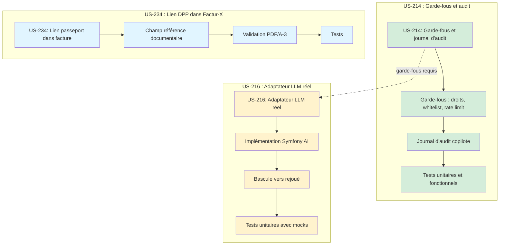

# Dépendances du Sprint 43

> Ce fichier documente les dépendances entre les stories et les tâches du sprint 43.

## Graphe des dépendances globales



## Dépendances inter-stories

| Story | Dépend de | Type | Notes |
|-------|-----------|------|-------|
| US-214 | US-212 (S41), US-213 (S42) | Externe (done) | Garde-fous sur les outils introduits dans les sprints précédents |
| US-216 | US-214 | Intra-sprint | L'adaptateur réel doit respecter les garde-fous d'US-214 |
| US-234 | US-231 (backlog), plugin facturx | Externe | Lien DPP dans les factures, indépendante du copilote |

## Dépendances intra-story

### US-214 : Garde-fous et journal d'audit

Flux TDD strict :
1. Lecture du code existant du plugin copilote (ports, adaptateurs, outils)
2. RED-GREEN pour chaque scénario (droits, whitelist, audit, rate limit, refus commande)
3. Intégration dans la démo
4. Tests fonctionnels plugin + démo

### US-216 : Adaptateur LLM réel

Flux séquentiel :
1. Analyse du port `CopilotModel` et de l'ADR 0018
2. Implémentation Symfony AI (configuration, timeout, retries)
3. Bascule vers rejoué en cas d'erreur
4. Plafond de coût journalier
5. Tests unitaires avec mocks

### US-234 : Lien DPP dans Factur-X

Flux séquentiel :
1. Lecture du plugin facturx (extension points, profil XML)
2. Champ référence documentaire optionnel
3. Validation PDF/A-3 après ajout
4. Tests

## Workers recommandés

| Worker | Stories | Parallélisme | Notes |
|--------|---------|--------------|-------|
| w214 | US-214 | Non (TDD strict) | Terminer AVANT US-216 |
| w216 | US-216 | Non (séquentiel) | Après w214 |
| w234 | US-234 | Oui | Indépendante, parallèle avec w214/w216 |

## Contraintes

- **RAM** : Au plus 2 workers lancent des tests en même temps (8 Go RAM)
- **Ordre** : w214 d'abord, puis w216 (garde-fous avant LLM réel) ; w234 en parallèle dès le début
- **Plugin copilote** : US-214 et US-216 modifient le même plugin — fichiers potentiellement partagés, à vérifier lors de la décomposition
- **Plugin facturx** : US-234 modifie un plugin différent — aucun conflit avec le copilote

## Chemin critique

```
US-214 (5 pts) → US-216 (5 pts)
```

Le chemin critique passe par US-214 puis US-216 (10 pts sur 13). US-234 (3 pts) peut se faire en parallèle.
