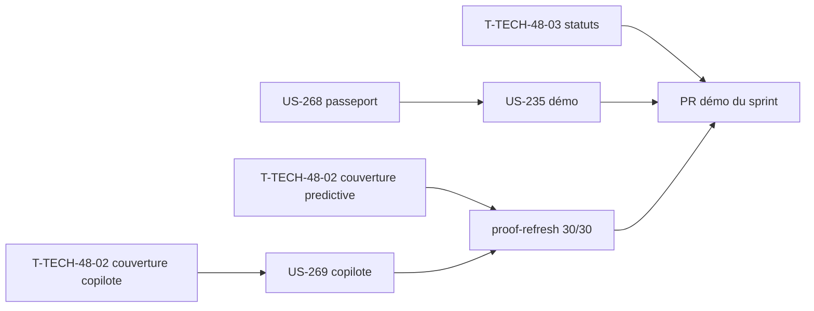

# Sprint 48 — Montées de version

**Durée** : 2026-11-04 → 2026-11-18
**Capacité** : 13 points
**Engagement** : 8 points (3 stories) + 3 tâches techniques

## Sprint Goal

Lancer les montées de version en attente de la veille hebdomadaire (endroid/qr-code 6 sur le passeport, Symfony AI 0.15 sur le copilote), finir la couverture publiée des 30 plugins et redonner au backlog des statuts fiables.

## Stories

| ID | Titre | Dépôt | Points | MoSCoW |
|----|-------|-------|--------|--------|
| US-268 | Passeport produit : QR codes avec endroid/qr-code 6 | passeport | 2 | Should |
| US-269 | Copilote commercial : Symfony AI 0.15, en préparant la 1.0 | copilote | 3 | Should |
| US-235 | Passeport : fixtures, intégration à la démo et formulation prudente (reste à faire après US-241) | démo | 3 | Should |

### Périmètre d'US-235 après US-241

US-241 (sprint 37) a déjà livré l'installation du passeport dans la démo, 4 passeports de fixtures, le lien depuis la fiche produit, la page publique bilingue et la formulation prudente de la fiche « Plugins ». Reste :

- un 5ᵉ passeport (batterie d'outillage ou visserie, selon le catalogue) ;
- un test de contenu qui échoue si « conforme » ou « certifié » qualifie le passeport dans les textes de la démo ;
- un chargement de fixture qui échoue en nommant le champ obligatoire manquant ;
- la vérification que la remise à zéro nocturne recrée les 5 passeports.

## Tâches techniques

| ID | Titre | Type | Heures |
|----|-------|------|--------|
| T-TECH-48-01 | Marquer le sprint 47 terminé, `current_sprint: 48` | OPS | 0,25 h |
| T-TECH-48-02 | Fin d'US-253 : couverture CI de predictive-analytics et sales-copilot, puis `bin/proof-refresh` (30/30) | OPS | 1,5 h |
| T-TECH-48-03 | Remettre à jour les statuts périmés des fiches de stories livrées (~30 fiches) | DOC | 1 h |

## Ordre d'exécution

- US-268 et US-269 en parallèle (dépôts distincts) ; au plus deux workers lancent des tests en même temps (8 Go de RAM).
- La couverture du copilote est mergée avant la branche d'US-269, pour éviter un conflit sur `build.yaml`.
- US-235 démarre quand un des deux workers a rendu la main.

## Portes

- Tags des plugins (passeport, copilote) : GO de Thibaut demandé une fois les PR mergées.
- US-268 : capture du QR code dans la démo avant le tag.
- PR Dependabot #7 du copilote fermée au profit de la PR d'US-269.

## Contexte

Les stories viennent de la veille des versions du 2026-11-04 (US-268, US-269) et de la feuille de route innovation (US-235, repoussée depuis le sprint 41). US-266 (PHPUnit 13) et US-267 (build du thème) restent au backlog : elles attendent que Sylius migre (`@dependabot ignore this dependency`).
