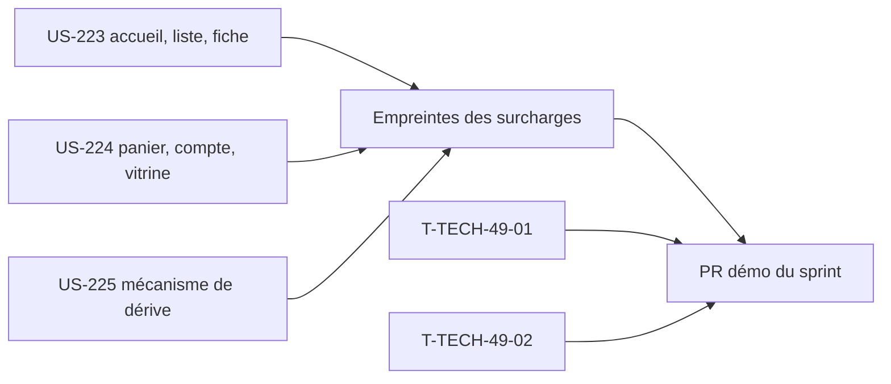

# Sprint 49 — Thème Industrie & Négoce, tranche 2

**Durée** : 2026-11-05 → 2026-11-19
**Capacité** : 13 points
**Engagement** : 13 points (3 stories) + 2 tâches techniques

## Sprint Goal

Le thème Industrie & Négoce couvre le parcours d'achat principal (accueil, catalogue, fiche produit, panier, compte, pages vitrine) et prévient quand Sylius change un gabarit qu'il surcharge.

## Stories

| ID | Titre | Dépôt | Points | MoSCoW |
|----|-------|-------|--------|--------|
| US-223 | Thème : accueil, liste et fiche produit (tranche 2) | thème | 5 | Must |
| US-224 | Thème : panier, compte et pages vitrine | thème | 5 | Must |
| US-225 | Thème : test de dérive des surcharges de gabarits | thème | 3 | Must |

Périmètre choisi par Thibaut le 2026-11-05. Les trois stories étaient proposées au sprint 40 et ont été repoussées depuis.

### Source des gabarits

Les pages refondues existent déjà dans la démo (`templates/shop/theme_b2b/**`, branchées par les fichiers `config/packages/demo_theme_b2b*.yaml`). Le thème les reprend en les rendant génériques :

- aucun texte, lien, code produit ou compte propre à la démo ;
- aucun appel à un plugin non installé : chaque bloc de plugin (tier-pricing, quick-order, company-accounts, purchase-approval…) est conditionné à la présence de son service ou de sa route ;
- jetons de design et composants du thème (US-222, US-238), contrastes AAA, navigation au clavier, repli en cartes sous 375 px.

La démo ne consomme pas encore le thème : c'est l'objet d'US-228.

## Tâches techniques

| ID | Titre | Type | Heures |
|----|-------|------|--------|
| T-TECH-49-01 | Marquer le sprint 48 terminé, `current_sprint: 49` | OPS | 0,25 h |
| T-TECH-49-02 | Restes du sprint 48 : branche locale `proof/us-268-qr-capture`, version du passeport dans `config/demo/proof.json` | OPS | 0,5 h |

## Ordre d'exécution

- Trois workers en parallèle dans le dépôt du thème, chacun sur sa branche.
- Pour éviter les conflits : un fichier de hooks et un partiel SCSS par page (`config/twig_hooks/<page>.yaml`, `assets/styles/pages/_<page>.scss`). Seules les lignes d'import de `theme.scss` et de la configuration principale sont partagées.
- Au plus deux workers lancent la suite fonctionnelle en même temps (8 Go de RAM). US-225 ne lance que des tests unitaires.
- Les empreintes d'US-225 sont enregistrées une fois US-223 et US-224 fusionnées.

## Portes

- Espace disque ≥ 10 Go avant de lancer les workers (A-48-1) : 18 Go au départ.
- `main` de la démo vert au lancement (A-48-3) : vert (cba3ada).
- Après chaque rapport de worker, le SHA local est comparé au `headRefOid` de la PR (A-48-2).
- Aucun tag ni release du thème sans GO de Thibaut.

## Definition of Done (sprint)

- CI du thème verte sur Sylius 2.2 et 2.3.
- Audit pa11y (WCAG2AAA) des pages livrées, sans erreur.
- Captures dans `docs/` et dans les deux README du thème.
- Test de dérive exécuté dans la CI du thème et dans une CI planifiée hebdomadaire, procédure de revue documentée.
