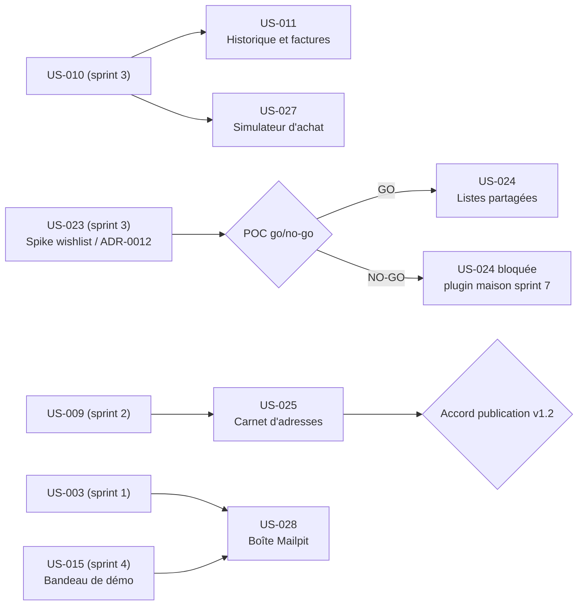

# Sprint 5 — Listes et scénarios

## Informations

| Attribut | Valeur |
|----------|--------|
| Numéro | 5 |
| Nom | listes-et-scenarios |
| Début | 2026-10-16 |
| Fin | 2026-10-30 |
| Durée | 10 jours ouvrés |
| Points engagés | 29 |

## Sprint Goal

> Rendre la démo vivante et rejouable : historique de commandes et factures, listes d'achat et carnet d'adresses partagés par l'entreprise, simulateur PunchOut et boîte d'e-mails en lecture seule.

## Périmètre

- Historique de commandes et factures Factur-X pour chaque entreprise (US-011).
- Listes d'achat partagées : POC go/no-go du plugin officiel `sylius/wishlist-plugin` sur Sylius 2.3 (ADR-0012), puis extension « liste d'entreprise » avec droits par membre, télémétrie neutralisée (US-024).
- Carnet d'adresses de l'entreprise : company-accounts v1.2 sans BC break, publication soumise à l'accord explicite de l'utilisateur, puis intégration dans la démo (US-025).
- Simulateur d'outil d'achat cXML/OCI (US-027).
- Boîte d'e-mails de démo : lecture seule via l'API HTTP de Mailpit côté serveur, e-mails sensibles exclus, Mailpit non exposé (US-028).
- Tâches techniques d'audit : couverture en CI (pcov) et `doctrine:schema:validate --skip-sync`.

Hors périmètre : plugin maison de listes (sprint 7 si NO-GO), envoi ou relais d'e-mails, exposition publique de Mailpit.

## Jalons de décision

| Jalon | Tâche | Décision | Conséquence |
|-------|-------|----------|-------------|
| Go/no-go wishlist | T-024-04 (après POC T-024-01 à 03) | GO si installation 2.3 OK, télémétrie neutralisable, < 50 % du modèle à réécrire (ADR-0012) | GO : T-024-05 à 11. NO-GO : US-024 bloquée, T-024-12, plugin maison au sprint 7 (≈ 15.5h libérées) |
| Publication v1.2 | T-025-08 | Accord EXPLICITE de l'utilisateur | Sans accord : aucun tag ni release ; la démo consomme la branche, publication reportée |

## Lien avec les sprints précédents

Prérequis : US-010 (sprint 3, données/PunchOut), US-023 (spike wishlist, ADR-0012), US-009 (comptes de démo), US-003 (Mailpit), bandeau de démo (US-015, sprint 4, variable DEMO_MAILPIT_URL).

## Sprint Backlog

| ID | Titre | Points | Dépend de | Tâches | Heures | Statut |
|----|-------|--------|-----------|--------|--------|--------|
| US-011 | Historique de commandes et factures | 5 | US-010 | 6 | 10h | 🔵 To Do |
| US-024 | Listes d'achat partagées par l'entreprise | 8 | US-023 | 11 | 22h | 🔵 To Do |
| US-025 | Carnet d'adresses de l'entreprise | 8 | US-009 | 12 | 19h | 🔵 To Do |
| US-027 | Simulateur d'outil d'achat | 5 | US-010 | 7 | 13h | 🔵 To Do |
| US-028 | Boîte Mailpit publique | 3 | US-003, US-015 | 6 | 9.5h | 🔵 To Do |
| TECH | Tâches techniques (audit) | — | — | 4 | 3h | 🔵 To Do |

**Total engagé : 29 points, 46 tâches, 76.5h (chemin GO).** US-025 ré-estimée de 5 à 8 pts (évolution + publication de company-accounts v1.2) et US-028 de 2 à 3 pts (lecture filtrée côté serveur), décision PO du 2026-10-16.

## Ordre de réalisation recommandé

1. J1 : POC wishlist (T-024-01 à 04) pour lever le jalon tôt ; T-025-01 (état du dépôt plugin) ; US-028, US-027, tâches techniques en parallèle
2. US-011 (fixtures), puis US-024 GO ou NO-GO
3. US-025 : plugin → jalon d'accord → publication → intégration démo (garder de la marge avant le 30/10)

## Dépendances inter-stories

## Definition of Done (rappel)

- [ ] Critères d'acceptation automatisés (tests fonctionnels ou de fumée) et verts
- [ ] ECS et PHPStan passent sur le code ajouté/modifié (démo et plugins)
- [ ] Libellés en français et en anglais si interface
- [ ] Aucun secret ni identifiant réel dans le dépôt
- [ ] Mailpit non exposé ; aucune action d'envoi
- [ ] Documentation mise à jour si comportement visible
- [ ] CI verte sur la branche `feature/sprint-5-listes-et-scenarios`

## Risques identifiés

| Risque | Probabilité | Impact | Mitigation |
|--------|-------------|--------|------------|
| Wishlist officielle incompatible Sylius 2.3 | Moyenne | Élevé | POC en début de sprint, branche NO-GO prête |
| Couplage owner=user profond | Moyenne | Élevé | Mesure à T-024-03, critère 50 % de l'ADR |
| Télémétrie non neutralisable | Faible | Moyen | Critère de bascule NO-GO |
| Branche du plugin company-accounts en retard sur main | Moyenne | Moyen | T-025-01 : fetch, vérification de fusion |
| BC break dans company-accounts v1.2 | Faible | Élevé | Migration additive, tests de non-régression v1.1 |
| Publication v1.2 non autorisée à temps | Moyenne | Moyen | Jalon T-025-08, repli sur branche |
| Fuite d'un e-mail sensible (jeton) via la boîte de démo | Moyenne | Élevé | Filtre par défaut-exclure, tests dédiés, pas d'accès par ID direct |
| Mailpit indisponible | Moyenne | Faible | Message clair, délai d'attente court |
| Génération Factur-X ralentit les fixtures | Moyenne | Moyen | Budget de temps T-011-04 |

## Cérémonies

| Cérémonie | Date indicative | Durée |
|-----------|----------------|-------|
| Sprint Planning Part 1 (Quoi) | 2026-10-16 | 2 h |
| Sprint Planning Part 2 (Comment) | 2026-10-16 | 2 h |
| Daily Scrum | Chaque jour | 15 min |
| Sprint Review | 2026-10-30 (matin) | 1 h |
| Rétrospective | 2026-10-30 (après-midi) | 1 h 30 |
| Affinage Backlog | 2026-10-23 (mid-sprint) | 1 h |
