# Task Board — Sprint 5 (Listes et scénarios)

## Légende

- 🔲 À faire
- 🔄 En cours
- 👀 En review
- ✅ Terminé
- 🚫 Bloqué

---

## Graphe de dépendances global

```mermaid
graph TD
    subgraph US011["US-011 Historique de commandes et factures (10h)"]
        T01101["T-011-01 [BE] 1h"]
        T01102["T-011-02 [BE] 3h"]
        T01103["T-011-03 [BE] 2.5h"]
        T01104["T-011-04 [BE] 1h"]
        T01105["T-011-05 [TEST] 2h"]
        T01106["T-011-06 [DOC] 0.5h"]
    end
    subgraph US024["US-024 Listes d'achat partagées par l'entreprise (22h)"]
        T02401["T-024-01 [OPS] 2h"]
        T02402["T-024-02 [BE] 1h"]
        T02403["T-024-03 [BE] 1.5h"]
        T02404["T-024-04 [DOC] 1h"]
        T02405["T-024-05 [BE] 2h"]
        T02406["T-024-06 [BE] 3h"]
        T02407["T-024-07 [BE] 3h"]
        T02408["T-024-08 [FE-WEB] 4h"]
        T02409["T-024-09 [BE] 1h"]
        T02410["T-024-10 [TEST] 3h"]
        T02411["T-024-11 [DOC] 0.5h"]
    end
    subgraph US025["US-025 Carnet d'adresses de l'entreprise (19h)"]
        T02501["T-025-01 [OPS] 0.5h"]
        T02502["T-025-02 [BE] 2.5h"]
        T02503["T-025-03 [BE] 2h"]
        T02504["T-025-04 [FE-WEB] 3h"]
        T02505["T-025-05 [FE-WEB] 3h"]
        T02506["T-025-06 [TEST] 3h"]
        T02507["T-025-07 [DOC] 1h"]
        T02508["T-025-08 [OPS] 0.5h"]
        T02509["T-025-09 [OPS] 0.5h"]
        T02510["T-025-10 [OPS] 0.5h"]
        T02510b["T-025-10b [OPS] 0.5h repli VCS"]
        T02511["T-025-11 [BE] 1h"]
        T02512["T-025-12 [TEST] 1.5h"]
    end
    subgraph US027["US-027 Simulateur d'outil d'achat (13h)"]
        T02701["T-027-01 [BE] 2.5h"]
        T02702["T-027-02 [BE] 2h"]
        T02703["T-027-03 [BE] 2h"]
        T02704["T-027-04 [FE-WEB] 2h"]
        T02705["T-027-05 [BE] 1h"]
        T02706["T-027-06 [TEST] 3h"]
        T02707["T-027-07 [DOC] 0.5h"]
    end
    subgraph US028["US-028 Boîte Mailpit publique (9.5h)"]
        T02801["T-028-01 [BE] 1.5h"]
        T02802["T-028-02 [BE] 2h"]
        T02803["T-028-03 [BE] 1.5h"]
        T02804["T-028-04 [FE-WEB] 1.5h"]
        T02805["T-028-05 [TEST] 2.5h"]
        T02806["T-028-06 [DOC] 0.5h"]
    end
    subgraph TECH["Technique (3h)"]
        TT01["T-TECH-01 [OPS] 1h"]
        TT02["T-TECH-02 [OPS] 1h"]
        TT03["T-TECH-03 [OPS] 0.5h"]
        TT04["T-TECH-04 [DOC] 0.5h"]
    end
    T01101 --> T01102
    T01102 --> T01103
    T01102 --> T01104
    T01103 --> T01105
    T01104 --> T01105
    T01105 --> T01106
    T02401 --> T02402
    T02401 --> T02403
    T02402 --> T02404
    T02403 --> T02404
    T02404 --> T02405
    T02405 --> T02406
    T02406 --> T02407
    T02406 --> T02408
    T02407 --> T02408
    T02406 --> T02409
    T02407 --> T02410
    T02408 --> T02410
    T02409 --> T02410
    T02410 --> T02411
    T02501 --> T02502
    T02502 --> T02503
    T02503 --> T02504
    T02503 --> T02505
    T02504 --> T02506
    T02505 --> T02506
    T02506 --> T02507
    T02507 --> T02508
    T02508 --> T02509
    T02509 --> T02510
    T02510 --> T02511
    T02508 -.->|repli sans accord| T02510b
    T02510b -.->|alternative à T-025-09| T02511
    T02511 --> T02512
    T02701 --> T02702
    T02701 --> T02703
    T02703 --> T02704
    T02701 --> T02705
    T02702 --> T02706
    T02704 --> T02706
    T02705 --> T02706
    T02706 --> T02707
    T02801 --> T02802
    T02802 --> T02803
    T02803 --> T02804
    T02804 --> T02805
    T02805 --> T02806
    TT01 --> TT02
    TT02 --> TT04
    TT03 --> TT04
    T02404 -.->|jalon GO| T02405
    T02404 -.->|NO-GO| T02412["T-024-12 NO-GO 1h"]
    T02508 -.->|accord explicite| T02509
```

> Jalons : T-024-04 (décision go/no-go) et T-025-08 (accord de publication v1.2). Liens inter-US : T-015-06 (bandeau, sprint 4) → T-028-04 (lien boîte de démo).

---

## 🔲 À faire

### US-011 — Historique de commandes et factures

| ID | Tâche | Type | Estimation |
|----|-------|------|------------|
| T-011-01 | Inventaire des fixtures existantes et des états de commande/paiement cibles | [BE] | 1h |
| T-011-02 | Fixture de commandes historiques par entreprise (états variés, dates étalées) | [BE] | 3h |
| T-011-03 | Factures Factur-X et entrées de timeline/audit pour ces commandes | [BE] | 2.5h |
| T-011-04 | Idempotence et temps de chargement (app:demo:reset, app:fixtures:load) | [BE] | 1h |
| T-011-05 | Tests : historique par entreprise, états, Factur-X valide, idempotence, entreprise vide, XML invalide | [TEST] | 2h |
| T-011-06 | Documentation : contenu de l'historique de démo | [DOC] | 0.5h |

### US-024 — Listes d'achat partagées par l'entreprise

| ID | Tâche | Type | Estimation |
|----|-------|------|------------|
| T-024-01 | [POC] Installer sylius/wishlist-plugin sur Sylius 2.3 (branche jetable) | [OPS] | 2h |
| T-024-02 | [POC] Neutraliser la télémétrie (sylius/telemetry) pour la démo publique | [BE] | 1h |
| T-024-03 | [POC] Mesurer le couplage owner=user (part du modèle/CRUD à réécrire) | [BE] | 1.5h |
| T-024-04 | [JALON] Décision go/no-go : ADR-0012 Proposé → Accepté (GO) ou NO-GO | [DOC] | 1h |
| T-024-05 | [GO] Intégrer le plugin dans la démo (composer, bundles, routes, migrations, télémétrie off) | [BE] | 2h |
| T-024-06 | [GO] Liste appartenant à une entreprise (Company owner) + migration | [BE] | 3h |
| T-024-07 | [GO] Droits par membre (voter : lecture membres, édition propriétaire/admin) | [BE] | 3h |
| T-024-08 | [GO] Pages liste, détail (articles, quantités) et ajout de tout/partie au panier | [FE-WEB] | 4h |
| T-024-09 | [GO] Fixtures : liste « Atelier » d'Acme avec membres et rôles | [BE] | 1h |
| T-024-10 | [GO] Tests : liste partagée, ajout partiel, rôles, autre entreprise, anonyme | [TEST] | 3h |
| T-024-11 | [GO] Documentation : listes partagées et décision ADR | [DOC] | 0.5h |
| T-024-12 (conditionnelle) | [NO-GO] Marquer la story bloquée et préparer le plugin maison (sprint 7) | [DOC] | 1h |

### US-025 — Carnet d'adresses de l'entreprise

| ID | Tâche | Type | Estimation |
|----|-------|------|------------|
| T-025-01 | [plugin] Fetch, vérifier si chore/quality-tooling est mergée, repartir de main à jour | [OPS] | 0.5h |
| T-025-02 | [plugin] Modèle d'adresses partagées de l'entreprise + migration additive | [BE] | 2.5h |
| T-025-03 | [plugin] Droits : seuls les administrateurs de l'entreprise modifient (voter) | [BE] | 2h |
| T-025-04 | [plugin] Gestion du carnet côté compte client (liste, ajout, édition, suppression) | [FE-WEB] | 3h |
| T-025-05 | [plugin] Sélection d'une adresse du carnet au checkout par les membres | [FE-WEB] | 3h |
| T-025-06 | [plugin] Tests du plugin (unitaires, fonctionnels, CI du plugin verte) | [TEST] | 3h |
| T-025-07 | [plugin] CHANGELOG v1.2.0 et README | [DOC] | 1h |
| T-025-08 | [JALON] Obtenir l'ACCORD EXPLICITE de l'utilisateur pour publier v1.2 | [OPS] | 0.5h |
| T-025-09 | [plugin] Publication v1.2.0 (tag, release, Packagist) — après accord uniquement | [OPS] | 0.5h |
| T-025-10 | [démo] Montée de version de company-accounts dans la démo (composer, migrations) | [OPS] | 0.5h |
| T-025-10b | [démo] Variante de repli (hors total) : company-accounts via la branche du dépôt VCS (repository vcs + `dev-<branche>`) tant que l'accord v1.2 n'est pas donné | [OPS] | 0.5h |
| T-025-11 | [démo] Fixtures d'adresses pour Acme (ex. « Usine de Lyon ») | [BE] | 1h |
| T-025-12 | [démo] Test de fumée : Claire choisit « Usine de Lyon » au checkout | [TEST] | 1.5h |

### US-027 — Simulateur d'outil d'achat

| ID | Tâche | Type | Estimation |
|----|-------|------|------------|
| T-027-01 | Reprise du simulateur de la TestApplication du plugin punchout (cXML : setup, retour du panier) | [BE] | 2.5h |
| T-027-02 | Parcours OCI (HOOK_URL, retour du panier) | [BE] | 2h |
| T-027-03 | Affichage du panier transféré et envoi de l'OrderRequest | [BE] | 2h |
| T-027-04 | Interface du simulateur (choix Ariba/SAP, panier reçu, bouton envoyer) FR/EN | [FE-WEB] | 2h |
| T-027-05 | Garde mode démo : 404 hors démo, aucun envoi vers l'extérieur | [BE] | 1h |
| T-027-06 | Tests : aller-retour cXML, OCI, OrderRequest, hors démo, session invalide, panier vide | [TEST] | 3h |
| T-027-07 | Documentation du simulateur | [DOC] | 0.5h |

### US-028 — Boîte Mailpit publique

| ID | Tâche | Type | Estimation |
|----|-------|------|------------|
| T-028-01 | Client HTTP Mailpit côté serveur + variables (DEMO_MAILPIT_URL = lien public du bandeau, DEMO_MAILPIT_API_URL = API interne) | [BE] | 1.5h |
| T-028-02 | Filtre des e-mails sensibles (réinitialisation de mot de passe, vérification de compte, tout e-mail contenant un jeton) | [BE] | 2h |
| T-028-03 | Contrôleur lecture seule (GET uniquement) : liste et détail ; mode démo | [BE] | 1.5h |
| T-028-04 | Page de la boîte de démo et lien depuis le bandeau (FR/EN, message Mailpit indisponible) | [FE-WEB] | 1.5h |
| T-028-05 | Tests : lecture, exclusion des e-mails sensibles, Mailpit indisponible, aucune action d'envoi, hors démo | [TEST] | 2.5h |
| T-028-06 | Documentation : boîte de démo et variables d'environnement | [DOC] | 0.5h |

### Technique

| ID | Tâche | Type | Estimation |
|----|-------|------|------------|
| T-TECH-01 | Couverture en CI : driver pcov (coverage: pcov dans setup-php) | [OPS] | 1h |
| T-TECH-02 | Seuil de couverture affiché (rapport texte + seuil, non bloquant) | [OPS] | 1h |
| T-TECH-03 | Validation du schéma Doctrine en CI : `doctrine:schema:validate --skip-sync` | [OPS] | 0.5h |
| T-TECH-04 | Documentation CI (couverture, schema:validate) | [DOC] | 0.5h |

---

## 🔄 En cours

| ID | US | Tâche | Démarré | Assigné |
|----|-----|-------|---------|---------|
| — | — | — | — | — |

## 👀 En review

| ID | US | Tâche | Reviewer |
|----|-----|-------|----------|
| — | — | — | — |

## ✅ Terminé

| ID | US | Tâche | Réel | Terminé |
|----|-----|-------|------|---------|
| — | — | — | — | — |

## 🚫 Bloqué

| ID | US | Raison | Action |
|----|-----|--------|--------|
| — | — | — | — |

---

## Métriques

- **Tâches** : 46 total | 0 terminées (0%)
- **Heures** : 76.5h estimées (chemin GO) | 0h consommées | 76.5h restantes
- **Points** : 29 engagés | 0 livrés

### Répartition par type

| Type | Nb tâches | Heures |
|------|-----------|--------|
| [BE] | 20 | 37h |
| [DOC] | 7 | 4.5h |
| [FE-WEB] | 5 | 13.5h |
| [OPS] | 8 | 6.5h |
| [TEST] | 6 | 15h |
| **TOTAL** | **46** | **76.5h** |

### Répartition par US

| US | Tâches | Heures | Points |
|----|--------|--------|--------|
| US-011 | 6 | 10h | 5 |
| US-024 | 11 | 22h | 8 |
| US-025 | 12 | 19h | 8 |
| US-027 | 7 | 13h | 5 |
| US-028 | 6 | 9.5h | 3 |
| Technique | 4 | 3h | — |
| **TOTAL** | **46** | **76.5h** | **29** |
