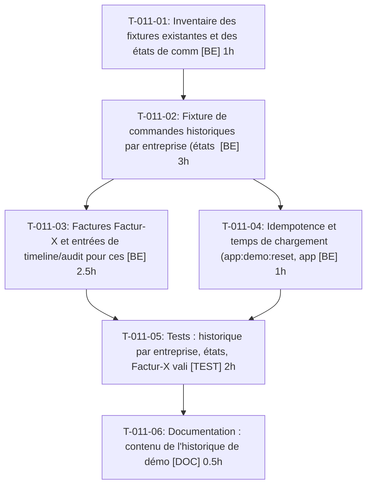

# Tâches — US-011 : Historique de commandes et factures

## Informations US

- **Epic** : EPIC-02
- **Persona** : Isabelle
- **Story Points** : 5
- **Sprint** : sprint-5-listes-et-scenarios
- **Dépendances** : US-010

## Résumé

En tant que Isabelle, je veux un historique de commandes et de factures Factur-X, afin que les comptes et l'admin paraissent vivants.

## Vue d'ensemble des tâches

| ID | Type | Tâche | Estimation | Dépend de | Statut |
|----|------|-------|------------|-----------|--------|
| T-011-01 | [BE] | Inventaire des fixtures existantes et des états de commande/paiement cibles | 1h | — | 🔲 |
| T-011-02 | [BE] | Fixture de commandes historiques par entreprise (états variés, dates étalées) | 3h | T-011-01 | 🔲 |
| T-011-03 | [BE] | Factures Factur-X et entrées de timeline/audit pour ces commandes | 2.5h | T-011-02 | 🔲 |
| T-011-04 | [BE] | Idempotence et temps de chargement (app:demo:reset, app:fixtures:load) | 1h | T-011-02 | 🔲 |
| T-011-05 | [TEST] | Tests : historique par entreprise, états, Factur-X valide, idempotence, entreprise vide, XML invalide | 2h | T-011-03, T-011-04 | 🔲 |
| T-011-06 | [DOC] | Documentation : contenu de l'historique de démo | 0.5h | T-011-05 | 🔲 |

**Total estimé : 10h**

---

## Détail des tâches

### T-011-01 — Inventaire des fixtures existantes et des états de commande/paiement cibles

- **Type** : [BE]
- **Estimation** : 1h
- **Dépend de** : —

**Description** :
Lister les fixtures de commandes, les états (nouvelle, payée, expédiée, annulée, remboursée) et les plugins qui réagissent (timeline, audit, Factur-X, réassort).

**Critères de validation** :
- [ ] Matrice entreprise × état documentée

---

### T-011-02 — Fixture de commandes historiques par entreprise (états variés, dates étalées)

- **Type** : [BE]
- **Estimation** : 3h
- **Dépend de** : T-011-01

**Description** :
Créer les commandes par entreprise via les services Sylius (pas d'insertion SQL), dates étalées sur 12 mois, comptes de la source unique.

**Critères de validation** :
- [ ] Chaque entreprise a des commandes dans ≥ 3 états
- [ ] Dates passées cohérentes

---

### T-011-03 — Factures Factur-X et entrées de timeline/audit pour ces commandes

- **Type** : [BE]
- **Estimation** : 2.5h
- **Dépend de** : T-011-02

**Description** :
Déclencher la génération Factur-X pour les commandes éligibles et laisser les listeners alimenter timeline et audit.

**Critères de validation** :
- [ ] Facture présente pour chaque commande éligible
- [ ] Timeline non vide

---

### T-011-04 — Idempotence et temps de chargement (app:demo:reset, app:fixtures:load)

- **Type** : [BE]
- **Estimation** : 1h
- **Dépend de** : T-011-02

**Description** :
Vérifier qu'un rechargement ne duplique rien et que le chargement reste sous le budget de la CI.

**Critères de validation** :
- [ ] Deux chargements successifs : mêmes compteurs

---

### T-011-05 — Tests : historique par entreprise, états, Factur-X valide, idempotence, entreprise vide, XML invalide

- **Type** : [TEST]
- **Estimation** : 2h
- **Dépend de** : T-011-03, T-011-04

**Description** :
Tests de fumée sur les fixtures chargées, scénarios Gherkin US-011.

**Critères de validation** :
- [ ] 5 scénarios couverts

---

### T-011-06 — Documentation : contenu de l'historique de démo

- **Type** : [DOC]
- **Estimation** : 0.5h
- **Dépend de** : T-011-05

**Description** :
Décrire les jeux de commandes par entreprise.

**Critères de validation** :
- [ ] Doc relue

---

## Graphe de dépendances

## Résumé

| Type | Nb tâches | Heures |
|------|-----------|--------|
| [BE] | 4 | 7.5h |
| [TEST] | 1 | 2h |
| [DOC] | 1 | 0.5h |
| **TOTAL** | **6** | **10h** |
