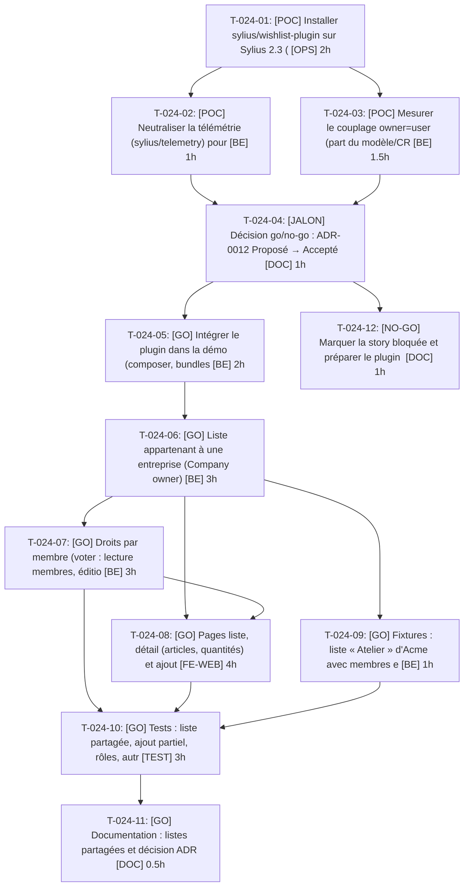

# Tâches — US-024 : Listes d'achat partagées par l'entreprise

## Informations US

- **Epic** : EPIC-06
- **Persona** : Claire
- **Story Points** : 8
- **Sprint** : sprint-5-listes-et-scenarios
- **Dépendances** : US-023

## Résumé

En tant que Claire, je veux des listes d'achat partagées avec mon entreprise, afin de recommander rapidement les mêmes articles. Démarre par un POC go/no-go (ADR-0012), puis tâches GO, ou blocage et plugin maison au sprint 7 si NO-GO.

## Vue d'ensemble des tâches

| ID | Type | Tâche | Estimation | Dépend de | Statut |
|----|------|-------|------------|-----------|--------|
| T-024-01 | [OPS] | [POC] Installer sylius/wishlist-plugin sur Sylius 2.3 (branche jetable) | 2h | — | 🔲 |
| T-024-02 | [BE] | [POC] Neutraliser la télémétrie (sylius/telemetry) pour la démo publique | 1h | T-024-01 | 🔲 |
| T-024-03 | [BE] | [POC] Mesurer le couplage owner=user (part du modèle/CRUD à réécrire) | 1.5h | T-024-01 | 🔲 |
| T-024-04 | [DOC] | [JALON] Décision go/no-go : ADR-0012 Proposé → Accepté (GO) ou NO-GO | 1h | T-024-02, T-024-03 | 🔲 |
| T-024-05 | [BE] | [GO] Intégrer le plugin dans la démo (composer, bundles, routes, migrations, télémétrie off) | 2h | T-024-04 | 🔲 |
| T-024-06 | [BE] | [GO] Liste appartenant à une entreprise (Company owner) + migration | 3h | T-024-05 | 🔲 |
| T-024-07 | [BE] | [GO] Droits par membre (voter : lecture membres, édition propriétaire/admin) | 3h | T-024-06 | 🔲 |
| T-024-08 | [FE-WEB] | [GO] Pages liste, détail (articles, quantités) et ajout de tout/partie au panier | 4h | T-024-06, T-024-07 | 🔲 |
| T-024-09 | [BE] | [GO] Fixtures : liste « Atelier » d'Acme avec membres et rôles | 1h | T-024-06 | 🔲 |
| T-024-10 | [TEST] | [GO] Tests : liste partagée, ajout partiel, rôles, autre entreprise, anonyme | 3h | T-024-07, T-024-08, T-024-09 | 🔲 |
| T-024-11 | [DOC] | [GO] Documentation : listes partagées et décision ADR | 0.5h | T-024-10 | 🔲 |

**Total estimé : 22h**

**Branche conditionnelle (NO-GO)** : T-024-12 [DOC] [NO-GO] Marquer la story bloquée et préparer le plugin maison (sprint 7) — 1h, hors total (remplace les tâches GO).

---

## Détail des tâches

### T-024-01 — [POC] Installer sylius/wishlist-plugin sur Sylius 2.3 (branche jetable)

- **Type** : [OPS]
- **Estimation** : 2h
- **Dépend de** : —

**Description** :
Composer require, bundles, routes, migrations, fumée admin et shop. Critère ADR-0012 : compatibilité 2.3 réelle.

**Critères de validation** :
- [ ] Installation et fumée OK, ou échec documenté

---

### T-024-02 — [POC] Neutraliser la télémétrie (sylius/telemetry) pour la démo publique

- **Type** : [BE]
- **Estimation** : 1h
- **Dépend de** : T-024-01

**Description** :
Désactiver/neutraliser proprement et prouver l'absence d'appel sortant.

**Critères de validation** :
- [ ] Aucun appel sortant de télémétrie

---

### T-024-03 — [POC] Mesurer le couplage owner=user (part du modèle/CRUD à réécrire)

- **Type** : [BE]
- **Estimation** : 1.5h
- **Dépend de** : T-024-01

**Description** :
Esquisse de la couche « owner = Company » ; estimer la part du modèle à réécrire face au seuil de 50 % de l'ADR.

**Critères de validation** :
- [ ] Pourcentage estimé et justifié

---

### T-024-04 — [JALON] Décision go/no-go : ADR-0012 Proposé → Accepté (GO) ou NO-GO

- **Type** : [DOC]
- **Estimation** : 1h
- **Dépend de** : T-024-02, T-024-03

**Description** :
Trancher selon les critères ADR-0012 (compat 2.3, télémétrie, >50 % à réécrire) ; consigner la décision et la soumettre à l'utilisateur.

**Critères de validation** :
- [ ] ADR mis à jour avec la décision
- [ ] GO : tâches T-024-05+ lancées ; NO-GO : T-024-12 seule

---

### T-024-05 — [GO] Intégrer le plugin dans la démo (composer, bundles, routes, migrations, télémétrie off)

- **Type** : [BE]
- **Estimation** : 2h
- **Dépend de** : T-024-04

**Description** :
Passage du POC à l'intégration propre sur la branche du sprint.

**Critères de validation** :
- [ ] lint:container vert
- [ ] migrations appliquées

---

### T-024-06 — [GO] Liste appartenant à une entreprise (Company owner) + migration

- **Type** : [BE]
- **Estimation** : 3h
- **Dépend de** : T-024-05

**Description** :
Extension du modèle wishlist : propriétaire Company branché sur company-accounts, sans modifier les listes personnelles existantes.

**Critères de validation** :
- [ ] Liste liée à Company
- [ ] Listes personnelles inchangées

---

### T-024-07 — [GO] Droits par membre (voter : lecture membres, édition propriétaire/admin)

- **Type** : [BE]
- **Estimation** : 3h
- **Dépend de** : T-024-06

**Description** :
Voter Symfony ; refus pour les autres entreprises et les anonymes.

**Critères de validation** :
- [ ] Accès refusé hors entreprise
- [ ] Droits par rôle testables

---

### T-024-08 — [GO] Pages liste, détail (articles, quantités) et ajout de tout/partie au panier

- **Type** : [FE-WEB]
- **Estimation** : 4h
- **Dépend de** : T-024-06, T-024-07

**Description** :
Libellés FR/EN, thème B2B.

**Critères de validation** :
- [ ] Ajout complet ou partiel en un clic

---

### T-024-09 — [GO] Fixtures : liste « Atelier » d'Acme avec membres et rôles

- **Type** : [BE]
- **Estimation** : 1h
- **Dépend de** : T-024-06

**Description** :
Fixture alimentée par la source unique des comptes.

**Critères de validation** :
- [ ] Claire voit « Atelier »

---

### T-024-10 — [GO] Tests : liste partagée, ajout partiel, rôles, autre entreprise, anonyme

- **Type** : [TEST]
- **Estimation** : 3h
- **Dépend de** : T-024-07, T-024-08, T-024-09

**Description** :
Scénarios Gherkin US-024.

**Critères de validation** :
- [ ] 6 scénarios couverts

---

### T-024-11 — [GO] Documentation : listes partagées et décision ADR

- **Type** : [DOC]
- **Estimation** : 0.5h
- **Dépend de** : T-024-10

**Description** :
Doc utilisateur et note d'architecture.

**Critères de validation** :
- [ ] Doc relue

---

### T-024-12 — [NO-GO] Marquer la story bloquée et préparer le plugin maison (sprint 7)

- **Type** : [DOC]
- **Estimation** : 1h
- **Dépend de** : T-024-04

**Description** :
Statut Bloqué, motif tracé, découpage du plugin maison dans le backlog sprint 7, ADR mis à jour. Remplace T-024-05 à T-024-11 (≈ 15.5h libérées à ré-allouer).

**Critères de validation** :
- [ ] Story bloquée avec motif
- [ ] Entrée sprint 7 créée

---

## Graphe de dépendances

## Résumé

| Type | Nb tâches | Heures |
|------|-----------|--------|
| [OPS] | 1 | 2h |
| [BE] | 6 | 11.5h |
| [DOC] | 2 | 1.5h |
| [FE-WEB] | 1 | 4h |
| [TEST] | 1 | 3h |
| **TOTAL** | **11** | **22h** |
