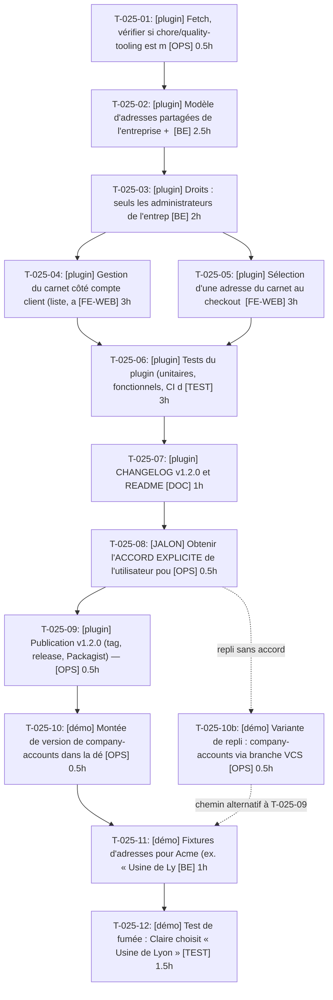

# Tâches — US-025 : Carnet d'adresses de l'entreprise

## Informations US

- **Epic** : EPIC-06
- **Persona** : Isabelle
- **Story Points** : 8
- **Sprint** : sprint-5-listes-et-scenarios
- **Dépendances** : US-009

## Résumé

En tant que Isabelle, je veux un carnet d'adresses partagé par les membres, afin que chacun livre sur les sites de l'entreprise. Évolution de company-accounts v1.2 sans BC break (dépôt sylius-company-accounts-plugin).

## Vue d'ensemble des tâches

| ID | Type | Tâche | Estimation | Dépend de | Statut |
|----|------|-------|------------|-----------|--------|
| T-025-01 | [OPS] | [plugin] Fetch, vérifier si chore/quality-tooling est mergée, repartir de main à jour | 0.5h | — | ✅ |
| T-025-02 | [BE] | [plugin] Modèle d'adresses partagées de l'entreprise + migration additive | 2.5h | T-025-01 | ✅ |
| T-025-03 | [BE] | [plugin] Droits : seuls les administrateurs de l'entreprise modifient (voter) | 2h | T-025-02 | ✅ |
| T-025-04 | [FE-WEB] | [plugin] Gestion du carnet côté compte client (liste, ajout, édition, suppression) | 3h | T-025-03 | ✅ |
| T-025-05 | [FE-WEB] | [plugin] Sélection d'une adresse du carnet au checkout par les membres | 3h | T-025-03 | ✅ |
| T-025-06 | [TEST] | [plugin] Tests du plugin (unitaires, fonctionnels, CI du plugin verte) | 3h | T-025-04, T-025-05 | ✅ |
| T-025-07 | [DOC] | [plugin] CHANGELOG v1.2.0 et README | 1h | T-025-06 | ✅ |
| T-025-08 | [OPS] | [JALON] Obtenir l'ACCORD EXPLICITE de l'utilisateur pour publier v1.2 | 0.5h | T-025-07 | ✅ |
| T-025-09 | [OPS] | [plugin] Publication v1.2.0 (tag, release, Packagist) — après accord uniquement | 0.5h | T-025-08 | ✅ |
| T-025-10 | [OPS] | [démo] Montée de version de company-accounts dans la démo (composer, migrations) | 0.5h | T-025-09 | ✅ |
| T-025-10b | [OPS] | [démo] VARIANTE DE REPLI : intégrer company-accounts via la branche du dépôt VCS (repository vcs + `dev-<branche>` dans composer.json de la démo) tant que l'accord de publication v1.2 n'est pas donné | 0.5h | T-025-08 | ➖ sans objet (v1.2.0 publiée) |
| T-025-11 | [BE] | [démo] Fixtures d'adresses pour Acme (ex. « Usine de Lyon ») | 1h | T-025-10 ou T-025-10b | ✅ |
| T-025-12 | [TEST] | [démo] Test de fumée : Claire choisit « Usine de Lyon » au checkout | 1.5h | T-025-11 | ✅ |

**Total estimé : 19h**

---

## Détail des tâches

### T-025-01 — [plugin] Fetch, vérifier si chore/quality-tooling est mergée, repartir de main à jour

- **Type** : [OPS]
- **Estimation** : 0.5h
- **Dépend de** : —

**Description** :
Dépôt /Users/tmonier/Projects/sylius_plugins/sylius-company-accounts-plugin (v1.1.0). git fetch, vérifier la branche courante et son état de fusion, créer feature/shared-address-book depuis main à jour.

**Critères de validation** :
- [ ] Branche de travail issue de main à jour

---

### T-025-02 — [plugin] Modèle d'adresses partagées de l'entreprise + migration additive

- **Type** : [BE]
- **Estimation** : 2.5h
- **Dépend de** : T-025-01

**Description** :
Entité CompanyAddress liée à Company ; migration additive, aucune table/colonne existante modifiée.

**Critères de validation** :
- [ ] Aucun BC break (API publique inchangée)
- [ ] Migration réversible

---

### T-025-03 — [plugin] Droits : seuls les administrateurs de l'entreprise modifient (voter)

- **Type** : [BE]
- **Estimation** : 2h
- **Dépend de** : T-025-02

**Description** :
Lecture pour tous les membres, écriture pour les admins uniquement.

**Critères de validation** :
- [ ] Membre non admin refusé en écriture

---

### T-025-04 — [plugin] Gestion du carnet côté compte client (liste, ajout, édition, suppression)

- **Type** : [FE-WEB]
- **Estimation** : 3h
- **Dépend de** : T-025-03

**Description** :
Écrans visibles des membres, actions réservées aux admins ; FR/EN.

**Critères de validation** :
- [ ] Admin gère, membre consulte

---

### T-025-05 — [plugin] Sélection d'une adresse du carnet au checkout par les membres

- **Type** : [FE-WEB]
- **Estimation** : 3h
- **Dépend de** : T-025-03

**Description** :
Choix de l'adresse de livraison parmi celles de l'entreprise, sans casser le checkout standard.

**Critères de validation** :
- [ ] Adresse du carnet utilisable en livraison
- [ ] Checkout v1.1 inchangé sans carnet

---

### T-025-06 — [plugin] Tests du plugin (unitaires, fonctionnels, CI du plugin verte)

- **Type** : [TEST]
- **Estimation** : 3h
- **Dépend de** : T-025-04, T-025-05

**Description** :
Scénarios Gherkin US-025 côté plugin ; ECS/PHPStan/CI du dépôt.

**Critères de validation** :
- [ ] CI du plugin verte

---

### T-025-07 — [plugin] CHANGELOG v1.2.0 et README

- **Type** : [DOC]
- **Estimation** : 1h
- **Dépend de** : T-025-06

**Description** :
Keep a Changelog, section Added/Changed, note de compatibilité.

**Critères de validation** :
- [ ] CHANGELOG à jour

---

### T-025-08 — [JALON] Obtenir l'ACCORD EXPLICITE de l'utilisateur pour publier v1.2

- **Type** : [OPS]
- **Estimation** : 0.5h
- **Dépend de** : T-025-07

**Description** :
Présenter le diff, le CHANGELOG et la CI verte ; AUCUN tag/release/push tag sans réponse explicite. Sans accord : consommer la branche via dépôt VCS/dev dans la démo, sans publier.

**Critères de validation** :
- [ ] Accord explicite tracé (ou publication reportée)

---

### T-025-09 — [plugin] Publication v1.2.0 (tag, release, Packagist) — après accord uniquement

- **Type** : [OPS]
- **Estimation** : 0.5h
- **Dépend de** : T-025-08

**Description** :
Tag annoté et release ; vérifier Packagist.

**Critères de validation** :
- [ ] v1.2.0 disponible

---

### T-025-10 — [démo] Montée de version de company-accounts dans la démo (composer, migrations)

- **Type** : [OPS]
- **Estimation** : 0.5h
- **Dépend de** : T-025-09

**Description** :
composer update du seul plugin ; lint:container, migrations.

**Critères de validation** :
- [ ] Démo sur v1.2

---

### T-025-10b — [démo] Variante de repli : company-accounts via la branche du dépôt VCS

- **Type** : [OPS]
- **Estimation** : 0.5h (alternative à T-025-09 + T-025-10, hors total)
- **Dépend de** : T-025-08

**Description** :
Tant que l'accord de publication v1.2 n'est pas donné : déclarer le dépôt sylius-company-accounts-plugin en `repository` de type `vcs` dans composer.json de la démo et exiger `dev-<branche>` ; composer update du seul plugin, lint:container, migrations. À remplacer par la v1.2.0 publiée (T-025-09 puis T-025-10) une fois l'accord obtenu.

**Critères de validation** :
- [ ] Démo sur la branche du plugin, sans publication
- [ ] Retour à une version taguée planifié après accord

---

### T-025-11 — [démo] Fixtures d'adresses pour Acme (ex. « Usine de Lyon »)

- **Type** : [BE]
- **Estimation** : 1h
- **Dépend de** : T-025-10

**Description** :
Adresses partagées Acme, administrées par Isabelle.

**Critères de validation** :
- [ ] Claire voit « Usine de Lyon »

---

### T-025-12 — [démo] Test de fumée : Claire choisit « Usine de Lyon » au checkout

- **Type** : [TEST]
- **Estimation** : 1.5h
- **Dépend de** : T-025-11

**Description** :
Parcours démo de bout en bout.

**Critères de validation** :
- [ ] Scénario nominal vert

---

## Graphe de dépendances

## Résumé

| Type | Nb tâches | Heures |
|------|-----------|--------|
| [OPS] | 4 | 2h |
| [BE] | 3 | 5.5h |
| [FE-WEB] | 2 | 6h |
| [TEST] | 2 | 4.5h |
| [DOC] | 1 | 1h |
| **TOTAL** | **12** | **19h** |
