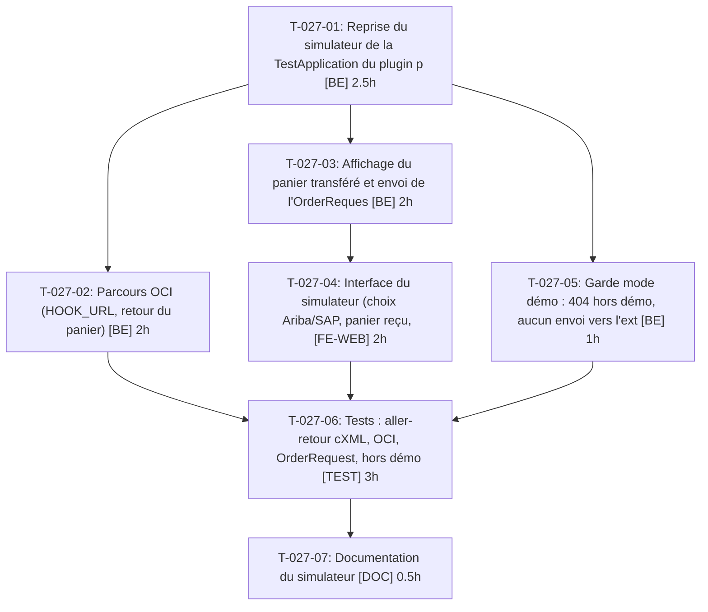

# Tâches — US-027 : Simulateur d'outil d'achat

## Informations US

- **Epic** : EPIC-07
- **Persona** : Hugo
- **Story Points** : 5
- **Sprint** : sprint-5-listes-et-scenarios
- **Dépendances** : US-010

## Résumé

En tant que Hugo, je veux simuler Ariba ou SAP depuis la démo, afin de voir le PunchOut sans compte d'outil d'achat.

## Vue d'ensemble des tâches

| ID | Type | Tâche | Estimation | Dépend de | Statut |
|----|------|-------|------------|-----------|--------|
| T-027-01 | [BE] | Reprise du simulateur de la TestApplication du plugin punchout (cXML : setup, retour du panier) | 2.5h | — | ✅ |
| T-027-02 | [BE] | Parcours OCI (HOOK_URL, retour du panier) | 2h | T-027-01 | ➖ reporté : OCI non simulé, documenté (README) |
| T-027-03 | [BE] | Affichage du panier transféré et envoi de l'OrderRequest | 2h | T-027-01 | ✅ |
| T-027-04 | [FE-WEB] | Interface du simulateur (choix Ariba/SAP, panier reçu, bouton envoyer) FR/EN | 2h | T-027-03 | ✅ |
| T-027-05 | [BE] | Garde mode démo : 404 hors démo, aucun envoi vers l'extérieur | 1h | T-027-01 | ✅ |
| T-027-06 | [TEST] | Tests : aller-retour cXML, OCI, OrderRequest, hors démo, session invalide, panier vide | 3h | T-027-02, T-027-04, T-027-05 | ✅ |
| T-027-07 | [DOC] | Documentation du simulateur | 0.5h | T-027-06 | ✅ |

**Total estimé : 13h**

---

## Détail des tâches

### T-027-01 — Reprise du simulateur de la TestApplication du plugin punchout (cXML : setup, retour du panier)

- **Type** : [BE]
- **Estimation** : 2.5h
- **Dépend de** : —

**Description** :
Adapter dans src/Demo/PunchOutSimulator, identifiants fictifs.

**Critères de validation** :
- [ ] Session cXML lancée vers la boutique

---

### T-027-02 — Parcours OCI (HOOK_URL, retour du panier)

- **Type** : [BE]
- **Estimation** : 2h
- **Dépend de** : T-027-01

**Description** :
Même simulateur, protocole OCI.

**Critères de validation** :
- [ ] Session OCI fonctionnelle

---

### T-027-03 — Affichage du panier transféré et envoi de l'OrderRequest

- **Type** : [BE]
- **Estimation** : 2h
- **Dépend de** : T-027-01

**Description** :
Réception du panier côté simulateur, OrderRequest vers l'endpoint du plugin.

**Critères de validation** :
- [ ] Commande créée après OrderRequest

---

### T-027-04 — Interface du simulateur (choix Ariba/SAP, panier reçu, bouton envoyer) FR/EN

- **Type** : [FE-WEB]
- **Estimation** : 2h
- **Dépend de** : T-027-03

**Description** :
Page dédiée liée depuis la page Plugins.

**Critères de validation** :
- [ ] Parcours utilisable au clavier

---

### T-027-05 — Garde mode démo : 404 hors démo, aucun envoi vers l'extérieur

- **Type** : [BE]
- **Estimation** : 1h
- **Dépend de** : T-027-01

**Description** :
Réutiliser la garde DemoMode ; URL du plugin uniquement interne.

**Critères de validation** :
- [ ] 404 hors mode démo

---

### T-027-06 — Tests : aller-retour cXML, OCI, OrderRequest, hors démo, session invalide, panier vide

- **Type** : [TEST]
- **Estimation** : 3h
- **Dépend de** : T-027-02, T-027-04, T-027-05

**Description** :
Scénarios Gherkin US-027.

**Critères de validation** :
- [ ] 6 scénarios couverts

---

### T-027-07 — Documentation du simulateur

- **Type** : [DOC]
- **Estimation** : 0.5h
- **Dépend de** : T-027-06

**Description** :
Usage et limites.

**Critères de validation** :
- [ ] Doc relue

---

## Graphe de dépendances

## Résumé

| Type | Nb tâches | Heures |
|------|-----------|--------|
| [BE] | 4 | 7.5h |
| [FE-WEB] | 1 | 2h |
| [TEST] | 1 | 3h |
| [DOC] | 1 | 0.5h |
| **TOTAL** | **7** | **13h** |
