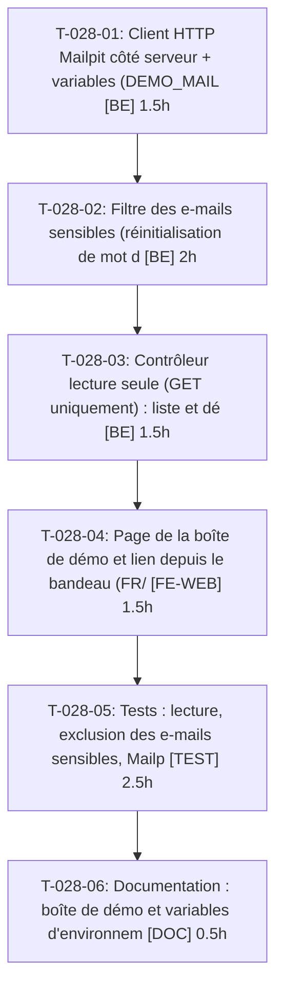

# Tâches — US-028 : Boîte Mailpit publique

## Informations US

- **Epic** : EPIC-07
- **Persona** : Hugo
- **Story Points** : 3
- **Sprint** : sprint-5-listes-et-scenarios
- **Dépendances** : US-003

## Résumé

En tant que Hugo, je veux lire les e-mails envoyés par la démo, afin de voir les notifications de chaque plugin. Décision : Mailpit n'est PAS exposé ; une page de démo lit l'API HTTP de Mailpit côté serveur, en lecture seule, en excluant les e-mails sensibles.

## Vue d'ensemble des tâches

| ID | Type | Tâche | Estimation | Dépend de | Statut |
|----|------|-------|------------|-----------|--------|
| T-028-01 | [BE] | Client HTTP Mailpit côté serveur + variables (DEMO_MAILPIT_URL = lien public du bandeau, DEMO_MAILPIT_API_URL = API interne) | 1.5h | — | ✅ |
| T-028-02 | [BE] | Filtre des e-mails sensibles (réinitialisation de mot de passe, vérification de compte, tout e-mail contenant un jeton) | 2h | T-028-01 | ✅ |
| T-028-03 | [BE] | Contrôleur lecture seule (GET uniquement) : liste et détail ; mode démo | 1.5h | T-028-02 | ✅ |
| T-028-04 | [FE-WEB] | Page de la boîte de démo et lien depuis le bandeau (FR/EN, message Mailpit indisponible) | 1.5h | T-028-03 | ✅ |
| T-028-05 | [TEST] | Tests : lecture, exclusion des e-mails sensibles, Mailpit indisponible, aucune action d'envoi, hors démo | 2.5h | T-028-04 | ✅ |
| T-028-06 | [DOC] | Documentation : boîte de démo et variables d'environnement | 0.5h | T-028-05 | ✅ |

**Total estimé : 9.5h**

---

## Détail des tâches

### T-028-01 — Client HTTP Mailpit côté serveur + variables (DEMO_MAILPIT_URL = lien public du bandeau, DEMO_MAILPIT_API_URL = API interne)

- **Type** : [BE]
- **Estimation** : 1.5h
- **Dépend de** : —

**Description** :
Distinguer l'URL publique du lien et l'URL interne de l'API ; délai d'attente court.

**Critères de validation** :
- [ ] Aucune URL interne dans le HTML rendu

---

### T-028-02 — Filtre des e-mails sensibles (réinitialisation de mot de passe, vérification de compte, tout e-mail contenant un jeton)

- **Type** : [BE]
- **Estimation** : 2h
- **Dépend de** : T-028-01

**Description** :
Détection par sujet, gabarit et motif de jeton dans le corps/liens ; liste par défaut « exclure ».

**Critères de validation** :
- [ ] E-mails sensibles jamais listés ni lisibles par ID direct

---

### T-028-03 — Contrôleur lecture seule (GET uniquement) : liste et détail ; mode démo

- **Type** : [BE]
- **Estimation** : 1.5h
- **Dépend de** : T-028-02

**Description** :
Aucune route d'envoi, de suppression ni de relais ; 404 hors démo.

**Critères de validation** :
- [ ] Seules des routes GET existent

---

### T-028-04 — Page de la boîte de démo et lien depuis le bandeau (FR/EN, message Mailpit indisponible)

- **Type** : [FE-WEB]
- **Estimation** : 1.5h
- **Dépend de** : T-028-03

**Description** :
Rendu texte échappé, pièces jointes non servies.

**Critères de validation** :
- [ ] Message clair si Mailpit est injoignable

---

### T-028-05 — Tests : lecture, exclusion des e-mails sensibles, Mailpit indisponible, aucune action d'envoi, hors démo

- **Type** : [TEST]
- **Estimation** : 2.5h
- **Dépend de** : T-028-04

**Description** :
Scénarios Gherkin US-028 avec faux client HTTP.

**Critères de validation** :
- [ ] 6 scénarios couverts

---

### T-028-06 — Documentation : boîte de démo et variables d'environnement

- **Type** : [DOC]
- **Estimation** : 0.5h
- **Dépend de** : T-028-05

**Description** :
Précise la non-exposition de Mailpit.

**Critères de validation** :
- [ ] Doc relue

---

## Graphe de dépendances

## Résumé

| Type | Nb tâches | Heures |
|------|-----------|--------|
| [BE] | 3 | 5h |
| [FE-WEB] | 1 | 1.5h |
| [TEST] | 1 | 2.5h |
| [DOC] | 1 | 0.5h |
| **TOTAL** | **6** | **9.5h** |
