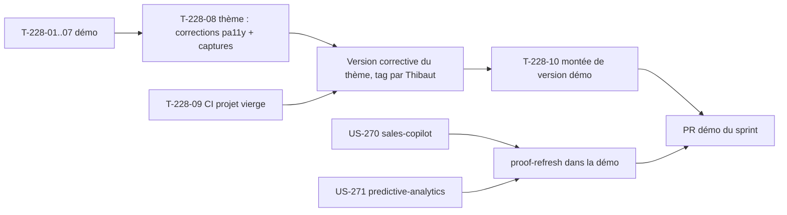

# Sprint 50 — La démo sur le thème publié

**Durée** : 2026-11-05 → 2026-11-19
**Capacité** : 10 points
**Engagement** : 10 points (3 stories) + 2 tâches techniques

## Sprint Goal

La boutique B2B de la démo tourne sur le thème Industrie & Négoce installé depuis Packagist, et les deux derniers plugins sous 80 % de couverture passent le seuil.

## Stories

| ID | Titre | Dépôt | Points | MoSCoW |
|----|-------|-------|--------|--------|
| US-228 | Thème : installation par Composer et démo qui consomme le thème publié | démo + thème | 5 | Must |
| US-270 | Couverture de tests du plugin sales-copilot (58,90 % → ≥ 80 %) | sales-copilot | 3 | Should |
| US-271 | Couverture de tests du plugin predictive-analytics (78,36 % → ≥ 80 %) | predictive-analytics | 2 | Should |

Périmètre choisi par Thibaut le 2026-11-05. Le thème v0.1.0 est publié sur Packagist depuis le 2026-11-05.

## Découpage d'US-228

La démo a son propre habillage B2B : 75 gabarits sous `templates/shop/theme_b2b/` et 3 fichiers `config/packages/demo_theme_b2b*.yaml` (hooks conditionnés au canal B2B). Le thème publié s'active par le `themeName` du canal. US-228 se fait en deux parties :

| Tâche | Dépôt | Contenu | Heures |
|-------|-------|---------|--------|
| T-228-01 | démo | `composer require tmonier/sylius-industry-trade-theme:^0.1`, configuration du README copiée, source `sylius_theme` qui trouve le paquet dans `vendor/`, `themeName` du canal B2B dans les fixtures ; le canal B2C garde les pages standard | 2 h |
| T-228-02 | démo | Inventaire des gabarits et hooks de `theme_b2b` : retirer ceux que le thème fournit, garder ce qui est propre à la démo (logo, rayons, menu du compte, insights, pages des plugins, textes). Tableau de décision dans la PR | 4 h |
| T-228-03 | démo | Test qui échoue si `composer.json` référence un paquet `tmonier/*` en `dev-*` (scénario « version non publiée ») | 0,5 h |
| T-228-04 | démo | Test qui signale un gabarit local masquant un gabarit du thème (scénario « surcharge locale oubliée ») | 1 h |
| T-228-05 | démo | Tests fonctionnels : pages du parcours en 200 sur le canal B2B (thème) et B2C (sans thème) | 1 h |
| T-228-06 | démo | Pages « Plugins » et « Preuve technique » : mention du thème, ton neutre | 0,5 h |
| T-228-07 | démo | Captures (accueil, liste, fiche, panier) et audit pa11y WCAG2AAA sur la boutique B2B de la démo | 1 h |
| T-228-08 | thème | Corriger les erreurs pa11y relevées par T-228-07 (dont les 5 de l'en-tête et du pied de page, libellé du champ de recherche des filtres) ; captures du README remplacées par celles de la démo | 2 h |
| T-228-09 | thème | Job de CI « projet vierge » : installation par la procédure du README, page d'accueil en 200 avec le thème (scénario « projet vierge ») | 1,5 h |
| T-228-10 | démo | Après la version corrective du thème (tag par Thibaut) : montée de version dans la démo | 0,25 h |

Le scénario « mise à jour de version » est couvert par Dependabot (déjà configuré sur Composer) et la CI de la démo.

Il n'existe pas de recette Flex pour le thème : la procédure du README (copie de deux éléments de configuration) en tient lieu. Publier une recette dans `symfony/recipes-contrib` est une publication externe : proposée à Thibaut, hors sprint.

## Tâches techniques

| ID | Titre | Type | Heures |
|----|-------|------|--------|
| T-TECH-50-01 | Marquer le sprint 49 terminé, `current_sprint: 50` | OPS | 0,25 h |
| T-TECH-50-02 | Reprise de T-TECH-49-02 : version du passeport dans `proof.json` (dès que l'API Packagist sert v0.3.1), branche `proof/us-268-qr-capture` après suppression du worktree | OPS | 0,5 h |

## Ordre d'exécution

- Vague 1 : US-228 côté démo ∥ US-271.
- Vague 2 : US-228 côté thème (T-228-08, T-228-09) ∥ US-270.
- Au plus deux workers à la fois : la VM Docker n'a que 2 Go de mémoire. Les suites complètes tournent dans la CI ; en local, seulement les tests ciblés.

## Portes

- Espace disque ≥ 10 Go avant de lancer les workers (A-48-1) : 14 Go au départ.
- `main` de la démo vert au lancement (A-48-3) : b7af1fb.
- Après chaque rapport de worker, le SHA local est comparé au `headRefOid` de la PR (A-48-2).
- Brief des workers : un push, puis attendre la fin du run avant tout autre push (A-49-4).
- Scénario « canal sans le thème » dans les tests d'US-228 (A-49-1).
- Aucun tag ni release sans GO de Thibaut.

## Definition of Done (sprint)

- Démo sur le paquet publié, CI verte (« Quality and smoke tests », « Docker image »).
- pa11y WCAG2AAA sans erreur sur les pages du parcours de la boutique B2B.
- Captures du README du thème prises sur la démo.
- Couverture des lignes ≥ 80 % sur `main` pour sales-copilot et predictive-analytics, ou taux réel publié et écart expliqué.
- `bin/proof-refresh` lancé, page « Preuve technique » à jour.
