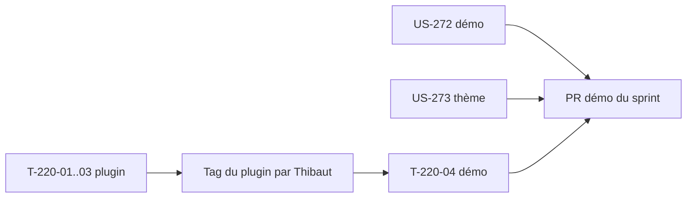

# Sprint 51 — Valeur visible dans la démo

**Durée** : 2026-11-05 → 2026-11-19
**Capacité** : 9 points
**Engagement** : 9 points (3 stories) + 1 tâche technique

## Sprint Goal

Le back-office de la démo montre les entreprises qui ralentissent leurs commandes, avec la raison en clair, et le QR des passeports produits ; l'installation du thème est prouvée par sa CI.

## Stories

| ID | Titre | Dépôt | Points | MoSCoW |
|----|-------|-------|--------|--------|
| US-220 | Commerce prédictif : score d'attrition explicable dans l'admin | predictive-analytics, puis démo | 5 | Should |
| US-272 | Passeport : GTIN fictifs valides dans les fixtures, QR visible dans la démo | démo | 2 | Should |
| US-273 | Thème : installation vérifiée dans un projet vierge par la CI | thème | 2 | Should |

Périmètre choisi par Thibaut le 2026-11-05. Dépendances d'US-220 (US-217, US-219) faites.

## Découpage

| Tâche | Story | Dépôt | Contenu | Heures |
|-------|-------|-------|---------|--------|
| T-220-01 | US-220 | predictive | Calcul du score par entreprise : intervalle médian sur 12 mois, ≥ 4 commandes, historique ≥ 6 mois, seuils 2× (à risque) et 3× (critique) ; tests unitaires des seuils et cas limites | 3 h |
| T-220-02 | US-220 | predictive | Fiche entreprise de l'admin : statut, raison en clair (FR/EN), mention « indicatif », masqué sans droit de lecture des entreprises | 2 h |
| T-220-03 | US-220 | predictive | Filtre « à risque / critique / actif » dans la liste des entreprises de l'admin | 2 h |
| T-220-04 | US-220 | démo | Après la version du plugin (tag par Thibaut) : montée de version, au moins une entreprise à risque visible à toute date dans les fixtures, capture de la fiche | 1,5 h |
| T-272-01 | US-272 | démo | GTIN fictifs (préfixe d'exemple GS1 `0950600`, clé de contrôle calculée) dans la fixture des passeports ; échec nommé si clé fausse | 1 h |
| T-272-02 | US-272 | démo | Tests : 5 GTIN uniques et valides, onglet « Étiquettes » avec lien GS1 et QR SVG, produit sans passeport sans 500 ; captures FR et EN | 1,5 h |
| T-273-01 | US-273 | thème | Job de CI « projet vierge » (Sylius 2.2 et 2.3) qui suit le README, canal avec et sans thème | 2,5 h |
| T-273-02 | US-273 | thème | Une seule source pour les commandes (README ↔ script du job), rouge prouvé en retirant une étape | 0,5 h |

## Tâches techniques

| ID | Titre | Type | Heures |
|----|-------|------|--------|
| T-TECH-51-01 | Marquer le sprint 50 terminé, `current_sprint: 51` | OPS | 0,25 h |

## Ordre d'exécution

- Trois workers en parallèle, un par dépôt (predictive, démo, thème) ; VM Docker à 4 Go.
- T-220-04 se fait dans le worktree de la démo après US-272, une fois le plugin tagué.

## Portes

- Disque ≥ 10 Go (14 Go au départ) ; `main` de la démo vert (f980c01).
- Branches de worktree créées avec `--no-track`, push explicite `HEAD:<branche>`, `headRefOid` vérifié (A-50-1).
- `composer install` dans chaque worktree, jamais de `vendor/` copié (A-50-3).
- `php bin/proof-check` avant fusion d'une PR démo qui ajoute des fichiers de tests (A-50-4).
- Pour US-273 : canal avec et sans thème (A-49-1).
- Aucun tag sans GO de Thibaut.

## Definition of Done (sprint)

- CI verte sur chaque dépôt (Sylius 2.2 et 2.3 pour plugin et thème).
- Rendu de la fiche entreprise et de l'onglet « Étiquettes » vérifié dans la démo (captures).
- `bin/proof-refresh` lancé si le plugin change de version.
