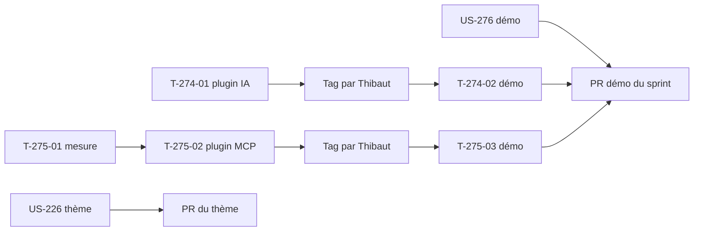

# Sprint 52 — Pile à jour et mode sombre du thème

**Durée** : 2026-11-10 → 2026-11-24
**Capacité** : 11 points
**Engagement** : 11 points (4 stories) + 3 tâches techniques ; ramené à 6 points actifs le 2026-11-10 (US-276 abandonnée, US-275 bloquée par l'amont)

## Sprint Goal

La démo et ses plugins IA et MCP tournent sur les dernières versions de Symfony AI, du serveur MCP de Sylius et d'apexcharts, sans régression visible ; le thème Industrie & Négoce propose un mode sombre AAA.

## Stories

| ID | Titre | Dépôt | Points | MoSCoW |
|----|-------|-------|--------|--------|
| US-274 | Symfony AI 0.15 : plugin ai-catalog-copilot puis démo | ai-catalog-copilot, puis démo | 3 | Should |
| US-275 | Serveur MCP de Sylius 0.3 : plugin b2b-mcp puis démo : **bloquée** par l'amont (attend une version compatible `symfony/mcp-bundle >= 0.15`) | b2b-mcp, puis démo | 3 | Should |
| ~~US-276~~ | apexcharts 8 pour le graphique des statistiques de l'admin : **abandonnée** (licence non MIT depuis apexcharts 5, la démo reste en 3.x comme Sylius) | démo | 2 | Should |
| US-226 | Thème Industrie & Négoce : mode sombre optionnel en AAA | thème | 3 | Should |

Périmètre choisi par Thibaut le 2026-11-10. US-266 (PHPUnit 13) et US-267 (chaîne de build du thème) restent bloquées : décision du 2026-11-04, en attente de la migration de Sylius.

## Découpage

| Tâche | Story | Dépôt | Contenu | Heures |
|-------|-------|-------|---------|--------|
| T-274-01 | US-274 | ai-catalog-copilot | Contraintes `symfony/ai-*` en `^0.15` ; `PlatformTextGeneratorTest` et `SwitchableTextGeneratorTest` passent à `Test\MockPlatformFactory::createPlatform()` (rouge prouvé : PHPStan sur la classe absente) ; SPEC section 2, CHANGELOG | 2 h |
| T-274-02 | US-274 | démo | Après le tag du plugin par Thibaut : `symfony/ai-bundle ^0.15`, suggestions de démonstration vérifiées dans l'admin | 1 h |
| T-275-01 | US-275 | b2b-mcp | Mesurer les changements de `symfony/mcp-bundle` 0.13 et de `sylius/mcp-server-plugin` 0.3 sur le plugin ; redécoupage avec Thibaut si plus de 3 points | 0,5 h |
| T-275-02 | US-275 | b2b-mcp | Contrainte `^0.3`, adaptation des outils B2B, tests (liste et appel d'un outil), README FR/EN, CHANGELOG | 2,5 h |
| T-275-03 | US-275 | démo | Après le tag du plugin : `^0.3`, point d'entrée (routes, durcissement, accès par canal, guide MCP, `config/demo/*.yaml`), test qui refuse une référence à l'ancien point d'entrée | 1,5 h |
| T-276-01 | US-276 | démo | Notes de version d'apexcharts 3 → 8 ; captures « avant » du tableau de bord (clair et sombre) | 0,5 h |
| T-276-02 | US-276 | démo | `apexcharts ^8`, migration des options de `statistics_chart.js`, captures « après », aucune erreur console | 1,5 h |
| T-226-01 | US-226 | thème | Jeu de jetons sombre sous `[data-theme="industry-trade"]`, activé par `prefers-color-scheme` ou par le commutateur ; paires sombres ajoutées à `ColorContrastTest` (7:1, rouge prouvé sur une paire sous le seuil) | 2,5 h |
| T-226-02 | US-226 | thème | Commutateur mémorisé (stockage indisponible : mode appliqué à la page, sans erreur), sans scintillement au chargement ; test fonctionnel avec application hôte (A-50-2) ; captures clair et sombre dans les README FR/EN | 2 h |

## Tâches techniques

| ID | Titre | Type | Heures |
|----|-------|------|--------|
| T-TECH-52-01 | Marquer le sprint 51 terminé, `current_sprint: 52` ; statuts des fiches US-220, US-272, US-273 dans la liste du backlog | OPS | 0,25 h |
| T-TECH-52-02 | Appliquer la décision du 2026-11-04 aux PR Dependabot restées ouvertes (PHPUnit sur les plugins, webpack-cli du thème) : `@dependabot ignore this dependency`, puis vérifier la fermeture | OPS | 0,5 h |
| T-TECH-52-03 | Fusionner les PR `actions/github-script` 9.0.0 vertes des plugins (einvoice-transmission, erp-flatfile, punchout-cxml, timeline, sales-copilot) : fusion par Thibaut | OPS | 0,25 h |

## Ordre d'exécution

- Un worker par dépôt : ai-catalog-copilot, b2b-mcp, thème ; US-276 dans le worktree de la démo, puis T-274-02 et T-275-03 une fois les plugins tagués.
- Les deux montées de la démo touchent `composer.json` et `composer.lock` : une PR démo à la fois, la seconde rebasée sur la première.

## Portes

- Disque ≥ 10 Go (35 Go au départ) ; `main` de la démo vert (`c5741ba`).
- Branches de worktree créées avec `--no-track`, push explicite `HEAD:<branche>`, `headRefOid` vérifié (A-50-1).
- `composer install` dans chaque worktree, et dans le checkout principal de la démo après chaque fusion qui change `composer.lock` (A-50-3, A-51-2).
- `php bin/proof-check` avant fusion d'une PR démo qui ajoute des fichiers de tests (A-50-4).
- Un job qui monte une application de zéro valide d'abord son environnement (A-51-1).
- Aucun tag sans GO de Thibaut ; aucune fusion par Claude.
