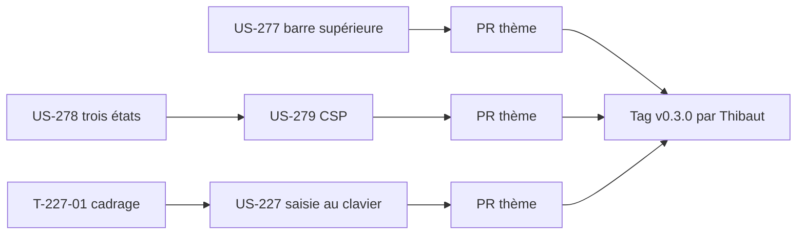

# Sprint 53 — Finitions du thème : AAA partout, mode automatique, CSP et saisie au clavier

**Durée** : 2026-11-12 → 2026-11-26
**Capacité** : 12 points
**Engagement** : 14 points (5 stories, US-280 ajoutée le 2026-11-11) + 2 tâches techniques

## Sprint Goal

Le thème Industrie & Négoce tient l'AAA sur toute la page, laisse le visiteur revenir au mode automatique, fonctionne sous une CSP stricte et permet de saisir ses références au clavier.

## Stories

| ID | Titre | Dépôt | Points | MoSCoW |
|----|-------|-------|--------|--------|
| [US-277](../../backlog/user-stories/US-277.md) | Lien de la barre supérieure lisible en AAA | thème | 2 | Should |
| [US-278](../../backlog/user-stories/US-278.md) | Revenir au mode automatique après un choix | thème | 3 | Should |
| [US-279](../../backlog/user-stories/US-279.md) | Script du mode sombre compatible avec une CSP stricte | thème | 2 | Should |
| [US-227](../../backlog/user-stories/US-227.md) | Saisie rapide au clavier et autocomplétion de référence | thème | 5 | Should |
| [US-280](../../backlog/user-stories/US-280.md) | Mode sombre lisible sur toute la page | thème | 2 | Must |

Périmètre choisi par Thibaut le 2026-11-11 (12 points avec US-227). US-277 à US-279 viennent de la revue du sprint 52. La démo ne change pas : elle garde son propre habillage (décision du 2026-11-05) ; la PR démo du sprint ne porte que la documentation.

## Découpage

| Tâche | Story | Type | Contenu | Heures |
|-------|-------|------|---------|--------|
| T-277-01 | US-277 | [TEST] | Paires « lien de la barre supérieure » (clair et sombre) dans `ColorContrastTest` ; rouge prouvé avec la couleur actuelle | 1 h |
| T-277-02 | US-277 | [FE-WEB] | Jeton de lien de la barre supérieure dans les deux modes, survol et focus ; captures clair et sombre refaites | 1,5 h |
| T-278-01 | US-278 | [TEST] | Test fonctionnel du script : choix, retour automatique, changement du système, stockage refusé, valeur inconnue ; rouge prouvé | 1,5 h |
| T-278-02 | US-278 | [FE-WEB] | Commutateur à trois états (automatique, clair, sombre) : nom et état annoncés, clavier, cible de 44 px ; « Automatique » retire la clé et écoute `prefers-color-scheme` | 2,5 h |
| T-278-03 | US-278 | [DOC] | README FR/EN (comportement du commutateur), CHANGELOG | 0,5 h |
| T-279-01 | US-279 | [TEST] | Test : l'empreinte SHA-256 publiée dans les README est celle du script rendu ; rouge prouvé en modifiant le script | 1 h |
| T-279-02 | US-279 | [FE-WEB] | Nonce de l'application quand il existe (`csp_nonce` de NelmioSecurityBundle, sans dépendance obligatoire) ; empreinte dans les README FR/EN, CHANGELOG | 1,5 h |
| T-227-01 | US-227 | [REV] | Cadrage : page cible (liste dense du thème, page quick-order si installée), source de l'autocomplétion dans Sylius 2, lien vers la palette de commandes ; redécoupage avec Thibaut si plus de 5 points | 1 h |
| T-227-02 | US-227 | [FE-WEB] | Champ de référence avec autocomplétion accessible (combobox ARIA, région live, « Aucune référence trouvée ») | 3 h |
| T-227-03 | US-227 | [FE-WEB] | Navigation au clavier dans la grille (flèches, Entrée, Échap), focus visible ; lien vers la palette quand elle est installée | 2 h |
| T-280-01 | US-280 | [TEST] | Audit axe en mode sombre (accueil, liste) dans le job « projet vierge » ; rouge prouvé | 1,5 h |
| T-280-02 | US-280 | [FE-WEB] | Couleurs sombres du menu, du pied de page, du total du panier ; traduction `skip_link` ; captures refaites | 1,5 h |
| T-227-04 | US-227 | [TEST] | Tests fonctionnels clavier, audit AAA, capture ou GIF dans les README FR/EN, CHANGELOG | 2 h |

## Tâches techniques

| ID | Titre | Type | Heures |
|----|-------|------|--------|
| T-TECH-53-01 | Marquer le sprint 52 terminé, `current_sprint: 53` ; US-274 `done` dans la liste du backlog | OPS | 0,25 h |
| T-TECH-53-02 | Après fusion des PR du thème et GO de Thibaut : tag v0.3.0 et release (notes avec captures) | OPS | 0,25 h |

## Ordre d'exécution

- US-278 et US-279 touchent le même script (`_color_mode_script.html.twig`) : même worker, US-278 d'abord.
- US-277 et US-227 sont indépendantes : un worker chacune, dans leur propre worktree.
- Une PR par story ou par paire ; les conflits attendus se limitent au CHANGELOG et aux README, résolus au rebase.

## Portes

- `main` du thème vert (`4c864b4`, v0.2.0) et `main` de la démo vert (`e8b0e0d`).
- Branches de worktree créées avec `--no-track`, push explicite `HEAD:<branche>`, `headRefOid` vérifié (A-50-1).
- Un worker ne modifie que son worktree ; aucune modification d'un fichier qu'un worker est en train de changer (A-52-2).
- Les tests de rendu passent par l'application hôte du job « projet vierge » quand un comportement dépend du navigateur (A-50-2).
- Aucun tag sans GO de Thibaut ; aucune fusion par Claude.
