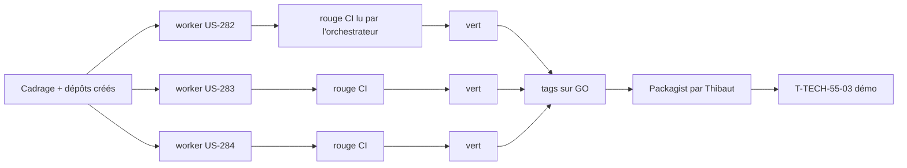

# Sprint 55 — Trois plugins qui comblent des manques de l'écosystème Sylius

**Durée** : 2026-11-12 → 2026-11-26
**Capacité** : 15 points + 4 tâches techniques
**Engagement** : 15 points (3 stories) + 4 tâches techniques

## Sprint Goal

Un marchand B2B peut vérifier l'identité d'une entreprise à l'inscription, transmettre ses factures Factur-X à Pennylane et publier le passeport public d'une batterie : trois manques de l'écosystème Sylius 2 comblés, sans recoupement avec Sylius Plus.

## Stories

| ID | Titre | Dépôt | Points | MoSCoW |
|----|-------|-------|--------|--------|
| [US-282](../../backlog/user-stories/US-282.md) | Plugin company-verification : SIREN/SIRET et TVA vérifiés à l'inscription B2B | nouveau : `sylius-company-verification-plugin` | 5 | Should |
| [US-283](../../backlog/user-stories/US-283.md) | Plugin einvoice-pennylane : premier adaptateur réel de transmission | nouveau : `sylius-einvoice-pennylane-plugin` | 5 | Should |
| [US-284](../../backlog/user-stories/US-284.md) | Passeport produit : profil batterie (art. 77), niveau public | `sylius-digital-product-passport-plugin` | 5 | Should |

Périmètre proposé à Thibaut le 2026-11-12 (analyse de l'écosystème, PR #186) et lancé par `/workflow:auto-sprint 55`. Les pistes Omnibus, outil de migration et VIES seul sont reportées après ce sprint, pas écartées (Thibaut, 2026-11-12).

## Décisions de cadrage (2026-11-12, sources primaires)

### US-282
- Dépendance directe à `tmonier/sylius-company-accounts-plugin` ^1.3 (champs `vatNumber` et `registrationNumber` de `Company`) : pas d'interface d'abstraction tant qu'un seul fournisseur existe (YAGNI). Intégration à `registration-approval` facultative : le badge n'est affiché dans *Clients > Inscriptions* que si ce plugin est installé.
- Sources : [API Recherche d'entreprises](https://recherche-entreprises.api.gouv.fr) (`GET /search?q=<siren>`, champs `siren`, `nom_complet`, `etat_administratif` `A`/`C`, `date_fermeture`, `siege.siret`, `siege.adresse`, `matching_etablissements`), vérifiés le 2026-11-12 ; VIES par son API REST de la Commission (point d'accès exact vérifié par le worker).
- Asynchrone par Messenger. Service indisponible : statut « non vérifié », nouvelle vérification par un bouton de l'administration et par une commande console planifiable (pas de reprise automatique cachée).
- Contrôle de format (Luhn SIREN/SIRET, clé TVA FR) recopié de `facturx` (`FrenchIdentifiers`), sans dépendance à `facturx`.

### US-283
- Point d'accès : `POST /api/external/v2/customer_invoices/e_invoices/imports`, champ `file` (Factur-X) et `invoice_options.customer_id`, portée `customer_invoices:all` ([changelog Pennylane](https://pennylane.readme.io/changelog/customer-supplier-invoices-dedicated-e-invoice-import-endpoints)). Client recherché par `external_reference`, créé sinon (chemins exacts vérifiés par le worker dans la référence de l'API).
- Adaptateur de `InvoiceTransmitterInterface` (`einvoice-transmission` ^0.2) ; succès = statut `deposited`, l'identifiant Pennylane est dans le message du journal (`TransmissionResult` n'a pas de champ dédié : pas de changement d'`einvoice-transmission` dans ce sprint).
- Jeton par variable d'environnement. Le test manuel contre le bac à sable demande un jeton de Thibaut : action de Thibaut, non bloquante pour le tag.
- Statut de plateforme agréée de Pennylane : à confirmer sur la [liste de la DGFiP](https://www.impots.gouv.fr/je-consulte-la-liste-des-plateformes-agreees) avant toute mention dans le README (T-283-00).

### US-284
- Texte vérifié sur EUR-Lex (règlement (UE) 2023/1542) : art. 77(1) « From 18 February 2027 each LMT battery, each industrial battery with a capacity greater than 2 kWh and each electric vehicle battery » ; données publiques = annexe XIII point 1, dont l'annexe VI partie A (fabricant, catégorie, lieu et date de fabrication, poids, capacité, chimie, substances dangereuses, agent d'extinction, matières premières critiques > 0,1 %).
- Le plugin n'a pas d'écran d'administration des passeports : la saisie passe par les fixtures (et la future interface). La validation est portée par des contraintes Symfony sur le profil batterie ; les critères « l'administrateur l'enregistre » sont vérifiés par le validateur.
- Champs obligatoires : catégorie, chimie, capacité nominale (Ah), tension nominale (V), poids (kg), date de fabrication (mois et année). Facultatifs : tensions min/max, lieu de fabrication, empreinte carbone, contenu recyclé (cobalt, lithium, nickel, plomb, en %), part renouvelable, durée de vie en cycles, substances dangereuses, matières premières critiques, agent d'extinction, durée de garantie.
- Version mineure du plugin (v0.4.0).

## Découpage

| Tâche | Story | Type | Contenu | Heures |
|-------|-------|------|---------|--------|
| T-282-01 | US-282 | [OPS] | Dépôt créé (sujets, description), squelette copié de `company-insights`, CI verte à vide | 2 h |
| T-282-02 | US-282 | [TEST] | Tests rouges : format, réponses simulées des deux API (actif, fermé, hors France, indisponible) | 2 h |
| T-282-03 | US-282 | [BE] | Clients HTTP, résultat historisé, message Messenger, commande de reprise | 4 h |
| T-282-04 | US-282 | [FE-WEB] | Badge et bouton « vérifier à nouveau » (fiche entreprise, inscriptions si présent) | 2 h |
| T-282-05 | US-282 | [DOC] | README EN/FR, captures, CHANGELOG, `bin/plugin-supply-chain apply` | 1,5 h |
| T-283-00 | US-283 | [DOC] | Statut de Pennylane sur la liste de la DGFiP | 0,25 h |
| T-283-01 | US-283 | [OPS] | Dépôt créé, squelette, CI verte à vide | 2 h |
| T-283-02 | US-283 | [TEST] | Tests rouges : client créé ou retrouvé, import, 401/403, 429/5xx, délai | 2 h |
| T-283-03 | US-283 | [BE] | Adaptateur `InvoiceTransmitterInterface`, client HTTP Pennylane, configuration | 4 h |
| T-283-04 | US-283 | [DOC] | README EN/FR, CHANGELOG, `bin/plugin-supply-chain apply` | 1,5 h |
| T-284-01 | US-284 | [TEST] | Tests rouges : profil complet affiché, champ manquant, valeur hors bornes, hors périmètre art. 77 | 2 h |
| T-284-02 | US-284 | [DB] | Entité du profil batterie, migration réversible, révision historisée | 2 h |
| T-284-03 | US-284 | [FE-WEB] | Section batterie de la page publique (fr, en), JSON `schemaVersion` | 3 h |
| T-284-04 | US-284 | [DOC] | README EN/FR, capture, CHANGELOG | 1 h |

## Tâches techniques

| ID | Titre | Type | Heures |
|----|-------|------|--------|
| T-TECH-55-01 | `current_sprint: 55`, sprint 55 planifié | OPS | 0,25 h |
| T-TECH-55-02 | Tags v0.1.0 (deux nouveaux plugins) et v0.4.0 (passeport) après fusion et GO de Thibaut ; soumission Packagist des deux nouveaux par Thibaut | OPS | 0,5 h |
| T-TECH-55-03 | Démo : installation des trois versions publiées, `config/demo/plugins.yaml`, `bin/compat-refresh`, `bin/proof-refresh`, fixtures (batterie de chariot, entreprise vérifiée) | OPS | 3 h |
| T-TECH-55-04 | `config/demo/plugin-repositories.json` : deux nouveaux dépôts, `bin/plugin-supply-chain report` | OPS | 0,5 h |

## Ordre d'exécution

- Un worker par dépôt, dans son worktree, consignes de `project-management/worker-brief.md` transmises au lancement.
- La démo n'installe que des versions publiées : T-TECH-55-03 attend les tags et Packagist, et peut glisser au sprint suivant sans changer le but.

## Portes

- `main` de la démo vert (`c33ced6`) ; dépôts DPP, `einvoice-transmission`, `company-accounts` à jour.
- Rouge valide = échec d'assertion vu en CI (pas ECS, pas PHPStan, pas une erreur de configuration).
- Aucun appel réel aux API externes en CI (clients HTTP simulés).
- Aucun tag sans GO de Thibaut ; fusions par Thibaut ; Packagist des nouveaux paquets par Thibaut.
