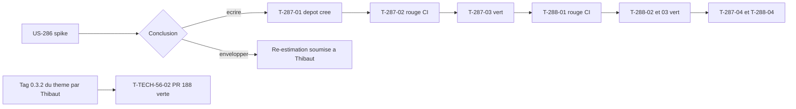

# Sprint 56 — Santé de la plateforme : le contrat de sonde et le premier écran

**Durée** : 2026-11-26 → 2026-12-10
**Capacité** : 15 points + 4 tâches techniques
**Engagement** : 13 points (3 stories) + 4 tâches techniques

## Sprint Goal

Un administrateur ouvre une page et voit, catégorie par catégorie, l'état de sa plateforme ; un intégrateur y ajoute sa propre sonde en quinze lignes, sans configuration et sans pouvoir casser l'administration.

## Stories

| ID | Titre | Dépôt | Points | MoSCoW |
|----|-------|-------|--------|--------|
| [US-286](../../backlog/user-stories/US-286.md) | Spike : ce que Symfony, Sylius et l'écosystème fournissent déjà | démo (note de cadrage) | 3 | Must |
| [US-287](../../backlog/user-stories/US-287.md) | Squelette du plugin, contrat de sonde et exécution à sécurité passive | nouveau : `sylius-platform-health-plugin` | 5 | Must |
| [US-288](../../backlog/user-stories/US-288.md) | Page d'administration, synthèse par catégorie et rendu différé | `sylius-platform-health-plugin` | 5 | Must |

Périmètre issu de la demande de Thibaut du 2026-11-22 et de ses quatre arbitrages du même jour ([EPIC-20](../../backlog/epics/EPIC-20.md) à [EPIC-23](../../backlog/epics/EPIC-23.md), 27 stories, 113 points). Ce sprint ne prend que le socle : **aucune sonde réelle n'est livrée**, les sondes des EPIC-21 et 22 arrivent aux sprints 57 et suivants.

## Décisions de cadrage (2026-11-22)

Arbitrages de Thibaut, le jour de la demande :

- **Périmètre complet** retenu : technique, métier et une sonde par plugin de l'écosystème. Les quatre epics sont engagés.
- **Sondes de plugins par `suggest` et vérification de classe** : l'interface reste propriété du plugin de santé, aucun plugin surveillé ne gagne de dépendance obligatoire. Pas de paquet de contrats séparé.
- **Historique en base dès la première version** : US-309 passe de Should à Must.
- **Alertes par courriel *et* par webhook sortant** via `webhook-outbox`, à la transition d'état seulement.

Propositions de ce sprint, à confirmer ou corriger **avant T-287-01** (c'est l'objet d'US-286) :

- **Nom du paquet** : `tmonier/sylius-platform-health-plugin`, dépôt `thibmonier/sylius-platform-health-plugin`.
- **Rendu différé** : Live Component, par cohérence avec `command-palette` et le thème.
- **Catégories de départ** : `environment`, `data`, `scheduled_tasks`, `shop`, `plugins`.
- **Budget de temps par sonde** : 500 ms ; **TTL du cache** : 60 s. Les deux configurables.
- **Statuts** : `ok`, `warning`, `critical`, `unknown`. Le quatrième est structurant, pas décoratif : il porte tout ce qui n'a pas pu être mesuré.

### Leçon reprise de la semaine précédente

Sur le thème, un point d'extension non protégé transformait un correctif d'accessibilité en erreur 500 sur toutes les pages de la boutique (PR #31, corrigée le 2026-11-21 par un `|default(null)` et un test qui le prouve). La sécurité passive du `Runner` d'US-287 répond au même risque, en plus grave : un écran de diagnostic qui devient lui-même la panne. Le scénario « sonde qui lève une exception » est donc un critère d'acceptation, pas une robustesse implicite.

Second report de cette semaine : les trois outils de qualité du thème (PHPStan, ECS, Rector) ne scopaient que `tests`, parce que le thème n'avait pas de `src/`. Le nouveau dépôt les scope sur `src` **et** `tests` dès le premier commit (T-287-01).

## Découpage

| Tâche | Story | Type | Contenu | Heures |
|-------|-------|------|---------|--------|
| T-286-01 | US-286 | [DOC] | Relevé des cinq questions : `liip/monitor`, Symfony, `sylius:install:check` et hooks du tableau de bord, Packagist, Sylius Plus — sources datées | 3 h |
| T-286-02 | US-286 | [DOC] | Note de cadrage, conclusion « envelopper / écrire », nom du paquet et technique de rendu tranchés | 2 h |
| T-287-01 | US-287 | [OPS] | Dépôt créé (sujets, description), squelette d'un plugin récent, `phpstan.neon` / `ecs.php` / `rector.php` sur `src` **et** `tests`, `bin/plugin-supply-chain apply`, CI verte à vide | 2 h |
| T-287-02 | US-287 | [TEST] | Tests rouges : trois sondes exécutées, aucune sonde, budget dépassé, exception capturée, identifiant en double au `cache:warmup` | 2,5 h |
| T-287-03 | US-287 | [BE] | `HealthCheckInterface`, `HealthStatus`, `HealthCategory`, `HealthResult`, `HealthCheckRunner` à sécurité passive, passe de compilation de l'unicité des identifiants | 4 h |
| T-287-04 | US-287 | [DOC] | README EN/FR : contrat, sonde maison en 15 lignes, non-objectifs ; CHANGELOG | 1,5 h |
| T-288-01 | US-288 | [TEST] | Tests rouges : synthèse et ordre, squelette rendu sans exécuter de sonde, cache mutualisé, rafraîchissement, « non mesurable », aucune sonde | 2,5 h |
| T-288-02 | US-288 | [FE-WEB] | Page sous *Configuration*, entrée de menu, Live Component, synthèse par catégorie, détail replié, lien d'action par route | 4 h |
| T-288-03 | US-288 | [BE] | Cache court mutualisé, TTL configurable, rafraîchissement explicite qui ignore le cache | 2 h |
| T-288-04 | US-288 | [DOC] | Traductions FR/EN, capture de la page, CHANGELOG | 1,5 h |

**Total** : 25 h de stories.

## Tâches techniques

Elles soldent la semaine du 2026-11-17 au 2026-11-21. État vérifié le 2026-11-22 : les PR Dependabot #191 et #192 sont fusionnées, **#188 reste ouverte**, et la PR #31 du thème est toujours ouverte (dernier tag `v0.3.1`), ce qui maintient T-TECH-56-02 bloquée.

| ID | Titre | Type | Heures |
|----|-------|------|--------|
| T-TECH-56-01 | `current_sprint: 56`, sprint 56 planifié, US-286 à US-312 inscrites au backlog | OPS | 0,5 h |
| T-TECH-56-02 | **Démo, #188** : alias de `RegistrationLinkPolicyInterface` sur la règle de la démo, suppression du `register.html.twig` local, retrait des deux entrées périmées d'`ACCEPTED` (`shared/flashes.html.twig`, `layout/base/footer/content.html.twig`) → PR Dependabot #188 verte. **Attend le tag 0.3.2 du thème** | BE | 2 h |
| T-TECH-56-03 | ~~**Dependabot #191 et #192** : `@dependabot rebase`~~ — **sans objet** : les deux PR ont été fusionnées par Thibaut le 2026-11-21 (`3dd360f`, `48b708b`). Vérifié le 2026-11-22 | OPS | 0 h |
| T-TECH-56-04 | **Thème** : `tests/Stub/HidePricesVoter` compatible avec le 4e paramètre `?Vote $vote` de `Voter::voteOnAttribute()` de Symfony 8, en restant compatible 7.4 — débloque les tests fonctionnels en local, et la CI quand la matrice montera | TEST | 1 h |
| T-TECH-56-05 | `config/demo/plugin-repositories.json` : nouveau dépôt du plugin de santé, `bin/plugin-supply-chain report` | OPS | 0,5 h |

## Actions de Thibaut (hors capacité)

Aucune n'est bloquante pour le Sprint Goal, mais T-TECH-56-02 attend la première.

- **Thème** : fusionner la PR [#31](https://github.com/thibmonier/sylius-industry-trade-theme/pull/31) (CI verte, 15 jobs) et taguer **v0.3.2**.
- **Railway** : `railway config plan` puis `railway config apply` pour `MP_MAX_MESSAGES: "50"` (convention : jamais par Claude). 48 h après le déploiement, `railway usage` par service, pour vérifier la prédiction écrite sur le service `web` (moyenne 0,88 Go, 3-4 $/mois).
- **Plugin de santé** : GO sur le nom du paquet, puis création du dépôt et soumission à Packagist après le tag.

## Ordre d'exécution

- **US-287 et US-288 ne démarrent pas avant la conclusion d'US-286.** Si le spike conclut « envelopper », les deux stories sont re-estimées et soumises à Thibaut avant toute ligne de code : le sprint peut alors se retrouver à 3 points engagés, ce qui est un résultat acceptable et non un échec.
- US-288 suit US-287 dans le même dépôt : pas de parallélisme, un seul worker, un seul worktree.
- La tâche technique T-TECH-56-04 est indépendante et peut partir dès le premier jour.

## Portes

- `main` de la démo verte avant de commencer ; thème, `company-accounts` et `webhook-outbox` à jour.
- **Porte du spike** : aucun dépôt créé avant que Thibaut ait lu la conclusion d'US-286.
- Rouge valide = échec d'assertion vu en CI (pas ECS, pas PHPStan, pas une erreur de configuration).
- `phpstan.neon`, `ecs.php` et `rector.php` couvrent `src` et `tests` dès le premier commit du nouveau dépôt — vérifié en revue de T-287-01, pas après coup.
- Aucune sonde réelle dans ce sprint : une sonde de démonstration sert aux tests, et le README dit explicitement que le plugin n'embarque pas encore de diagnostic.
- Aucun tag sans GO de Thibaut ; fusions par Thibaut ; Packagist du nouveau paquet par Thibaut.
