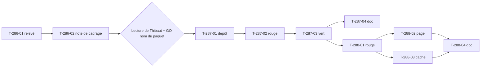

# Tâches — Sprint 56 (santé de la plateforme)

> Sprint Planning Part 2 du 2026-11-22 (décomposition). Source de vérité du statut : `.bmad/sprint-status.yaml` (`sprint-56`). Objectif et découpage d'origine : [../sprint-goal.md](../sprint-goal.md). Tableau : [../board.md](../board.md).

## Vue d'ensemble

| US | Titre | Points | Tâches | Heures | Statut |
|----|-------|--------|--------|--------|--------|
| [US-286](./US-286-tasks.md) | Spike : ce que Symfony, Sylius et l'écosystème fournissent déjà | 3 | 2 | 5 h | ✅ |
| [US-287](./US-287-tasks.md) | Squelette du plugin, contrat de sonde et exécution à sécurité passive | 5 | 4 | 10 h | ✅ |
| [US-288](./US-288-tasks.md) | Page d'administration, synthèse par catégorie et rendu différé | 5 | 4 | 10 h | ✅ |

**Total stories** : 10 tâches, 25 h, 13 points. **Tâches techniques** : T-TECH-56-01 à 05, 4 h (voir [../sprint-goal.md](../sprint-goal.md#tâches-techniques)).

## Capacité

15 points de capacité, 13 engagés (87 %). Si le spike conclut « envelopper », US-287 et US-288 sont re-estimées et soumises à Thibaut avant toute ligne de code ; le sprint peut retomber à 3 points engagés.

## Répartition par type (stories)

| Type | Tâches | Heures | % |
|------|--------|--------|---|
| [OPS] | 1 | 2 h | 8 % |
| [BE] | 2 | 6 h | 24 % |
| [FE-WEB] | 1 | 4 h | 16 % |
| [TEST] | 2 | 5 h | 20 % |
| [DOC] | 4 | 8 h | 32 % |
| **Total** | **10** | **25 h** | |

## Dépendances

