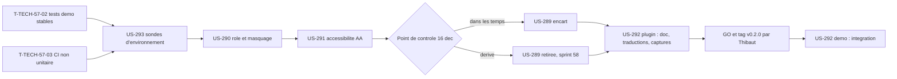

# Sprint 57 — Sondes d'environnement et sécurité de l'écran de santé

**Durée** : 2026-12-10 → 2026-12-24
**Capacité** : 15 points + tâches techniques
**Engagement** : **17 points (5 stories), soit 113 % de la capacité** + 5 tâches techniques (dont une terminée à la planification)

## Sprint Goal

La page de santé de la plateforme affiche ses premières vraies sondes, celles de l'environnement, derrière un rôle dédié, sans valeur sensible à l'écran et lisible sans la couleur, et le plugin entre dans la démo.

## Stories

| ID | Titre | Dépôt | Points | MoSCoW |
|----|-------|-------|--------|--------|
| [US-293](../../backlog/user-stories/US-293.md) | Sondes d'environnement : versions, fin de support, extensions, OPcache, `APP_DEBUG` | `sylius-platform-health-plugin` | 5 | Must |
| [US-290](../../backlog/user-stories/US-290.md) | Rôle dédié `ROLE_PLATFORM_HEALTH_VIEW`, masquage des valeurs sensibles, aucune trace à l'écran | `sylius-platform-health-plugin` | 3 | Must |
| [US-291](../../backlog/user-stories/US-291.md) | Accessibilité AA : statut jamais porté par la seule couleur, tableau annoncé, mode sombre | `sylius-platform-health-plugin` | 3 | Must |
| [US-289](../../backlog/user-stories/US-289.md) | Encart du tableau de bord : un feu par catégorie | `sylius-platform-health-plugin` | 3 | Must (**sacrifiée en premier**) |
| [US-292](../../backlog/user-stories/US-292.md) | Traductions FR/EN, README, capture, CHANGELOG, intégration à la démo | plugin puis `sylius-b2b-demo` | 3 | Must |

Suite des EPIC-20 et EPIC-21 (US-286 à US-288 livrées au sprint 56, plugin en v0.1.0). L'ordre ci-dessus est l'ordre d'exécution, pas celui d'EPIC-20.

## Décisions de cadrage (2026-11-22)

Arbitrages de Thibaut, le 2026-11-22, à l'ouverture du sprint :

1. **Périmètre : les 17 points**, au-dessus de la capacité de 15 (113 %). Thibaut le sait et le choisit. **Ordre de sacrifice : US-289 d'abord** si le sprint dérive (point de contrôle ci-dessous).
2. **US-290 : rôle dédié `ROLE_PLATFORM_HEALTH_VIEW`, activable en configuration (option B, choisie par Thibaut le 2026-11-22)**. Relevé dans `vendor/sylius` : Sylius 2 n'a **aucun système de permissions fines** ni de super-administrateur distinct (un administrateur est un `AdminUser` dont `roles` est une liste de chaînes ; `--super-admin` ajoute seulement `ROLE_ADMINISTRATION_ACCESS` ; aucun `role_hierarchy`). D'où : un attribut `PLATFORM_HEALTH_VIEW` tranché par un *voter*, et une option `access.role`, par défaut `ROLE_ADMINISTRATION_ACCESS` (comportement de la v0.1.0, aucune rupture) ; l'intégrateur la règle sur `ROLE_PLATFORM_HEALTH_VIEW` et accorde le rôle par `sylius:user:promote`. Pas de commande d'attribution propre au plugin. Option A (rôle exigé d'office et commande `grant-role`, rupture en 0.2.0) écartée.
3. **US-293 : dates de fin de support figées dans le code**, table mise à jour à chaque version du plugin, aucun appel réseau depuis l'administration (règle d'EPIC-20) ; chaque sonde dit la version de table qu'elle utilise.
4. **Le plugin entre dans la démo au sprint 57, par US-292, avec les vraies sondes d'US-293** : intégrer la v0.1.0 seule donnerait une page vide. US-292 dépend donc d'US-293.
5. **Décision A du 2026-11-22** : `identifier()` reste une constante littérale (un attribut PHP pourra venir plus tard, en version mineure). Les six sondes d'US-293 s'y conforment.
6. **Décisions antérieures des epics maintenues** : sondes de plugins par `suggest` et vérification de classe, historique en base dès la v1, alertes par courriel et par `webhook-outbox`.

Hors sprint : **US-313 (PHP 8.6)** reste au backlog (EPIC-01), non planifiée en 57 ; la sonde de version de FrankenPHP attendra.

### Point de contrôle mi-sprint (2026-12-16)

Capacité réelle : 15 points ; engagement : 17. À la fin du 2026-12-16 : si **US-293 et US-290 ne sont pas fusionnées**, US-289 est retirée du sprint (retour au backlog, sprint 58) et la décision est inscrite au registre avant de lancer la story suivante. Retirer US-289 ramène l'engagement à 14 points (93 %). Elle ne bloque aucune autre story.

### Points à soumettre à Thibaut dans la fiche

- **Pas sécurisé par défaut (assumé, option B)** : sans réglage, tout administrateur voit la page, comme en v0.1.0. Le README recommande `ROLE_PLATFORM_HEALTH_VIEW` en production et la démo l'active (US-292).
- **Point d'accès du Live Component** (vérifié dans Sylius 2 le 2026-11-22) : le tag `sylius.live_component.admin` sert le composant par la route `sylius_admin_live_component`, `/admin/{_locale}/_components/…`, donc sous le préfixe admin et couvert par `access_control` (`ROLE_ADMINISTRATION_ACCESS`) : v0.1.0 n'expose rien hors connexion. Cette règle n'exige pas le rôle dédié : US-290 pose donc le garde `ROLE_PLATFORM_HEALTH_VIEW` sur la classe du composant et sur la route de la page, et le prouve par un test sur le point d'accès `/admin/…/_components/…` (OWASP A01).

## Découpage

| Tâche | Story | Type | Contenu | Heures |
|-------|-------|------|---------|--------|
| T-293-01 | US-293 | [TEST] | Tests rouges des six sondes : sain, fin de support proche et dépassée (horloge injectée), extension manquante, debug en prod, branche inconnue, table périmée | 3 h |
| T-293-02 | US-293 | [BE] | `EndOfSupportTable` versionnée, sondes PHP et Sylius, sonde Symfony (constantes du noyau) | 3,5 h |
| T-293-03 | US-293 | [BE] | Sondes extensions, OPcache, `APP_DEBUG`, seuils configurables, liens d'action | 3,5 h |
| T-293-04 | US-293 | [DOC] | Traductions FR/EN des six sondes, README (liste, seuils, maintenance de la table), CHANGELOG | 1,5 h |
| T-290-01 | US-290 | [TEST] | Tests rouges : 403 de la page, du point d'accès `/admin/…/_components/…` et du rafraîchissement hors rôle ; masquage (DSN, `password=`, clé, chemin, trace) ; commande idempotente | 2,5 h |
| T-290-02 | US-290 | [BE] | Garde sur la route, `#[IsGranted]` sur le composant, entrée de menu conditionnelle | 2,5 h |
| T-290-03 | US-290 | [BE] | `SensitiveValueMasker` appliqué au rendu, détection de trace d'exécution, journalisation de la sonde fautive | 2 h |
| T-290-04 | US-290 | [BE] | Attribut `PLATFORM_HEALTH_VIEW`, *voter* et option `access.role` (défaut `ROLE_ADMINISTRATION_ACCESS`, validation à la compilation) | 1,5 h |
| T-290-05 | US-290 | [DOC] | README EN/FR (option, recommandation de production, `sylius:user:promote`), CHANGELOG | 1 h |
| T-291-01 | US-291 | [TEST] | Tests rouges : statut écrit et icône distincte, tableau annoncé, région d'état, contraste calculé clair et sombre | 2 h |
| T-291-02 | US-291 | [FE-WEB] | Gabarits : `<table>` légendée, `
`, jetons CSS suivant `data-bs-theme`, région `role="status"`, mouvement réduit | 3,5 h |
| T-291-03 | US-291 | [REV] | Revue manuelle : clavier seul, lecteur d'écran, mode sombre, capture ; constat consigné | 1,5 h |
| T-291-04 | US-291 | [DOC] | CHANGELOG, section accessibilité du README | 0,5 h |
| T-289-01 | US-289 | [TEST] | Tests rouges : un feu par catégorie, tableau de bord sans attendre, cache partagé, 403 hors rôle, échec silencieux | 2 h |
| T-289-02 | US-289 | [FE-WEB] | Hook du tableau de bord, Live Component différé, lecture du cache mutualisé, statut écrit | 3 h |
| T-289-03 | US-289 | [BE] | Visibilité par rôle, échec journalisé sans effet sur le tableau de bord | 1 h |
| T-289-04 | US-289 | [DOC] | Traductions FR/EN, capture du tableau de bord, CHANGELOG | 1 h |
| T-292-01 | US-292 | [TEST] | Tests rouges : complétude des traductions FR/EN, clés référencées présentes | 1,5 h |
| T-292-02 | US-292 | [DOC] | README EN/FR réécrits, captures réelles FR/EN clair/sombre, CHANGELOG 0.2.0 | 3 h |
| T-292-03 | US-292 | [OPS] | Démo, **après le tag v0.2.0 de Thibaut** : `composer require`, bundle, routes, `plugins.yaml`, rôle accordé aux comptes d'administration publics, `compat-refresh`, `proof-refresh` | 3,5 h |
| T-292-04 | US-292 | [TEST] | Démo : page visible avec le rôle, 403 sans, rôle accordé au chargement des fixtures (rouge prouvé en CI) | 2 h |
| T-292-05 | US-292 | [REV] | Captures de la démo relues à 1280 px (règle 23) | 0,5 h |

**Total** : 22 tâches, **46 h** de stories (17 points, soit 2,7 h par point ; le sprint 56 en était à 1,9 h par point : c'est le prix du dépassement de capacité choisi).

## Tâches techniques

Elles reprennent les actions de la rétrospective du sprint 56 et soldent ses suites.

| ID | Titre | Type | Heures |
|----|-------|------|--------|
| T-TECH-57-01 | `current_sprint: 57`, sprint 57 planifié, fiches US-289 à US-293 | OPS | 0,5 h (faite) |
| T-TECH-57-02 | **A-56-4, démo, avant US-293** : corriger les 4 tests instables : `CheckDiskTest` (locale fixée), `CleanTestCachesTest` (horloge injectée, pas de PID réutilisé), `WebhookDeliveryTest` et `RenderPageTest` (délais indépendants de la charge). Mesure : 5 exécutions consécutives de la suite non unitaire sans échec, dont une avec `LC_ALL=fr_FR.UTF-8` | TEST | 4 h |
| T-TECH-57-03 | **A-56-1, plugin de santé, avant le premier commit rouge** : le pas non unitaire de la CI s'exécute même si l'unitaire échoue (`if: !cancelled()`) ; même correction dans le gabarit de nouveau plugin. PR `ci:` fusionnée avant les branches de story (règle 27) | OPS | 1,5 h |
| T-TECH-57-04 | **A-56-1, A-56-2, A-56-3, A-56-5** : règles 26 à 29 écrites dans `project-management/templates/consigne-worker.md` | DOC | 0,5 h (faite) |
| T-TECH-57-05 | Dependabot : vérifier que la PR des 2 paquets restants de #188 (fermée) est réapparue, sinon `@dependabot recreate` | OPS | 0,25 h |

**Total** : 6,75 h dont 1 h faite à la planification. Avec les stories : **52,75 h**.

## Actions de Thibaut (hors capacité)

- **GO et tag `v0.2.0`** du plugin de santé, puis mise à jour Packagist : sans eux, la partie démo d'US-292 (T-292-03 à T-292-05) ne peut pas démarrer. Aucun tag sans GO ; fusions par Thibaut.
- **Railway** : `railway usage` par service, 48 h après le déploiement de `MP_MAX_MESSAGES: "50"`, pour vérifier la prédiction écrite sur le service `web` (moyenne 0,88 Go, 3-4 $/mois). Convention : jamais par Claude.
  - **Relevé de Thibaut du 2026-11-24** (période du 13 novembre au 13 décembre, 11,4 jours écoulés) : workspace 9,76 $ consommés, 19,28 $ estimés (2026-11-22 : 8,42 $ et 18,34 $, soit +0,67 $/jour) ; projet `sylius-b2b-demo` 5,55 $ : `web` 3,12 $ (mémoire 3,03 $), `mysql` 1,68 $, `mailpit` 0,75 $. Lecture : `web` ≈ 8,2 $/mois et 0,80 Go de moyenne (à 10 $/Go/mois), proche des 0,88 Go mesurés au 2026-11-20 ; la cible « 3-4 $/mois » n'est pas atteinte et ne concordait pas avec 0,88 Go (≈ 8,8 $/mois). `MP_MAX_MESSAGES` ne touche que `mailpit` : en retirant 9,4 jours à 0,22 Go, les ~2 jours suivants donnent ≈ 0,09 Go, estimation fragile (pas de relevé par service au 2026-11-22). Les autres projets du workspace pèsent 4,21 $ (≈ 11 $/mois au rythme actuel, contre ~2,5 $/mois estimés) : à auditer en premier (levier 3 de `docs/deploiement-railway.md`). Prochain relevé par service : 2026-12-01, pour mesurer `mailpit` sur une semaine entière.
- ~~**Lecture d'US-290**~~ : tranché le 2026-11-22, option B (rôle activable en configuration, sans rupture).
- **Point de contrôle du 2026-12-16** : valider le retrait d'US-289 si l'engagement dérive.

## Contrainte d'exécution

Les cinq stories sont dans le **même dépôt** (le plugin de santé) : **un seul worker à la fois, un seul worktree, pas de PR empilée** (règle 27, rétro du sprint 56). Chaque story est **fusionnée avant que la suivante démarre**, ou la suivante part de `main`. La partie démo d'US-292 et T-TECH-57-02 sont dans un autre dépôt : elles ne sont pas concernées, mais T-TECH-57-02 doit être fusionnée avant US-293.

## Ordre d'exécution

- T-TECH-57-02 (démo) et T-TECH-57-03 (plugin) partent le premier jour, en parallèle (dépôts différents) ; **aucune story ne démarre avant T-TECH-57-03 fusionnée** ; US-293 attend aussi T-TECH-57-02.
- US-290 suit US-293 pour tester le masquage sur de vraies sondes ; US-291 suit US-290 pour auditer l'écran final ; US-289 vient avant US-292 pour que le README décrive l'encart s'il existe.
- Si US-289 est retirée, le README d'US-292 ne la mentionne pas.

## Portes

- `main` de la démo verte avant de commencer ; thème, `company-accounts` et `webhook-outbox` à jour.
- **Porte A-56-4** : T-TECH-57-02 fusionnée avant la première ligne d'US-293.
- **Rouge valide = échec d'assertion vu en CI, dans le run du SHA poussé, sur les suites unitaire et non unitaire** (règle 26) ; un commit rouge passe PHPStan et ECS.
- `phpstan.neon`, `ecs.php` et `rector.php` sur `src` **et** `tests`, lancés **dans Docker** (règle 28) ; tout passage en PHP local est noté avec sa raison.
- Aucune PR empilée (règle 27) ; tout écart à une tâche est signalé dès qu'il est décidé (règle 29).
- Aucune sonde qui appelle l'extérieur ; aucune valeur d'environnement, aucun DSN, aucune trace à l'écran.
- Aucun tag sans GO de Thibaut ; fusions par Thibaut ; Packagist par Thibaut.
