# Tâches — Sprint 57 (sondes d'environnement et sécurité de l'écran de santé)

> Sprint Planning Part 2 du 2026-11-22 (décomposition). Source de vérité du statut : `.bmad/sprint-status.yaml` (`sprint-57`). Objectif, décisions et découpage : [../sprint-goal.md](../sprint-goal.md). Tableau : [../board.md](../board.md).

## Vue d'ensemble

Dans l'ordre d'exécution.

| US | Titre | Points | Tâches | Heures | Statut |
|----|-------|--------|--------|--------|--------|
| [US-293](./US-293-tasks.md) | Sondes d'environnement | 5 | 4 | 11,5 h | 🔲 |
| [US-290](./US-290-tasks.md) | Rôle dédié, masquage, aucune trace | 3 | 5 | 9,5 h | 🔲 |
| [US-291](./US-291-tasks.md) | Accessibilité AA | 3 | 4 | 7,5 h | 🔲 |
| [US-289](./US-289-tasks.md) | Encart du tableau de bord (**sacrifiée en premier**) | 3 | 4 | 7 h | 🔲 |
| [US-292](./US-292-tasks.md) | Traductions, README, capture, CHANGELOG, démo | 3 | 5 | 10,5 h | 🔲 |

**Total stories** : 22 tâches, 46 h, 17 points. **Tâches techniques** : T-TECH-57-01 à 05, 6,75 h (voir [../sprint-goal.md](../sprint-goal.md#tâches-techniques)). **Total** : 52,75 h.

## Capacité

15 points de capacité, **17 engagés (113 %)**, choix de Thibaut du 2026-11-22. Si US-293 et US-290 ne sont pas fusionnées au 2026-12-16, US-289 est retirée (14 points, 93 %). Ratio : 2,7 h par point, contre 1,9 h au sprint 56.

## Répartition par type (stories)

| Type | Tâches | Heures | % |
|------|--------|--------|---|
| [TEST] | 6 | 13 h | 28 % |
| [BE] | 6 | 14 h | 30 % |
| [FE-WEB] | 2 | 6,5 h | 14 % |
| [DOC] | 5 | 7 h | 15 % |
| [REV] | 2 | 2 h | 4 % |
| [OPS] | 1 | 3,5 h | 8 % |
| **Total** | **22** | **46 h** | |

## Contrainte d'exécution

Même dépôt pour les cinq stories (plugin de santé) : **un worker à la fois, pas de PR empilée** (règle 27). Chaque story est fusionnée avant la suivante, ou la suivante part de `main`. La démo (T-TECH-57-02, T-292-03 à 05) est un autre dépôt.

## Dépendances

```mermaid
graph LR
    TT02[T-TECH-57-02 tests demo stables] --> T29301
    TT03[T-TECH-57-03 CI non unitaire] --> T29301[T-293-01 rouge]
    T29301 --> T29302[T-293-02 table et PHP Sylius Symfony] & T29303[T-293-03 extensions OPcache debug]
    T29302 --> T29304[T-293-04 doc]
    T29303 --> T29304
    T29304 --> T29001[T-290-01 rouge]
    T29001 --> T29002[T-290-02 garde] & T29003[T-290-03 masquage] & T29004[T-290-04 commande]
    T29002 --> T29005[T-290-05 doc]
    T29003 --> T29005
    T29004 --> T29005
    T29005 --> T29101[T-291-01 rouge] --> T29102[T-291-02 gabarits] --> T29103[T-291-03 revue] --> CP{Controle 16 dec}
    T29102 --> T29104[T-291-04 doc]
    CP --> T28901[T-289-01 rouge] --> T28902[T-289-02 encart] & T28903[T-289-03 role]
    T28902 --> T28904[T-289-04 doc]
    T28903 --> T28904
    CP --> T29201[T-292-01 rouge]
    T28904 --> T29201
    T29201 --> T29202[T-292-02 doc] --> TAG{GO et tag v0.2.0 Thibaut}
    TAG --> T29203[T-292-03 demo] --> T29204[T-292-04 test demo] & T29205[T-292-05 captures]
```

