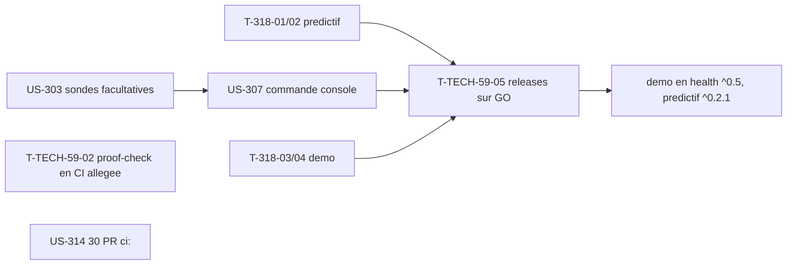

# Sprint 59 — Console, sondes des plugins et schéma de la démo

**Durée** : 2027-01-07 → 2027-01-21. C'est le créneau prévisionnel, comme pour les sprints 54 à 58 ; l'exécution réelle commence le 2026-11-26.
**Capacité** : 15 points + tâches techniques
**Engagement** : **13 points (4 stories), soit 87 % de la capacité** + 5 tâches techniques (deux faites à la planification)

## Sprint Goal

Le diagnostic de santé se lit aussi en console avec un code de sortie utile, un plugin peut fournir sa sonde sans imposer le plugin de santé, et la démo n'a plus de dérive de schéma.

## Stories

| ID | Titre | Dépôt | Points | MoSCoW |
|----|-------|-------|--------|--------|
| [US-318](../../backlog/user-stories/US-318.md) | Dérive du schéma de la démo : 16 instructions entre le mapping et la base | prédictif, puis démo | 3 | Must |
| [US-303](../../backlog/user-stories/US-303.md) | Sondes facultatives : un plugin fournit sa sonde sans dépendre du plugin de santé | `sylius-platform-health-plugin` | 5 | Must |
| [US-307](../../backlog/user-stories/US-307.md) | Commande `tmonier:health:check` : texte ou JSON, code de sortie 0/1/2, filtres | `sylius-platform-health-plugin` | 3 | Must |
| [US-314](../../backlog/user-stories/US-314.md) | CI des plugins : la suite non unitaire s'exécute même si l'unitaire échoue | 30 plugins | 2 | Should |

## Décisions de cadrage (2026-11-26)

Arbitrages de Thibaut, le 2026-11-26 :

1. **US-318 en tête** (« ASAP »), à la suite du constat de `data.schema_drift` sur la démo.
2. **Périmètre** : US-318, US-303, US-307 et US-314 (13 points). US-307 est avancée du sprint 60. US-304 reste après US-303, à un sprint suivant.
3. **US-307 : une sonde `unknown` donne le code de sortie 1**, comme un avertissement : une sonde qui ne mesure pas ne passe pas une porte de CI en silence.
4. **Actions A-58-1 à A-58-5 approuvées** ; ROTI du sprint 58 : 5.

Choix posés dans les fiches, à revoir si Thibaut le souhaite :
- US-307 : une option invalide donne le code **3**, distinct de 2 ;
- US-303 : la vérification d'existence est injectable dans le plugin de démonstration, pour tester l'absence de l'interface dans ce dépôt.

## Décisions en cours de sprint

| Date | Décision | Par |
|------|----------|-----|
| 2026-11-26 | US-318 : clés étrangères du prédictif en `ON DELETE CASCADE` | Thibaut |
| 2026-11-26 | US-318 : commentaires DBAL 3 de Sylius corrigés par une migration de la démo, pas par un filtre de la sonde | Thibaut |
| 2026-11-26 | US-307 : un `unknown` donne le code de sortie 1, comme un `warning` | Thibaut |
| 2026-11-26 | US-307 : la règle de vocabulaire (« contrôle » / « check », jamais « sonde » / « probe ») vaut aussi pour la console ([health #21](https://github.com/thibmonier/sylius-platform-health-plugin/pull/21)) | Thibaut |
| 2026-11-27 | T-TECH-59-02 : le job `proof` des PR de documentation est informatif, comme dans le job des tests (rendre bloquant : question ouverte dans #235) | orchestrateur |
| 2026-11-27 | T-TECH-59-02 : le job `proof` reste non bloquant | Thibaut |
| 2026-11-27 | Dette : `AdminOrderBulkActionsTest` instable inscrite au backlog ([US-319](../../backlog/user-stories/US-319.md)) | Thibaut |
| 2026-11-27 | US-318 : `messenger_messages` de production alignée par une migration de la démo (option A, [#238](https://github.com/thibmonier/sylius-b2b-demo/pull/238)), pas exclue de la sonde | Thibaut |

## Découpage

| Tâche | Story | Type | Contenu | Heures |
|-------|-------|------|---------|--------|
| T-318-01 à 05 | US-318 | TEST, DB, DOC | [US-318-tasks.md](tasks/US-318-tasks.md) | 9,5 h |
| T-303-00 à 03 | US-303 | DOC, TEST, BE | [US-303-tasks.md](tasks/US-303-tasks.md) | 8,5 h |
| T-307-00 à 03 | US-307 | DOC, TEST, BE | [US-307-tasks.md](tasks/US-307-tasks.md) | 6,5 h |
| T-314-01 et 02 | US-314 | OPS | [US-314-tasks.md](tasks/US-314-tasks.md) | 4 h |
| T-TECH-59-01 | — | OPS | Sprint 58 clos (ROTI 5, A-58 approuvées), `current_sprint` 59, sprint 59 planifié, fiches US-303 et US-307 | 1 h |
| T-TECH-59-02 | — | OPS | **A-58-2** : `bin/proof-check` dans la CI allégée des PR de documentation (sans base ni réseau) ; test du classement inchangé | 2 h |
| T-TECH-59-03 | — | DOC | **A-58-3** : procédure Docker des tests fonctionnels de la démo dans `docs/tests-locaux.md` (`composer install`, `yarn build` dans `node:24`, `bin/run-tests` dans `sylius-php:8.5-alpine` avec la base de l'hôte, `pcntl` absent de l'image) | 1,5 h |
| T-TECH-59-04 | — | DOC | **A-58-1, A-58-2, A-58-4, A-58-5** : règles 26 (complétée), 32, 33 et 34 de la consigne des workers | 0,5 h |
| T-TECH-59-05 | — | OPS | **Dernière tâche (A-57-1)** : releases health v0.5.0 (US-303, US-307) et prédictif v0.2.1 (US-318), sur GO de Thibaut ; démo en health ^0.5 et prédictif ^0.2.1 ; `compat-refresh` puis `proof-refresh` relus (A-57-3) ; CI de `main` suivie (A-58-1) ; « Dérive du schéma » vue `ok` en production | 3 h |

**Total** : 36,5 h, dont 2,5 h faites à la planification (T-TECH-59-01, T-TECH-59-04, T-303-00, T-307-00).

## Actions de Thibaut (hors capacité)

- **GO des releases** health v0.5.0 et prédictif v0.2.1, puis Packagist.
- **US-314** : fusion des 30 PR `ci:` (liste unique fournie).
- **Production** : « Dérive du schéma » en `ok` après le déploiement de T-TECH-59-05.
- **A-57-4, 2026-12-01** : relevé Railway par service.

## Contrainte d'exécution

- **Plugin de santé** : US-303 puis US-307, chacune fusionnée avant que la suivante démarre (règle 27).
- **Plugin prédictif** : US-318, en parallèle du plugin de santé (dépôts différents).
- **US-314** : en parallèle des autres. Son changement (`build.yaml`) ne touche aucun fichier des stories ; dans les dépôts de santé et du prédictif, la PR `ci:` part de `main`.
- **Releases** : après la fusion de toutes les stories qu'elles portent (règle 30).

## Ordre d'exécution

## Portes

- `main` de la démo et des plugins verts avant de commencer, et **suivis après chaque fusion** (A-58-1).
- **Rouge valide = échec d'assertion vu en CI dans le run du SHA poussé, suites unitaire et non unitaire** (règle 26). Cela vaut aussi pour les tâches de la démo (A-58-5). Le commit rouge passe PHPStan et ECS, sortie lue sans filtre et code de retour vérifié (règle 31).
- Une PR qui ajoute ou retire un fichier `*Test.php` dans la démo embarque `proof.json` rafraîchi (A-58-2).
- Outils de qualité dans Docker (règle 28) ; écart signalé dès qu'il est décidé (règle 29).
- Aucun tag sans GO de Thibaut ; fusions par Thibaut ; Packagist par Thibaut ; aucune écriture en production sans GO.
