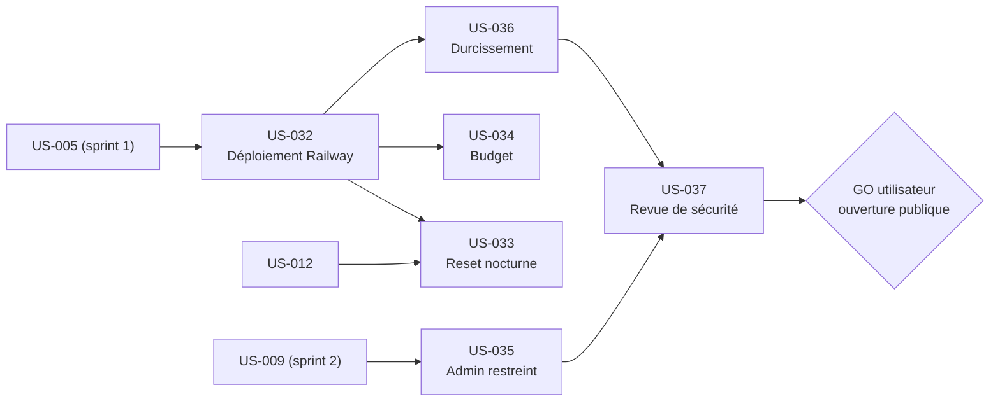

# Sprint 6 — Railway et sécurité

## Informations

| Attribut | Valeur |
|----------|--------|
| Numéro | 6 |
| Nom | railway-securite |
| Début | 2026-10-16 |
| Fin | 2026-10-30 |
| Durée | 10 jours ouvrés |
| Points engagés | 29 |

## Sprint Goal

> Mettre la démo en ligne sur Railway, privée et durcie : déploiement, remise à zéro nocturne supervisée, budget plafonné, admin restreint, durcissement et revue de sécurité, constats reportés des sprints 2, 4 et 5 inclus.

## Décisions utilisateur (2026-10-16)

1. Le projet Railway est créé et la démo déployée pendant ce sprint : web + MySQL + Mailpit interne non exposé ; limite d'usage ≤ 25 $/mois.
2. La démo reste **PRIVÉE** (authentification HTTP basique activée par variable d'environnement) jusqu'au GO explicite de l'utilisateur, après la revue US-037. Aucune ouverture publique sans ce GO.
3. Alertes d'échec de la remise à zéro nocturne : notifications e-mail natives de Railway + journal.
4. US-006 (spike mode worker), US-029 (récepteur de webhooks) et US-030 (guide MCP) reportées au sprint 7.
5. **Arbitrage de capacité** : l'estimation initiale (127,5 h pour 21 pts) dépassait la capacité. Points ré-estimés : US-033 3 → 5, US-035 5 → 8, US-036 3 → 8. Tâches glissées au sprint 7 (statut « ➡️ sprint 7 ») : T-006-\*, T-033-05 (échéance du bandeau), T-034-02 (relevé du coût à J+7, calendaire), T-036-09 (S4-R3), T-036-12, T-036-13, T-036-14 (S2-R3 à S2-R10). Heures restantes dans le sprint : 107,5 h. US-037 reste dans le sprint : elle conditionne le GO.

## Périmètre

- Déploiement Railway depuis GitHub : build de l'image, migrations en pre-deploy, bascule après healthcheck, HTTPS, `DEFAULT_URI` = URL HTTPS publique, `DEMO_MODE=1` explicite, auth HTTP basique par variable (US-032).
- Remise à zéro nocturne à 03:00 Europe/Paris dans le conteneur web, garde « démo-aware » et atomicité, alerte d'échec (US-033).
- Limite d'usage Railway et relevé du coût réel après une semaine (US-034).
- Admin de démo restreint : Sophie ne peut pas modifier administrateurs, canaux, passerelles, URLs de webhooks, clés (US-035).
- Durcissement : limitation de débit, aucun appel ni e-mail sortant réel, en-têtes de sécurité, hôtes et proxys de confiance (US-036).
- Revue de sécurité indépendante avant ouverture : aucun constat critique ou majeur ouvert (US-037).

Hors périmètre : ouverture publique effective (sprint ultérieur, sur GO explicite), US-006, US-029, US-030, correctif du plugin punchout-cxml (sprint 7), exposition publique de Mailpit.

## Sprint Backlog

| ID | Titre | Points | Dépend de | Statut |
|----|-------|--------|-----------|--------|
| US-032 | Déploiement Railway | 5 | US-005 | 🔵 To Do |
| US-033 | Remise à zéro nocturne supervisée | 5 | US-012, US-032 | 🔵 To Do |
| US-034 | Budget et mesure du coût | 1 | US-032 | 🔵 To Do |
| US-035 | Admin de démo restreint | 8 | US-009 | 🔵 To Do |
| US-036 | Durcissement de la démo publique | 8 | US-032 | 🔵 To Do |
| US-037 | Revue de sécurité avant ouverture | 2 | US-035, US-036 | 🔵 To Do |

**Total engagé : 29 points, 6 stories** (US-032 5, US-033 5, US-034 1, US-035 8, US-036 8, US-037 2 ; capacité `sprint-status.yaml`). Décomposition en tâches : `/project:decompose-tasks 006`. Reportées au sprint 7 : US-006 (2 pts), US-029 (3 pts), US-030 (2 pts).

## Traçabilité des constats de sécurité reportés

Chaque constat doit être clos (corrigé, ou accepté par écrit avec justification) avant le GO de la revue US-037.

### Sprint 4 (`sprint-4-theme-b2b/review-findings.md`, « Reporté »)

| # | Constat | Story |
|---|---------|-------|
| S4-R1 | Compte admin `sophie` public avec accès complet (Sylius CE sans droits fins) : blocage, défiguration | US-035, US-033 |
| S4-R2 | Inscription et checkout publics : données personnelles réelles visibles via l'admin (RGPD) → avertissement « aucune donnée réelle » ou inscription désactivée | US-036 |
| S4-R3 | Prix « dès » calculé produit par produit sur une liste (coût CPU) → batch | US-036 (T-036-09 glissée au sprint 7) |
| S4-R4 | `csrf_token()` du bandeau ouvre une session par visiteur anonyme (cache HTTP impossible) ; `Vary: Cookie` si cache ajouté | US-036 |
| S4-R5 | Locales des pages légales non restreintes aux locales du canal | US-036 |
| S4-R6 | Cookie `demo_badges` sans `Secure` forcé (dépend de `trusted_proxies` derrière Railway) | US-032 |
| S4-H | « Prochaine remise à zéro » dans le bandeau (US-015) dépend du reset supervisé | US-033 (T-033-05 glissée au sprint 7) |

### Sprint 5 (`sprint-5-listes-et-scenarios/review-findings.md`, « Reporté »)

| # | Gravité | Constat | Story |
|---|---------|---------|-------|
| S5-R1 | Moyenne | Simulateur public : commandes Acme anonymes illimitées, état signé rejouable 1 h, secret de démo permettant de poster sur `/punchout/cxml`, consommation du crédit → accès restreint ou nonce à usage unique + limiteur par IP ; reset régulier d'Acme | US-036 (accès, limiteur), US-033 (reset) |
| S5-R2 | Basse | Pas de `framework.trusted_hosts` ; `TRUSTED_PROXIES` = `REMOTE_ADDR` → hôte public + plages du proxy Railway | US-032 (configuration), US-036 |
| S5-R3 | Basse | Limiteur de setup du plugin voit le simulateur en 127.0.0.1 : un visiteur peut bloquer les autres (429) → limiteur par IP visiteur | US-036 |
| S5-R4 | Basse à moyenne | Boîte de démo : tous les e-mails visibles quel que soit le destinataire (RGPD) → liste blanche des destinataires des comptes de démo | US-036 |

### Sprint 2 (`sprint-2-donnees-b2b/review-findings.md`, « Reporté »)

| # | Constat | Story |
|---|---------|-------|
| S2-R1 | Admin `sophie` exposé sur `/demo/accounts` : least-privilege strict, mailer de prod en puits (null/catch-all), rate-limiting login et `/demo/accounts` | US-035, US-036 |
| S2-R2 | `app:demo:reset` : garde d'environnement **démo-aware** (une garde `APP_ENV=prod` naïve casserait le reset voulu) et atomicité (purge puis reload non transactionnel) | US-033 |
| S2-R3 | `CsvProductReader` ignore silencieusement les lignes au nombre de colonnes erroné → journaliser, compter ou rejeter | US-036 |
| S2-R4 | Doublon de SKU inter-fichiers écrase silencieusement → accumuler les SKU sur les 3 CSV | US-036 |
| S2-R5 | `attributes_json` invalide ignoré, valeur non-chaîne (TypeError), code d'attribut inconnu ignoré | US-036 |
| S2-R6 | BOM UTF-8, en-tête non trimé, encodage non validé | US-036 |
| S2-R7 | ≈ 420 requêtes au reset (`findAll()` canaux, taxon/attribut par produit) | US-036 (perf, si le temps le permet) |
| S2-R8 | `DemoAccountsController` recopie les comptes en dur → source partagée (déjà partiellement traité au sprint 4) | US-036 (vérifier) |
| S2-R9 | Fixtures de même priorité (-15, -40, -50) : ordre indéfini, vérifier l'absence de dépendance | US-036 (vérifier) |
| S2-R10 | Valeurs d'attribut créées en fr_FR et en_US même si non traduisible | US-036 (vérifier) |

Note : S2-R3 à S2-R10 sont latents (210 produits chargés sans perte) et **glissés au sprint 7** (arbitrage du 2026-10-16, T-036-12 à T-036-14) ; ils sont consignés dans review-findings sans bloquer le GO. S4-R3 (prix « dès » en lot) est également glissé au sprint 7 (T-036-09), avec acceptation écrite, la limitation de débit atténuant le coût CPU. S2-R1, S2-R2 et les autres constats S4/S5 restent bloquants pour l'ouverture publique.

## Jalons de décision

| Jalon | Décision | Conséquence |
|-------|----------|-------------|
| Création du projet Railway (US-032) | Action externe, compte Railway de l'utilisateur | Sans accès au compte, US-032/033/034 attendent |
| Revue de sécurité (US-037) | Aucun constat critique/majeur ouvert | Pré-requis du GO |
| GO ouverture publique | Décision EXPLICITE de l'utilisateur | Sans GO : auth HTTP basique conservée, démo privée |

## Ordre de réalisation recommandé

1. J1 : US-035 et US-036 (code, indépendants de Railway) ; S2-R2 de US-033 (garde et atomicité du reset, local)
2. US-032 : préparation du dépôt (Dockerfile/config Railway, pre-deploy, healthcheck, auth basique par variable), puis création du projet avec le compte utilisateur
3. US-033 (planification 03:00 Paris, alerte) et US-034 (limite d'usage) une fois le projet créé (le relevé du coût à J+7 est au sprint 7)
4. US-037 en fin de sprint, après US-035 et US-036 ; relevé du coût après une semaine d'exploitation

## Dépendances inter-stories

## Definition of Done (rappel)

- [ ] Critères d'acceptation automatisés (tests fonctionnels ou de fumée) et verts
- [ ] ECS et PHPStan passent sur le code ajouté/modifié
- [ ] Libellés en français et en anglais si interface
- [ ] Aucun secret ni identifiant réel dans le dépôt (secrets Railway uniquement en variables d'environnement)
- [ ] Mailpit non exposé ; aucun e-mail ni appel sortant réel
- [ ] Documentation mise à jour (déploiement, exploitation, alertes)
- [ ] CI verte sur la branche `feature/sprint-6-railway-securite`

## Risques identifiés

| Risque | Probabilité | Impact | Mitigation |
|--------|-------------|--------|------------|
| US-032 et US-034 dépendent d'actions sur le compte Railway (création du projet, limite d'usage, notifications) que l'agent ne peut pas faire seul | Élevée | Élevé | Actions listées en checklist, à réaliser par l'utilisateur ou avec son accord explicite ; préparer tout le code en amont |
| Capacité : 107,5 h restantes pour 29 pts malgré les glissements, dont 10,5 h d'actions externes | Élevée | Moyen | Arbitrage du 2026-10-16 appliqué ; ordre de priorité : US-032, US-035, US-036 (cœur), US-033, puis US-037 |
| Dépassement du budget 25 $/mois (web + MySQL + Mailpit) | Moyenne | Moyen | Limite d'usage posée à la création, relevé après une semaine, veille (sleep) si besoin |
| Démo exposée par erreur avant le GO | Faible | Élevé | Auth HTTP basique par variable activée par défaut, test de fumée la vérifiant |
| Reset nocturne bloqué par une garde `APP_ENV=prod` naïve ou échec non atomique | Moyenne | Élevé | S2-R2 : garde démo-aware, transaction, test ; alerte e-mail Railway |
| Alerte e-mail Railway non fiable pour une tâche cron interne | Moyenne | Moyen | Journal explicite + code de sortie non nul ; test d'échec simulé |
| `trusted_proxies` / `Secure` mal réglés derrière Railway (cookies, URL en HTTP) | Moyenne | Moyen | S4-R6, S5-R2 ; `DEFAULT_URI` HTTPS ; test des en-têtes en conteneur |
| Image Docker lourde, disque local presque plein | Élevée | Faible | Éviter les rebuilds, construire en CI/Railway |
| Pas de wkhtmltopdf en local (Factur-X, PDF) | Certaine | Faible | Tests concernés exécutés en CI |
| Revue US-037 révèle des constats majeurs tardifs | Moyenne | Élevé | Revue intermédiaire après US-035/036 ; marge de fin de sprint |

## Cérémonies

| Cérémonie | Date indicative | Durée |
|-----------|----------------|-------|
| Sprint Planning Part 1 (Quoi) | 2026-10-16 | 2 h |
| Sprint Planning Part 2 (Comment) | 2026-10-16 | 2 h |
| Daily Scrum | Chaque jour | 15 min |
| Affinage Backlog | 2026-10-23 (mid-sprint) | 1 h |
| Sprint Review | 2026-10-30 (matin) | 1 h |
| Rétrospective | 2026-10-30 (après-midi) | 1 h 30 |
