# Task Board — Sprint 6 (Railway et sécurité)

## Légende

- 🔲 À faire
- 🔄 En cours
- 👀 En review
- ✅ Terminé
- ➡️ Reporté au sprint 7
- 🚫 Bloqué

---

## Graphe de dépendances global

```mermaid
graph TD
    subgraph US032["US-032 Déploiement Railway (22h)"]
        T03201["T-032-01 [BE] 2.5h"]
        T03202["T-032-02 [BE] 3h"]
        T03203["T-032-03 [OPS] 3h"]
        T03204["T-032-04 [BE] 1h"]
        T03205["T-032-05 [OPS] 1.5h"]
        T03206["T-032-06 [TEST] 2h"]
        T03207["T-032-07 [TEST] 1.5h"]
        T03208["T-032-08 [DOC] 2h"]
        T03209["T-032-09 [OPS] 1.5h"]
        T03210["T-032-10 [OPS] 1h"]
        T03211["T-032-11 [OPS] 1.5h"]
        T03212["T-032-12 [REV] 1.5h"]
    end
    subgraph US033["US-033 Remise à zéro nocturne supervisée (17h)"]
        T03301["T-033-01 [BE] 1.5h"]
        T03302["T-033-02 [BE] 3.5h"]
        T03303["T-033-03 [BE] 1.5h"]
        T03304["T-033-04 [BE] 1.5h"]
        T03306["T-033-06 [OPS] 1h"]
        T03307["T-033-07 [TEST] 3h"]
        T03308["T-033-08 [DOC] 1h"]
        T03309["T-033-09 [OPS] 1h"]
        T03310["T-033-10 [OPS] 2h"]
        T03311["T-033-11 [REV] 1h"]
    end
    subgraph US034["US-034 Budget et mesure du coût (1.5h)"]
        T03401["T-034-01 [OPS] 0.5h"]
        T03403["T-034-03 [DOC] 1h"]
    end
    subgraph US035["US-035 Admin de démo restreint (19h)"]
        T03501["T-035-01 [BE] 2h"]
        T03502["T-035-02 [BE] 1.5h"]
        T03503["T-035-03 [BE] 4h"]
        T03504["T-035-04 [BE] 1.5h"]
        T03505["T-035-05 [FE-WEB] 1.5h"]
        T03506["T-035-06 [BE] 2h"]
        T03507["T-035-07 [TEST] 3h"]
        T03508["T-035-08 [TEST] 2h"]
        T03509["T-035-09 [DOC] 0.5h"]
        T03510["T-035-10 [REV] 1h"]
    end
    subgraph US036["US-036 Durcissement de la démo publique (31.5h)"]
        T03601["T-036-01 [BE] 3h"]
        T03602["T-036-02 [BE] 2.5h"]
        T03603["T-036-03 [BE] 4h"]
        T03604["T-036-04 [BE] 2.5h"]
        T03605["T-036-05 [BE] 2h"]
        T03606["T-036-06 [BE] 3h"]
        T03607["T-036-07 [BE] 2.5h"]
        T03608["T-036-08 [FE-WEB] 1.5h"]
        T03610["T-036-10 [BE] 2h"]
        T03611["T-036-11 [BE] 1h"]
        T03615["T-036-15 [TEST] 5h"]
        T03616["T-036-16 [DOC] 1h"]
        T03617["T-036-17 [REV] 1.5h"]
    end
    subgraph US037["US-037 Revue de sécurité avant ouverture (16.5h)"]
        T03701["T-037-01 [REV] 2h"]
        T03702["T-037-02 [REV] 4h"]
        T03703["T-037-03 [TEST] 3h"]
        T03704["T-037-04 [BE] 4h"]
        T03705["T-037-05 [DOC] 1.5h"]
        T03706["T-037-06 [REV] 1.5h"]
        T03707["T-037-07 [OPS] 0.5h"]
    end
    T03201 --> T03203
    T03204 --> T03203
    T03201 --> T03206
    T03202 --> T03206
    T03204 --> T03206
    T03203 --> T03207
    T03206 --> T03207
    T03211 --> T03208
    T03203 --> T03209
    T03205 --> T03209
    T03209 --> T03210
    T03210 --> T03211
    T03207 --> T03211
    T03208 --> T03212
    T03211 --> T03212
    T03301 --> T03302
    T03301 --> T03303
    T03302 --> T03304
    T03304 --> T03306
    T03302 --> T03307
    T03303 --> T03307
    T03304 --> T03307
    T03307 --> T03308
    T03211 --> T03309
    T03306 --> T03310
    T03309 --> T03310
    T03211 --> T03310
    T03307 --> T03310
    T03308 --> T03311
    T03310 --> T03311
    T03209 --> T03401
    T03401 --> T03403
    T03501 --> T03502
    T03502 --> T03503
    T03503 --> T03504
    T03503 --> T03505
    T03503 --> T03506
    T03503 --> T03507
    T03504 --> T03507
    T03505 --> T03507
    T03504 --> T03508
    T03506 --> T03508
    T03507 --> T03508
    T03508 --> T03509
    T03508 --> T03510
    T03509 --> T03510
    T03202 --> T03601
    T03601 --> T03602
    T03601 --> T03603
    T03601 --> T03604
    T03205 --> T03606
    T03202 --> T03607
    T03602 --> T03615
    T03603 --> T03615
    T03604 --> T03615
    T03605 --> T03615
    T03606 --> T03615
    T03607 --> T03615
    T03608 --> T03615
    T03610 --> T03615
    T03611 --> T03615
    T03615 --> T03616
    T03615 --> T03617
    T03616 --> T03617
    T03212 --> T03701
    T03311 --> T03701
    T03403 --> T03701
    T03510 --> T03701
    T03617 --> T03701
    T03701 --> T03702
    T03701 --> T03703
    T03211 --> T03703
    T03702 --> T03704
    T03703 --> T03704
    T03704 --> T03705
    T03704 --> T03706
    T03705 --> T03706
    T03706 --> T03707
```

US-006 et les tâches glissées au sprint 7 (voir « Reporté au sprint 7 ») sont retirées du graphe. T-034-03 dépend désormais de T-034-01 seule. Les dépendances inter-stories sont portées par les arêtes entre sous-graphes ; US-037 dépend de la revue finale de chaque autre story.

---

## 🔲 À Faire

| ID | US | Tâche | Estimation | Assigné |
|----|-----|-------|------------|---------|
| T-032-01 | US-032 | [BE] Authentification HTTP basique par variable d'environnement (démo privée par défaut) | 2.5h | — |
| T-032-02 | US-032 | [BE] Hôtes et proxys de confiance par variables ; cookie `demo_badges` Secure | 3h | — |
| T-032-03 | US-032 | [OPS] Configuration Railway du dépôt : Dockerfile, railway.json, pre-deploy (migrations), healthcheck, DEMO_MODE=1 | 3h | — |
| T-032-04 | US-032 | [BE] Healthcheck /health : vérifie base de données et migrations appliquées, hors authentification basique | 1h | — |
| T-032-05 | US-032 | [OPS] Mailpit interne : service et DSN réseau privé, aucun port ni domaine public | 1.5h | — |
| T-032-06 | US-032 | [TEST] Tests fonctionnels de la porte démo : 401/200, /health, hôtes, proxys, cookie Secure | 2h | — |
| T-032-07 | US-032 | [TEST] Test de fumée du conteneur en CI : image construite en CI, 401 sans identifiants, migrations OK | 1.5h | — |
| T-032-08 | US-032 | [DOC] Runbook de déploiement Railway (variables, domaines, rollback, ouverture publique) | 2h | — |
| T-032-09 | US-032 | [OPS] Création du projet Railway, des services (web, MySQL, Mailpit) et connexion GitHub (externe) | 1.5h | — |
| T-032-10 | US-032 | [OPS] Variables d'environnement, secrets et domaine HTTPS généré (externe) | 1h | — |
| T-032-11 | US-032 | [OPS] Premier déploiement et vérifications : 401 sans identifiants, migrations, bascule après healthcheck, Mailpit injoignable (externe) | 1.5h | — |
| T-032-12 | US-032 | [REV] Revue du déploiement (configuration, secrets, fail-closed) | 1.5h | — |
| T-033-01 | US-033 | [BE] Garde « démo-aware » de app:demo:reset (autorisé si DEMO_MODE=1, refusé sinon) | 1.5h | — |
| T-033-02 | US-033 | [BE] Atomicité du reset : un échec laisse la démo dans l'état précédent | 3.5h | — |
| T-033-03 | US-033 | [BE] Le reset purge les commandes Acme anonymes et réinitialise le crédit du simulateur | 1.5h | — |
| T-033-04 | US-033 | [BE] Journal explicite et alerte d'échec : message identifiable, code de sortie non nul, sortie sur stderr | 1.5h | — |
| T-033-06 | US-033 | [OPS] Planification à 03:00 Europe/Paris dans le conteneur web (supercronic, TZ) | 1h | — |
| T-033-07 | US-033 | [TEST] Tests : garde, atomicité, alerte, Acme purgé, échéance du bandeau | 3h | — |
| T-033-08 | US-033 | [DOC] Runbook d'exploitation du reset (lecture du journal, relance manuelle, alerte) | 1h | — |
| T-033-09 | US-033 | [OPS] Notifications e-mail Railway activées (échec de déploiement / crash) (externe) | 1h | — |
| T-033-10 | US-033 | [OPS] Reset manuel sur Railway : durée < 10 min, démo de nouveau opérationnelle, échec simulé visible dans le journal (externe) | 2h | — |
| T-033-11 | US-033 | [REV] Revue du reset (garde, atomicité, fuseau, alerte) | 1h | — |
| T-034-01 | US-034 | [OPS] Limite d'usage Railway ≤ 25 $/mois et alerte de seuil (externe) | 0.5h | — |
| T-034-03 | US-034 | [DOC] Documenter le plafond, le coût relevé et les leviers (mise en veille, taille des services) | 1h | — |
| T-035-01 | US-035 | [BE] Inventaire des routes et ressources admin sensibles (matrice route × méthode × décision) | 2h | — |
| T-035-02 | US-035 | [BE] Source unique du rôle restreint : Sophie reçoit ROLE_DEMO_ADMIN depuis le catalogue de comptes | 1.5h | — |
| T-035-03 | US-035 | [BE] Garde des écritures sensibles (POST/PUT/PATCH/DELETE, actions de masse, surcharge `_method`) | 4h | — |
| T-035-04 | US-035 | [BE] Profil de Sophie et jetons : changement de mot de passe, e-mail, locale et création de jeton API refusés | 1.5h | — |
| T-035-05 | US-035 | [FE-WEB] Message de démo FR/EN sur refus (flash et page 403 explicite) | 1.5h | — |
| T-035-06 | US-035 | [BE] Contenu édité par Sophie rendu sur le shop : échappement ou nettoyage (XSS stocké, défiguration) | 2h | — |
| T-035-07 | US-035 | [TEST] Tests fonctionnels par ressource : refus avec message, lecture et reste de l'admin utilisables | 3h | — |
| T-035-08 | US-035 | [TEST] Tests de non-contournement : POST direct avec CSRF valide, `_method`, action de masse, XSS stocké | 2h | — |
| T-035-09 | US-035 | [DOC] Documenter la politique d'admin de démo et les risques acceptés | 0.5h | — |
| T-035-10 | US-035 | [REV] Revue de l'admin restreint | 1h | — |
| T-036-01 | US-036 | [BE] Infrastructure de limitation de débit : limiteurs par IP visiteur réelle (derrière le proxy) | 3h | — |
| T-036-02 | US-036 | [BE] Limiter login admin et boutique, /demo/accounts, inscription et formulaires publics | 2.5h | — |
| T-036-03 | US-036 | [BE] Simulateur PunchOut public : état signé à usage unique, limiteur par IP, plafond de commandes Acme anonymes | 4h | — |
| T-036-04 | US-036 | [BE] Limiteur de setup du plugin : le simulateur transmet l'IP visiteur (plus de 127.0.0.1 partagé) | 2.5h | — |
| T-036-05 | US-036 | [BE] Boîte de démo : e-mails visibles uniquement pour les destinataires des comptes de démo | 2h | — |
| T-036-06 | US-036 | [BE] Aucun appel ni e-mail sortant réel : transport forcé vers Mailpit, client HTTP et webhooks sortants bornés | 3h | — |
| T-036-07 | US-036 | [BE] En-têtes de sécurité (CSP compatible assets/Stimulus, nosniff, frame, referrer, permissions, HSTS en HTTPS) | 2.5h | — |
| T-036-08 | US-036 | [FE-WEB] Avertissement « aucune donnée réelle » sur inscription, adresses et checkout (FR/EN) | 1.5h | — |
| T-036-10 | US-036 | [BE] Bandeau sans session anonyme : jeton CSRF sans état et en-tête Vary: Cookie | 2h | — |
| T-036-11 | US-036 | [BE] Pages légales : locales restreintes à celles du canal | 1h | — |
| T-036-15 | US-036 | [TEST] Tests de comportement rendu : 429 par IP, rejeu simulateur, boîte filtrée, sortie bloquée, en-têtes, session, locale | 5h | — |
| T-036-16 | US-036 | [DOC] Documenter le durcissement et les risques acceptés | 1h | — |
| T-036-17 | US-036 | [REV] Revue du durcissement | 1.5h | — |
| T-037-01 | US-037 | [REV] Matrice constats → preuves (S2, S4, S5) et périmètre de la revue | 2h | — |
| T-037-02 | US-037 | [REV] Revue indépendante du code (agent de sécurité, contexte frais, OWASP 2025) | 4h | — |
| T-037-03 | US-037 | [TEST] Vérification dynamique sur la démo privée déployée : 401, en-têtes, cookies Secure, 429, hôtes, Mailpit (externe) | 3h | — |
| T-037-04 | US-037 | [BE] Correction des constats critiques et majeurs (réserve) | 4h | — |
| T-037-05 | US-037 | [DOC] review-findings.md du sprint 6 et recommandation GO / NO-GO | 1.5h | — |
| T-037-06 | US-037 | [REV] Contre-vérification des corrections et clôture | 1.5h | — |
| T-037-07 | US-037 | [OPS] Présentation du GO à l'utilisateur ; la démo reste privée tant que le GO n'est pas donné | 0.5h | — |

## ➡️ Reporté au sprint 7

US-006 (2 pts) entière, plus les tâches glissées par l'arbitrage de capacité du 2026-10-16. Hors Kanban actif et hors totaux du sprint.

| ID | US | Tâche | Estimation | Statut |
|----|-----|-------|------------|--------|
| T-006-01 | US-006 | [BE] Activer le mode worker en local (Caddyfile, variables FrankenPHP) derrière un drapeau | 1.5h | ➡️ sprint 7 |
| T-006-02 | US-006 | [TEST] Test de fuite d'état en mode worker : requêtes alternées entre comptes, canaux, locales et badges | 2.5h | ➡️ sprint 7 |
| T-006-03 | US-006 | [BE] Mesurer le gain : latence p50/p95 sur 5 pages types, classique contre worker | 1.5h | ➡️ sprint 7 |
| T-006-04 | US-006 | [DOC] ADR-0013 : mode retenu (worker ou classique) et inventaire des services à état | 1h | ➡️ sprint 7 |
| T-006-05 | US-006 | [REV] Revue du spike (méthode de mesure, couverture du test de fuite) | 0.5h | ➡️ sprint 7 |
| T-033-05 | US-033 | [FE-WEB] « Prochaine remise à zéro » du bandeau calculée à 03:00 Europe/Paris (heure d'été comprise) | 2h | ➡️ sprint 7 |
| T-034-02 | US-034 | [OPS] Relevé du coût réel après une semaine d'exploitation (externe) | 0.5h | ➡️ sprint 7 |
| T-036-09 | US-036 | [BE] Prix « dès » calculé en lot sur les listes (glissable) | 3h | ➡️ sprint 7 |
| T-036-12 | US-036 | [BE] CsvProductReader : colonnes erronées, doublons de SKU inter-fichiers, attributes_json invalide, BOM/trim/encodage (glissable) | 4h | ➡️ sprint 7 |
| T-036-13 | US-036 | [BE] Réduire les ≈ 420 requêtes du reset (canaux, taxons et attributs préchargés) (glissable) | 2h | ➡️ sprint 7 |
| T-036-14 | US-036 | [BE] Vérifications latentes : source unique des comptes, ordre des fixtures, valeurs d'attribut traduites (glissable) | 1.5h | ➡️ sprint 7 |

Total reporté : 11 tâches, 20h.

## 🔄 En Cours

| ID | US | Tâche | Démarré | Assigné |
|----|-----|-------|---------|---------|
| — | — | — | — | — |

## 👀 En Review

| ID | US | Tâche | Reviewer |
|----|-----|-------|----------|
| — | — | — | — |

## ✅ Terminé

| ID | US | Tâche | Réel | Terminé |
|----|-----|-------|------|---------|
| — | — | — | — | — |

## 🚫 Bloqué

| ID | US | Raison | Action |
|----|-----|--------|--------|
| — | — | — | — |

---

## Métriques

- **Tâches** : 54 total | 0 terminées (0%) ; 11 tâches (20h) reportées au sprint 7
- **Heures** : 107.5h estimées | 0h consommées | 107.5h restantes
- **Points** : 29 engagés | 0 livrés

## Alerte de capacité

- Arbitrage utilisateur du 2026-10-16 : 127.5h initiales pour 21 pts, ramenées à **107.5h** pour **29 pts** après ré-estimation (US-033 5, US-035 8, US-036 8) et glissement de 20h au sprint 7 (US-006, T-033-05, T-034-02, T-036-09, T-036-12 à T-036-14). Détail : `tasks/README.md`, section « Arbitrage de capacité ».
- Dont **10.5h d'actions externes** (Railway, vérification dynamique). US-037 reste dans le sprint (condition du GO) ; la démo reste privée jusqu'au GO explicite.

### Répartition par type

| Type | Nb tâches | Heures | % |
|------|-----------|--------|---|
| [BE] | 22 | 52h | 48% |
| [DOC] | 6 | 7h | 6% |
| [FE-WEB] | 2 | 3h | 3% |
| [OPS] | 10 | 13.5h | 13% |
| [REV] | 7 | 12.5h | 12% |
| [TEST] | 7 | 19.5h | 18% |
| **TOTAL** | **54** | **107.5h** | 100% |

### Répartition par US

| US | Tâches | Heures | Points |
|----|--------|--------|--------|
| US-032 | 12 | 22h | 5 |
| US-033 | 10 | 17h | 5 |
| US-034 | 2 | 1.5h | 1 |
| US-035 | 10 | 19h | 8 |
| US-036 | 13 | 31.5h | 8 |
| US-037 | 7 | 16.5h | 2 |
| **TOTAL** | **54** | **107.5h** | **29** |
