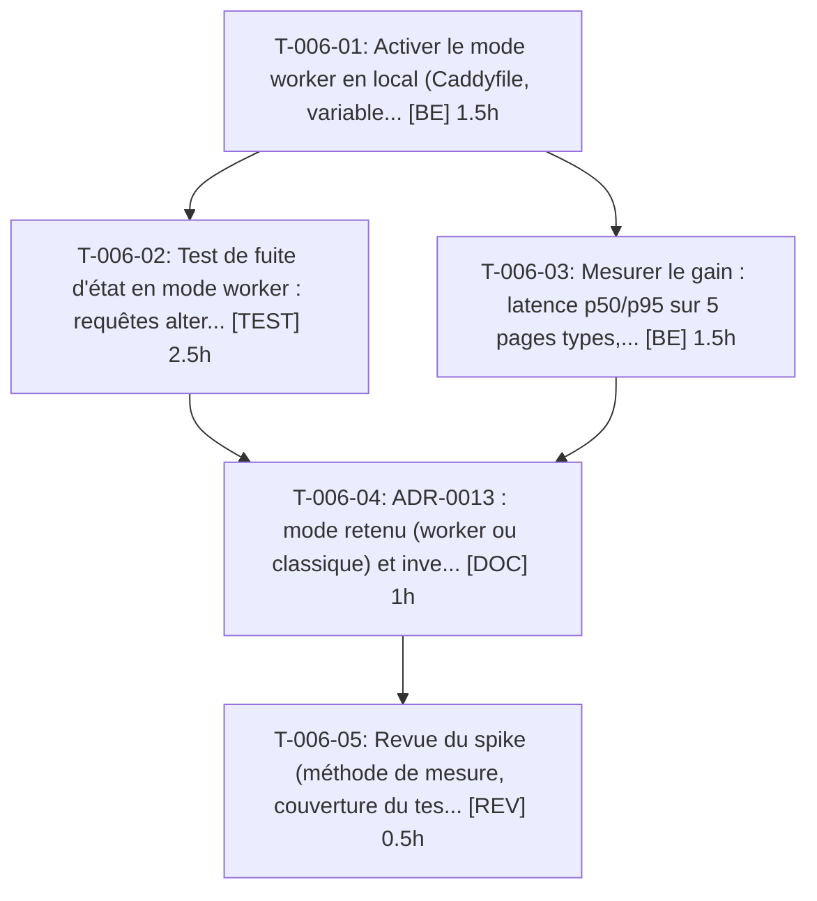

# Tâches — US-006 : Spike : mode worker FrankenPHP

## Informations US

- **Epic** : EPIC-01
- **Persona** : Thibaut
- **Story Points** : 2
- **Sprint** : sprint-6-railway-securite
- **Dépendances** : US-002

## Résumé

En tant que Thibaut, je veux savoir si le mode worker FrankenPHP est sûr avec Sylius et les plugins, afin de gagner en performance sans fuite d'état.

## Vue d'ensemble des tâches

| ID | Type | Tâche | Estimation | Dépend de | Statut |
|----|------|-------|------------|-----------|--------|
| T-006-01 | [BE] | Activer le mode worker en local (Caddyfile, variables FrankenPHP) derrière un drapeau | 1.5h | — | ➡️ sprint 7 |
| T-006-02 | [TEST] | Test de fuite d'état en mode worker : requêtes alternées entre comptes, canaux, locales et badges | 2.5h | T-006-01 | ➡️ sprint 7 |
| T-006-03 | [BE] | Mesurer le gain : latence p50/p95 sur 5 pages types, classique contre worker | 1.5h | T-006-01 | ➡️ sprint 7 |
| T-006-04 | [DOC] | ADR-0013 : mode retenu (worker ou classique) et inventaire des services à état | 1h | T-006-02, T-006-03 | ➡️ sprint 7 |
| T-006-05 | [REV] | Revue du spike (méthode de mesure, couverture du test de fuite) | 0.5h | T-006-04 | ➡️ sprint 7 |

**Total estimé : 7h**

---

## Détail des tâches

### T-006-01 — Activer le mode worker en local (Caddyfile, variables FrankenPHP) derrière un drapeau

- **Type** : [BE]
- **Estimation** : 1.5h
- **Dépend de** : —

**Description** :
Ajouter un profil `worker` (variable `FRANKENPHP_WORKER=1`) sans modifier le mode par défaut. Aucun build d'image sur le poste (disque) : utiliser l'image existante ou la CI.

**Fichiers (indicatifs)** :
- `docker/Caddyfile`
- `docker/entrypoint.sh`
- `compose.yaml`

**Critères de validation** :
- [ ] Le démarrage en mode worker est reproductible par une seule variable
- [ ] Le mode classique reste le défaut

---

### T-006-02 — Test de fuite d'état en mode worker : requêtes alternées entre comptes, canaux, locales et badges

- **Type** : [TEST]
- **Estimation** : 2.5h
- **Dépend de** : T-006-01

**Description** :
Script de fumée qui enchaîne sur le même worker : visiteur A (panier, canal B2C par cookie, locale en_US, cookie `demo_badges`), puis visiteur B anonyme, puis compte B2B. Détecte toute donnée de A visible pour B (panier, canal, utilisateur courant, locale, badges, jeton CSRF).

**Fichiers (indicatifs)** :
- `tests/Smoke/WorkerStateLeakTest.php`

**Critères de validation** :
- [ ] Le visiteur B ne voit jamais le panier, le canal, la locale ni l'identité du visiteur A (assertions sur le HTML rendu)
- [ ] Les services à état trouvés sont listés (nom de service, état conservé)

---

### T-006-03 — Mesurer le gain : latence p50/p95 sur 5 pages types, classique contre worker

- **Type** : [BE]
- **Estimation** : 1.5h
- **Dépend de** : T-006-01

**Description** :
Mesure reproductible (même jeu de données, 100 requêtes par page après échauffement) : accueil, liste produits, fiche produit, panier, tableau de bord B2B.

**Fichiers (indicatifs)** :
- `docs/performance-worker.md (section mesures)`

**Critères de validation** :
- [ ] Tableau p50/p95 pour les deux modes
- [ ] Le gain relatif est chiffré par page

---

### T-006-04 — ADR-0013 : mode retenu (worker ou classique) et inventaire des services à état

- **Type** : [DOC]
- **Estimation** : 1h
- **Dépend de** : T-006-02, T-006-03

**Description** :
Décision documentée avec le gain mesuré, les fuites éventuelles et le repli. Si une fuite d'état n'est pas corrigeable simplement, la décision est « classique ».

**Fichiers (indicatifs)** :
- `docs/adr/0013-mode-worker-frankenphp.md`
- `docs/adr/index.md`

**Critères de validation** :
- [ ] ADR au statut Accepté, mode retenu explicite
- [ ] Le Dockerfile (T-032-03) lit le mode retenu

---

### T-006-05 — Revue du spike (méthode de mesure, couverture du test de fuite)

- **Type** : [REV]
- **Estimation** : 0.5h
- **Dépend de** : T-006-04

**Description** :
Relecture croisée, contexte frais.

**Critères de validation** :
- [ ] Revue consignée
- [ ] Aucune fuite d'état non traitée dans l'ADR

---

## Graphe de dépendances

## Résumé

| Type | Nb tâches | Heures |
|------|-----------|--------|
| [BE] | 2 | 3h |
| [DOC] | 1 | 1h |
| [REV] | 1 | 0.5h |
| [TEST] | 1 | 2.5h |
| **TOTAL** | **5** | **7h** |
