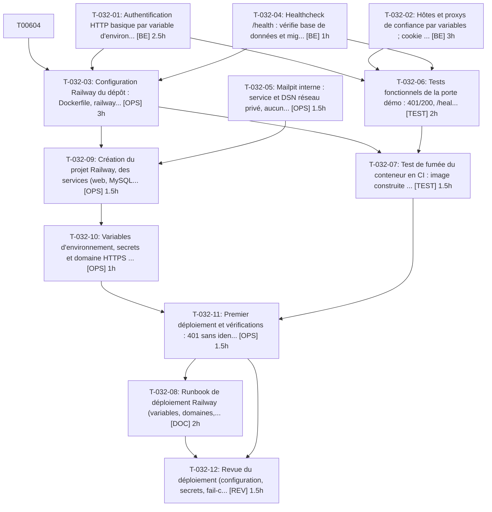

# Tâches — US-032 : Déploiement Railway

## Informations US

- **Epic** : EPIC-08
- **Persona** : Thibaut
- **Story Points** : 5
- **Sprint** : sprint-6-railway-securite
- **Dépendances** : US-005

## Résumé

En tant que Thibaut, je veux déployer la démo sur Railway depuis GitHub, afin qu'elle soit en ligne.

## Vue d'ensemble des tâches

| ID | Type | Tâche | Estimation | Dépend de | Statut |
|----|------|-------|------------|-----------|--------|
| T-032-01 | [BE] | Authentification HTTP basique par variable d'environnement (démo privée par défaut) | 2.5h | — | 🔲 |
| T-032-02 | [BE] | Hôtes et proxys de confiance par variables ; cookie `demo_badges` Secure | 3h | — | 🔲 |
| T-032-03 | [OPS] | Configuration Railway du dépôt : Dockerfile, railway.json, pre-deploy (migrations), healthcheck, DEMO_MODE=1 | 3h | T-032-01, T-032-04 | 🔲 |
| T-032-04 | [BE] | Healthcheck /health : vérifie base de données et migrations appliquées, hors authentification basique | 1h | — | 🔲 |
| T-032-05 | [OPS] | Mailpit interne : service et DSN réseau privé, aucun port ni domaine public | 1.5h | — | 🔲 |
| T-032-06 | [TEST] | Tests fonctionnels de la porte démo : 401/200, /health, hôtes, proxys, cookie Secure | 2h | T-032-01, T-032-02, T-032-04 | 🔲 |
| T-032-07 | [TEST] | Test de fumée du conteneur en CI : image construite en CI, 401 sans identifiants, migrations OK | 1.5h | T-032-03, T-032-06 | 🔲 |
| T-032-08 | [DOC] | Runbook de déploiement Railway (variables, domaines, rollback, ouverture publique) | 2h | T-032-11 | 🔲 |
| T-032-09 | [OPS] | Création du projet Railway, des services (web, MySQL, Mailpit) et connexion GitHub (externe) | 1.5h | T-032-03, T-032-05 | 🔲 |
| T-032-10 | [OPS] | Variables d'environnement, secrets et domaine HTTPS généré (externe) | 1h | T-032-09 | 🔲 |
| T-032-11 | [OPS] | Premier déploiement et vérifications : 401 sans identifiants, migrations, bascule après healthcheck, Mailpit injoignable (externe) | 1.5h | T-032-10, T-032-07 | 🔲 |
| T-032-12 | [REV] | Revue du déploiement (configuration, secrets, fail-closed) | 1.5h | T-032-08, T-032-11 | 🔲 |

**Total estimé : 22h**

---

## Détail des tâches

### T-032-01 — Authentification HTTP basique par variable d'environnement (démo privée par défaut)

- **Type** : [BE]
- **Estimation** : 2.5h
- **Dépend de** : —
- **Constat tracé** : Risque « démo exposée par erreur »

**Description** :
Écouteur de requête (ou directive Caddy) qui exige `DEMO_BASIC_AUTH_USER` / `DEMO_BASIC_AUTH_PASSWORD_HASH` ; actif par défaut en `DEMO_MODE=1` ; démarrage en échec si activé sans identifiants (fail-closed). `/health` exempté. Aucun identifiant dans le dépôt.

**Fichiers (indicatifs)** :
- `src/Demo/Security/BasicAuthGate.php`
- `config/services.yaml`
- `.env`

**Critères de validation** :
- [ ] GET / sans identifiants renvoie 401 avec WWW-Authenticate (réponse rendue)
- [ ] GET / avec identifiants valides renvoie 200
- [ ] GET /health sans identifiants renvoie 200
- [ ] Variables absentes en DEMO_MODE=1 : le conteneur refuse de démarrer

---

### T-032-02 — Hôtes et proxys de confiance par variables ; cookie `demo_badges` Secure

- **Type** : [BE]
- **Estimation** : 3h
- **Dépend de** : —
- **Constat tracé** : S4-R6, S5-R2 (configuration)

**Description** :
`framework.trusted_hosts` depuis `TRUSTED_HOSTS` (hôte public Railway), `TRUSTED_PROXIES` = plages du proxy Railway (plus `REMOTE_ADDR`), `DEFAULT_URI` HTTPS. Cookie `demo_badges` marqué Secure dès que la requête effective est HTTPS (via X-Forwarded-Proto d'un proxy de confiance).

**Fichiers (indicatifs)** :
- `config/packages/framework.yaml`
- `config/services.yaml`
- `src/Demo/Badge/BadgePreference.php`
- `.env`

**Critères de validation** :
- [ ] Hôte non listé : réponse 400 (requête réelle)
- [ ] Requête avec X-Forwarded-Proto=https d'un proxy de confiance : Set-Cookie demo_badges contient `Secure`
- [ ] Même en-tête envoyé par un client non de confiance : ignoré (REMOTE_ADDR visiteur conservé)
- [ ] Les URLs absolues générées sont en https

---

### T-032-03 — Configuration Railway du dépôt : Dockerfile, railway.json, pre-deploy (migrations), healthcheck, DEMO_MODE=1

- **Type** : [OPS]
- **Estimation** : 3h
- **Dépend de** : T-032-01, T-032-04 (mode classique de FrankenPHP : spike worker US-006 au sprint 7)

**Description** :
Fichier de configuration as code : build depuis `docker/Dockerfile`, `preDeployCommand` = migrations seules (pas de reset), `healthcheckPath=/health`, politique de redémarrage, mode FrankenPHP issu de l'ADR-0013. `DEMO_MODE=1` explicite.

**Fichiers (indicatifs)** :
- `railway.json`
- `docker/Dockerfile`
- `docker/entrypoint.sh`

**Critères de validation** :
- [ ] Le pre-deploy ne lance que `doctrine:migrations:migrate --no-interaction`
- [ ] Le healthcheck pointe sur /health
- [ ] Aucun secret dans les fichiers

---

### T-032-04 — Healthcheck /health : vérifie base de données et migrations appliquées, hors authentification basique

- **Type** : [BE]
- **Estimation** : 1h
- **Dépend de** : —

**Description** :
Étendre `HealthController` : 200 si la base répond, 503 sinon ; corps minimal sans détail interne.

**Fichiers (indicatifs)** :
- `src/Demo/Controller/HealthController.php`

**Critères de validation** :
- [ ] Base indisponible : 503 sans trace ni nom d'hôte dans la réponse
- [ ] Base disponible : 200

---

### T-032-05 — Mailpit interne : service et DSN réseau privé, aucun port ni domaine public

- **Type** : [OPS]
- **Estimation** : 1.5h
- **Dépend de** : —

**Description** :
Image Mailpit déployée comme service privé (réseau privé Railway) ; `MAILER_DSN` pointe sur le nom d'hôte privé.

**Fichiers (indicatifs)** :
- `docs/deploiement-railway.md`
- `railway.json`

**Critères de validation** :
- [ ] Aucun domaine ni port TCP public défini pour Mailpit dans la configuration
- [ ] L'application envoie un e-mail de test capté par Mailpit

---

### T-032-06 — Tests fonctionnels de la porte démo : 401/200, /health, hôtes, proxys, cookie Secure

- **Type** : [TEST]
- **Estimation** : 2h
- **Dépend de** : T-032-01, T-032-02, T-032-04

**Description** :
Tests sur le noyau Symfony avec requêtes réelles (en-têtes X-Forwarded-*). Vérifient le comportement rendu, pas la configuration.

**Fichiers (indicatifs)** :
- `tests/Functional/Demo/BasicAuthGateTest.php`
- `tests/Functional/Demo/TrustedProxiesTest.php`

**Critères de validation** :
- [ ] Couvre les 4 critères de T-032-01 et T-032-02
- [ ] Verts en CI

---

### T-032-07 — Test de fumée du conteneur en CI : image construite en CI, 401 sans identifiants, migrations OK

- **Type** : [TEST]
- **Estimation** : 1.5h
- **Dépend de** : T-032-03, T-032-06

**Description** :
Job CI qui construit l'image (jamais en local), démarre la pile et exécute la fumée.

**Fichiers (indicatifs)** :
- `.github/workflows/ci.yaml`

**Critères de validation** :
- [ ] Job vert en CI sur la branche
- [ ] La fumée échoue si l'authentification basique est désactivée

---

### T-032-08 — Runbook de déploiement Railway (variables, domaines, rollback, ouverture publique)

- **Type** : [DOC]
- **Estimation** : 2h
- **Dépend de** : T-032-11

**Description** :
Procédure pas à pas, liste des variables sans valeurs, procédure de retrait de l'authentification basique sur GO.

**Fichiers (indicatifs)** :
- `docs/deploiement-railway.md`
- `README.md`

**Critères de validation** :
- [ ] Toutes les variables lues par l'application sont listées
- [ ] La procédure d'ouverture est conditionnée au GO explicite

---

### T-032-09 — Création du projet Railway, des services (web, MySQL, Mailpit) et connexion GitHub

- **Type** : [OPS] — **action externe — exécutée par l'orchestrateur après accord déjà donné**
- **Estimation** : 1.5h
- **Dépend de** : T-032-03, T-032-05

**Description** :
action externe — exécutée par l'orchestrateur après accord déjà donné. Création sous le compte de l'utilisateur ; branche de déploiement `main` conditionnée à la CI verte.

**Critères de validation** :
- [ ] Trois services présents, Mailpit sans domaine public
- [ ] Déploiement conditionné à la CI

---

### T-032-10 — Variables d'environnement, secrets et domaine HTTPS généré

- **Type** : [OPS] — **action externe — exécutée par l'orchestrateur après accord déjà donné**
- **Estimation** : 1h
- **Dépend de** : T-032-09

**Description** :
action externe — exécutée par l'orchestrateur après accord déjà donné. `DEMO_MODE=1`, `APP_SECRET`, `DEFAULT_URI` (HTTPS), `TRUSTED_HOSTS`, `TRUSTED_PROXIES`, `DEMO_BASIC_AUTH_*`, `MAILER_DSN`, `TZ=Europe/Paris`. Secrets uniquement dans Railway.

**Critères de validation** :
- [ ] Aucune valeur secrète écrite dans le dépôt, les journaux ou le rapport
- [ ] Domaine HTTPS attribué

---

### T-032-11 — Premier déploiement et vérifications : 401 sans identifiants, migrations, bascule après healthcheck, Mailpit injoignable

- **Type** : [OPS] — **action externe — exécutée par l'orchestrateur après accord déjà donné**
- **Estimation** : 1.5h
- **Dépend de** : T-032-10, T-032-07

**Description** :
action externe — exécutée par l'orchestrateur après accord déjà donné. La démo reste privée. Vérifications depuis l'extérieur : GET / sans identifiants = 401 ; avec identifiants = 200 en HTTPS ; Mailpit injoignable depuis Internet.

**Critères de validation** :
- [ ] Réponse 401 observée sans identifiants
- [ ] Page d'accueil servie en HTTPS avec identifiants
- [ ] Mailpit non joignable publiquement
- [ ] Journal de pre-deploy sans erreur

---

### T-032-12 — Revue du déploiement (configuration, secrets, fail-closed)

- **Type** : [REV]
- **Estimation** : 1.5h
- **Dépend de** : T-032-08, T-032-11

**Description** :
Relecture du code et de la configuration ; vérification qu'aucun secret n'est versionné.

**Critères de validation** :
- [ ] Aucun secret détecté (recherche sur le diff)
- [ ] Checklist DoD cochée

---

## Graphe de dépendances

## Résumé

| Type | Nb tâches | Heures |
|------|-----------|--------|
| [BE] | 3 | 6.5h |
| [DOC] | 1 | 2h |
| [OPS] | 5 | 8.5h |
| [REV] | 1 | 1.5h |
| [TEST] | 2 | 3.5h |
| **TOTAL** | **12** | **22h** |
