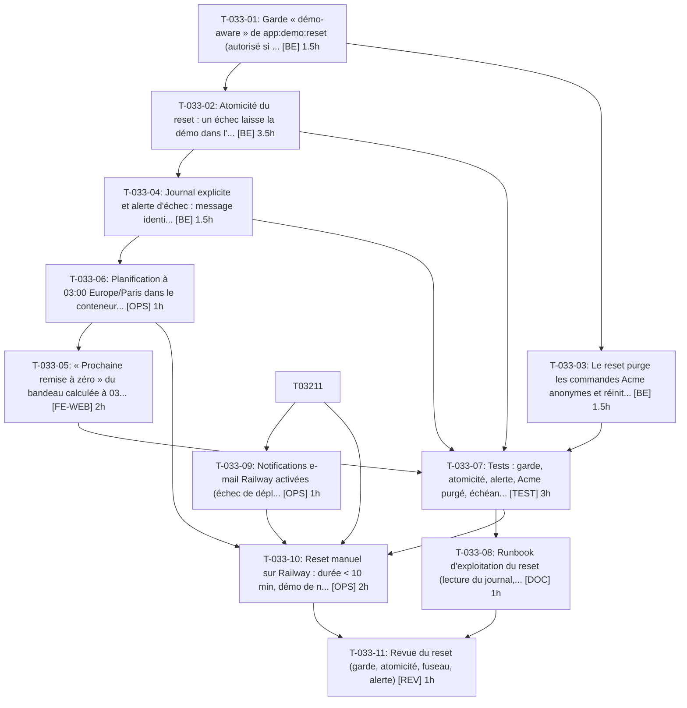

# Tâches — US-033 : Remise à zéro nocturne supervisée

## Informations US

- **Epic** : EPIC-08
- **Persona** : Thibaut
- **Story Points** : 5
- **Sprint** : sprint-6-railway-securite
- **Dépendances** : US-012, US-032

## Résumé

En tant que Thibaut, je veux que la démo se remette à zéro chaque nuit et me prévienne en cas d'échec, afin qu'elle reste propre sans intervention.

## Vue d'ensemble des tâches

| ID | Type | Tâche | Estimation | Dépend de | Statut |
|----|------|-------|------------|-----------|--------|
| T-033-01 | [BE] | Garde « démo-aware » de app:demo:reset (autorisé si DEMO_MODE=1, refusé sinon) | 1.5h | — | ✅ |
| T-033-02 | [BE] | Atomicité du reset : un échec laisse la démo dans l'état précédent | 3.5h | T-033-01 | ✅ |
| T-033-03 | [BE] | Le reset purge les commandes Acme anonymes et réinitialise le crédit du simulateur | 1.5h | T-033-01 | ✅ |
| T-033-04 | [BE] | Journal explicite et alerte d'échec : message identifiable, code de sortie non nul, sortie sur stderr | 1.5h | T-033-02 | ✅ |
| T-033-05 | [FE-WEB] | « Prochaine remise à zéro » du bandeau calculée à 03:00 Europe/Paris (heure d'été comprise) | 2h | T-033-06 | ➡️ sprint 7 |
| T-033-06 | [OPS] | Planification à 03:00 Europe/Paris dans le conteneur web (supercronic, TZ) | 1h | T-033-04 | ✅ |
| T-033-07 | [TEST] | Tests : garde, atomicité, alerte, Acme purgé, échéance du bandeau | 3h | T-033-02, T-033-03, T-033-04, T-033-05 | ✅ |
| T-033-08 | [DOC] | Runbook d'exploitation du reset (lecture du journal, relance manuelle, alerte) | 1h | T-033-07 | ✅ |
| T-033-09 | [OPS] | Notifications e-mail Railway activées (échec de déploiement / crash) (externe) | 1h | T-032-11 | ⏳ vérification utilisateur |
| T-033-10 | [OPS] | Reset manuel sur Railway : durée < 10 min, démo de nouveau opérationnelle, échec simulé visible dans le journal (externe) | 2h | T-033-06, T-033-09, T-032-11, T-033-07 | ✅ |
| T-033-11 | [REV] | Revue du reset (garde, atomicité, fuseau, alerte) | 1h | T-033-08, T-033-10 | ✅ |

**Total estimé : 19h**

---

## Détail des tâches

### T-033-01 — Garde « démo-aware » de app:demo:reset (autorisé si DEMO_MODE=1, refusé sinon)

- **Type** : [BE]
- **Estimation** : 1.5h
- **Dépend de** : —
- **Constat tracé** : S2-R2 (garde)

**Description** :
Remplacer toute garde sur `APP_ENV` par `DEMO_MODE=1` : le reset est voulu en environnement `prod` de démo et interdit partout ailleurs.

**Fichiers (indicatifs)** :
- `src/Demo/Command/DemoResetCommand.php`

**Critères de validation** :
- [ ] DEMO_MODE=1 en APP_ENV=prod : le reset s'exécute
- [ ] DEMO_MODE absent ou 0 : code de sortie non nul, base intacte (comptage avant/après)

---

### T-033-02 — Atomicité du reset : un échec laisse la démo dans l'état précédent

- **Type** : [BE]
- **Estimation** : 3.5h
- **Dépend de** : T-033-01
- **Constat tracé** : S2-R2 (atomicité)

**Description** :
Purge puis rechargement non transactionnels aujourd'hui. Charger dans une base tampon (ou transaction englobante si le moteur le permet) puis basculer, ou sauvegarde/restauration. Choix consigné dans l'ADR-0003.

**Fichiers (indicatifs)** :
- `src/Demo/Command/DemoResetCommand.php`
- `docs/adr/0003-remise-a-zero-locale-nocturne.md`

**Critères de validation** :
- [ ] Échec injecté pendant le chargement : les données d'avant (produits, clients, commandes) sont toujours présentes
- [ ] Code de sortie non nul

---

### T-033-03 — Le reset purge les commandes Acme anonymes et réinitialise le crédit du simulateur

- **Type** : [BE]
- **Estimation** : 1.5h
- **Dépend de** : T-033-01
- **Constat tracé** : S5-R1 (reset régulier d'Acme)

**Description** :
Vérifier que le reset supprime les commandes créées via le simulateur PunchOut et remet le crédit Acme à sa valeur initiale.

**Fichiers (indicatifs)** :
- `src/Demo/Command/DemoResetCommand.php`
- `src/Demo/DataFixtures/PunchoutDemoFixture.php`

**Critères de validation** :
- [ ] Après N commandes simulées puis reset : 0 commande anonyme Acme et crédit initial restauré

---

### T-033-04 — Journal explicite et alerte d'échec : message identifiable, code de sortie non nul, sortie sur stderr

- **Type** : [BE]
- **Estimation** : 1.5h
- **Dépend de** : T-033-02

**Description** :
Journal `DEMO_RESET_FAILED` (cause, durée) vers stdout/stderr pour Railway ; le conteneur ne redémarre pas la démo dans un état partiel. Note : l'ADR-0008 prévoit une URL d'alerte opérateur ; la décision du 2026-10-16 retient les notifications e-mail Railway + journal → amender l'ADR-0008.

**Fichiers (indicatifs)** :
- `src/Demo/Command/DemoResetCommand.php`
- `docs/adr/0008-securite-de-la-demo-publique.md`

**Critères de validation** :
- [ ] Échec simulé : la sortie contient DEMO_RESET_FAILED et le code de sortie est non nul
- [ ] Succès : DEMO_RESET_OK avec durée

---

### T-033-05 — « Prochaine remise à zéro » du bandeau calculée à 03:00 Europe/Paris (heure d'été comprise)

- **Type** : [FE-WEB]
- **Estimation** : 2h
- **Dépend de** : T-033-06
- **Constat tracé** : S4-H

**Description** :
Calcul de la prochaine échéance à partir du fuseau, libellés FR/EN.

**Fichiers (indicatifs)** :
- `src/Demo/Account/DemoTwigExtension.php`
- `templates/**/demo_banner.html.twig`
- `translations/messages.*.yaml`

**Critères de validation** :
- [ ] Bandeau rendu à 02:59 et à 03:01 (horloge figée) affiche l'échéance attendue
- [ ] Passage à l'heure d'été : échéance exacte à 03:00 locale

---

### T-033-06 — Planification à 03:00 Europe/Paris dans le conteneur web (supercronic, TZ)

- **Type** : [OPS]
- **Estimation** : 1h
- **Dépend de** : T-033-04

**Description** :
La crontab actuelle commente 03:00 UTC : fixer `TZ=Europe/Paris` pour supercronic et corriger le commentaire.

**Fichiers (indicatifs)** :
- `docker/crontab`
- `docker/Dockerfile`

**Critères de validation** :
- [ ] Le prochain déclenchement calculé par supercronic -test est 03:00 Europe/Paris
- [ ] Le reset ne se chevauche pas avec les tâches de 04:00

---

### T-033-07 — Tests : garde, atomicité, alerte, Acme purgé, échéance du bandeau

- **Type** : [TEST]
- **Estimation** : 3h
- **Dépend de** : T-033-02, T-033-03, T-033-04, T-033-05

**Description** :
Tests fonctionnels sur la base de test, avec échec injecté (double de service).

**Fichiers (indicatifs)** :
- `tests/Functional/Demo/DemoResetCommandTest.php`
- `tests/Unit/Demo/NextResetTest.php`

**Critères de validation** :
- [ ] Couvre les critères de T-033-01 à T-033-05
- [ ] Verts en CI

---

### T-033-08 — Runbook d'exploitation du reset (lecture du journal, relance manuelle, alerte)

- **Type** : [DOC]
- **Estimation** : 1h
- **Dépend de** : T-033-07

**Description** :
Documenter la lecture des journaux Railway, la relance manuelle et le comportement en cas d'échec.

**Fichiers (indicatifs)** :
- `docs/deploiement-railway.md`

**Critères de validation** :
- [ ] Doc relue

---

### T-033-09 — Notifications e-mail Railway activées (échec de déploiement / crash)

- **Type** : [OPS] — **action externe — exécutée par l'orchestrateur après accord déjà donné**
- **Estimation** : 1h
- **Dépend de** : T-032-11

**Description** :
action externe — exécutée par l'orchestrateur après accord déjà donné. Activer les notifications e-mail natives du projet.

**Critères de validation** :
- [ ] Notification de test reçue, ou preuve de réglage dans les paramètres du projet

---

### T-033-10 — Reset manuel sur Railway : durée < 10 min, démo de nouveau opérationnelle, échec simulé visible dans le journal

- **Type** : [OPS] — **action externe — exécutée par l'orchestrateur après accord déjà donné**
- **Estimation** : 2h
- **Dépend de** : T-033-06, T-033-09, T-032-11, T-033-07

**Description** :
action externe — exécutée par l'orchestrateur après accord déjà donné. Déclencher le reset dans le conteneur web ; mesurer la durée jusqu'au retour de /health et de la page d'accueil ; simuler un échec (variable de test) et vérifier le journal.

**Critères de validation** :
- [ ] Durée mesurée < 10 min
- [ ] Page d'accueil servie après le reset (avec authentification)
- [ ] DEMO_RESET_FAILED visible dans les journaux Railway après échec simulé

---

### T-033-11 — Revue du reset (garde, atomicité, fuseau, alerte)

- **Type** : [REV]
- **Estimation** : 1h
- **Dépend de** : T-033-08, T-033-10

**Description** :
Relecture croisée.

**Critères de validation** :
- [ ] Revue consignée

---

## Graphe de dépendances

## Résumé

| Type | Nb tâches | Heures |
|------|-----------|--------|
| [BE] | 4 | 8h |
| [DOC] | 1 | 1h |
| [FE-WEB] | 1 | 2h |
| [OPS] | 3 | 4h |
| [REV] | 1 | 1h |
| [TEST] | 1 | 3h |
| **TOTAL** | **11** | **19h** |
