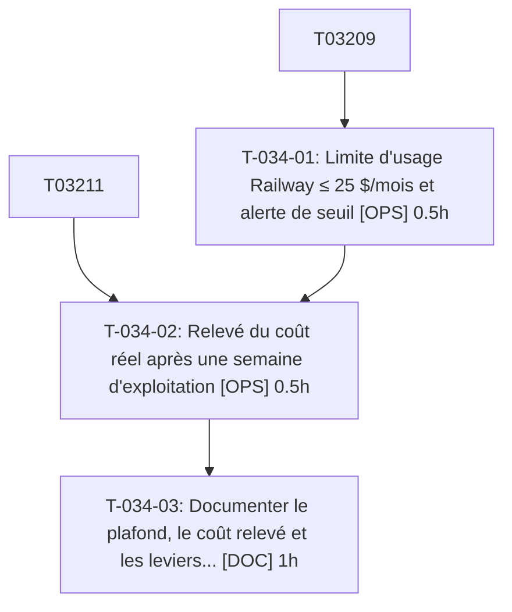

# Tâches — US-034 : Budget et mesure du coût

## Informations US

- **Epic** : EPIC-08
- **Persona** : Thibaut
- **Story Points** : 1
- **Sprint** : sprint-6-railway-securite
- **Dépendances** : US-032

## Résumé

En tant que Thibaut, je veux plafonner et suivre le coût, afin de rester sous 25 $ par mois.

## Vue d'ensemble des tâches

| ID | Type | Tâche | Estimation | Dépend de | Statut |
|----|------|-------|------------|-----------|--------|
| T-034-01 | [OPS] | Limite d'usage Railway ≤ 25 $/mois et alerte de seuil (externe) | 0.5h | T-032-09 | ✅ |
| T-034-02 | [OPS] | Relevé du coût réel après une semaine d'exploitation (externe) | 0.5h | T-032-11, T-034-01 | ➡️ sprint 7 |
| T-034-03 | [DOC] | Documenter le plafond, le coût relevé et les leviers (mise en veille, taille des services) | 1h | T-034-02 | ✅ |

**Total estimé : 2h**

---

## Détail des tâches

### T-034-01 — Limite d'usage Railway ≤ 25 $/mois et alerte de seuil

- **Type** : [OPS] — **action externe — exécutée par l'orchestrateur après accord déjà donné**
- **Estimation** : 0.5h
- **Dépend de** : T-032-09

**Description** :
action externe — exécutée par l'orchestrateur après accord déjà donné. Poser la limite dès la création du projet.

**Critères de validation** :
- [ ] Limite visible dans les paramètres du projet
- [ ] Alerte de seuil configurée

---

### T-034-02 — Relevé du coût réel après une semaine d'exploitation

- **Type** : [OPS] — **action externe — exécutée par l'orchestrateur après accord déjà donné**
- **Estimation** : 0.5h
- **Dépend de** : T-032-11, T-034-01

**Description** :
action externe — exécutée par l'orchestrateur après accord déjà donné. Relevé ≥ 7 jours après le premier déploiement, soit le 2026-10-23 au plus tôt si déployé avant ; si le déploiement est tardif, le relevé glisse au sprint 7.

**Critères de validation** :
- [ ] Coût par service relevé et projeté sur 30 jours
- [ ] Écart avec 25 $ documenté

---

### T-034-03 — Documenter le plafond, le coût relevé et les leviers (mise en veille, taille des services)

- **Type** : [DOC]
- **Estimation** : 1h
- **Dépend de** : T-034-02

**Description** :
Section coût du runbook.

**Fichiers (indicatifs)** :
- `docs/deploiement-railway.md`

**Critères de validation** :
- [ ] Coût projeté et leviers consignés

---

## Graphe de dépendances

## Résumé

| Type | Nb tâches | Heures |
|------|-----------|--------|
| [DOC] | 1 | 1h |
| [OPS] | 2 | 1h |
| **TOTAL** | **3** | **2h** |
