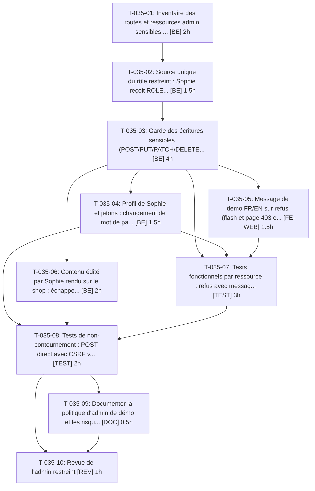

# Tâches — US-035 : Admin de démo restreint

## Informations US

- **Epic** : EPIC-09
- **Persona** : Sophie
- **Story Points** : 8
- **Sprint** : sprint-6-railway-securite
- **Dépendances** : US-009

## Résumé

En tant que Sophie, je veux un compte back-office public qui ne peut pas casser la démo, afin que chacun explore l'admin sans risque.

## Vue d'ensemble des tâches

| ID | Type | Tâche | Estimation | Dépend de | Statut |
|----|------|-------|------------|-----------|--------|
| T-035-01 | [BE] | Inventaire des routes et ressources admin sensibles (matrice route × méthode × décision) | 2h | — | ✅ |
| T-035-02 | [BE] | Source unique du rôle restreint : Sophie reçoit ROLE_DEMO_ADMIN depuis le catalogue de comptes | 1.5h | T-035-01 | ✅ |
| T-035-03 | [BE] | Garde des écritures sensibles (POST/PUT/PATCH/DELETE, actions de masse, surcharge `_method`) | 4h | T-035-02 | ✅ |
| T-035-04 | [BE] | Profil de Sophie et jetons : changement de mot de passe, e-mail, locale et création de jeton API refusés | 1.5h | T-035-03 | ✅ |
| T-035-05 | [FE-WEB] | Message de démo FR/EN sur refus (flash et page 403 explicite) | 1.5h | T-035-03 | ✅ |
| T-035-06 | [BE] | Contenu édité par Sophie rendu sur le shop : échappement ou nettoyage (XSS stocké, défiguration) | 2h | T-035-03 | ✅ |
| T-035-07 | [TEST] | Tests fonctionnels par ressource : refus avec message, lecture et reste de l'admin utilisables | 3h | T-035-03, T-035-04, T-035-05 | ✅ |
| T-035-08 | [TEST] | Tests de non-contournement : POST direct avec CSRF valide, `_method`, action de masse, XSS stocké | 2h | T-035-04, T-035-06, T-035-07 | ✅ |
| T-035-09 | [DOC] | Documenter la politique d'admin de démo et les risques acceptés | 0.5h | T-035-08 | ✅ |
| T-035-10 | [REV] | Revue de l'admin restreint | 1h | T-035-08, T-035-09 | ✅ |

**Total estimé : 19h**

---

## Détail des tâches

### T-035-01 — Inventaire des routes et ressources admin sensibles (matrice route × méthode × décision)

- **Type** : [BE]
- **Estimation** : 2h
- **Dépend de** : —
- **Constat tracé** : S4-R1, S2-R1

**Description** :
Lister administrateurs, canaux, passerelles et méthodes de paiement, URLs de webhooks, clés et jetons API, réglages de plugins contenant URL ou secret (PunchOut, webhooks, IA), profil de Sophie. Inclure les actions de masse et les routes AJAX.

**Fichiers (indicatifs)** :
- `docs/securite-admin-demo.md`

**Critères de validation** :
- [ ] Matrice complète, chaque ligne a une décision (refus / autorisé)
- [ ] Toute route d'écriture non listée est classée

---

### T-035-02 — Source unique du rôle restreint : Sophie reçoit ROLE_DEMO_ADMIN depuis le catalogue de comptes

- **Type** : [BE]
- **Estimation** : 1.5h
- **Dépend de** : T-035-01

**Description** :
Pas de comparaison d'e-mail en dur : le rôle est posé par la fixture à partir de `DemoAccountCatalog`.

**Fichiers (indicatifs)** :
- `src/Demo/DataFixtures/*`
- `src/Demo/Account/DemoAccountCatalog.php`

**Critères de validation** :
- [ ] Sophie porte le rôle après un chargement des fixtures
- [ ] Aucun autre compte ne le porte

---

### T-035-03 — Garde des écritures sensibles (POST/PUT/PATCH/DELETE, actions de masse, surcharge `_method`)

- **Type** : [BE]
- **Estimation** : 4h
- **Dépend de** : T-035-02
- **Constat tracé** : S4-R1, S2-R1

**Description** :
Écouteur de requête sur le pare-feu admin : pour ROLE_DEMO_ADMIN, refuse toute écriture sur les ressources de la matrice ; lecture autorisée. Refus par défaut des routes d'écriture non classées dans la zone sensible.

**Fichiers (indicatifs)** :
- `src/Demo/Security/DemoAdminWriteGuard.php`
- `config/services.yaml`

**Critères de validation** :
- [ ] Chaque écriture sensible de la matrice est refusée (403 ou redirection) avec le message de démo
- [ ] Les lectures de ces ressources restent possibles
- [ ] La surcharge `_method` et les actions de masse ne contournent pas la garde

---

### T-035-04 — Profil de Sophie et jetons : changement de mot de passe, e-mail, locale et création de jeton API refusés

- **Type** : [BE]
- **Estimation** : 1.5h
- **Dépend de** : T-035-03
- **Constat tracé** : S4-R1 (blocage)

**Description** :
Empêcher Sophie de verrouiller le compte public ou de créer des accès durables.

**Fichiers (indicatifs)** :
- `src/Demo/Security/DemoAdminWriteGuard.php`

**Critères de validation** :
- [ ] Changement de mot de passe de Sophie refusé (mot de passe inchangé après la requête)
- [ ] Aucun jeton créé

---

### T-035-05 — Message de démo FR/EN sur refus (flash et page 403 explicite)

- **Type** : [FE-WEB]
- **Estimation** : 1.5h
- **Dépend de** : T-035-03

**Description** :
Texte clair : action désactivée dans la démo publique, remise à zéro nocturne. Pas de détail interne.

**Fichiers (indicatifs)** :
- `translations/messages.fr.yaml`
- `translations/messages.en.yaml`
- `templates/bundles/TwigBundle/Exception/error403.html.twig`

**Critères de validation** :
- [ ] Le message apparaît en français et en anglais selon la locale de l'admin
- [ ] Le reste de l'admin n'affiche aucune alerte parasite

---

### T-035-06 — Contenu édité par Sophie rendu sur le shop : échappement ou nettoyage (XSS stocké, défiguration)

- **Type** : [BE]
- **Estimation** : 2h
- **Dépend de** : T-035-03
- **Constat tracé** : S4-R1 (défiguration)

**Description** :
Les champs riches (description produit, pages) modifiables par Sophie sont rendus côté public : vérifier l'échappement/le nettoyage et la limite de taille ; la défiguration résiduelle est acceptée par écrit car le reset nocturne la corrige.

**Fichiers (indicatifs)** :
- `templates/**`
- `docs/securite-admin-demo.md`

**Critères de validation** :
- [ ] Un `<script>` saisi par Sophie dans une description produit ne s'exécute pas dans le HTML rendu côté shop
- [ ] Acceptation écrite de la défiguration résiduelle (réparée par le reset de 03:00)

---

### T-035-07 — Tests fonctionnels par ressource : refus avec message, lecture et reste de l'admin utilisables

- **Type** : [TEST]
- **Estimation** : 3h
- **Dépend de** : T-035-03, T-035-04, T-035-05

**Description** :
Un test par ligne de la matrice : administrateurs, canaux, passerelles/méthodes de paiement, URLs de webhooks, clés/jetons API ; plus produits, commandes, clients modifiables.

**Fichiers (indicatifs)** :
- `tests/Functional/Demo/DemoAdminRestrictionTest.php`

**Critères de validation** :
- [ ] Scénario Gherkin US-035 couvert pour les 5 familles
- [ ] Modification d'un produit par Sophie : réussie

---

### T-035-08 — Tests de non-contournement : POST direct avec CSRF valide, `_method`, action de masse, XSS stocké

- **Type** : [TEST]
- **Estimation** : 2h
- **Dépend de** : T-035-04, T-035-06, T-035-07

**Description** :
Requêtes construites à la main, sans passer par l'interface.

**Fichiers (indicatifs)** :
- `tests/Functional/Demo/DemoAdminBypassTest.php`

**Critères de validation** :
- [ ] Aucune écriture sensible n'aboutit (comptage en base inchangé)
- [ ] Test XSS sur HTML rendu vert

---

### T-035-09 — Documenter la politique d'admin de démo et les risques acceptés

- **Type** : [DOC]
- **Estimation** : 0.5h
- **Dépend de** : T-035-08

**Description** :
Compléter ADR-0008 et la doc de sécurité.

**Fichiers (indicatifs)** :
- `docs/securite-admin-demo.md`
- `docs/adr/0008-securite-de-la-demo-publique.md`

**Critères de validation** :
- [ ] Doc relue

---

### T-035-10 — Revue de l'admin restreint

- **Type** : [REV]
- **Estimation** : 1h
- **Dépend de** : T-035-08, T-035-09

**Description** :
Relecture croisée de la matrice et de la garde.

**Critères de validation** :
- [ ] Revue consignée
- [ ] Aucune écriture sensible non classée

---

## Graphe de dépendances

## Résumé

| Type | Nb tâches | Heures |
|------|-----------|--------|
| [BE] | 5 | 11h |
| [DOC] | 1 | 0.5h |
| [FE-WEB] | 1 | 1.5h |
| [REV] | 1 | 1h |
| [TEST] | 2 | 5h |
| **TOTAL** | **10** | **19h** |
