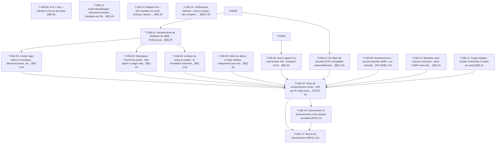

# Tâches — US-036 : Durcissement de la démo publique

## Informations US

- **Epic** : EPIC-09
- **Persona** : Thibaut
- **Story Points** : 8
- **Sprint** : sprint-6-railway-securite
- **Dépendances** : US-032

## Résumé

En tant que Thibaut, je veux limiter les abus, afin que la démo publique reste sûre.

## Vue d'ensemble des tâches

| ID | Type | Tâche | Estimation | Dépend de | Statut |
|----|------|-------|------------|-----------|--------|
| T-036-01 | [BE] | Infrastructure de limitation de débit : limiteurs par IP visiteur réelle (derrière le proxy) | 3h | T-032-02 | ✅ |
| T-036-02 | [BE] | Limiter login admin et boutique, /demo/accounts, inscription et formulaires publics | 2.5h | T-036-01 | ✅ |
| T-036-03 | [BE] | Simulateur PunchOut public : état signé à usage unique, limiteur par IP, plafond de commandes Acme anonymes | 4h | T-036-01 | ✅ |
| T-036-04 | [BE] | Limiteur de setup du plugin : le simulateur transmet l'IP visiteur (plus de 127.0.0.1 partagé) | 2.5h | T-036-01 | ✅ |
| T-036-05 | [BE] | Boîte de démo : e-mails visibles uniquement pour les destinataires des comptes de démo | 2h | — | ✅ |
| T-036-06 | [BE] | Aucun appel ni e-mail sortant réel : transport forcé vers Mailpit, client HTTP et webhooks sortants bornés | 3h | T-032-05 | ✅ |
| T-036-07 | [BE] | En-têtes de sécurité (CSP compatible assets/Stimulus, nosniff, frame, referrer, permissions, HSTS en HTTPS) | 2.5h | T-032-02 | ✅ |
| T-036-08 | [FE-WEB] | Avertissement « aucune donnée réelle » sur inscription, adresses et checkout (FR/EN) | 1.5h | — | ✅ |
| T-036-09 | [BE] | Prix « dès » calculé en lot sur les listes (glissable) | 3h | — | ➡️ sprint 7 |
| T-036-10 | [BE] | Bandeau sans session anonyme : jeton CSRF sans état et en-tête Vary: Cookie | 2h | — | ✅ |
| T-036-11 | [BE] | Pages légales : locales restreintes à celles du canal | 1h | — | ✅ |
| T-036-12 | [BE] | CsvProductReader : colonnes erronées, doublons de SKU inter-fichiers, attributes_json invalide, BOM/trim/encodage (glissable) | 4h | — | ➡️ sprint 7 |
| T-036-13 | [BE] | Réduire les ≈ 420 requêtes du reset (canaux, taxons et attributs préchargés) (glissable) | 2h | — | ➡️ sprint 7 |
| T-036-14 | [BE] | Vérifications latentes : source unique des comptes, ordre des fixtures, valeurs d'attribut traduites (glissable) | 1.5h | — | ➡️ sprint 7 |
| T-036-15 | [TEST] | Tests de comportement rendu : 429 par IP, rejeu simulateur, boîte filtrée, sortie bloquée, en-têtes, session, locale | 5h | T-036-02, T-036-03, T-036-04, T-036-05, T-036-06, T-036-07, T-036-08, T-036-10, T-036-11 | ✅ |
| T-036-16 | [DOC] | Documenter le durcissement et les risques acceptés | 1h | T-036-15 | ✅ |
| T-036-17 | [REV] | Revue du durcissement | 1.5h | T-036-15, T-036-16 | ✅ |

**Total estimé : 42h**

---

## Détail des tâches

### T-036-01 — Infrastructure de limitation de débit : limiteurs par IP visiteur réelle (derrière le proxy)

- **Type** : [BE]
- **Estimation** : 3h
- **Dépend de** : T-032-02
- **Constat tracé** : S2-R1, S5-R3 (socle)

**Description** :
Composant rate-limiter avec clé = IP visiteur résolue par les proxys de confiance ; limiteurs nommés et configurables par variable.

**Fichiers (indicatifs)** :
- `config/packages/rate_limiter.yaml`
- `src/Demo/Security/VisitorIpResolver.php`

**Critères de validation** :
- [ ] Deux IP visiteur distinctes ont des compteurs indépendants
- [ ] L'IP du proxy n'est jamais utilisée comme clé

---

### T-036-02 — Limiter login admin et boutique, /demo/accounts, inscription et formulaires publics

- **Type** : [BE]
- **Estimation** : 2.5h
- **Dépend de** : T-036-01
- **Constat tracé** : S2-R1 (rate-limiting)

**Description** :
Appliquer les limiteurs avec réponse 429 et en-tête Retry-After.

**Fichiers (indicatifs)** :
- `src/Demo/Security/RateLimitSubscriber.php`
- `config/packages/security.yaml`

**Critères de validation** :
- [ ] Après N tentatives de login depuis une IP, la N+1 renvoie 429 (réponse rendue)
- [ ] Une autre IP n'est pas bloquée
- [ ] /demo/accounts et l'inscription sont limités

---

### T-036-03 — Simulateur PunchOut public : état signé à usage unique, limiteur par IP, plafond de commandes Acme anonymes

- **Type** : [BE]
- **Estimation** : 4h
- **Dépend de** : T-036-01
- **Constat tracé** : S5-R1

**Description** :
Nonce stocké et consommé (rejeu refusé), expiration courte, limiteur par IP, plafond journalier de commandes Acme ; le secret de démo n'est jamais exposé ni utilisable depuis un client public sur `/punchout/cxml`.

**Fichiers (indicatifs)** :
- `src/Demo/PunchOutSimulator/SignedState.php`
- `src/Demo/Controller/PunchOutSimulatorController.php`

**Critères de validation** :
- [ ] Rejouer le même état signé une deuxième fois : refusé
- [ ] Plafond atteint : refus avec message de démo, pas de commande créée
- [ ] POST direct sur /punchout/cxml avec le secret de démo depuis un client non autorisé : refusé

---

### T-036-04 — Limiteur de setup du plugin : le simulateur transmet l'IP visiteur (plus de 127.0.0.1 partagé)

- **Type** : [BE]
- **Estimation** : 2.5h
- **Dépend de** : T-036-01
- **Constat tracé** : S5-R3

**Description** :
Le simulateur appelle le plugin en loopback : transmettre l'IP visiteur via en-tête de confiance (loopback de confiance) pour que le plugin limite par visiteur. Correctif du plugin lui-même au sprint 7.

**Fichiers (indicatifs)** :
- `src/Demo/PunchOutSimulator/EndpointClient.php`
- `config/services.yaml`

**Critères de validation** :
- [ ] Un visiteur qui épuise son quota setup n'empêche pas un deuxième visiteur (IP différente) de lancer un setup
- [ ] Aucun appel setup ne porte l'IP 127.0.0.1 comme identité

---

### T-036-05 — Boîte de démo : e-mails visibles uniquement pour les destinataires des comptes de démo

- **Type** : [BE]
- **Estimation** : 2h
- **Dépend de** : —
- **Constat tracé** : S5-R4

**Description** :
Liste blanche issue de `DemoAccountCatalog` ; les autres destinataires (adresses saisies par un visiteur) ne sont ni affichés ni accessibles par identifiant.

**Fichiers (indicatifs)** :
- `src/Demo/Mail/DemoMailbox.php`
- `src/Demo/Controller/DemoMailsController.php`

**Critères de validation** :
- [ ] Un e-mail envoyé à une adresse hors comptes de démo n'apparaît pas dans la boîte rendue
- [ ] Accès direct à son identifiant : 404

---

### T-036-06 — Aucun appel ni e-mail sortant réel : transport forcé vers Mailpit, client HTTP et webhooks sortants bornés

- **Type** : [BE]
- **Estimation** : 3h
- **Dépend de** : T-032-05
- **Constat tracé** : S2-R1 (mailer en puits)

**Description** :
En `DEMO_MODE=1`, démarrage en échec si `MAILER_DSN` n'est pas le Mailpit interne ; HttpClient scopé aux hôtes internes ; webhooks sortants dirigés vers le récepteur interne (ou désactivés).

**Fichiers (indicatifs)** :
- `config/packages/mailer.yaml`
- `config/packages/framework.yaml`
- `src/DependencyInjection/Compiler/*`

**Critères de validation** :
- [ ] Un DSN externe en DEMO_MODE=1 empêche le démarrage
- [ ] Une requête sortante vers un hôte externe lève une erreur (test avec client simulé)
- [ ] Un e-mail déclenché par la boutique n'atteint que Mailpit

---

### T-036-07 — En-têtes de sécurité (CSP compatible assets/Stimulus, nosniff, frame, referrer, permissions, HSTS en HTTPS)

- **Type** : [BE]
- **Estimation** : 2.5h
- **Dépend de** : T-032-02

**Description** :
Écouteur de réponse ou Caddy ; CSP en mode compatible avec les scripts du thème ; HSTS uniquement si HTTPS effectif.

**Fichiers (indicatifs)** :
- `src/Demo/Security/SecurityHeadersSubscriber.php`
- `docker/Caddyfile`

**Critères de validation** :
- [ ] Les réponses boutique, admin, erreurs 4xx/5xx et redirections portent tous les en-têtes attendus
- [ ] Aucune violation CSP dans la console sur les pages clés (accueil, produit, panier, admin)

---

### T-036-08 — Avertissement « aucune donnée réelle » sur inscription, adresses et checkout (FR/EN)

- **Type** : [FE-WEB]
- **Estimation** : 1.5h
- **Dépend de** : —
- **Constat tracé** : S4-R2

**Description** :
Décision : avertissement visible plutôt que désactivation de l'inscription ; traductions.

**Fichiers (indicatifs)** :
- `templates/**/register`
- `templates/**/checkout`
- `translations/messages.*.yaml`

**Critères de validation** :
- [ ] Le message est présent dans le HTML rendu de l'inscription, de l'adresse et du checkout en FR et en EN

---

### T-036-09 — Prix « dès » calculé en lot sur les listes

- **Type** : [BE]
- **Estimation** : 3h
- **Dépend de** : —
- **Constat tracé** : S4-R3
- **Glissable** : oui (voir README, alerte de capacité)

**Description** :
Remplacer le calcul produit par produit par une requête groupée par page de liste.

**Fichiers (indicatifs)** :
- `src/Demo/Theme/TierFromPriceProvider.php`

**Critères de validation** :
- [ ] Nombre de requêtes d'une liste de 24 produits constant (≤ valeur fixée) quelle que soit la taille de page
- [ ] Prix affichés identiques à l'existant

---

### T-036-10 — Bandeau sans session anonyme : jeton CSRF sans état et en-tête Vary: Cookie

- **Type** : [BE]
- **Estimation** : 2h
- **Dépend de** : —
- **Constat tracé** : S4-R4

**Description** :
Le jeton du bandeau ne doit pas ouvrir de session pour un visiteur anonyme ; si un cache est ajouté, `Vary: Cookie`.

**Fichiers (indicatifs)** :
- `templates/**/demo_banner.html.twig`
- `src/Demo/Controller/BadgeToggleController.php`
- `config/packages/framework.yaml`

**Critères de validation** :
- [ ] GET / anonyme ne renvoie pas de cookie de session (réponse rendue)
- [ ] Basculer un badge fonctionne avec le jeton sans état
- [ ] Vary: Cookie présent

---

### T-036-11 — Pages légales : locales restreintes à celles du canal

- **Type** : [BE]
- **Estimation** : 1h
- **Dépend de** : —
- **Constat tracé** : S4-R5

**Description** :
404 pour une locale hors canal.

**Fichiers (indicatifs)** :
- `src/Demo/Controller/LegalPagesController.php`

**Critères de validation** :
- [ ] /xx/mentions-legales avec une locale non activée : 404
- [ ] Locale du canal : 200

---

### T-036-12 — CsvProductReader : colonnes erronées, doublons de SKU inter-fichiers, attributes_json invalide, BOM/trim/encodage

- **Type** : [BE]
- **Estimation** : 4h
- **Dépend de** : —
- **Constat tracé** : S2-R3, S2-R4, S2-R5, S2-R6
- **Glissable** : oui (voir README, alerte de capacité)

**Description** :
Rejeter ou compter et journaliser les lignes fautives ; accumuler les SKU sur les 3 CSV ; valider attributes_json (type chaîne, code connu) ; retirer le BOM UTF-8, trimer les en-têtes, valider l'encodage.

**Fichiers (indicatifs)** :
- `src/Demo/DataFixtures/ProductCsvFixture.php`
- `src/Demo/**/CsvProductReader.php`

**Critères de validation** :
- [ ] Ligne à nombre de colonnes erroné : signalée (exception ou compteur)
- [ ] Même SKU dans deux fichiers : refusé
- [ ] attributes_json invalide / valeur non chaîne / code inconnu : signalé sans TypeError
- [ ] Fichier avec BOM et en-tête non trimé : lu correctement

---

### T-036-13 — Réduire les ≈ 420 requêtes du reset (canaux, taxons et attributs préchargés)

- **Type** : [BE]
- **Estimation** : 2h
- **Dépend de** : —
- **Constat tracé** : S2-R7
- **Glissable** : oui (voir README, alerte de capacité)

**Description** :
Mise en cache en mémoire des canaux, taxons et attributs pendant le chargement.

**Fichiers (indicatifs)** :
- `src/Demo/DataFixtures/ProductCsvFixture.php`

**Critères de validation** :
- [ ] Nombre de requêtes du chargement des produits mesuré avant/après, réduction ≥ 50 %

---

### T-036-14 — Vérifications latentes : source unique des comptes, ordre des fixtures, valeurs d'attribut traduites

- **Type** : [BE]
- **Estimation** : 1.5h
- **Dépend de** : —
- **Constat tracé** : S2-R8, S2-R9, S2-R10
- **Glissable** : oui (voir README, alerte de capacité)

**Description** :
Tests de garde : /demo/accounts lit la source partagée ; chargement des fixtures indépendant de l'ordre de priorités égales ; pas de valeur d'attribut créée en locale non traduisible.

**Fichiers (indicatifs)** :
- `tests/Functional/Demo/FixtureOrderTest.php`
- `src/Demo/Controller/DemoAccountsController.php`

**Critères de validation** :
- [ ] Les trois constats sont vérifiés par un test vert ou traités
- [ ] Résultat consigné dans review-findings

---

### T-036-15 — Tests de comportement rendu : 429 par IP, rejeu simulateur, boîte filtrée, sortie bloquée, en-têtes, session, locale

- **Type** : [TEST]
- **Estimation** : 5h
- **Dépend de** : T-036-02, T-036-03, T-036-04, T-036-05, T-036-06, T-036-07, T-036-08, T-036-10, T-036-11

**Description** :
Assertions sur les réponses HTTP et le HTML réellement rendus ; un test par constat reporté couvert par la story.

**Fichiers (indicatifs)** :
- `tests/Functional/Demo/HardeningTest.php`

**Critères de validation** :
- [ ] Un test vert par constat S2-R1, S4-R2, S4-R4, S4-R5, S5-R1, S5-R3, S5-R4
- [ ] Scénario Gherkin US-036 couvert

---

### T-036-16 — Documenter le durcissement et les risques acceptés

- **Type** : [DOC]
- **Estimation** : 1h
- **Dépend de** : T-036-15

**Description** :
Mettre à jour ADR-0008 et la doc de sécurité.

**Fichiers (indicatifs)** :
- `docs/adr/0008-securite-de-la-demo-publique.md`
- `docs/securite-admin-demo.md`

**Critères de validation** :
- [ ] Chaque constat S2/S4/S5 a un statut (corrigé / accepté avec justification)

---

### T-036-17 — Revue du durcissement

- **Type** : [REV]
- **Estimation** : 1.5h
- **Dépend de** : T-036-15, T-036-16

**Description** :
Relecture croisée.

**Critères de validation** :
- [ ] Revue consignée

---

## Graphe de dépendances

## Résumé

| Type | Nb tâches | Heures |
|------|-----------|--------|
| [BE] | 13 | 33h |
| [DOC] | 1 | 1h |
| [FE-WEB] | 1 | 1.5h |
| [REV] | 1 | 1.5h |
| [TEST] | 1 | 5h |
| **TOTAL** | **17** | **42h** |
