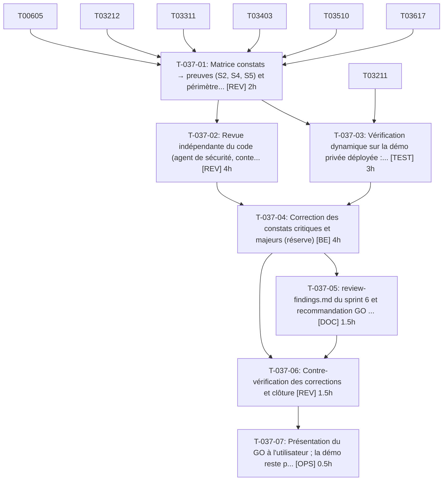

# Tâches — US-037 : Revue de sécurité avant ouverture

## Informations US

- **Epic** : EPIC-09
- **Persona** : Thibaut
- **Story Points** : 2
- **Sprint** : sprint-6-railway-securite
- **Dépendances** : US-035, US-036

## Résumé

En tant que Thibaut, je veux une revue de sécurité indépendante, afin d'ouvrir la démo sans faille connue.

## Vue d'ensemble des tâches

| ID | Type | Tâche | Estimation | Dépend de | Statut |
|----|------|-------|------------|-----------|--------|
| T-037-01 | [REV] | Matrice constats → preuves (S2, S4, S5) et périmètre de la revue | 2h | T-032-12, T-033-11, T-034-03, T-035-10, T-036-17 | 🔲 |
| T-037-02 | [REV] | Revue indépendante du code (agent de sécurité, contexte frais, OWASP 2025) | 4h | T-037-01 | 🔲 |
| T-037-03 | [TEST] | Vérification dynamique sur la démo privée déployée : 401, en-têtes, cookies Secure, 429, hôtes, Mailpit (externe) | 3h | T-037-01, T-032-11 | 🔲 |
| T-037-04 | [BE] | Correction des constats critiques et majeurs (réserve) | 4h | T-037-02, T-037-03 | 🔲 |
| T-037-05 | [DOC] | review-findings.md du sprint 6 et recommandation GO / NO-GO | 1.5h | T-037-04 | 🔲 |
| T-037-06 | [REV] | Contre-vérification des corrections et clôture | 1.5h | T-037-04, T-037-05 | 🔲 |
| T-037-07 | [OPS] | Présentation du GO à l'utilisateur ; la démo reste privée tant que le GO n'est pas donné | 0.5h | T-037-06 | 🔲 |

**Total estimé : 16.5h**

---

## Détail des tâches

### T-037-01 — Matrice constats → preuves (S2, S4, S5) et périmètre de la revue

- **Type** : [REV]
- **Estimation** : 2h
- **Dépend de** : T-032-12, T-033-11, T-034-03, T-035-10, T-036-17

**Description** :
Construire la matrice : chaque constat reporté, la tâche qui le traite, le test ou la preuve. Définir le périmètre.

**Fichiers (indicatifs)** :
- `project-management/sprints/sprint-6-railway-securite/review-findings.md`

**Critères de validation** :
- [ ] Tous les constats du sprint goal figurent dans la matrice avec une preuve ou une acceptation écrite

---

### T-037-02 — Revue indépendante du code (agent de sécurité, contexte frais, OWASP 2025)

- **Type** : [REV]
- **Estimation** : 4h
- **Dépend de** : T-037-01

**Description** :
Revue par un relecteur n'ayant pas écrit le code : contrôle d'accès, injections, CSRF, XSS, SSRF, secrets, dépendances.

**Fichiers (indicatifs)** :
- `review-findings.md`

**Critères de validation** :
- [ ] Constats classés critique / majeur / mineur
- [ ] Aucun secret dans le dépôt

---

### T-037-03 — Vérification dynamique sur la démo privée déployée : 401, en-têtes, cookies Secure, 429, hôtes, Mailpit

- **Type** : [TEST] — **action externe — exécutée par l'orchestrateur après accord déjà donné**
- **Estimation** : 3h
- **Dépend de** : T-037-01, T-032-11

**Description** :
action externe — exécutée par l'orchestrateur après accord déjà donné. Exécutée depuis l'extérieur avec les identifiants d'authentification basique ; aucune ouverture publique.

**Fichiers (indicatifs)** :
- `review-findings.md`

**Critères de validation** :
- [ ] Chaque contrôle est vérifié sur la réponse réelle
- [ ] Mailpit et base non joignables depuis Internet

---

### T-037-04 — Correction des constats critiques et majeurs (réserve)

- **Type** : [BE]
- **Estimation** : 4h
- **Dépend de** : T-037-02, T-037-03

**Description** :
Volume inconnu : réserve de fin de sprint ; tout dépassement est signalé.

**Critères de validation** :
- [ ] Chaque constat critique ou majeur est corrigé avec un test de non-régression

---

### T-037-05 — review-findings.md du sprint 6 et recommandation GO / NO-GO

- **Type** : [DOC]
- **Estimation** : 1.5h
- **Dépend de** : T-037-04

**Description** :
Statut de chaque constat (corrigé, accepté par écrit) ; recommandation explicite.

**Fichiers (indicatifs)** :
- `review-findings.md`

**Critères de validation** :
- [ ] Aucun constat critique ou majeur ouvert
- [ ] Recommandation écrite

---

### T-037-06 — Contre-vérification des corrections et clôture

- **Type** : [REV]
- **Estimation** : 1.5h
- **Dépend de** : T-037-04, T-037-05

**Description** :
Revérifier chaque correction par le relecteur indépendant.

**Critères de validation** :
- [ ] Constats clos confirmés par le relecteur

---

### T-037-07 — Présentation du GO à l'utilisateur ; la démo reste privée tant que le GO n'est pas donné

- **Type** : [OPS]
- **Estimation** : 0.5h
- **Dépend de** : T-037-06

**Description** :
Ne pas retirer l'authentification basique. L'ouverture publique est hors sprint et décidée explicitement par l'utilisateur.

**Critères de validation** :
- [ ] Démo toujours protégée par l'authentification basique à la clôture du sprint

---

## Graphe de dépendances

## Résumé

| Type | Nb tâches | Heures |
|------|-----------|--------|
| [BE] | 1 | 4h |
| [DOC] | 1 | 1.5h |
| [OPS] | 1 | 0.5h |
| [REV] | 3 | 7.5h |
| [TEST] | 1 | 3h |
| **TOTAL** | **7** | **16.5h** |
