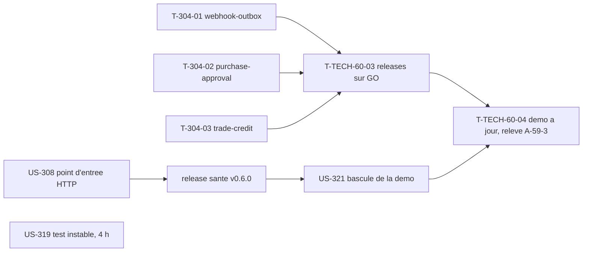

# Sprint 60 — Sondes des plugins B2B et santé exposée en HTTP

**Durée** : 2027-01-21 → 2027-02-04. C'est le créneau prévisionnel, comme pour les sprints 54 à 59 ; l'exécution réelle commence le 2026-11-27.
**Capacité** : 15 points + tâches techniques
**Engagement** : **14 points (4 stories), soit 93 % de la capacité** + 4 tâches techniques (deux faites à la planification)

## Sprint Goal

Les trois plugins B2B les plus exposés remontent leur propre état sur la page de santé, et la démo est surveillée par le point d'entrée HTTP du plugin au lieu de son `/healthz` maison.

## Stories

| ID | Titre | Dépôt | Points | MoSCoW |
|----|-------|-------|--------|--------|
| [US-304](../../backlog/user-stories/US-304.md) | Sondes des plugins B2B (lot 1) : webhook-outbox, purchase-approval, trade-credit | 3 plugins | 5 | Must |
| [US-308](../../backlog/user-stories/US-308.md) | Point d'entrée HTTP JSON protégé par jeton, deux niveaux de détail, limitation de débit | `sylius-platform-health-plugin` | 5 | Must |
| [US-321](../../backlog/user-stories/US-321.md) | Démo : `/healthz` servi par le point d'entrée du plugin de santé | `sylius-b2b-demo` | 2 | Must |
| [US-319](../../backlog/user-stories/US-319.md) | Dette : `AdminOrderBulkActionsTest` instable | `sylius-bulk-actions-plugin` | 2 | Should |

## Décisions de cadrage (2026-11-27)

Arbitrages de Thibaut, le 2026-11-27 :

1. **Périmètre** : US-304, US-308 et US-319, puis US-321 issue du découpage d'US-308 (14 points).
2. **US-319 : enquête bornée à 4 h.** Au-delà, le journal d'un échec en CI est conservé et la suite lui est soumise.
3. **`/healthz` de la démo remplacé** par le point d'entrée du plugin (question 4 d'EPIC-23), pas gardé à côté.
4. **Lot 1 d'US-304 confirmé** : webhook-outbox, purchase-approval, trade-credit (question 3 d'EPIC-22).
5. **Niveau « vivant » sans jeton, désactivé par défaut** (US-308) : 200 ou 503, corps vide, pour le contrôle de santé de Railway, qui n'envoie pas d'en-tête.
6. **Seuils des sondes d'US-304** validés (tableaux de cas des fiches).
7. **Actions A-59-1 à A-59-3 approuvées** ; ROTI du sprint 59 : 5. Option A pour `unknown` (code 1 inchangé) et US-320 au backlog (revue du sprint 59).

## Décisions en cours de sprint

| Date | Décision | Par |
|------|----------|-----|

## Découpage

| Tâche | Story | Type | Contenu | Heures |
|-------|-------|------|---------|--------|
| T-304-01 à 03 | US-304 | TEST, BE, DOC | [US-304-tasks.md](tasks/US-304-tasks.md) | 10 h |
| T-308-01 à 03 | US-308 | TEST, BE, DOC | [US-308-tasks.md](tasks/US-308-tasks.md) | 7 h |
| T-321-01 et 02 | US-321 | BE, OPS | [US-321-tasks.md](tasks/US-321-tasks.md) | 5 h |
| T-319-01 et 02 | US-319 | TEST | [US-319-tasks.md](tasks/US-319-tasks.md) | 6 h |
| T-TECH-60-01 | — | OPS | Sprint 59 clos (ROTI 5, A-59 approuvées), `current_sprint` 60, sprint 60 planifié, fiches US-304, US-308 et US-321 | 1,5 h |
| T-TECH-60-02 | — | DOC | **A-59-1 à A-59-3** : règles 35, 36 et 37 de la consigne des workers | 0,5 h |
| T-TECH-60-03 | — | OPS | Releases santé v0.6.0, webhook-outbox v1.1.0, purchase-approval v1.5.0, trade-credit v1.2.0, sur GO de Thibaut, après toute la documentation (règle 30) | 2 h |
| T-TECH-60-04 | — | OPS | **Dernière tâche** : démo à jour des trois plugins ; `compat-refresh` puis `proof-refresh` relus ; CI de `main` suivie ; relevé `tmonier:health:check` après déploiement (A-59-3), sondes de la catégorie Plugins vues sur la page | 1,5 h |

**Total** : 33,5 h, dont 2 h faites à la planification (T-TECH-60-01, T-TECH-60-02).

## Actions de Thibaut (hors capacité)

- **GO des quatre releases**, puis Packagist.
- **Railway** : variables de jeton de `/healthz` (US-321), aucune valeur dans le dépôt.
- **A-57-4, 2026-12-01** : relevé Railway par service.

## Contrainte d'exécution

- **Trois dépôts d'US-304 en parallèle** (aucun fichier commun) ; chacun s'appuie sur santé v0.5.0, déjà publiée.
- **Plugin de santé** : US-308 seule dans ce dépôt ce sprint.
- **US-321 après la release santé v0.6.0** : la démo exige `^0.6`. La release v0.6.0 peut précéder les trois autres (règle 30 : elle ne porte que la documentation d'US-308).
- **US-319** : en parallèle, dans son dépôt.
- **A-59-1** sans objet : aucune story ne touche au schéma de la démo. **A-59-3** s'applique à chaque déploiement de la démo (US-321, T-TECH-60-04).

## Ordre d'exécution

## Portes

- `main` de la démo et des plugins verts avant de commencer, et **suivis après chaque fusion** (règle 32).
- **Rouge valide = échec d'assertion vu en CI dans le run du SHA poussé, suites unitaire et non unitaire** (règle 26), démo comprise.
- Une ligne de test par ligne des tableaux de cas (règle 33).
- Une PR de la démo qui ajoute ou retire un fichier `*Test.php` embarque `proof.json` rafraîchi (règle 34).
- Après chaque déploiement de la démo : relevé `tmonier:health:check --format=json` noté dans la PR de suivi (règle 37).
- Aucun tag sans GO de Thibaut ; fusions par Thibaut ; Packagist par Thibaut ; aucune écriture en production sans GO.
