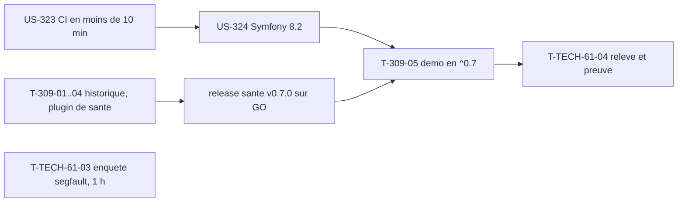

# Sprint 61 — Historique de santé, Symfony 8.2 et CI plus rapide

**Durée** : 2027-02-04 → 2027-02-18. C'est le créneau prévisionnel, comme pour les sprints 54 à 60 ; l'exécution réelle commence le 2026-11-28.
**Capacité** : 15 points + tâches techniques
**Engagement** : **11 points (3 stories), soit 73 % de la capacité** + 4 tâches techniques (deux faites à la planification). La marge couvre le schéma de la démo touché par US-309 (règles 35 et 36) et les risques de la montée de Symfony.

## Sprint Goal

Le plugin de santé garde trente jours d'historique et montre si une sonde empire, la démo passe en Symfony 8.2 avant la fin de support de 8.1, et sa CI rend son verdict en moins de 10 minutes.

## Stories

| ID | Titre | Dépôt | Points | MoSCoW |
|----|-------|-------|--------|--------|
| [US-309](../../backlog/user-stories/US-309.md) | Historique : instantané périodique, frise par sonde sur 30 jours, purge configurable | `sylius-platform-health-plugin`, puis démo | 5 | Must |
| [US-324](../../backlog/user-stories/US-324.md) | Démo en Symfony 8.2 avant la fin de support de Symfony 8.1 | `sylius-b2b-demo` | 3 | Should |
| [US-323](../../backlog/user-stories/US-323.md) | Dette : le job « Quality and smoke tests » en moins de 10 minutes | `sylius-b2b-demo` | 3 | Should |

## Décisions de cadrage (2026-11-28)

Arbitrages de Thibaut, le 2026-11-28 :

1. **Périmètre** : US-309, US-323 et une nouvelle story pour la montée de Symfony, US-324 (11 points). US-300 à US-302 (sondes métier, Must d'EPIC-22) restent au backlog.
2. **US-309, relevé** : commande `tmonier:health:record` lancée par le cron de l'hôte ; elle purge aussi.
3. **US-309, contenu** : statut seul (identifiant, catégorie, statut, date), sans résumé.
4. **US-309, forme** : frise d'une case par jour (pire statut du jour), rendue côté serveur, sans JavaScript.
5. **US-309, rétention** : 30 jours par défaut, configurable.
6. **Actions A-60-1 à A-60-3 approuvées** ; ROTI du sprint 60 : 5.

## Décisions en cours de sprint

| Date | Décision | Par |
|------|----------|-----|

## Découpage

| Tâche | Story | Type | Contenu | Heures |
|-------|-------|------|---------|--------|
| T-309-01 à 05 | US-309 | DB, BE, FE-WEB, DOC, OPS | [US-309-tasks.md](tasks/US-309-tasks.md) | 14 h |
| T-324-01 à 03 | US-324 | OPS, TEST, DOC | [US-324-tasks.md](tasks/US-324-tasks.md) | 6 h |
| T-323-01 à 04 | US-323 | OPS, TEST, DOC | [US-323-tasks.md](tasks/US-323-tasks.md) | 9 h |
| T-TECH-61-01 | — | OPS | Sprint 60 clos (ROTI 5, A-60 approuvées), `current_sprint` 61, sprint 61 planifié, fiches US-309 et US-324 | 1,5 h |
| T-TECH-61-02 | — | DOC | **A-60-1 et A-60-2** : règles 38 et 39 de la consigne des workers | 0,5 h |
| T-TECH-61-03 | — | TEST | **A-60-3** : enquête bornée à 1 h sur l'erreur de segmentation de `sylius-php:8.5-alpine` pendant les fixtures de la démo ; contournement ou limite écrite dans `docs/tests-locaux.md` | 1 h |
| T-TECH-61-04 | — | OPS | **Dernière tâche** : `compat-refresh` puis `proof-refresh` relus ; CI de `main` suivie ; relevé `tmonier:health:check` après déploiement, `environment.symfony_version` en `ok` et frise visible sur la page | 1,5 h |

**Total** : 33,5 h, dont 2 h faites à la planification (T-TECH-61-01, T-TECH-61-02).

## Actions de Thibaut (hors capacité)

- **GO de la release santé v0.7.0**, puis Packagist.
- **GO de l'écriture en production** si la migration d'US-309 en demande une hors du preDeploy (aucune prévue).
- **A-57-4, 2026-12-01** : relevé Railway par service.

## Contrainte d'exécution

- **Plugin de santé** : US-309 seule dans ce dépôt ce sprint (T-309-01 à T-309-04), en parallèle de la démo dès le début.
- **Démo, une PR à la fois** (pas de PR empilées) : US-323 d'abord, pour que tous les runs suivants profitent de la CI rapide ; puis US-324 ; puis T-309-05 après la release v0.7.0 ; enfin T-TECH-61-04.
- **A-59-1 s'applique à T-309-05** : `doctrine:schema:update --dump-sql` relevé en lecture seule en production avant le premier test, écrit dans la fiche. **A-59-2** : la migration de la table d'historique est celle du plugin ; aucun `IF NOT EXISTS` dans la démo sans test de la table préexistante.
- **A-59-3** s'applique à chaque déploiement de la démo (US-323 n'en change pas le code, US-324, T-309-05, T-TECH-61-04).

## Ordre d'exécution

## Portes

- `main` de la démo et du plugin de santé verts avant de commencer, et **suivis après chaque fusion** (règle 32).
- **Rouge valide = échec d'assertion vu en CI dans le run du SHA poussé, suites unitaire et non unitaire** (règle 26), démo comprise.
- Une ligne de test par ligne des tableaux de cas (règle 33).
- Une PR de la démo qui ajoute ou retire un fichier `*Test.php` embarque `proof.json` rafraîchi (règle 34).
- `--dump-sql` de production avant une story de schéma, pas de `IF NOT EXISTS` sans test de la table préexistante (règles 35 et 36).
- Après chaque déploiement de la démo : relevé `tmonier:health:check --format=json` noté dans la PR de suivi (règle 37).
- **Rien n'est poussé pendant que le run du rouge tourne ; le vert et les commits de suivi sont regroupés en un seul push quand c'est possible** (règle 38, A-60-1).
- **Tout test ajouté, y compris une garde de configuration, a son commit rouge poussé avant le correctif** (règle 39, A-60-2).
- Aucun tag sans GO de Thibaut ; fusions par Thibaut ; Packagist par Thibaut ; aucune écriture en production sans GO.
