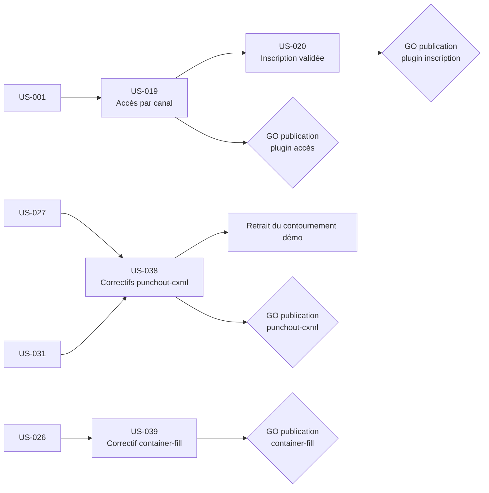

# Sprint 7 — Plugins et intégrations

## Informations

| Attribut | Valeur |
|----------|--------|
| Numéro | 7 |
| Nom | plugins-et-integrations |
| Début | 2026-10-16 |
| Fin | 2026-10-30 |
| Durée | 10 jours ouvrés |
| Points engagés | 27 (4 stories, ≈ 121,5 h décomposées) |
| Branche | `feature/sprint-7-plugins-et-integrations` |

## Sprint Goal

> Livrer deux nouveaux plugins publiés (accès par canal, inscription validée) et les intégrer à la démo, et corriger à la source les plugins punchout-cxml et container-fill.

## Décisions utilisateur (2026-10-16)

1. US-019 et US-020 sont réalisées dans ce sprint comme **plugins autonomes publiés** (dépôts dédiés `tmonier/sylius-*`, CI, Packagist, revue de sécurité), puis intégrées dans la démo. Modèle de dépôt : les plugins existants du dossier parent (ex. `sylius-company-accounts-plugin`).
2. Quatre nouvelles stories : US-038 (punchout-cxml), US-039 (container-fill), US-040 (durcissement complémentaire), US-041 (qualité des données et du reset).
3. **Toute publication d'une version de plugin (tag, Packagist) est soumise au GO explicite de l'utilisateur, plugin par plugin.** Aucune commande externe (railway, gh, push, `composer require`) sans accord.
4. **Arbitrage de capacité (après décomposition : 210 h pour 34 pts)** : le sprint 7 est recentré sur les plugins (27 pts) ; les stories de démo, de durcissement et de qualité passent au sprint 8 « sprint-8-demo-et-durcissement » (voir « Arbitrage de capacité »).

## Périmètre

- Nouveaux plugins publiés : mode d'accès par canal (US-019), inscription validée par l'admin (US-020), puis intégration dans la démo.
- Correctifs de plugins existants : punchout-cxml (US-038), container-fill (US-039) ; retrait du contournement `App\PunchOut\AuthorizedPunchOutOrderFactory` de la démo après publication de punchout-cxml.

Hors périmètre (sprint 8) : récepteur de webhooks (US-029), guide MCP (US-030), spike mode worker FrankenPHP (US-006), durcissement complémentaire (US-040), qualité des données et du reset (US-041). Hors périmètre aussi : ouverture publique de la démo (GO explicite de l'utilisateur distinct, voir sprint 6), exposition publique de Mailpit.

## Sprint Backlog

| ID | Titre | Points | Heures | Epic | Dépend de | Statut |
|----|-------|--------|--------|------|-----------|--------|
| US-019 | Mode d'accès par canal (plugin publié) | 8 | 41,5 h | EPIC-04 | US-001 | 🔵 To Do |
| US-020 | Inscription validée par l'admin (plugin publié) | 8 | 40 h | EPIC-04 | US-019 | 🔵 To Do |
| US-038 | Correctifs du plugin punchout-cxml | 8 | 30,5 h | EPIC-07 | US-027, US-031 | 🔵 To Do |
| US-039 | Correctif du plugin container-fill | 3 | 9,5 h | EPIC-07 | US-026 | 🔵 To Do |

**Total engagé : 27 points, 4 stories, 59 tâches, 121,5 h** (source de vérité : `.bmad/sprint-status.yaml`). Détail : [tasks/README.md](./tasks/README.md).

## Arbitrage de capacité

- **Constat** : la décomposition du 2026-10-16 donne 210 h pour 34 points (6,2 h/pt) contre ≈ 126 h de capacité de référence (3,7 h/pt), soit 167 %. Cause principale : deux plugins complets (dépôt, CI, tests, revue de sécurité, release, intégration).
- **Décision de l'utilisateur (2026-10-16)** : sprint 7 = plugins, 27 points (US-019, US-020, US-038, US-039), ≈ 121,5 h. Les 88,5 h restantes passent au sprint 8.
- **Part au sprint 8** (« sprint-8-demo-et-durcissement », planifié) : US-006 (2 pts, 7 h), US-029 (3 pts, 14 h), US-030 (2 pts, 7 h), US-040 (5 pts, 30 h), US-041 (5 pts, 30,5 h), soit 17 points. Leurs fichiers de tâches sont dans `sprints/sprint-8-demo-et-durcissement/tasks/`.
- **Effet** : le sprint 7 reste chargé (≈ 121,5 h pour 27 pts, 4,5 h/pt) mais 9 h sont des attentes de GO ou d'actions externes ; leviers si besoin : intégration de démo d'US-020 (T-020-15/16) si le GO n'arrive pas, puis US-039 (Should).
- Les attentes de GO ne consomment pas de temps de développement : enchaîner les autres plugins pendant ces attentes.

## Traçabilité des éléments reportés

| Élément | Origine | Story |
|---------|---------|-------|
| Commande PunchOut « invitée » + contournement démo | Sprint 5 review | US-038 (a) |
| R1 interfaces Doctrine | Sprint 3 review | US-038 (b) |
| R2 événement de création (et R6 libellé des notes) | Sprint 3 review | US-038 (c) |
| R3 guard de workflow `complete` | Sprint 3 review | US-038 (d) |
| R5 container-fill sans données logistiques | Sprint 3 review | US-039 |

Les éléments du sprint 6 reportés (US-006, US-029, US-030, M2/M4/M5/M6/M8, S2-R3 à R10, S4-R3, T-033-05, T-034-02) sont tracés dans [le sprint 8](../sprint-8-demo-et-durcissement/tasks/README.md).

## Ordre de réalisation recommandé

1. Chemin critique (publication soumise au GO) : US-019, puis US-020 (démarre sur le contrat T-019-04, pas sur la publication).
2. En parallèle, courts et indépendants : US-038, puis US-039.
3. Intégration des plugins dans la démo après validation et revue de sécurité ; retrait du contournement punchout après publication d'US-038.
4. Revue de sécurité de chaque plugin avant la demande de GO correspondante.

## Dépendances inter-stories

## Jalons de décision

| Jalon | Décision | Conséquence |
|-------|----------|-------------|
| GO publication du plugin d'accès (US-019) | Explicite, utilisateur | Sans GO : plugin non tagué, intégration démo par chemin local uniquement |
| GO publication du plugin d'inscription (US-020) | Explicite, utilisateur, après US-019 | Idem |
| GO publication punchout-cxml (US-038) | Explicite, utilisateur | Sans GO : contournement démo conservé |
| GO publication container-fill (US-039) | Explicite, utilisateur | Sans GO : correctif en branche |

## Definition of Done (rappel)

- [ ] Critères d'acceptation automatisés (tests fonctionnels ou de fumée) et verts
- [ ] ECS et PHPStan passent (code de la démo et des plugins)
- [ ] Libellés en français et en anglais si interface
- [ ] Aucun secret ni identifiant réel dans le dépôt
- [ ] Documentation mise à jour (README des plugins, démo)
- [ ] CI verte sur la branche `feature/sprint-7-plugins-et-integrations` et sur chaque dépôt de plugin
- [ ] Nouveaux plugins : revue de sécurité sans constat critique ou majeur ouvert avant la demande de GO

## Risques identifiés

| Risque | Probabilité | Impact | Mitigation |
|--------|-------------|--------|------------|
| Volume : 27 points avec deux nouveaux plugins complets (dépôt, CI, Packagist, revue), ≈ 121,5 h | Élevée | Élevé | Reste de la charge déjà déplacé au sprint 8 ; priorité US-019, US-020, US-038 ; US-039 sacrifiable |
| Deux nouveaux plugins à publier, GO explicite par plugin (4 jalons) | Élevée | Moyen | Préparer tag et notes de version, demander les GO groupés mais séparés ; sans GO, livrer en branche et intégrer par chemin local |
| US-020 dépend d'US-019 (l'inscription validée suppose le mode d'accès) | Certaine | Moyen | Interface publique d'US-019 figée tôt (T-019-04) ; US-020 démarre sur le contrat, pas sur la publication |
| Retrait du contournement démo conditionné à la publication de punchout-cxml (US-038) | Certaine | Moyen | Contournement conservé jusqu'à publication ; retrait en dernière étape (T-038-13) et test de non-régression PunchOut |
| Régression de sécurité par l'intégration des plugins d'accès (routes exemptées PunchOut, MCP, feeds) | Moyenne | Élevé | Tests de routes exemptées, revue de sécurité des plugins, `HardeningTest` (repris au sprint 8, T-040-12) |
| Chevauchement de dates avec le sprint 6 (mêmes dates dans `sprint-status.yaml`) | Moyenne | Moyen | Branches distinctes, vérifier `git fetch` et la branche courante avant tout commit |
| Pas de wkhtmltopdf ni peu de disque en local | Certaine | Faible | Tests concernés en CI, éviter les rebuilds d'images |

## Cérémonies

| Cérémonie | Date indicative | Durée |
|-----------|----------------|-------|
| Sprint Planning Part 1 (Quoi) | 2026-10-16 | 2 h |
| Sprint Planning Part 2 (Comment) | 2026-10-16 | 2 h |
| Daily Scrum | Chaque jour | 15 min |
| Affinage Backlog | 2026-10-23 (mid-sprint, préparation du sprint 8) | 1 h |
| Sprint Review | 2026-10-30 (matin) | 1 h |
| Rétrospective | 2026-10-30 (après-midi) | 1 h 30 |
