# Task Board — Sprint 7 (Plugins et intégrations)

## Légende

- 🔲 À faire
- 🔄 En cours
- 👀 En review
- ✅ Terminé
- ⏳ En attente du GO utilisateur
- 🚫 Bloqué

---

## Graphe de dépendances global

```mermaid
graph TD
    subgraph US019["US-019 Mode d'accès par canal (plugin publié) (41.5h)"]
        T01901["T-019-01 [BE] 3h"]
        T01902["T-019-02 [OPS] 2h"]
        T01903["T-019-03 [DB] 2.5h"]
        T01904["T-019-04 [BE] 1.5h"]
        T01905["T-019-05 [BE] 4h"]
        T01906["T-019-06 [FE-WEB] 3h"]
        T01907["T-019-07 [BE] 2.5h"]
        T01908["T-019-08 [FE-WEB] 2h"]
        T01909["T-019-09 [TEST] 5h"]
        T01910["T-019-10 [DOC] 1.5h"]
        T01911["T-019-11 [REV] 3h"]
        T01912["T-019-12 [BE] 2h"]
        T01913["T-019-13 [OPS] 1h"]
        T01914["T-019-14 [OPS] 1h"]
        T01915["T-019-15 [OPS] 1.5h"]
        T01916["T-019-16 [BE] 2.5h"]
        T01917["T-019-17 [TEST] 2.5h"]
        T01918["T-019-18 [OPS] 1h"]
    end
    subgraph US020["US-020 Inscription validée par l'admin (plugin publié) (40h)"]
        T02001["T-020-01 [BE] 2.5h"]
        T02002["T-020-02 [OPS] 1.5h"]
        T02003["T-020-03 [DB] 2.5h"]
        T02004["T-020-04 [BE] 3h"]
        T02005["T-020-05 [BE] 3.5h"]
        T02006["T-020-06 [BE] 2.5h"]
        T02007["T-020-07 [FE-WEB] 4h"]
        T02008["T-020-08 [TEST] 5h"]
        T02009["T-020-09 [DOC] 1.5h"]
        T02010["T-020-10 [REV] 3h"]
        T02011["T-020-11 [BE] 2h"]
        T02012["T-020-12 [OPS] 1h"]
        T02013["T-020-13 [OPS] 1h"]
        T02014["T-020-14 [OPS] 1.5h"]
        T02015["T-020-15 [BE] 2h"]
        T02016["T-020-16 [TEST] 2.5h"]
        T02017["T-020-17 [OPS] 1h"]
    end
    subgraph US038["US-038 Correctifs du plugin punchout-cxml (30.5h)"]
        T03801["T-038-01 [TEST] 3h"]
        T03802["T-038-02 [BE] 2h"]
        T03803["T-038-03 [BE] 3h"]
        T03804["T-038-04 [OPS] 1h"]
        T03805["T-038-05 [BE] 2.5h"]
        T03806["T-038-06 [BE] 3.5h"]
        T03807["T-038-07 [TEST] 3h"]
        T03808["T-038-08 [DOC] 1h"]
        T03809["T-038-09 [REV] 2h"]
        T03810["T-038-10 [OPS] 0.5h"]
        T03811["T-038-11 [OPS] 1h"]
        T03812["T-038-12 [BE] 1.5h"]
        T03813["T-038-13 [BE] 1.5h"]
        T03814["T-038-14 [BE] 1.5h"]
        T03815["T-038-15 [TEST] 2.5h"]
        T03816["T-038-16 [REV] 1h"]
    end
    subgraph US039["US-039 Correctif du plugin container-fill (9.5h)"]
        T03901["T-039-01 [TEST] 2h"]
        T03902["T-039-02 [BE] 2.5h"]
        T03903["T-039-03 [OPS] 0.5h"]
        T03904["T-039-04 [DOC] 0.5h"]
        T03905["T-039-05 [REV] 1h"]
        T03906["T-039-06 [OPS] 0.5h"]
        T03907["T-039-07 [OPS] 1h"]
        T03908["T-039-08 [BE] 1.5h"]
    end
    T01901 --> T01902
    T01901 --> T01903
    T01901 --> T01904
    T01903 --> T01905
    T01904 --> T01905
    T01904 --> T01906
    T01904 --> T01907
    T01903 --> T01908
    T01905 --> T01909
    T01906 --> T01909
    T01907 --> T01909
    T01908 --> T01909
    T01909 --> T01910
    T01909 --> T01911
    T01910 --> T01911
    T01911 --> T01912
    T01912 --> T01913
    T01913 --> T01914
    T01914 --> T01915
    T01912 --> T01916
    T01916 --> T01917
    T01915 --> T01918
    T01917 --> T01918
    T01904 --> T02001
    T01901 --> T02001
    T02001 --> T02002
    T02001 --> T02003
    T02003 --> T02004
    T02004 --> T02005
    T01905 --> T02005
    T02004 --> T02006
    T02004 --> T02007
    T02005 --> T02008
    T02006 --> T02008
    T02007 --> T02008
    T02008 --> T02009
    T02008 --> T02010
    T02009 --> T02010
    T02010 --> T02011
    T02011 --> T02012
    T02012 --> T02013
    T02013 --> T02014
    T01915 --> T02014
    T02011 --> T02015
    T01916 --> T02015
    T02015 --> T02016
    T02014 --> T02017
    T02016 --> T02017
    T03801 --> T03802
    T03801 --> T03803
    T03803 --> T03804
    T03801 --> T03805
    T03801 --> T03806
    T03802 --> T03807
    T03803 --> T03807
    T03805 --> T03807
    T03806 --> T03807
    T03807 --> T03808
    T03807 --> T03809
    T03808 --> T03809
    T03809 --> T03810
    T03810 --> T03811
    T03811 --> T03812
    T03811 --> T03813
    T03812 --> T03813
    T03811 --> T03814
    T03813 --> T03815
    T03814 --> T03815
    T03815 --> T03816
    T03901 --> T03902
    T03902 --> T03903
    T03902 --> T03904
    T03903 --> T03905
    T03904 --> T03905
    T03905 --> T03906
    T03906 --> T03907
    T03907 --> T03908
    classDef ext fill:#fde68a,stroke:#b45309
    class T01914,T01915,T01918,T02013,T02014,T02017,T03811,T03907 ext
```

En jaune : actions externes (GO utilisateur) ou calendaires.

---

## 🔲 À faire

| ID | US | Tâche | Estimation | Assigné |
|----|-----|-------|------------|---------|
| T-019-01 | US-019 | [BE] Créer le dépôt local `sylius-channel-access-plugin` : squelette copié du modèle sylius-order-hold-plugin (composer, ECS, PHPStan, Rector, Makefile, compose, TestApplication) | 3h | — |
| T-019-02 | US-019 | [OPS] CI multi-versions (PHP 8.3/8.4 × Sylius 2.2/2.3, MySQL) avec doctrine:schema:validate | 2h | — |
| T-019-03 | US-019 | [DB] Champ « mode d'accès » sur le canal (trait + interface + mapping) et migration | 2.5h | — |
| T-019-04 | US-019 | [BE] Contrat public figé : enum `AccessMode` (open, prices_hidden, closed) et `AccessModeResolverInterface` | 1.5h | — |
| T-019-05 | US-019 | [BE] Canal fermé : redirection des anonymes vers la connexion, liste blanche de routes exemptées configurable | 4h | — |
| T-019-06 | US-019 | [FE-WEB] Prix masqués : extension Twig et gabarits remplaçant prix et bouton d'achat par « Connectez-vous pour voir vos prix » | 3h | — |
| T-019-07 | US-019 | [BE] Prix masqués côté serveur : refus d'ajout au panier anonyme et prix absents de l'API boutique | 2.5h | — |
| T-019-08 | US-019 | [FE-WEB] Admin : champ « mode d'accès » dans le formulaire de canal, traductions FR/EN | 2h | — |
| T-019-09 | US-019 | [TEST] Tests unitaires et fonctionnels du plugin : les 3 modes, routes exemptées, API, admin | 5h | — |
| T-019-10 | US-019 | [DOC] README, CHANGELOG, documentation de configuration et de la liste blanche | 1.5h | — |
| T-019-11 | US-019 | [REV] Revue de sécurité du plugin (agent de sécurité, contexte frais, OWASP 2025) | 3h | — |
| T-019-12 | US-019 | [BE] Corrections des constats de la revue (réserve) | 2h | — |
| T-019-13 | US-019 | [OPS] Préparer la version : CHANGELOG daté, notes de version, tag proposé v0.1.0 (sans tag) | 1h | — |
| T-019-16 | US-019 | [BE] Intégration dans la démo : dépôt `path` local, activation sur le canal B2B (fermé) et un canal en prix masqués | 2.5h | — |
| T-019-17 | US-019 | [TEST] Tests de démo : canal fermé, prix masqués, routes exemptées PunchOut/MCP/feeds, non-régression de la navigation | 2.5h | — |
| T-020-01 | US-020 | [BE] Créer le dépôt local `sylius-registration-approval-plugin` : squelette (modèle order-hold / company-accounts), dépendance au contrat d'US-019 | 2.5h | — |
| T-020-02 | US-020 | [OPS] CI multi-versions et doctrine:schema:validate | 1.5h | — |
| T-020-03 | US-020 | [DB] Statut d'approbation du client (en attente, approuvé, refusé) : trait, mapping et migration | 2.5h | — |
| T-020-04 | US-020 | [BE] Contrat public et service d'approbation (approve/reject, événements, historique) | 3h | — |
| T-020-05 | US-020 | [BE] Inscription en attente : compte créé sans accès au catalogue fermé, connexion limitée à une page d'attente | 3.5h | — |
| T-020-06 | US-020 | [BE] E-mails d'approbation et de refus (mailer Sylius, gabarits FR/EN) | 2.5h | — |
| T-020-07 | US-020 | [FE-WEB] Admin : liste « inscriptions en attente » (filtre), actions approuver/refuser protégées (CSRF, droits) | 4h | — |
| T-020-08 | US-020 | [TEST] Tests unitaires et fonctionnels : parcours inscription → attente → approbation/refus, e-mails, erreurs | 5h | — |
| T-020-09 | US-020 | [DOC] README, CHANGELOG, configuration (canaux concernés) | 1.5h | — |
| T-020-10 | US-020 | [REV] Revue de sécurité du plugin (énumération de comptes, contournement du statut, CSRF, élévation) | 3h | — |
| T-020-11 | US-020 | [BE] Corrections des constats de la revue (réserve) | 2h | — |
| T-020-12 | US-020 | [OPS] Préparer la version : CHANGELOG daté, notes, tag proposé v0.1.0 (sans tag) | 1h | — |
| T-020-15 | US-020 | [BE] Intégration dans la démo : activation sur le canal B2B, inscription de démo soumise à validation | 2h | — |
| T-020-16 | US-020 | [TEST] Tests de démo : Sophie approuve/refuse, e-mail visible dans Mailpit, FR/EN | 2.5h | — |
| T-038-01 | US-038 | [TEST] Branche dédiée du plugin et tests rouges : commande invitée refusée en trade-credit, événement absent, guard absent, mapping classes | 3h | — |
| T-038-02 | US-038 | [BE] (a) `PunchoutCartFactory::create` : utiliser `setCustomerWithAuthorization` | 2h | — |
| T-038-03 | US-038 | [BE] (b) Cibler les interfaces Doctrine (OrderInterface, CustomerInterface, ChannelInterface) dans les mappings du plugin | 3h | — |
| T-038-04 | US-038 | [OPS] CI du plugin : `doctrine:schema:validate` ajouté, matrice conservée | 1h | — |
| T-038-05 | US-038 | [BE] (c) Événement de création de commande par OrderRequest (porte l'orderID, dispatché une fois) | 2.5h | — |
| T-038-06 | US-038 | [BE] (d) Guard de workflow sur la transition `complete` d'un panier PunchOut (y compris `PATCH /api/v2/shop/orders/{token}/complete`) | 3.5h | — |
| T-038-07 | US-038 | [TEST] Passer les tests au vert et compléter : API PATCH, boutique non PunchOut, événement unique, mapping | 3h | — |
| T-038-08 | US-038 | [DOC] CHANGELOG et README du plugin (correctifs, `resolve_target_entities`, événement) | 1h | — |
| T-038-09 | US-038 | [REV] Revue de sécurité du correctif (guard contournable, autorisation du client, événement) | 2h | — |
| T-038-10 | US-038 | [OPS] Préparer la version (CHANGELOG daté, notes, tag proposé) sans tag | 0.5h | — |
| T-038-12 | US-038 | [BE] Démo : monter la version du plugin et retirer `resolve_target_entities` des entités corrigées | 1.5h | — |
| T-038-13 | US-038 | [BE] Démo : retirer `App\PunchOut\AuthorizedPunchOutOrderFactory` et son câblage dans `config/services.yaml` (APRÈS publication) | 1.5h | — |
| T-038-14 | US-038 | [BE] Démo : remplacer la lecture des notes par l'événement de création (R6) | 1.5h | — |
| T-038-15 | US-038 | [TEST] Non-régression PunchOut de la démo : flux complet, paiement trade-credit, retour du simulateur, commande boutique normale | 2.5h | — |
| T-038-16 | US-038 | [REV] Contre-vérification finale (démo sans contournement) | 1h | — |
| T-039-01 | US-039 | [TEST] Branche dédiée du plugin et tests rouges : ligne sans données, panier sans aucune donnée, poids nul/négatif, panier complet inchangé | 2h | — |
| T-039-02 | US-039 | [BE] Ignorer les lignes sans poids/volume ; pas de division par zéro ; poids ≤ 0 ignoré (comportement documenté) | 2.5h | — |
| T-039-03 | US-039 | [OPS] CI du plugin verte (matrice complète, ECS, PHPStan) | 0.5h | — |
| T-039-04 | US-039 | [DOC] CHANGELOG et README (comportement des lignes sans données) | 0.5h | — |
| T-039-05 | US-039 | [REV] Revue du correctif (régression du calcul, cas limites) | 1h | — |
| T-039-06 | US-039 | [OPS] Préparer la version (notes, tag proposé) sans tag | 0.5h | — |
| T-039-08 | US-039 | [BE] Démo : monter la version et ajouter une fumée « panier mixte + règle tous produits » | 1.5h | — |

## ⏳ En attente du GO utilisateur

| ID | US | Tâche | Estimation | Condition |
|----|-----|-------|------------|-----------|
| T-019-14 | US-019 | [OPS] Créer le dépôt GitHub public `tmonier/sylius-channel-access-plugin` et les topics | 1h | action externe — après GO explicite de l'utilisateur |
| T-019-15 | US-019 | [OPS] Tag v0.1.0, release GitHub et publication Packagist | 1.5h | action externe — après GO explicite de l'utilisateur |
| T-019-18 | US-019 | [OPS] Démo : passer du chemin local à la version Packagist (contrainte `^0.1`) et relancer les tests | 1h | action externe — après GO explicite de l'utilisateur |
| T-020-13 | US-020 | [OPS] Créer le dépôt GitHub public `tmonier/sylius-registration-approval-plugin` et les topics | 1h | action externe — après GO explicite de l'utilisateur |
| T-020-14 | US-020 | [OPS] Tag v0.1.0, release GitHub et publication Packagist | 1.5h | action externe — après GO explicite de l'utilisateur |
| T-020-17 | US-020 | [OPS] Démo : passer à la version Packagist du plugin et relancer les tests | 1h | action externe — après GO explicite de l'utilisateur |
| T-038-11 | US-038 | [OPS] Tag, release et Packagist du plugin punchout-cxml | 1h | action externe — après GO explicite de l'utilisateur |
| T-039-07 | US-039 | [OPS] Tag, release et Packagist du plugin container-fill | 1h | action externe — après GO explicite de l'utilisateur |

## 🔄 En cours

| ID | US | Tâche | Démarré | Assigné |
|----|-----|-------|---------|---------|

## 👀 En review

| ID | US | Tâche | Reviewer |
|----|-----|-------|----------|

## ✅ Terminé

| ID | US | Tâche | Réel | Terminé |
|----|-----|-------|------|---------|

## 🚫 Bloqué

| ID | US | Raison | Action |
|----|-----|--------|--------|

## Métriques

- **Tâches** : 59 total | 0 terminées (0%)
- **Heures** : 121.5h estimées | 0h consommées | 121.5h restantes
- **Points** : 27 (US-019 : 8, US-020 : 8, US-038 : 8, US-039 : 3)
- **Capacité de référence** : ≈ 100 h (27 pts × 3,7 h/pt) : voir « Arbitrage de capacité » dans [tasks/README.md](./tasks/README.md)

## Arbitrage de capacité

Décision de l'utilisateur (2026-10-16) : la décomposition initiale (210h pour 34 pts) est ramenée à 121.5h pour 27 pts. US-006, US-029, US-030, US-040 et US-041 (17 pts, 88.5h) passent au sprint 8 « sprint-8-demo-et-durcissement » (planifié) ; leurs tâches ne figurent plus sur ce tableau.
