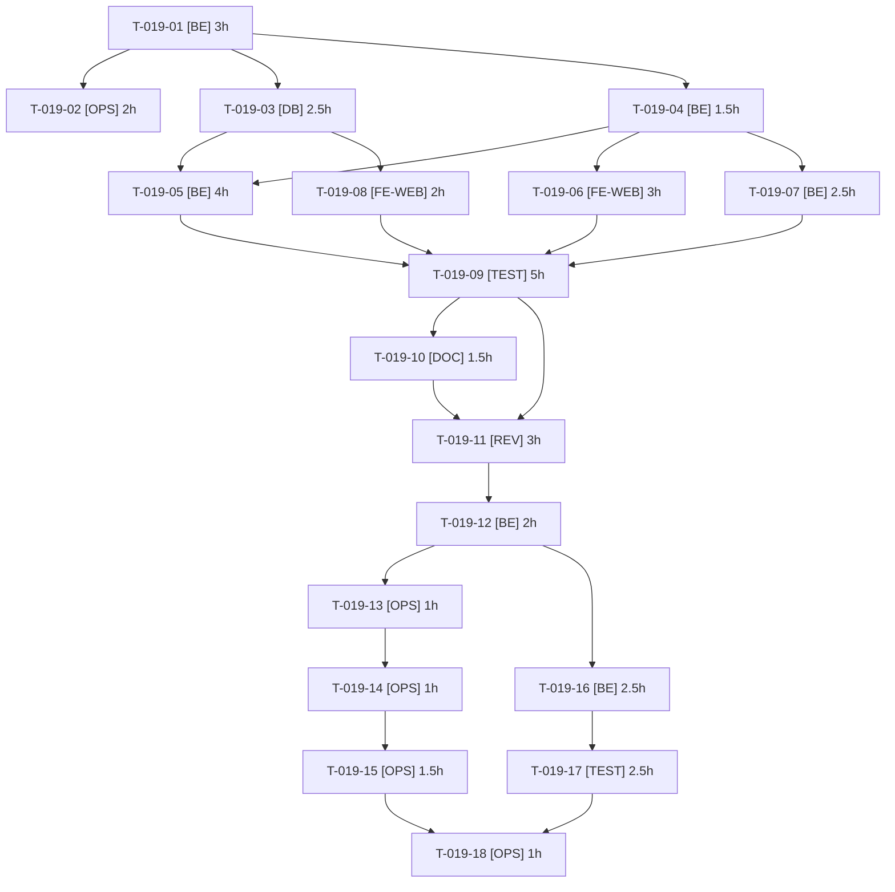

# Tâches — US-019 : Mode d'accès par canal (plugin publié)

## Informations US

- **Epic** : EPIC-04
- **Persona** : Nadia
- **Story Points** : 8
- **Sprint** : sprint-7-plugins-et-integrations
- **Dépendances** : US-001

## Résumé

En tant que Nadia, je veux régler un canal en ouvert, prix masqués ou fermé, afin de réserver le catalogue ou les prix aux clients connectés.

## Vue d'ensemble des tâches

| ID | Type | Tâche | Estimation | Dépend de | Statut |
|----|------|-------|------------|-----------|--------|
| T-019-01 | [BE] | Créer le dépôt local `sylius-channel-access-plugin` : squelette copié du modèle sylius-order-hold-plugin (composer, ECS, PHPStan, Rector, Makefile, compose, TestApplication) | 3h | — | 🔲 |
| T-019-02 | [OPS] | CI multi-versions (PHP 8.3/8.4 × Sylius 2.2/2.3, MySQL) avec doctrine:schema:validate | 2h | T-019-01 | 🔲 |
| T-019-03 | [DB] | Champ « mode d'accès » sur le canal (trait + interface + mapping) et migration | 2.5h | T-019-01 | 🔲 |
| T-019-04 | [BE] | Contrat public figé : enum `AccessMode` (open, prices_hidden, closed) et `AccessModeResolverInterface` | 1.5h | T-019-01 | 🔲 |
| T-019-05 | [BE] | Canal fermé : redirection des anonymes vers la connexion, liste blanche de routes exemptées configurable | 4h | T-019-03, T-019-04 | 🔲 |
| T-019-06 | [FE-WEB] | Prix masqués : extension Twig et gabarits remplaçant prix et bouton d'achat par « Connectez-vous pour voir vos prix » | 3h | T-019-04 | 🔲 |
| T-019-07 | [BE] | Prix masqués côté serveur : refus d'ajout au panier anonyme et prix absents de l'API boutique | 2.5h | T-019-04 | 🔲 |
| T-019-08 | [FE-WEB] | Admin : champ « mode d'accès » dans le formulaire de canal, traductions FR/EN | 2h | T-019-03 | 🔲 |
| T-019-09 | [TEST] | Tests unitaires et fonctionnels du plugin : les 3 modes, routes exemptées, API, admin | 5h | T-019-05, T-019-06, T-019-07, T-019-08 | 🔲 |
| T-019-10 | [DOC] | README, CHANGELOG, documentation de configuration et de la liste blanche | 1.5h | T-019-09 | 🔲 |
| T-019-11 | [REV] | Revue de sécurité du plugin (agent de sécurité, contexte frais, OWASP 2025) | 3h | T-019-09, T-019-10 | 🔲 |
| T-019-12 | [BE] | Corrections des constats de la revue (réserve) | 2h | T-019-11 | 🔲 |
| T-019-13 | [OPS] | Préparer la version : CHANGELOG daté, notes de version, tag proposé v0.1.0 (sans tag) | 1h | T-019-12 | 🔲 |
| T-019-14 | [OPS] | Créer le dépôt GitHub public `tmonier/sylius-channel-access-plugin` et les topics | 1h | T-019-13 | ⏳ GO utilisateur |
| T-019-15 | [OPS] | Tag v0.1.0, release GitHub et publication Packagist | 1.5h | T-019-14 | ⏳ GO utilisateur |
| T-019-16 | [BE] | Intégration dans la démo : dépôt `path` local, activation sur le canal B2B (fermé) et un canal en prix masqués | 2.5h | T-019-12 | 🔲 |
| T-019-17 | [TEST] | Tests de démo : canal fermé, prix masqués, routes exemptées PunchOut/MCP/feeds, non-régression de la navigation | 2.5h | T-019-16 | 🔲 |
| T-019-18 | [OPS] | Démo : passer du chemin local à la version Packagist (contrainte `^0.1`) et relancer les tests | 1h | T-019-15, T-019-17 | ⏳ GO utilisateur |

**Total estimé : 41.5h**

---

## Détail des tâches

### T-019-01 — Créer le dépôt local `sylius-channel-access-plugin` : squelette copié du modèle sylius-order-hold-plugin (composer, ECS, PHPStan, Rector, Makefile, compose, TestApplication)

- **Type** : [BE]
- **Estimation** : 3h
- **Dépend de** : —

**Description** :
Nouveau dépôt sous `/Users/tmonier/Projects/sylius_plugins/sylius-channel-access-plugin` (namespace `Tmonier\SyliusChannelAccessPlugin`, package `tmonier/sylius-channel-access-plugin`), Sylius `^2.2.9 || ^2.3`. Git initialisé, aucun push.

**Fichiers (indicatifs)** :
- `composer.json`
- `ecs.php`
- `phpstan.neon`
- `rector.php`
- `Makefile`
- `compose.yml`
- `phpunit.xml.dist`
- `tests/TestApplication/`
- `LICENSE`

**Critères de validation** :
- [ ] `make` install + TestApplication démarrent en Docker
- [ ] ECS, PHPStan, Rector et PHPUnit passent à vide

---

### T-019-02 — CI multi-versions (PHP 8.3/8.4 × Sylius 2.2/2.3, MySQL) avec doctrine:schema:validate

- **Type** : [OPS]
- **Estimation** : 2h
- **Dépend de** : T-019-01

**Description** :
Workflow `.github/workflows/build.yaml` aligné sur order-hold-plugin ; ajout de `doctrine:schema:validate`.

**Fichiers (indicatifs)** :
- `.github/workflows/build.yaml`

**Critères de validation** :
- [ ] Matrice identique au modèle
- [ ] Étape schema:validate présente
- [ ] Workflow valide (lint YAML local)

---

### T-019-03 — Champ « mode d'accès » sur le canal (trait + interface + mapping) et migration

- **Type** : [DB]
- **Estimation** : 2.5h
- **Dépend de** : T-019-01

**Description** :
Extension de `ChannelInterface` par trait et interface du plugin ; colonne `access_mode` (défaut `open`) ; migration up/down.

**Fichiers (indicatifs)** :
- `src/Entity/Channel/AccessModeTrait.php`
- `src/Entity/Channel/AccessModeAwareInterface.php`
- `src/Migrations/`

**Critères de validation** :
- [ ] Mapping valide (`doctrine:schema:validate`)
- [ ] Migration réversible
- [ ] Canaux existants = `open`

---

### T-019-04 — Contrat public figé : enum `AccessMode` (open, prices_hidden, closed) et `AccessModeResolverInterface`

- **Type** : [BE]
- **Estimation** : 1.5h
- **Dépend de** : T-019-01

**Description** :
Contrat consommé par US-020 : l'API publique est figée tôt (jalon du risque « US-020 dépend d'US-019 »). Documenter les points d'extension.

**Fichiers (indicatifs)** :
- `src/Access/AccessMode.php`
- `src/Access/AccessModeResolverInterface.php`

**Critères de validation** :
- [ ] Interface ≤ 5 méthodes
- [ ] Contrat publié dans le README avant le démarrage de T-020-01

---

### T-019-05 — Canal fermé : redirection des anonymes vers la connexion, liste blanche de routes exemptées configurable

- **Type** : [BE]
- **Estimation** : 4h
- **Dépend de** : T-019-03, T-019-04

**Description** :
Écouteur `kernel.request` : anonyme sur canal fermé → redirection vers la connexion. Liste blanche configurable (accueil, connexion, inscription, assets, routes PunchOut, MCP, feeds). Refuser par défaut tout motif non listé ; pas de redirection ouverte (`_target_path` interne seulement).

**Fichiers (indicatifs)** :
- `src/EventListener/ClosedChannelListener.php`
- `config/packages/tmonier_channel_access.yaml`

**Critères de validation** :
- [ ] Anonyme sur catalogue fermé : 302 vers la connexion
- [ ] Routes exemptées répondent 200 sans connexion
- [ ] Utilisateur connecté non redirigé

---

### T-019-06 — Prix masqués : extension Twig et gabarits remplaçant prix et bouton d'achat par « Connectez-vous pour voir vos prix »

- **Type** : [FE-WEB]
- **Estimation** : 3h
- **Dépend de** : T-019-04

**Description** :
Fiche produit, liste, recherche, panier rapide. Texte traduit FR/EN, lien vers la connexion.

**Fichiers (indicatifs)** :
- `src/Twig/AccessExtension.php`
- `templates/shop/product/_price_hidden.html.twig`
- `translations/messages.fr.yaml`
- `translations/messages.en.yaml`

**Critères de validation** :
- [ ] Aucun prix dans le HTML rendu d'un anonyme (fiche et liste)
- [ ] Message FR et EN présent
- [ ] Connecté : affichage inchangé

---

### T-019-07 — Prix masqués côté serveur : refus d'ajout au panier anonyme et prix absents de l'API boutique

- **Type** : [BE]
- **Estimation** : 2.5h
- **Dépend de** : T-019-04

**Description** :
Ne pas se contenter du masquage visuel : bloquer `POST add-to-cart` anonyme et retirer les prix des réponses `/api/v2/shop/products` pour un anonyme sur ce canal.

**Fichiers (indicatifs)** :
- `src/Api/PriceHidingNormalizer.php`
- `src/EventListener/AddToCartGuardListener.php`

**Critères de validation** :
- [ ] POST direct d'ajout au panier anonyme refusé (403/redirection)
- [ ] Réponse API sans prix pour un anonyme
- [ ] Connecté : prix présents

---

### T-019-08 — Admin : champ « mode d'accès » dans le formulaire de canal, traductions FR/EN

- **Type** : [FE-WEB]
- **Estimation** : 2h
- **Dépend de** : T-019-03

**Description** :
Sélecteur dans le formulaire de canal Sylius via `FormTypeExtension`.

**Fichiers (indicatifs)** :
- `src/Form/Extension/ChannelTypeExtension.php`
- `templates/admin/channel/_access_mode.html.twig`
- `translations/`

**Critères de validation** :
- [ ] Mode enregistré et relu
- [ ] Libellés FR/EN
- [ ] Valeur hors énumération refusée (422/erreur de formulaire)

---

### T-019-09 — Tests unitaires et fonctionnels du plugin : les 3 modes, routes exemptées, API, admin

- **Type** : [TEST]
- **Estimation** : 5h
- **Dépend de** : T-019-05, T-019-06, T-019-07, T-019-08

**Description** :
Couvre les scénarios « Fermé » et « Prix masqués » + erreurs : valeur invalide, route non listée, cache de page, anonyme/connecté.

**Fichiers (indicatifs)** :
- `tests/Unit/`
- `tests/Functional/`

**Critères de validation** :
- [ ] Scénarios Gherkin d'US-019 automatisés et verts
- [ ] Couverture lignes ≥ 80 %
- [ ] CI verte sur la matrice

---

### T-019-10 — README, CHANGELOG, documentation de configuration et de la liste blanche

- **Type** : [DOC]
- **Estimation** : 1.5h
- **Dépend de** : T-019-09

**Description** :
Installation, configuration, exemples (PunchOut, MCP, feeds), limites connues.

**Fichiers (indicatifs)** :
- `README.md`
- `CHANGELOG.md`
- `docs/`

**Critères de validation** :
- [ ] README suit le modèle des autres plugins
- [ ] CHANGELOG [Unreleased] renseigné

---

### T-019-11 — Revue de sécurité du plugin (agent de sécurité, contexte frais, OWASP 2025)

- **Type** : [REV]
- **Estimation** : 3h
- **Dépend de** : T-019-09, T-019-10

**Description** :
Contournements (API, cache, en-têtes de proxy), redirection ouverte, exemptions trop larges, fuite de prix.

**Fichiers (indicatifs)** :
- `review-findings.md du sprint 7`

**Critères de validation** :
- [ ] Constats classés critique/majeur/mineur
- [ ] Aucun critique ou majeur ouvert avant la demande de GO

---

### T-019-12 — Corrections des constats de la revue (réserve)

- **Type** : [BE]
- **Estimation** : 2h
- **Dépend de** : T-019-11

**Description** :
Traiter les constats critiques et majeurs ; mineurs consignés.

**Fichiers (indicatifs)** :
- `src/`

**Critères de validation** :
- [ ] Chaque correction a un test
- [ ] CI verte

---

### T-019-13 — Préparer la version : CHANGELOG daté, notes de version, tag proposé v0.1.0 (sans tag)

- **Type** : [OPS]
- **Estimation** : 1h
- **Dépend de** : T-019-12

**Description** :
Tout est prêt localement ; aucun tag, aucun push.

**Fichiers (indicatifs)** :
- `CHANGELOG.md`
- `notes de version (brouillon)`

**Critères de validation** :
- [ ] Notes prêtes
- [ ] Aucun tag créé

---

### T-019-14 — Créer le dépôt GitHub public `tmonier/sylius-channel-access-plugin` et les topics

- **Type** : [OPS] — **action externe — après GO explicite de l'utilisateur**
- **Estimation** : 1h
- **Dépend de** : T-019-13

**Description** :
Topics : ecommerce, sylius, sylius-plugin, symfony, b2b, access-control. action externe — après GO explicite de l'utilisateur.

**Fichiers (indicatifs)** :
- `GitHub (externe)`

**Critères de validation** :
- [ ] Dépôt public créé
- [ ] Topics présents

---

### T-019-15 — Tag v0.1.0, release GitHub et publication Packagist

- **Type** : [OPS] — **action externe — après GO explicite de l'utilisateur**
- **Estimation** : 1.5h
- **Dépend de** : T-019-14

**Description** :
action externe — après GO explicite de l'utilisateur. Sans GO : plugin non tagué, intégration démo par chemin local uniquement.

**Fichiers (indicatifs)** :
- `GitHub / Packagist (externe)`

**Critères de validation** :
- [ ] Version installable par `composer require`
- [ ] Webhook Packagist actif

---

### T-019-16 — Intégration dans la démo : dépôt `path` local, activation sur le canal B2B (fermé) et un canal en prix masqués

- **Type** : [BE]
- **Estimation** : 2.5h
- **Dépend de** : T-019-12

**Description** :
Via chemin local tant que non publié. Liste blanche : PunchOut, MCP, feeds, démo (`/demo/*`).

**Fichiers (indicatifs)** :
- `composer.json`
- `config/bundles.php`
- `config/packages/tmonier_channel_access.yaml`
- `src/DataFixtures/ (canaux)`

**Critères de validation** :
- [ ] Catalogue B2B fermé pour un anonyme
- [ ] Routes exemptées (PunchOut, MCP, feeds) toujours accessibles

---

### T-019-17 — Tests de démo : canal fermé, prix masqués, routes exemptées PunchOut/MCP/feeds, non-régression de la navigation

- **Type** : [TEST]
- **Estimation** : 2.5h
- **Dépend de** : T-019-16

**Description** :
Ajoute les cas au `HardeningTest` et aux fumées existantes.

**Fichiers (indicatifs)** :
- `tests/Functional/ChannelAccessTest.php`
- `tests/Functional/HardeningTest.php`

**Critères de validation** :
- [ ] Scénarios US-019 verts dans la démo
- [ ] Aucune route exemptée cassée

---

### T-019-18 — Démo : passer du chemin local à la version Packagist (contrainte `^0.1`) et relancer les tests

- **Type** : [OPS] — **action externe — après GO explicite de l'utilisateur**
- **Estimation** : 1h
- **Dépend de** : T-019-15, T-019-17

**Description** :
action externe — après GO explicite de l'utilisateur. Retirer le dépôt `path`.

**Fichiers (indicatifs)** :
- `composer.json`
- `composer.lock`

**Critères de validation** :
- [ ] Démo verte avec la version publiée

---

## Graphe de dépendances

## Résumé

| Couche | Nb tâches | Heures |
|--------|-----------|--------|
| [BE] | 6 | 15.5h |
| [OPS] | 5 | 6.5h |
| [DB] | 1 | 2.5h |
| [FE-WEB] | 2 | 5h |
| [TEST] | 2 | 7.5h |
| [DOC] | 1 | 1.5h |
| [REV] | 1 | 3h |
| **TOTAL** | **18** | **41.5h** |
