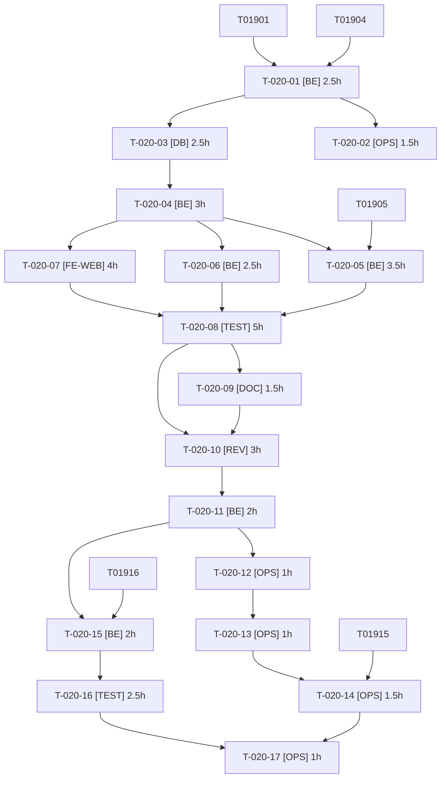

# Tâches — US-020 : Inscription validée par l'admin (plugin publié)

## Informations US

- **Epic** : EPIC-04
- **Persona** : Sophie
- **Story Points** : 8
- **Sprint** : sprint-7-plugins-et-integrations
- **Dépendances** : US-019

## Résumé

En tant que Sophie, je veux valider les inscriptions sur un canal B2B, afin de n'ouvrir le catalogue qu'à de vrais clients.

## Vue d'ensemble des tâches

| ID | Type | Tâche | Estimation | Dépend de | Statut |
|----|------|-------|------------|-----------|--------|
| T-020-01 | [BE] | Créer le dépôt local `sylius-registration-approval-plugin` : squelette (modèle order-hold / company-accounts), dépendance au contrat d'US-019 | 2.5h | T-019-04, T-019-01 | ✅ |
| T-020-02 | [OPS] | CI multi-versions et doctrine:schema:validate | 1.5h | T-020-01 | ✅ |
| T-020-03 | [DB] | Statut d'approbation du client (en attente, approuvé, refusé) : trait, mapping et migration | 2.5h | T-020-01 | ✅ |
| T-020-04 | [BE] | Contrat public et service d'approbation (approve/reject, événements, historique) | 3h | T-020-03 | ✅ |
| T-020-05 | [BE] | Inscription en attente : compte créé sans accès au catalogue fermé, connexion limitée à une page d'attente | 3.5h | T-020-04, T-019-05 | ✅ |
| T-020-06 | [BE] | E-mails d'approbation et de refus (mailer Sylius, gabarits FR/EN) | 2.5h | T-020-04 | ✅ |
| T-020-07 | [FE-WEB] | Admin : liste « inscriptions en attente » (filtre), actions approuver/refuser protégées (CSRF, droits) | 4h | T-020-04 | ✅ |
| T-020-08 | [TEST] | Tests unitaires et fonctionnels : parcours inscription → attente → approbation/refus, e-mails, erreurs | 5h | T-020-05, T-020-06, T-020-07 | ✅ |
| T-020-09 | [DOC] | README, CHANGELOG, configuration (canaux concernés) | 1.5h | T-020-08 | ✅ |
| T-020-10 | [REV] | Revue de sécurité du plugin (énumération de comptes, contournement du statut, CSRF, élévation) | 3h | T-020-08, T-020-09 | ✅ |
| T-020-11 | [BE] | Corrections des constats de la revue (réserve) | 2h | T-020-10 | ✅ |
| T-020-12 | [OPS] | Préparer la version : CHANGELOG daté, notes, tag proposé v0.1.0 (sans tag) | 1h | T-020-11 | ✅ |
| T-020-13 | [OPS] | Créer le dépôt GitHub public `tmonier/sylius-registration-approval-plugin` et les topics | 1h | T-020-12 | ✅ (GO donné) |
| T-020-14 | [OPS] | Tag v0.1.0, release GitHub et publication Packagist | 1.5h | T-020-13, T-019-15 | ✅ (GO donné) |
| T-020-15 | [BE] | Intégration dans la démo : activation sur le canal B2B, inscription de démo soumise à validation | 2h | T-020-11, T-019-16 | ✅ |
| T-020-16 | [TEST] | Tests de démo : Sophie approuve/refuse, e-mail visible dans Mailpit, FR/EN | 2.5h | T-020-15 | ✅ |
| T-020-17 | [OPS] | Démo : passer à la version Packagist du plugin et relancer les tests | 1h | T-020-14, T-020-16 | ✅ (GO donné) |

**Total estimé : 40h**

---

## Détail des tâches

### T-020-01 — Créer le dépôt local `sylius-registration-approval-plugin` : squelette (modèle order-hold / company-accounts), dépendance au contrat d'US-019

- **Type** : [BE]
- **Estimation** : 2.5h
- **Dépend de** : T-019-04, T-019-01

**Description** :
Dépôt `/Users/tmonier/Projects/sylius_plugins/sylius-registration-approval-plugin` (namespace `Tmonier\SyliusRegistrationApprovalPlugin`). Démarre sur le **contrat** `AccessModeResolverInterface`, pas sur la publication d'US-019.

**Fichiers (indicatifs)** :
- `composer.json`
- `ecs.php`
- `phpstan.neon`
- `rector.php`
- `Makefile`
- `tests/TestApplication/`

**Critères de validation** :
- [ ] Outillage vert à vide
- [ ] Dépendance au plugin d'accès déclarée (chemin local puis Packagist)

---

### T-020-02 — CI multi-versions et doctrine:schema:validate

- **Type** : [OPS]
- **Estimation** : 1.5h
- **Dépend de** : T-020-01

**Description** :
Même matrice qu'US-019 ; dépôt du plugin d'accès résolu en `path` tant que non publié.

**Fichiers (indicatifs)** :
- `.github/workflows/build.yaml`

**Critères de validation** :
- [ ] Matrice identique
- [ ] Workflow valide

---

### T-020-03 — Statut d'approbation du client (en attente, approuvé, refusé) : trait, mapping et migration

- **Type** : [DB]
- **Estimation** : 2.5h
- **Dépend de** : T-020-01

**Description** :
Colonne `approval_status` + date/auteur de décision ; clients existants = approuvé.

**Fichiers (indicatifs)** :
- `src/Entity/Customer/ApprovalTrait.php`
- `src/Migrations/`

**Critères de validation** :
- [ ] Mapping valide
- [ ] Migration réversible
- [ ] Comptes existants non bloqués

---

### T-020-04 — Contrat public et service d'approbation (approve/reject, événements, historique)

- **Type** : [BE]
- **Estimation** : 3h
- **Dépend de** : T-020-03

**Description** :
`ApprovalManagerInterface` ; événements `RegistrationApproved/Rejected` ; transitions idempotentes ; pas de passage refusé→approuvé sans action explicite.

**Fichiers (indicatifs)** :
- `src/Approval/ApprovalManager.php`
- `src/Event/`

**Critères de validation** :
- [ ] Transitions invalides refusées avec exception métier
- [ ] Événement dispatché une fois par décision

---

### T-020-05 — Inscription en attente : compte créé sans accès au catalogue fermé, connexion limitée à une page d'attente

- **Type** : [BE]
- **Estimation** : 3.5h
- **Dépend de** : T-020-04, T-019-05

**Description** :
Écouteur sur l'inscription Sylius : statut `pending` ; sur canal fermé le compte en attente est traité comme anonyme par le plugin d'accès ; page « compte en attente de validation » FR/EN.

**Fichiers (indicatifs)** :
- `src/EventListener/RegistrationListener.php`
- `src/Security/PendingUserChecker.php`
- `templates/shop/pending.html.twig`

**Critères de validation** :
- [ ] Compte en attente : redirigé hors du catalogue fermé
- [ ] Compte approuvé : accès normal
- [ ] Refusé : connexion refusée avec message générique

---

### T-020-06 — E-mails d'approbation et de refus (mailer Sylius, gabarits FR/EN)

- **Type** : [BE]
- **Estimation** : 2.5h
- **Dépend de** : T-020-04

**Description** :
Envoi à l'événement ; contenu sans donnée sensible ; échec d'envoi journalisé sans bloquer la décision.

**Fichiers (indicatifs)** :
- `src/Mailer/`
- `config/packages/sylius_mailer.yaml`
- `templates/email/`

**Critères de validation** :
- [ ] E-mail reçu dans la boîte de test (approuvé/refusé)
- [ ] Échec d'envoi n'annule pas la décision

---

### T-020-07 — Admin : liste « inscriptions en attente » (filtre), actions approuver/refuser protégées (CSRF, droits)

- **Type** : [FE-WEB]
- **Estimation** : 4h
- **Dépend de** : T-020-04

**Description** :
Grille Sylius, boutons POST avec jeton CSRF, ACL dédiée ; motif de refus optionnel.

**Fichiers (indicatifs)** :
- `src/Grid/`
- `src/Controller/Admin/`
- `config/routes/admin.yaml`
- `translations/`

**Critères de validation** :
- [ ] Action sans jeton CSRF refusée
- [ ] Utilisateur sans droit : 403
- [ ] Libellés FR/EN

---

### T-020-08 — Tests unitaires et fonctionnels : parcours inscription → attente → approbation/refus, e-mails, erreurs

- **Type** : [TEST]
- **Estimation** : 5h
- **Dépend de** : T-020-05, T-020-06, T-020-07

**Description** :
Scénario Gherkin d'US-020 + cas d'erreur : décision rejouée, utilisateur non autorisé, compte supprimé, canal ouvert (pas de validation requise).

**Fichiers (indicatifs)** :
- `tests/Unit/`
- `tests/Functional/`

**Critères de validation** :
- [ ] Scénarios US-020 verts
- [ ] Couverture lignes ≥ 80 %

---

### T-020-09 — README, CHANGELOG, configuration (canaux concernés)

- **Type** : [DOC]
- **Estimation** : 1.5h
- **Dépend de** : T-020-08

**Description** :
Installation, dépendance au plugin d'accès, activation par canal.

**Fichiers (indicatifs)** :
- `README.md`
- `CHANGELOG.md`

**Critères de validation** :
- [ ] README suit le modèle
- [ ] CHANGELOG [Unreleased] renseigné

---

### T-020-10 — Revue de sécurité du plugin (énumération de comptes, contournement du statut, CSRF, élévation)

- **Type** : [REV]
- **Estimation** : 3h
- **Dépend de** : T-020-08, T-020-09

**Description** :
Agent de sécurité, contexte frais.

**Fichiers (indicatifs)** :
- `review-findings.md du sprint 7`

**Critères de validation** :
- [ ] Constats classés
- [ ] Aucun critique ou majeur ouvert avant la demande de GO

---

### T-020-11 — Corrections des constats de la revue (réserve)

- **Type** : [BE]
- **Estimation** : 2h
- **Dépend de** : T-020-10

**Description** :
Voir critères de validation.

**Fichiers (indicatifs)** :
- `src/`

**Critères de validation** :
- [ ] Chaque correction a un test
- [ ] CI verte

---

### T-020-12 — Préparer la version : CHANGELOG daté, notes, tag proposé v0.1.0 (sans tag)

- **Type** : [OPS]
- **Estimation** : 1h
- **Dépend de** : T-020-11

**Description** :
Aucun tag, aucun push.

**Fichiers (indicatifs)** :
- `CHANGELOG.md`

**Critères de validation** :
- [ ] Notes prêtes

---

### T-020-13 — Créer le dépôt GitHub public `tmonier/sylius-registration-approval-plugin` et les topics

- **Type** : [OPS] — **action externe — après GO explicite de l'utilisateur**
- **Estimation** : 1h
- **Dépend de** : T-020-12

**Description** :
Topics : ecommerce, sylius, sylius-plugin, symfony, b2b, registration. action externe — après GO explicite de l'utilisateur.

**Fichiers (indicatifs)** :
- `GitHub (externe)`

**Critères de validation** :
- [ ] Dépôt public créé
- [ ] Topics présents

---

### T-020-14 — Tag v0.1.0, release GitHub et publication Packagist

- **Type** : [OPS] — **action externe — après GO explicite de l'utilisateur**
- **Estimation** : 1.5h
- **Dépend de** : T-020-13, T-019-15

**Description** :
action externe — après GO explicite de l'utilisateur. Nécessite que le plugin d'accès soit publié (dépendance Composer).

**Fichiers (indicatifs)** :
- `GitHub / Packagist (externe)`

**Critères de validation** :
- [ ] Version installable par `composer require`

---

### T-020-15 — Intégration dans la démo : activation sur le canal B2B, inscription de démo soumise à validation

- **Type** : [BE]
- **Estimation** : 2h
- **Dépend de** : T-020-11, T-019-16

**Description** :
Chemin local tant que non publié. Cohérence avec M2 (US-040) : les inscriptions de visiteurs restent en attente et invisibles.

**Fichiers (indicatifs)** :
- `composer.json`
- `config/packages/`
- `src/DataFixtures/`

**Critères de validation** :
- [ ] Inscription → compte en attente dans l'admin de démo

---

### T-020-16 — Tests de démo : Sophie approuve/refuse, e-mail visible dans Mailpit, FR/EN

- **Type** : [TEST]
- **Estimation** : 2.5h
- **Dépend de** : T-020-15

**Description** :
Parcours complet en fonctionnel + fumée.

**Fichiers (indicatifs)** :
- `tests/Functional/RegistrationApprovalTest.php`

**Critères de validation** :
- [ ] Scénario US-020 vert dans la démo
- [ ] E-mail capté par la boîte de test

---

### T-020-17 — Démo : passer à la version Packagist du plugin et relancer les tests

- **Type** : [OPS] — **action externe — après GO explicite de l'utilisateur**
- **Estimation** : 1h
- **Dépend de** : T-020-14, T-020-16

**Description** :
action externe — après GO explicite de l'utilisateur.

**Fichiers (indicatifs)** :
- `composer.json`
- `composer.lock`

**Critères de validation** :
- [ ] Démo verte avec la version publiée

---

## Graphe de dépendances

## Résumé

| Couche | Nb tâches | Heures |
|--------|-----------|--------|
| [BE] | 6 | 15.5h |
| [OPS] | 5 | 6h |
| [DB] | 1 | 2.5h |
| [FE-WEB] | 1 | 4h |
| [TEST] | 2 | 7.5h |
| [DOC] | 1 | 1.5h |
| [REV] | 1 | 3h |
| **TOTAL** | **17** | **40h** |
