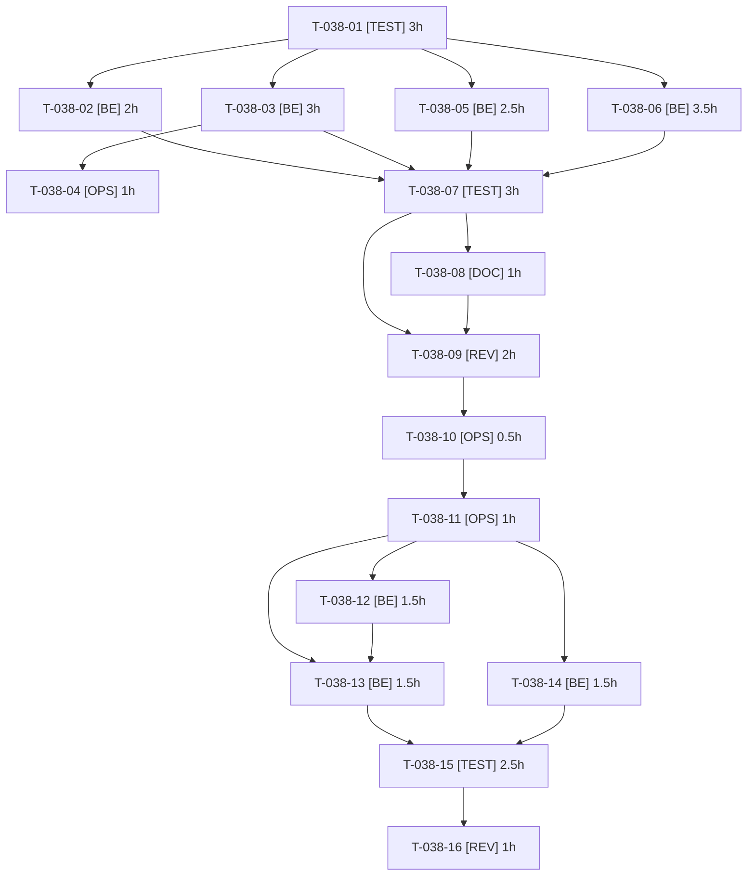

# Tâches — US-038 : Correctifs du plugin punchout-cxml

## Informations US

- **Epic** : EPIC-07
- **Persona** : Thibaut
- **Story Points** : 8
- **Sprint** : sprint-7-plugins-et-integrations
- **Dépendances** : US-027, US-031

## Résumé

En tant que Thibaut, je veux corriger le plugin punchout-cxml à la source, afin de retirer les contournements de la démo et publier un plugin fiable.

## Vue d'ensemble des tâches

| ID | Type | Tâche | Estimation | Dépend de | Statut |
|----|------|-------|------------|-----------|--------|
| T-038-01 | [TEST] | Branche dédiée du plugin et tests rouges : commande invitée refusée en trade-credit, événement absent, guard absent, mapping classes | 3h | — | 🔲 |
| T-038-02 | [BE] | (a) `PunchoutCartFactory::create` : utiliser `setCustomerWithAuthorization` | 2h | T-038-01 | 🔲 |
| T-038-03 | [BE] | (b) Cibler les interfaces Doctrine (OrderInterface, CustomerInterface, ChannelInterface) dans les mappings du plugin | 3h | T-038-01 | 🔲 |
| T-038-04 | [OPS] | CI du plugin : `doctrine:schema:validate` ajouté, matrice conservée | 1h | T-038-03 | 🔲 |
| T-038-05 | [BE] | (c) Événement de création de commande par OrderRequest (porte l'orderID, dispatché une fois) | 2.5h | T-038-01 | 🔲 |
| T-038-06 | [BE] | (d) Guard de workflow sur la transition `complete` d'un panier PunchOut (y compris `PATCH /api/v2/shop/orders/{token}/complete`) | 3.5h | T-038-01 | 🔲 |
| T-038-07 | [TEST] | Passer les tests au vert et compléter : API PATCH, boutique non PunchOut, événement unique, mapping | 3h | T-038-02, T-038-03, T-038-05, T-038-06 | 🔲 |
| T-038-08 | [DOC] | CHANGELOG et README du plugin (correctifs, `resolve_target_entities`, événement) | 1h | T-038-07 | 🔲 |
| T-038-09 | [REV] | Revue de sécurité du correctif (guard contournable, autorisation du client, événement) | 2h | T-038-07, T-038-08 | 🔲 |
| T-038-10 | [OPS] | Préparer la version (CHANGELOG daté, notes, tag proposé) sans tag | 0.5h | T-038-09 | 🔲 |
| T-038-11 | [OPS] | Tag, release et Packagist du plugin punchout-cxml | 1h | T-038-10 | ⏳ GO utilisateur |
| T-038-12 | [BE] | Démo : monter la version du plugin et retirer `resolve_target_entities` des entités corrigées | 1.5h | T-038-11 | 🔲 |
| T-038-13 | [BE] | Démo : retirer `App\PunchOut\AuthorizedPunchOutOrderFactory` et son câblage dans `config/services.yaml` (APRÈS publication) | 1.5h | T-038-11, T-038-12 | 🔲 |
| T-038-14 | [BE] | Démo : remplacer la lecture des notes par l'événement de création (R6) | 1.5h | T-038-11 | 🔲 |
| T-038-15 | [TEST] | Non-régression PunchOut de la démo : flux complet, paiement trade-credit, retour du simulateur, commande boutique normale | 2.5h | T-038-13, T-038-14 | 🔲 |
| T-038-16 | [REV] | Contre-vérification finale (démo sans contournement) | 1h | T-038-15 | 🔲 |

**Total estimé : 30.5h**

---

## Détail des tâches

### T-038-01 — Branche dédiée du plugin et tests rouges : commande invitée refusée en trade-credit, événement absent, guard absent, mapping classes

- **Type** : [TEST]
- **Estimation** : 3h
- **Dépend de** : —

**Description** :
Dépôt `/Users/tmonier/Projects/sylius_plugins/sylius-punchout-cxml-plugin`, branche `fix/sprint-7-demo-findings` (créée depuis la branche principale à jour : `git fetch` et vérification de la branche courante). Tests écrits avant correctif (TDD).

**Fichiers (indicatifs)** :
- `tests/Functional/`
- `tests/Unit/`

**Critères de validation** :
- [ ] Chaque constat (a), (b), (c), (d) a un test rouge
- [ ] Cas contraire : commande boutique non PunchOut (notes « PunchOut purchase order »)

---

### T-038-02 — (a) `PunchoutCartFactory::create` : utiliser `setCustomerWithAuthorization`

- **Type** : [BE]
- **Estimation** : 2h
- **Dépend de** : T-038-01

**Description** :
Commande non « invitée » (`createdByGuest = false`) pour que trade-credit accepte le paiement sur compte.

**Fichiers (indicatifs)** :
- `src/Factory/PunchoutCartFactory.php`

**Critères de validation** :
- [ ] Commande d'un client Acme non invitée
- [ ] Paiement sur compte accepté dans le test

---

### T-038-03 — (b) Cibler les interfaces Doctrine (OrderInterface, CustomerInterface, ChannelInterface) dans les mappings du plugin

- **Type** : [BE]
- **Estimation** : 3h
- **Dépend de** : T-038-01

**Description** :
Mappings relationnels vers interfaces ; documenter `resolve_target_entities` pour les applications.

**Fichiers (indicatifs)** :
- `src/Entity/`
- `config/doctrine/`

**Critères de validation** :
- [ ] Plus de classe concrète Sylius dans les mappings
- [ ] Application sans surcharge : mapping valide

---

### T-038-04 — CI du plugin : `doctrine:schema:validate` ajouté, matrice conservée

- **Type** : [OPS]
- **Estimation** : 1h
- **Dépend de** : T-038-03

**Description** :
Voir critères de validation.

**Fichiers (indicatifs)** :
- `.github/workflows/build.yaml`

**Critères de validation** :
- [ ] Étape schema:validate verte sur la matrice

---

### T-038-05 — (c) Événement de création de commande par OrderRequest (porte l'orderID, dispatché une fois)

- **Type** : [BE]
- **Estimation** : 2.5h
- **Dépend de** : T-038-01

**Description** :
Résout aussi R6 (libellé lu dans les notes de commande) : les consommateurs écoutent l'événement, pas les notes.

**Fichiers (indicatifs)** :
- `src/Event/PunchoutOrderCreatedEvent.php`
- `src/Controller/OrderRequestController.php (ou handler)`

**Critères de validation** :
- [ ] Événement dispatché une fois avec l'orderID
- [ ] Aucune lecture des notes nécessaire

---

### T-038-06 — (d) Guard de workflow sur la transition `complete` d'un panier PunchOut (y compris `PATCH /api/v2/shop/orders/{token}/complete`)

- **Type** : [BE]
- **Estimation** : 3.5h
- **Dépend de** : T-038-01

**Description** :
Guard limité aux commandes marquées PunchOut (marqueur fiable, pas le texte des notes). Refus avec message clair.

**Fichiers (indicatifs)** :
- `src/Workflow/PunchoutCompleteGuard.php`
- `config/packages/workflow.yaml`

**Critères de validation** :
- [ ] Complétion API d'un panier PunchOut refusée, commande reste au panier
- [ ] Commande boutique citant « PunchOut purchase order » complétée normalement

---

### T-038-07 — Passer les tests au vert et compléter : API PATCH, boutique non PunchOut, événement unique, mapping

- **Type** : [TEST]
- **Estimation** : 3h
- **Dépend de** : T-038-02, T-038-03, T-038-05, T-038-06

**Description** :
Scénarios Gherkin d'US-038 sauf démo.

**Fichiers (indicatifs)** :
- `tests/`

**Critères de validation** :
- [ ] Tests verts
- [ ] Couverture lignes du plugin ≥ 80 %
- [ ] ECS, PHPStan, Rector verts

---

### T-038-08 — CHANGELOG et README du plugin (correctifs, `resolve_target_entities`, événement)

- **Type** : [DOC]
- **Estimation** : 1h
- **Dépend de** : T-038-07

**Description** :
Notes de migration pour les utilisateurs du plugin.

**Fichiers (indicatifs)** :
- `CHANGELOG.md`
- `README.md`

**Critères de validation** :
- [ ] Changements visibles documentés

---

### T-038-09 — Revue de sécurité du correctif (guard contournable, autorisation du client, événement)

- **Type** : [REV]
- **Estimation** : 2h
- **Dépend de** : T-038-07, T-038-08

**Description** :
Contexte frais.

**Fichiers (indicatifs)** :
- `review-findings.md du sprint 7`

**Critères de validation** :
- [ ] Aucun critique ou majeur ouvert avant la demande de GO

---

### T-038-10 — Préparer la version (CHANGELOG daté, notes, tag proposé) sans tag

- **Type** : [OPS]
- **Estimation** : 0.5h
- **Dépend de** : T-038-09

**Description** :
Voir critères de validation.

**Fichiers (indicatifs)** :
- `CHANGELOG.md`

**Critères de validation** :
- [ ] Notes prêtes, aucun tag

---

### T-038-11 — Tag, release et Packagist du plugin punchout-cxml

- **Type** : [OPS] — **action externe — après GO explicite de l'utilisateur**
- **Estimation** : 1h
- **Dépend de** : T-038-10

**Description** :
action externe — après GO explicite de l'utilisateur. Sans GO : contournement démo conservé.

**Fichiers (indicatifs)** :
- `GitHub / Packagist (externe)`

**Critères de validation** :
- [ ] Version installable

---

### T-038-12 — Démo : monter la version du plugin et retirer `resolve_target_entities` des entités corrigées

- **Type** : [BE]
- **Estimation** : 1.5h
- **Dépend de** : T-038-11

**Description** :
Après publication (ou chemin local validé par l'utilisateur).

**Fichiers (indicatifs)** :
- `composer.json`
- `config/packages/doctrine.yaml`

**Critères de validation** :
- [ ] `doctrine:schema:validate` vert dans la démo sans resolve_target_entities

---

### T-038-13 — Démo : retirer `App\PunchOut\AuthorizedPunchOutOrderFactory` et son câblage dans `config/services.yaml` (APRÈS publication)

- **Type** : [BE]
- **Estimation** : 1.5h
- **Dépend de** : T-038-11, T-038-12

**Description** :
Contournement conservé jusqu'à publication.

**Fichiers (indicatifs)** :
- `src/PunchOut/AuthorizedPunchOutOrderFactory.php`
- `config/services.yaml`

**Critères de validation** :
- [ ] Plus de référence à la classe
- [ ] Commande Acme payable sur compte sans contournement

---

### T-038-14 — Démo : remplacer la lecture des notes par l'événement de création (R6)

- **Type** : [BE]
- **Estimation** : 1.5h
- **Dépend de** : T-038-11

**Description** :
Libellé et suivi du côté démo à partir de l'orderID.

**Fichiers (indicatifs)** :
- `src/PunchOut/`

**Critères de validation** :
- [ ] Aucun parsing de notes dans la démo

---

### T-038-15 — Non-régression PunchOut de la démo : flux complet, paiement trade-credit, retour du simulateur, commande boutique normale

- **Type** : [TEST]
- **Estimation** : 2.5h
- **Dépend de** : T-038-13, T-038-14

**Description** :
Voir critères de validation.

**Fichiers (indicatifs)** :
- `tests/Functional/PunchOut*Test.php`

**Critères de validation** :
- [ ] Scénario Acme vert sans contournement
- [ ] Parcours boutique normal inchangé

---

### T-038-16 — Contre-vérification finale (démo sans contournement)

- **Type** : [REV]
- **Estimation** : 1h
- **Dépend de** : T-038-15

**Description** :
Voir critères de validation.

**Fichiers (indicatifs)** :
- sans objet

**Critères de validation** :
- [ ] Aucun reste du contournement
- [ ] CI verte

---

## Graphe de dépendances

## Résumé

| Couche | Nb tâches | Heures |
|--------|-----------|--------|
| [TEST] | 3 | 8.5h |
| [BE] | 7 | 15.5h |
| [OPS] | 3 | 2.5h |
| [DOC] | 1 | 1h |
| [REV] | 2 | 3h |
| **TOTAL** | **16** | **30.5h** |
