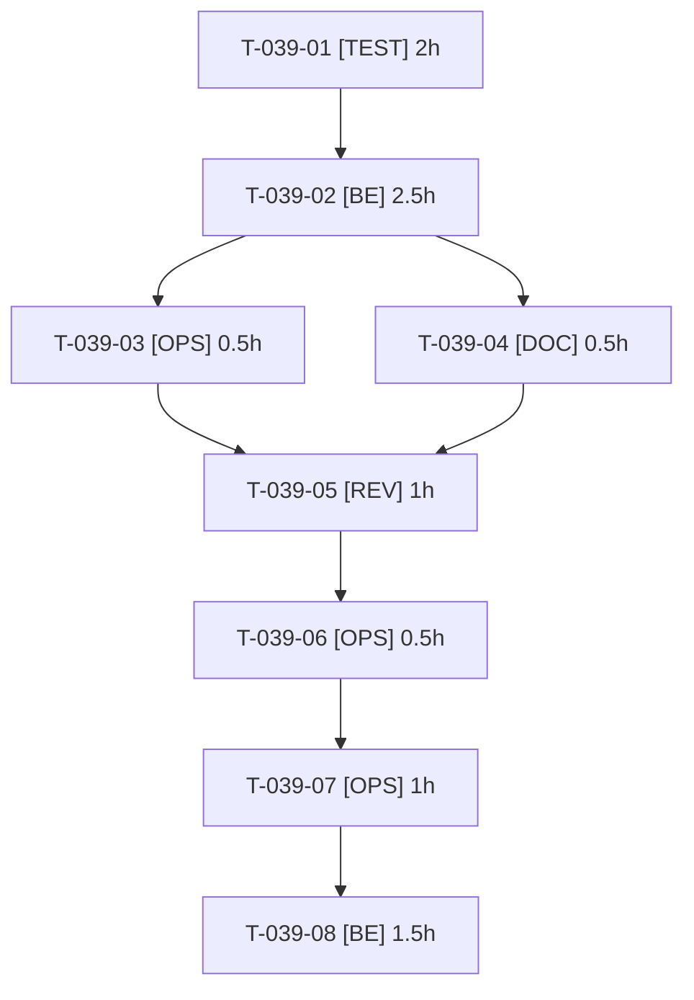

# Tâches — US-039 : Correctif du plugin container-fill

## Informations US

- **Epic** : EPIC-07
- **Persona** : Thibaut
- **Story Points** : 3
- **Sprint** : sprint-7-plugins-et-integrations
- **Dépendances** : US-026

## Résumé

En tant que Thibaut, je veux que container-fill ignore les lignes de panier sans données logistiques, afin de qu'une règle « tous produits » ne bloque plus les paniers mixtes.

## Vue d'ensemble des tâches

| ID | Type | Tâche | Estimation | Dépend de | Statut |
|----|------|-------|------------|-----------|--------|
| T-039-01 | [TEST] | Branche dédiée du plugin et tests rouges : ligne sans données, panier sans aucune donnée, poids nul/négatif, panier complet inchangé | 2h | — | ✅ |
| T-039-02 | [BE] | Ignorer les lignes sans poids/volume ; pas de division par zéro ; poids ≤ 0 ignoré (comportement documenté) | 2.5h | T-039-01 | ✅ |
| T-039-03 | [OPS] | CI du plugin verte (matrice complète, ECS, PHPStan) | 0.5h | T-039-02 | ✅ |
| T-039-04 | [DOC] | CHANGELOG et README (comportement des lignes sans données) | 0.5h | T-039-02 | ✅ |
| T-039-05 | [REV] | Revue du correctif (régression du calcul, cas limites) | 1h | T-039-03, T-039-04 | ✅ |
| T-039-06 | [OPS] | Préparer la version (notes, tag proposé) sans tag | 0.5h | T-039-05 | ✅ |
| T-039-07 | [OPS] | Tag, release et Packagist du plugin container-fill | 1h | T-039-06 | ✅ (GO donné) |
| T-039-08 | [BE] | Démo : monter la version et ajouter une fumée « panier mixte + règle tous produits » | 1.5h | T-039-07 | ✅ |

**Total estimé : 9.5h**

---

## Détail des tâches

### T-039-01 — Branche dédiée du plugin et tests rouges : ligne sans données, panier sans aucune donnée, poids nul/négatif, panier complet inchangé

- **Type** : [TEST]
- **Estimation** : 2h
- **Dépend de** : —

**Description** :
Dépôt `/Users/tmonier/Projects/sylius_plugins/sylius-container-fill-plugin`, branche `fix/lines-without-logistics-data` (fetch et branche courante vérifiés).

**Fichiers (indicatifs)** :
- `tests/Unit/`
- `tests/Functional/`

**Critères de validation** :
- [ ] 4 scénarios d'US-039 en tests rouges

---

### T-039-02 — Ignorer les lignes sans poids/volume ; pas de division par zéro ; poids ≤ 0 ignoré (comportement documenté)

- **Type** : [BE]
- **Estimation** : 2.5h
- **Dépend de** : T-039-01

**Description** :
Tout panier sans donnée est accepté sans exception.

**Fichiers (indicatifs)** :
- `src/Rule/`
- `src/Calculator/`

**Critères de validation** :
- [ ] Panier mixte non bloqué par la règle « tous produits »
- [ ] Calcul inchangé quand toutes les lignes ont des données
- [ ] Aucune exception non gérée

---

### T-039-03 — CI du plugin verte (matrice complète, ECS, PHPStan)

- **Type** : [OPS]
- **Estimation** : 0.5h
- **Dépend de** : T-039-02

**Description** :
Voir critères de validation.

**Fichiers (indicatifs)** :
- `.github/workflows/`

**Critères de validation** :
- [ ] CI verte

---

### T-039-04 — CHANGELOG et README (comportement des lignes sans données)

- **Type** : [DOC]
- **Estimation** : 0.5h
- **Dépend de** : T-039-02

**Description** :
Voir critères de validation.

**Fichiers (indicatifs)** :
- `CHANGELOG.md`
- `README.md`

**Critères de validation** :
- [ ] Comportement documenté

---

### T-039-05 — Revue du correctif (régression du calcul, cas limites)

- **Type** : [REV]
- **Estimation** : 1h
- **Dépend de** : T-039-03, T-039-04

**Description** :
Voir critères de validation.

**Fichiers (indicatifs)** :
- sans objet

**Critères de validation** :
- [ ] Aucun constat bloquant

---

### T-039-06 — Préparer la version (notes, tag proposé) sans tag

- **Type** : [OPS]
- **Estimation** : 0.5h
- **Dépend de** : T-039-05

**Description** :
Voir critères de validation.

**Fichiers (indicatifs)** :
- `CHANGELOG.md`

**Critères de validation** :
- [ ] Aucun tag

---

### T-039-07 — Tag, release et Packagist du plugin container-fill

- **Type** : [OPS] — **action externe — après GO explicite de l'utilisateur**
- **Estimation** : 1h
- **Dépend de** : T-039-06

**Description** :
action externe — après GO explicite de l'utilisateur. Sans GO : correctif en branche.

**Fichiers (indicatifs)** :
- `GitHub / Packagist (externe)`

**Critères de validation** :
- [ ] Version installable

---

### T-039-08 — Démo : monter la version et ajouter une fumée « panier mixte + règle tous produits »

- **Type** : [BE]
- **Estimation** : 1.5h
- **Dépend de** : T-039-07

**Description** :
Voir critères de validation.

**Fichiers (indicatifs)** :
- `composer.json`
- `tests/Functional/ContainerFill*Test.php`

**Critères de validation** :
- [ ] Panier mixte accepté dans la démo
- [ ] Tests de démo verts

---

## Graphe de dépendances

## Résumé

| Couche | Nb tâches | Heures |
|--------|-----------|--------|
| [TEST] | 1 | 2h |
| [BE] | 2 | 4h |
| [OPS] | 3 | 2h |
| [DOC] | 1 | 0.5h |
| [REV] | 1 | 1h |
| **TOTAL** | **8** | **9.5h** |
