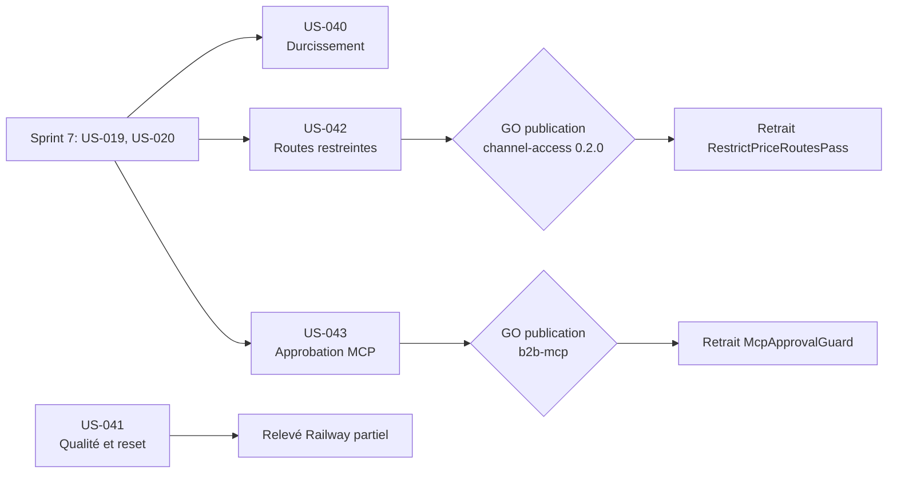

# Sprint 8 — Démo et durcissement

## Informations

| Attribut | Valeur |
|----------|--------|
| Numéro | 8 |
| Nom | demo-et-durcissement |
| Début | 2026-10-16 |
| Fin | 2026-10-30 |
| Durée | 10 jours ouvrés |
| Points engagés | 25 (5 stories ; 90,5 h, 51 tâches) |
| Branche | `feature/sprint-8-demo-et-durcissement` |

## Sprint Goal

> Rendre la démo durcie et documentée (guide MCP, reports sécurité et qualité du sprint 6, relevé partiel du coût Railway) et retirer deux contournements de la démo en les intégrant aux plugins channel-access et b2b-mcp.

## Décisions utilisateur

1. Arbitrage de capacité du sprint 7 : US-030, US-040 et US-041 sont reportées ici.
2. Deux stories issues de la rétro du sprint 7 : US-042 et US-043 (5 points chacune après décomposition).
3. **Arbitrage de capacité du 2026-10-16** : sprint 8 = 25 points (US-030, US-040, US-041, US-042, US-043). US-006 et US-029 passent au sprint 9 (« sprint-9-reports ») avec T-041-06 à 09 et T-041-15 ; revue de sécurité d'US-042 et US-043 mutualisée.
4. **Relevé du coût Railway partiel** (décision du 2026-10-16) : relevé à date et projection ; le relevé complet à J+7 reste ouvert (S2-R3 à S2-R6, T-033-05 et T-034-02 au sprint 8 ; S2-R7 à R10, S4-R3 et le relevé complet au sprint 9).
5. **Toute publication de plugin (tag, Packagist) est soumise au GO explicite de l'utilisateur.** Aucune commande externe (railway, gh, push, `composer require`) sans accord.
6. L'ouverture publique de la démo reste conditionnée à un GO explicite distinct.

## Sprint Backlog

| ID | Titre | Points | Epic | Dépend de | Statut |
|----|-------|--------|------|-----------|--------|
| US-030 | Guide de connexion MCP | 2 | EPIC-07 | US-009 | 🔵 To Do |
| US-040 | Durcissement complémentaire (reports sécurité du sprint 6) | 8 | EPIC-09 | US-036, US-037 | 🔵 To Do |
| US-041 | Qualité des données et du reset (reports du sprint 6, hors T-041-06 à 09 et T-041-15) | 5 | EPIC-08 | US-033, US-034, US-036 | 🔵 To Do |
| US-042 | Routes restreintes configurables dans channel-access | 5 | EPIC-04 | US-019, US-020 | 🔵 To Do |
| US-043 | Statut d'approbation dans le plugin b2b-mcp | 5 | EPIC-07 | US-020 | 🔵 To Do |

**Total : 25 points, 5 stories, 90,5 h, 51 tâches.** Source de vérité : `.bmad/sprint-status.yaml`. Détail : [tasks/README.md](./tasks/README.md). Reporté au sprint 9 : US-006 (2), US-029 (3), T-041-06 à 09 et T-041-15 ([README](../sprint-9-reports/tasks/README.md)).

### Arbitrage de capacité

| Story | Points | Heures |
|-------|--------|--------|
| US-030 | 2 | 7h |
| US-040 | 8 | 30h |
| US-041 | 5 | 17,5h |
| US-042 | 5 | 17h |
| US-043 | 5 | 19h |
| **Total** | **25** | **90,5h** |

Capacité ≈ 92 h (25 points à 3,7 h/point). Passé au sprint 9 : 35 h (US-006 7 h, US-029 14 h, T-041-06 à 09 et T-041-15 14 h). La revue de sécurité des deux plugins est une seule tâche (T-042-06, 2 h) qui remplace T-042-06 et T-043-08.

## Traçabilité

| Élément | Origine | Story |
|---------|---------|-------|
| Guide de connexion MCP | Sprint 6 | US-030 |
| M2, M4, M5, M6, M8 | Revue du sprint 6 | US-040 |
| S2-R3 à S2-R6, T-033-05 | Sprints 2 et 6 | US-041 |
| S2-R7 à S2-R10, S4-R3 | Sprints 2 et 4 | Sprint 9 (T-041-06 à 09) |
| T-034-02 (partiel) | Sprint 6 | US-041 |
| Relevé du coût Railway : **partiel** (à date + projection) ; relevé complet à J+7 (T-041-15) au sprint 9 | Décision utilisateur 2026-10-16 | US-041 / sprint 9 |
| Routes restreintes configurables | Rétro sprint 7 | US-042 |
| Statut d'approbation dans b2b-mcp | Rétro sprint 7 | US-043 |

## Ordre de réalisation recommandé

1. US-040 en premier (sécurité, dépend de l'intégration d'US-019 du sprint 7 ; T-040-12 `HardeningTest`).
2. US-042 et US-043 en parallèle : changements de plugins courts ; une seule revue de sécurité mutualisée (T-042-06), puis GO de publication dès les tests verts.
3. US-030 après US-043 (le guide MCP décrit le comportement d'US-043).
4. US-041, puis le relevé partiel du coût Railway en fin de sprint.

## Dépendances

## Jalons de décision

| Jalon | Décision | Conséquence |
|-------|----------|-------------|
| GO publication channel-access 0.2.0 (US-042) | Explicite, utilisateur | Sans GO : `RestrictPriceRoutesPass` conservée, plugin en branche |
| GO publication b2b-mcp, version mineure (US-043) | Explicite, utilisateur | Sans GO : `McpApprovalGuard` conservé |
| Relevé Railway complet à J+7 | Sprint 9 (T-041-15) | Relevé partiel et projection livrés au sprint 8 |
| Ouverture publique de la démo | GO explicite distinct | Hors périmètre du sprint |

## Definition of Done (rappel)

- [ ] Critères d'acceptation automatisés (tests fonctionnels ou de fumée) et verts
- [ ] ECS et PHPStan passent (démo et plugins touchés)
- [ ] Libellés en français et en anglais si interface
- [ ] Aucun secret ni identifiant réel dans le dépôt
- [ ] Documentation mise à jour (README des plugins, démo)
- [ ] CI verte sur `feature/sprint-8-demo-et-durcissement` et sur chaque dépôt de plugin touché
- [ ] Plugins modifiés : revue de sécurité sans constat critique ou majeur ouvert avant la demande de GO

## Risques identifiés

| Risque | Probabilité | Impact | Mitigation |
|--------|-------------|--------|------------|
| Disque presque plein (~3 Go libres ; l'utilisateur libère de la place) | Élevée | Moyen | Éviter les rebuilds d'images Docker, tests lourds en CI, ne rien installer en local |
| Publications de plugins soumises au GO utilisateur (2 jalons) | Élevée | Moyen | Préparer tags et notes de version ; sans GO, contournements de la démo conservés |
| Ouverture publique de la démo toujours conditionnée au GO utilisateur | Certaine | Faible | Hors périmètre ; aucune exposition publique (Mailpit inclus) |
| Relevé Railway partiel : projection moins fiable qu'un relevé à J+7 | Moyenne | Moyen | Indiquer les hypothèses et la marge ; garder le relevé complet ouvert |
| Volume : 90,5 h pour une capacité ≈ 92 h (peu de marge) | Moyenne | Moyen | Bandeau (T-041-10/11) puis guide MCP sacrifiables ; GO de publication et CI sont de l'attente |
| Régression de sécurité au retrait de `RestrictPriceRoutesPass` et `McpApprovalGuard` | Moyenne | Élevé | Retrait après publication seulement ; `HardeningTest` et tests de routes restreintes |
| Chevauchement de dates avec d'autres sprints dans `sprint-status.yaml` | Moyenne | Moyen | `git fetch` et vérification de la branche avant tout commit |

## Cérémonies

| Cérémonie | Date indicative | Durée |
|-----------|----------------|-------|
| Sprint Planning Part 1 (Quoi) | 2026-10-16 | 2 h |
| Sprint Planning Part 2 (Comment) | 2026-10-16 | 2 h |
| Daily Scrum | Chaque jour | 15 min |
| Affinage Backlog | 2026-10-23 | 1 h |
| Sprint Review | 2026-10-30 (matin) | 1 h |
| Rétrospective | 2026-10-30 (après-midi) | 1 h 30 |
