# Task Board — Sprint 008 (Démo et durcissement)

## Légende
🔲 À faire | 🔄 En cours | 👀 En review | ✅ Terminé | 🚫 Bloqué | 📅 Calendaire

## 🔲 À Faire

| ID | US | Type | Tâche | Estimation | Assigné |
|----|-----|------|-------|------------|---------|
| T-030-01 | US-030 | [DOC] | Guide pas à pas FR/EN : connecter Claude au compte de Claire (OAuth) et lister ses commandes | 2.5h | |
| T-030-02 | US-030 | [FE-WEB] | Page MCP de la démo : intégration du guide, liens, bloc de configuration copiable | 1.5h | |
| T-030-03 | US-030 | [TEST] | Fumée : métadonnées OAuth, jeton du compte de Claire, appel MCP listant ses commandes (avec garde sortant) | 2.5h | |
| T-030-04 | US-030 | [REV] | Revue du guide en suivant les étapes à froid | 0.5h | |
| T-040-01 | US-040 | [REV] | Relire review-findings du sprint 6 (M2, M4, M5, M6, M8) et fixer la preuve attendue par constat | 1h | |
| T-040-02 | US-040 | [BE] | M2 — Désactiver l'inscription visiteur en démo publique (ou file d'attente invisible avec US-020) et purger les données saisies au reset | 3h | |
| T-040-03 | US-040 | [TEST] | M2 — Test : inscription visiteur puis liste des clients de Sophie sans donnée personnelle | 1.5h | |
| T-040-04 | US-040 | [BE] | M4 — Purge des images orphelines de `public/media/image` au reset (images de fixtures conservées) ; échec journalisé et signalé par /healthz | 3.5h | |
| T-040-05 | US-040 | [TEST] | M4 — Test : image téléversée purgée, fixtures conservées, fichier non supprimable journalisé | 2h | |
| T-040-06 | US-040 | [BE] | M5 — Décorer le `http_client.transport` des clients du serveur MCP avec le garde sortant (liste d'hôtes autorisés) | 3h | |
| T-040-07 | US-040 | [TEST] | M5 — Test du garde sortant sur les clients MCP (autorisé/refusé, redirection vers hôte interdit) | 1.5h | |
| T-040-08 | US-040 | [BE] | M6 — `/healthz` : limiteur dédié par IP visiteur et cache court (aucune requête SQL à chaque appel) ; seuil jamais atteint à fréquence normale | 3h | |
| T-040-09 | US-040 | [TEST] | M6 — Test : rafale limitée, fréquence normale jamais bloquée, nombre de requêtes SQL | 2h | |
| T-040-10 | US-040 | [BE] | M8 — Retour du simulateur PunchOut : authentifier le panier signé (HMAC) et refuser le rejeu | 3.5h | |
| T-040-11 | US-040 | [TEST] | M8 — Test : retour légitime, rejeu, falsification, expiration ; aucune commande créée en cas de refus | 2h | |
| T-040-12 | US-040 | [TEST] | Non-régression globale `HardeningTest` (+ routes exemptées après intégration d'US-019) | 1.5h | |
| T-040-13 | US-040 | [DOC] | review-findings du sprint 8 : constats clos, acceptations écrites | 1h | |
| T-040-14 | US-040 | [REV] | Contre-vérification indépendante (contexte frais) | 1.5h | |
| T-041-01 | US-041 | [BE] | S2-R3 — Lignes CSV au mauvais nombre de colonnes : échec explicite avec fichier et ligne | 2.5h | |
| T-041-02 | US-041 | [BE] | S2-R4 — Doublons de SKU entre fichiers : détection et échec explicite | 2h | |
| T-041-03 | US-041 | [BE] | S2-R5 — `attributes_json` invalide ou valeur non-chaîne : erreur explicite | 1.5h | |
| T-041-04 | US-041 | [BE] | S2-R6 — BOM UTF-8, en-tête non trimé, encodage invalide | 2h | |
| T-041-05 | US-041 | [TEST] | Tests R3 à R6 et non-régression : 210 produits identiques à avant | 3.5h | |
| T-041-10 | US-041 | [FE-WEB] | T-033-05 — Bandeau « prochaine remise à zéro » à 03:00 Europe/Paris, FR/EN | 2h | |
| T-041-11 | US-041 | [TEST] | Test du bandeau : avant/après 03:00 et passage heure d'été/hiver (horloge injectée) | 1h | |
| T-041-12 | US-041 | [OPS] | T-034-02 — Relevé **partiel** du coût Railway (depuis le 2026-10-16) et projection mensuelle (`railway usage`, lecture seule, **GO utilisateur**) | 1h | |
| T-041-13 | US-041 | [DOC] | Rapport de coût partiel, projection et hypothèses ; mise à jour du suivi budget (US-034) | 1h | |
| T-041-14 | US-041 | [REV] | Revue : jeux de données, requêtes, bandeau | 1h | |
| T-042-01 | US-042 | [BE] | Plugin : options `restricted_routes` et `restricted_paths` dans `Configuration` (même validation que `exempt_*` : valeur vide ou non textuelle refusée, motif trop large refusé) | 1.5h | |
| T-042-02 | US-042 | [BE] | Plugin : fusion routes intégrées + configurées dans l'extension ; échec de compilation si une route est à la fois exemptée et restreinte (message nommant la route) | 2h | |
| T-042-03 | US-042 | [TEST] | Plugin : tests unitaires de configuration et d'extension (défaut inchangé, fusion, valeur invalide, conflit) | 2h | |
| T-042-04 | US-042 | [TEST] | Plugin : tests fonctionnels (route configurée refusée comme le panier, joker `prefix_*`, chemin d'API 401/403, visiteur avec accès non affecté) | 2.5h | |
| T-042-05 | US-042 | [DOC] | Plugin : README (options, exemple devis/commande rapide/MCP), CHANGELOG 0.2.0 | 1h | |
| T-042-06 | US-042, US-043 | [REV] | **Revue de sécurité mutualisée channel-access + b2b-mcp** (une passe indépendante ; couvre aussi l'ex-T-043-08) | 2h | |
| T-042-07 | US-042 | [OPS] | Plugin : CI verte (ECS, PHPStan, tests) sur la branche du plugin — push de branche = action externe, **GO utilisateur** | 1h | |
| T-042-08 | US-042 | [OPS] | **GO utilisateur** : demande de publication, puis tag et release 0.2.0 (Packagist) — action externe | 0.5h | |
| T-042-09 | US-042 | [BE] | Démo : déclarer `restricted_routes` et `restricted_paths` dans `config/packages`, supprimer `RestrictPriceRoutesPass` et son enregistrement, contrainte `^0.2` (mise à jour du lock après GO, sans install inutile) | 2h | |
| T-042-10 | US-042 | [TEST] | Démo : non-régression `HardeningTest` et tests des routes restreintes (devis, commande rapide, MCP, prix dégressifs) pour visiteur, client en attente et client approuvé | 2h | |
| T-042-11 | US-042 | [REV] | Démo : revue du retrait (régression de sécurité, doc de démo à jour) | 0.5h | |
| T-043-01 | US-043 | [BE] | Plugin : interface `AccountUsabilityCheckerInterface` (tag, méthode `check(CustomerInterface)` → résultat accepté/refusé avec motif), sans dépendance à registration-approval | 1.5h | |
| T-043-02 | US-043 | [BE] | Plugin : chaîne de vérificateurs (premier refus gagne et son motif est journalisé, exception = refus fail closed, erreur journalisée sans détail au client) | 2h | |
| T-043-03 | US-043 | [BE] | Plugin : refuser le consentement OAuth et l'émission du code d'autorisation si le compte est refusé | 2h | |
| T-043-04 | US-043 | [BE] | Plugin : refuser `/_mcp` (403 `access_denied`, `Cache-Control: private, no-store`, appel journalisé dans l'audit) après l'authentification MCP | 2.5h | |
| T-043-05 | US-043 | [TEST] | Plugin : tests unitaires de la chaîne (utilisable, refus, exception fail closed, deux vérificateurs dont un refuse) | 2h | |
| T-043-06 | US-043 | [TEST] | Plugin : tests fonctionnels (comportement inchangé sans vérificateur, consentement refusé, jeton existant 403 sans cache public + audit, exception) | 3h | |
| T-043-07 | US-043 | [DOC] | Plugin : README (point d'extension, exemple de vérificateur), CHANGELOG, numéro de version mineure | 1h | |
| T-043-09 | US-043 | [OPS] | Plugin : CI verte (ECS, PHPStan, tests) sur la branche du plugin — push de branche = action externe, **GO utilisateur** | 1h | |
| T-043-10 | US-043 | [OPS] | **GO utilisateur** : demande de publication, puis tag de la version mineure (Packagist) — action externe | 0.5h | |
| T-043-11 | US-043 | [BE] | Démo : vérificateur de compte basé sur `VisitorApprovalInterface` (motif en attente/rejeté), supprimer `McpApprovalGuard`, contrainte de version du plugin | 1.5h | |
| T-043-12 | US-043 | [TEST] | Démo : test d'un compte en attente et d'un compte rejeté sur `/_mcp` et au consentement, compte approuvé inchangé | 1.5h | |
| T-043-13 | US-043 | [REV] | Démo : revue du retrait (régression de sécurité, guide MCP US-030 à jour) | 0.5h | |

## 📅 Calendaire

Aucune tâche calendaire au sprint 8 : T-041-15 (relevé complet du coût Railway à J+7) est reportée au sprint 9.

## 🔄 En Cours
| ID | US | Tâche | Démarré | Assigné |
|----|-----|-------|---------|---------|

## 👀 En Review
| ID | US | Tâche | Reviewer |
|----|-----|-------|----------|

## ✅ Terminé
| ID | US | Tâche | Réel | Terminé |
|----|-----|-------|------|---------|

## 🚫 Bloqué
| ID | US | Raison | Action |
|----|-----|--------|--------|

## Métriques
- **Tâches** : 51 total | 0 terminées (0%)
- **Heures** : 90.5h estimées | 0h consommées | 90.5h restantes (25 points, 3,6 h/point ; capacité ≈ 92 h à 3,7 h/point, voir « Arbitrage de capacité » dans [tasks/README.md](./tasks/README.md))
- **Reporté au sprint 9** : US-006, US-029, T-041-06 à 09 et T-041-15 (35h, [sprint-9-reports](../sprint-9-reports/tasks/README.md))

## Graphe de dépendances global

```mermaid
graph LR
    S7["Sprint 7 : US-019, US-020, T-019-16 ✅"]
    subgraph US030["US-030 · Guide de connexion MCP · 7h"]
        direction TB
        T03001["T-030-01 [DOC] 2.5h"]
        T03002["T-030-02 [FE-WEB] 1.5h"]
        T03003["T-030-03 [TEST] 2.5h"]
        T03004["T-030-04 [REV] 0.5h"]
    end
    subgraph US040["US-040 · Durcissement complémentaire · 30h"]
        direction TB
        T04001["T-040-01 [REV] 1h"]
        T04002["T-040-02 [BE] 3h"]
        T04003["T-040-03 [TEST] 1.5h"]
        T04004["T-040-04 [BE] 3.5h"]
        T04005["T-040-05 [TEST] 2h"]
        T04006["T-040-06 [BE] 3h"]
        T04007["T-040-07 [TEST] 1.5h"]
        T04008["T-040-08 [BE] 3h"]
        T04009["T-040-09 [TEST] 2h"]
        T04010["T-040-10 [BE] 3.5h"]
        T04011["T-040-11 [TEST] 2h"]
        T04012["T-040-12 [TEST] 1.5h"]
        T04013["T-040-13 [DOC] 1h"]
        T04014["T-040-14 [REV] 1.5h"]
    end
    subgraph US041["US-041 · Qualité des données et du reset · 17.5h"]
        direction TB
        T04101["T-041-01 [BE] 2.5h"]
        T04102["T-041-02 [BE] 2h"]
        T04103["T-041-03 [BE] 1.5h"]
        T04104["T-041-04 [BE] 2h"]
        T04105["T-041-05 [TEST] 3.5h"]
        T04110["T-041-10 [FE-WEB] 2h"]
        T04111["T-041-11 [TEST] 1h"]
        T04112["T-041-12 [OPS] 1h"]
        T04113["T-041-13 [DOC] 1h"]
        T04114["T-041-14 [REV] 1h"]
    end
    subgraph US042["US-042 · Routes restreintes configurables dans channel-access · 17h"]
        direction TB
        T04201["T-042-01 [BE] 1.5h"]
        T04202["T-042-02 [BE] 2h"]
        T04203["T-042-03 [TEST] 2h"]
        T04204["T-042-04 [TEST] 2.5h"]
        T04205["T-042-05 [DOC] 1h"]
        T04206["T-042-06 [REV] 2h<br/>mutualisée US-042 + US-043"]
        T04207["T-042-07 [OPS] 1h"]
        T04208["T-042-08 [OPS] 0.5h"]
        T04209["T-042-09 [BE] 2h"]
        T04210["T-042-10 [TEST] 2h"]
        T04211["T-042-11 [REV] 0.5h"]
    end
    subgraph US043["US-043 · Statut d'approbation dans le plugin b2b-mcp · 19h"]
        direction TB
        T04301["T-043-01 [BE] 1.5h"]
        T04302["T-043-02 [BE] 2h"]
        T04303["T-043-03 [BE] 2h"]
        T04304["T-043-04 [BE] 2.5h"]
        T04305["T-043-05 [TEST] 2h"]
        T04306["T-043-06 [TEST] 3h"]
        T04307["T-043-07 [DOC] 1h"]
        T04309["T-043-09 [OPS] 1h"]
        T04310["T-043-10 [OPS] 0.5h"]
        T04311["T-043-11 [BE] 1.5h"]
        T04312["T-043-12 [TEST] 1.5h"]
        T04313["T-043-13 [REV] 0.5h"]
    end
    T03001 --> T03002
    T03002 --> T03003
    T04006 --> T03003
    T03003 --> T03004
    T04001 --> T04002
    T04002 --> T04003
    T04001 --> T04004
    T04004 --> T04005
    T04001 --> T04006
    T04006 --> T04007
    T04004 --> T04008
    T04008 --> T04009
    T04001 --> T04010
    T04010 --> T04011
    T04003 --> T04012
    T04005 --> T04012
    T04007 --> T04012
    T04009 --> T04012
    T04011 --> T04012
    T04012 --> T04013
    T04013 --> T04014
    T04101 --> T04105
    T04102 --> T04105
    T04103 --> T04105
    T04104 --> T04105
    T04110 --> T04111
    T04112 --> T04113
    T04105 --> T04114
    T04111 --> T04114
    T04201 --> T04202
    T04202 --> T04203
    T04202 --> T04204
    T04204 --> T04205
    T04203 --> T04206
    T04204 --> T04206
    T04205 --> T04206
    T04206 --> T04207
    T04207 --> T04208
    T04208 --> T04209
    T04209 --> T04210
    T04210 --> T04211
    T04301 --> T04302
    T04302 --> T04303
    T04302 --> T04304
    T04302 --> T04305
    T04303 --> T04306
    T04304 --> T04306
    T04306 --> T04307
    T04305 --> T04206
    T04306 --> T04206
    T04307 --> T04206
    T04206 --> T04309
    T04309 --> T04310
    T04310 --> T04311
    T04311 --> T04312
    T04312 --> T04313
    S7 --> T04012
    S7 --> T04201
    S7 --> T04301
    T04310 -. "GO b2b-mcp" .-> T04311
    T04208 -. "GO channel-access" .-> T04209
    T04312 -.-> T03001
    classDef go fill:#ffe9b0,stroke:#b07800
    class T04207,T04208,T04309,T04310,T04112 go
```

Tâches en jaune : action externe soumise au **GO utilisateur**. Arêtes pointillées : ordre recommandé ou condition de publication.
