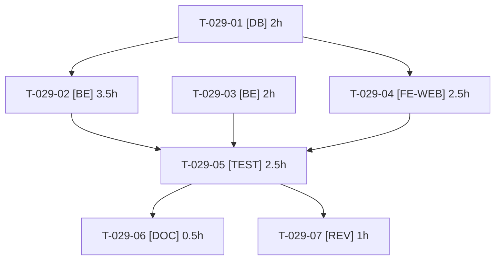

# Tâches — US-029 : Récepteur de webhooks de démo

## Informations US

- **Epic** : EPIC-07
- **Persona** : Sophie
- **Story Points** : 3
- **Sprint** : sprint-8-demo-et-durcissement
- **Dépendances** : US-004

## Résumé

En tant que Sophie, je veux voir les webhooks émis par l'outbox, afin de comprendre l'intégration sans appel sortant.

## Vue d'ensemble des tâches

| ID | Type | Tâche | Estimation | Dépend de | Statut |
|----|------|-------|------------|-----------|--------|
| T-029-01 | [DB] | Entité `ReceivedWebhook` (date, type, charge utile tronquée, signature vérifiée) et migration | 2h | — | 🔲 |
| T-029-02 | [BE] | Endpoint récepteur interne : vérification de la signature, limite de débit, taille maximale, stockage | 3.5h | T-029-01 | 🔲 |
| T-029-03 | [BE] | Abonnement de démo prérempli et refus de toute URL externe (validateur, protection SSRF) | 2h | — | 🔲 |
| T-029-04 | [FE-WEB] | Page « Webhooks reçus » (liste, détail, indicateur signature vérifiée) FR/EN | 2.5h | T-029-01 | 🔲 |
| T-029-05 | [TEST] | Test fonctionnel : commande passée → webhook signé visible ; URL externe refusée ; signature invalide rejetée | 2.5h | T-029-02, T-029-03, T-029-04 | 🔲 |
| T-029-06 | [DOC] | Documentation de la page et du fonctionnement de l'outbox | 0.5h | T-029-05 | 🔲 |
| T-029-07 | [REV] | Revue (SSRF, signature, rétention) | 1h | T-029-05 | 🔲 |

**Total estimé : 14h**

---

## Détail des tâches

### T-029-01 — Entité `ReceivedWebhook` (date, type, charge utile tronquée, signature vérifiée) et migration

- **Type** : [DB]
- **Estimation** : 2h
- **Dépend de** : —

**Description** :
Rétention bornée ; purgée au reset.

**Fichiers (indicatifs)** :
- `src/Entity/ReceivedWebhook.php`
- `migrations/`

**Critères de validation** :
- [ ] Migration réversible
- [ ] Mapping valide

---

### T-029-02 — Endpoint récepteur interne : vérification de la signature, limite de débit, taille maximale, stockage

- **Type** : [BE]
- **Estimation** : 3.5h
- **Dépend de** : T-029-01

**Description** :
Rejet des signatures invalides (aucun stockage), idempotence sur l'identifiant d'événement.

**Fichiers (indicatifs)** :
- `src/Webhook/ReceiverController.php`
- `config/routes/`

**Critères de validation** :
- [ ] Signature valide stockée
- [ ] Signature invalide : 401, rien de stocké
- [ ] Rejeu dédupliqué

---

### T-029-03 — Abonnement de démo prérempli et refus de toute URL externe (validateur, protection SSRF)

- **Type** : [BE]
- **Estimation** : 2h
- **Dépend de** : —

**Description** :
Seul l'endpoint local est acceptable ; échec de validation côté admin et côté émission.

**Fichiers (indicatifs)** :
- `src/Webhook/SubscriptionUrlValidator.php`
- `src/DataFixtures/`

**Critères de validation** :
- [ ] URL externe, redirection ou IP interne refusées
- [ ] Endpoint local accepté

---

### T-029-04 — Page « Webhooks reçus » (liste, détail, indicateur signature vérifiée) FR/EN

- **Type** : [FE-WEB]
- **Estimation** : 2.5h
- **Dépend de** : T-029-01

**Description** :
Accessible aux comptes de démo concernés ; charge utile échappée.

**Fichiers (indicatifs)** :
- `templates/demo/webhooks.html.twig`
- `src/Controller/Demo/`
- `translations/`

**Critères de validation** :
- [ ] Contenu échappé (XSS)
- [ ] Libellés FR/EN

---

### T-029-05 — Test fonctionnel : commande passée → webhook signé visible ; URL externe refusée ; signature invalide rejetée

- **Type** : [TEST]
- **Estimation** : 2.5h
- **Dépend de** : T-029-02, T-029-03, T-029-04

**Description** :
Voir critères de validation.

**Fichiers (indicatifs)** :
- `tests/Functional/WebhookReceiverTest.php`

**Critères de validation** :
- [ ] Scénario Gherkin d'US-029 vert

---

### T-029-06 — Documentation de la page et du fonctionnement de l'outbox

- **Type** : [DOC]
- **Estimation** : 0.5h
- **Dépend de** : T-029-05

**Description** :
Voir critères de validation.

**Fichiers (indicatifs)** :
- `docs/`

**Critères de validation** :
- [ ] Page documentée

---

### T-029-07 — Revue (SSRF, signature, rétention)

- **Type** : [REV]
- **Estimation** : 1h
- **Dépend de** : T-029-05

**Description** :
Voir critères de validation.

**Fichiers (indicatifs)** :
- sans objet

**Critères de validation** :
- [ ] Aucun constat bloquant

---

## Graphe de dépendances

## Résumé

| Couche | Nb tâches | Heures |
|--------|-----------|--------|
| [DB] | 1 | 2h |
| [BE] | 2 | 5.5h |
| [FE-WEB] | 1 | 2.5h |
| [TEST] | 1 | 2.5h |
| [DOC] | 1 | 0.5h |
| [REV] | 1 | 1h |
| **TOTAL** | **7** | **14h** |
