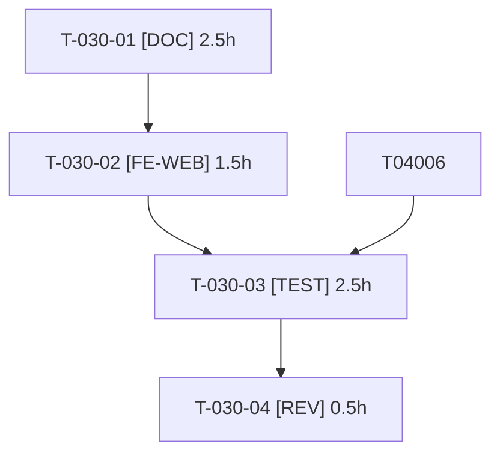

# Tâches — US-030 : Guide de connexion MCP

## Informations US

- **Epic** : EPIC-07
- **Persona** : Hugo
- **Story Points** : 2
- **Sprint** : sprint-8-demo-et-durcissement
- **Dépendances** : US-009

## Résumé

En tant que Hugo, je veux connecter Claude à la démo, afin de commander par conversation.

## Vue d'ensemble des tâches

| ID | Type | Tâche | Estimation | Dépend de | Statut |
|----|------|-------|------------|-----------|--------|
| T-030-01 | [DOC] | Guide pas à pas FR/EN : connecter Claude au compte de Claire (OAuth) et lister ses commandes | 2.5h | — | 🔲 |
| T-030-02 | [FE-WEB] | Page MCP de la démo : intégration du guide, liens, bloc de configuration copiable | 1.5h | T-030-01 | 🔲 |
| T-030-03 | [TEST] | Fumée : métadonnées OAuth, jeton du compte de Claire, appel MCP listant ses commandes (avec garde sortant) | 2.5h | T-030-02, T-040-06 | 🔲 |
| T-030-04 | [REV] | Revue du guide en suivant les étapes à froid | 0.5h | T-030-03 | 🔲 |

**Total estimé : 7h**

---

## Détail des tâches

### T-030-01 — Guide pas à pas FR/EN : connecter Claude au compte de Claire (OAuth) et lister ses commandes

- **Type** : [DOC]
- **Estimation** : 2.5h
- **Dépend de** : —

**Description** :
URL du serveur MCP, scopes, comptes de démo, captures/exemples de requêtes, limites de la démo.

**Fichiers (indicatifs)** :
- `templates/demo/mcp.html.twig`
- `docs/mcp.md`
- `translations/`

**Critères de validation** :
- [ ] Chaque étape numérotée et vérifiable
- [ ] Aucun secret réel

---

### T-030-02 — Page MCP de la démo : intégration du guide, liens, bloc de configuration copiable

- **Type** : [FE-WEB]
- **Estimation** : 1.5h
- **Dépend de** : T-030-01

**Description** :
Voir critères de validation.

**Fichiers (indicatifs)** :
- `templates/demo/mcp.html.twig`
- `src/Controller/Demo/`

**Critères de validation** :
- [ ] Page rendue FR/EN

---

### T-030-03 — Fumée : métadonnées OAuth, jeton du compte de Claire, appel MCP listant ses commandes (avec garde sortant)

- **Type** : [TEST]
- **Estimation** : 2.5h
- **Dépend de** : T-030-02, T-040-06

**Description** :
Validation manuelle avec Claude réel : par l'utilisateur (aucune commande externe depuis ce sprint).

**Fichiers (indicatifs)** :
- `tests/Functional/McpGuideSmokeTest.php`

**Critères de validation** :
- [ ] Commandes de Claire listées, celles d'un autre client non visibles

---

### T-030-04 — Revue du guide en suivant les étapes à froid

- **Type** : [REV]
- **Estimation** : 0.5h
- **Dépend de** : T-030-03

**Description** :
Voir critères de validation.

**Fichiers (indicatifs)** :
- sans objet

**Critères de validation** :
- [ ] Étapes reproduites sans improvisation

---

## Graphe de dépendances

## Résumé

| Couche | Nb tâches | Heures |
|--------|-----------|--------|
| [DOC] | 1 | 2.5h |
| [FE-WEB] | 1 | 1.5h |
| [TEST] | 1 | 2.5h |
| [REV] | 1 | 0.5h |
| **TOTAL** | **4** | **7h** |
