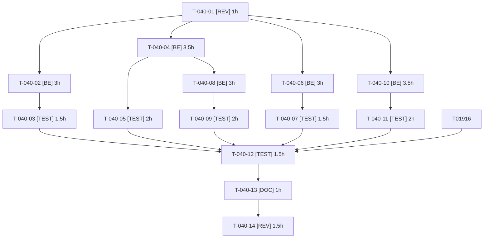

# Tâches — US-040 : Durcissement complémentaire

## Informations US

- **Epic** : EPIC-09
- **Persona** : Thibaut
- **Story Points** : 8
- **Sprint** : sprint-8-demo-et-durcissement
- **Dépendances** : US-036, US-037

## Résumé

En tant que Thibaut, je veux clore les constats mineurs reportés de la revue de sécurité du sprint 6, afin de réduire la surface d'abus de la démo avant et après son ouverture.

## Vue d'ensemble des tâches

| ID | Type | Tâche | Estimation | Dépend de | Statut |
|----|------|-------|------------|-----------|--------|
| T-040-01 | [REV] | Relire review-findings du sprint 6 (M2, M4, M5, M6, M8) et fixer la preuve attendue par constat | 1h | — | 🔲 |
| T-040-02 | [BE] | M2 — Désactiver l'inscription visiteur en démo publique (ou file d'attente invisible avec US-020) et purger les données saisies au reset | 3h | T-040-01 | 🔲 |
| T-040-03 | [TEST] | M2 — Test : inscription visiteur puis liste des clients de Sophie sans donnée personnelle | 1.5h | T-040-02 | 🔲 |
| T-040-04 | [BE] | M4 — Purge des images orphelines de `public/media/image` au reset (images de fixtures conservées) ; échec journalisé et signalé par /healthz | 3.5h | T-040-01 | 🔲 |
| T-040-05 | [TEST] | M4 — Test : image téléversée purgée, fixtures conservées, fichier non supprimable journalisé | 2h | T-040-04 | 🔲 |
| T-040-06 | [BE] | M5 — Décorer le `http_client.transport` des clients du serveur MCP avec le garde sortant (liste d'hôtes autorisés) | 3h | T-040-01 | 🔲 |
| T-040-07 | [TEST] | M5 — Test du garde sortant sur les clients MCP (autorisé/refusé, redirection vers hôte interdit) | 1.5h | T-040-06 | 🔲 |
| T-040-08 | [BE] | M6 — `/healthz` : limiteur dédié par IP visiteur et cache court (aucune requête SQL à chaque appel) ; seuil jamais atteint à fréquence normale | 3h | T-040-04 | 🔲 |
| T-040-09 | [TEST] | M6 — Test : rafale limitée, fréquence normale jamais bloquée, nombre de requêtes SQL | 2h | T-040-08 | 🔲 |
| T-040-10 | [BE] | M8 — Retour du simulateur PunchOut : authentifier le panier signé (HMAC) et refuser le rejeu | 3.5h | T-040-01 | 🔲 |
| T-040-11 | [TEST] | M8 — Test : retour légitime, rejeu, falsification, expiration ; aucune commande créée en cas de refus | 2h | T-040-10 | 🔲 |
| T-040-12 | [TEST] | Non-régression globale `HardeningTest` (+ routes exemptées après intégration d'US-019) | 1.5h | T-040-03, T-040-05, T-040-07, T-040-09, T-040-11 (T-019-16 ✅ faite au sprint 7) | 🔲 |
| T-040-13 | [DOC] | review-findings du sprint 8 : constats clos, acceptations écrites | 1h | T-040-12 | 🔲 |
| T-040-14 | [REV] | Contre-vérification indépendante (contexte frais) | 1.5h | T-040-13 | 🔲 |

**Total estimé : 30h**

---

## Détail des tâches

### T-040-01 — Relire review-findings du sprint 6 (M2, M4, M5, M6, M8) et fixer la preuve attendue par constat

- **Type** : [REV]
- **Estimation** : 1h
- **Dépend de** : —

**Description** :
Table constat → test cible ; confirmer que M1, M3, M7 sont bien clos.

**Fichiers (indicatifs)** :
- `sprints/sprint-6-railway-securite/review-findings.md`

**Critères de validation** :
- [ ] Preuve de clôture définie pour chaque constat

---

### T-040-02 — M2 — Désactiver l'inscription visiteur en démo publique (ou file d'attente invisible avec US-020) et purger les données saisies au reset

- **Type** : [BE]
- **Estimation** : 3h
- **Dépend de** : T-040-01

**Description** :
Décision : inscription désactivée en `DEMO_MODE` publique ; sinon acceptation écrite dans review-findings. Les clients saisis ne sont jamais lisibles par Sophie.

**Fichiers (indicatifs)** :
- `src/Security/`
- `config/packages/security.yaml`
- `templates/shop/register`

**Critères de validation** :
- [ ] Inscription refusée ou compte invisible dans la liste clients admin
- [ ] Reset purge tout compte hors fixtures

---

### T-040-03 — M2 — Test : inscription visiteur puis liste des clients de Sophie sans donnée personnelle

- **Type** : [TEST]
- **Estimation** : 1.5h
- **Dépend de** : T-040-02

**Description** :
Voir critères de validation.

**Fichiers (indicatifs)** :
- `tests/Functional/HardeningTest.php`

**Critères de validation** :
- [ ] Aucune donnée du visiteur dans la liste clients rendue

---

### T-040-04 — M4 — Purge des images orphelines de `public/media/image` au reset (images de fixtures conservées) ; échec journalisé et signalé par /healthz

- **Type** : [BE]
- **Estimation** : 3.5h
- **Dépend de** : T-040-01

**Description** :
Liste des fichiers attendus issue des fixtures ; suppression du reste ; erreur de suppression → journal + indicateur de santé, sans corrompre les données.

**Fichiers (indicatifs)** :
- `src/Reset/MediaPurger.php`
- `src/Reset/`

**Critères de validation** :
- [ ] Fichier orphelin supprimé
- [ ] Images de fixtures présentes
- [ ] Échec de suppression visible dans /healthz

---

### T-040-05 — M4 — Test : image téléversée purgée, fixtures conservées, fichier non supprimable journalisé

- **Type** : [TEST]
- **Estimation** : 2h
- **Dépend de** : T-040-04

**Description** :
Voir critères de validation.

**Fichiers (indicatifs)** :
- `tests/Functional/ResetMediaTest.php`

**Critères de validation** :
- [ ] Les 3 cas verts

---

### T-040-06 — M5 — Décorer le `http_client.transport` des clients du serveur MCP avec le garde sortant (liste d'hôtes autorisés)

- **Type** : [BE]
- **Estimation** : 3h
- **Dépend de** : T-040-01

**Description** :
Tous les clients HTTP scopés du MCP passent par le garde ; hôte non autorisé = exception journalisée.

**Fichiers (indicatifs)** :
- `config/services.yaml`
- `src/Mcp/`
- `src/Http/OutboundGuard*.php`

**Critères de validation** :
- [ ] Requête vers un hôte non listé refusée
- [ ] Hôte autorisé (OAuth/API interne) fonctionne

---

### T-040-07 — M5 — Test du garde sortant sur les clients MCP (autorisé/refusé, redirection vers hôte interdit)

- **Type** : [TEST]
- **Estimation** : 1.5h
- **Dépend de** : T-040-06

**Description** :
Voir critères de validation.

**Fichiers (indicatifs)** :
- `tests/Functional/McpOutboundGuardTest.php`

**Critères de validation** :
- [ ] Refus vérifié, redirection vers hôte interdit refusée

---

### T-040-08 — M6 — `/healthz` : limiteur dédié par IP visiteur et cache court (aucune requête SQL à chaque appel) ; seuil jamais atteint à fréquence normale

- **Type** : [BE]
- **Estimation** : 3h
- **Dépend de** : T-040-04

**Description** :
Limiteur au seuil supérieur à la fréquence d'un moniteur (ex. 1/10 s) ; réponse mise en cache quelques secondes.

**Fichiers (indicatifs)** :
- `src/Health/HealthController.php`
- `config/packages/rate_limiter.yaml`

**Critères de validation** :
- [ ] Rafale limitée (429)
- [ ] Fréquence normale : jamais de 429
- [ ] Pas de SQL par appel

---

### T-040-09 — M6 — Test : rafale limitée, fréquence normale jamais bloquée, nombre de requêtes SQL

- **Type** : [TEST]
- **Estimation** : 2h
- **Dépend de** : T-040-08

**Description** :
Voir critères de validation.

**Fichiers (indicatifs)** :
- `tests/Functional/HealthzTest.php`

**Critères de validation** :
- [ ] Les 3 cas verts

---

### T-040-10 — M8 — Retour du simulateur PunchOut : authentifier le panier signé (HMAC) et refuser le rejeu

- **Type** : [BE]
- **Estimation** : 3.5h
- **Dépend de** : T-040-01

**Description** :
Jeton à usage unique avec expiration ; aucune commande si signature invalide, rejeu ou panier falsifié.

**Fichiers (indicatifs)** :
- `src/PunchOut/SimulatorReturnController.php`
- `src/PunchOut/Signature/`

**Critères de validation** :
- [ ] Rejeu refusé
- [ ] Falsification refusée
- [ ] Retour légitime fonctionne

---

### T-040-11 — M8 — Test : retour légitime, rejeu, falsification, expiration ; aucune commande créée en cas de refus

- **Type** : [TEST]
- **Estimation** : 2h
- **Dépend de** : T-040-10

**Description** :
Voir critères de validation.

**Fichiers (indicatifs)** :
- `tests/Functional/PunchOutSimulatorReturnTest.php`

**Critères de validation** :
- [ ] Aucune commande créée sur refus

---

### T-040-12 — Non-régression globale `HardeningTest` (+ routes exemptées après intégration d'US-019)

- **Type** : [TEST]
- **Estimation** : 1.5h
- **Dépend de** : T-040-03, T-040-05, T-040-07, T-040-09, T-040-11 ; T-019-16 (intégration d'US-019 dans la démo, sprint 7) ✅ satisfaite

**Description** :
Voir critères de validation.

**Fichiers (indicatifs)** :
- `tests/Functional/HardeningTest.php`

**Critères de validation** :
- [ ] `HardeningTest` vert
- [ ] ECS et PHPStan verts

---

### T-040-13 — review-findings du sprint 8 : constats clos, acceptations écrites

- **Type** : [DOC]
- **Estimation** : 1h
- **Dépend de** : T-040-12

**Description** :
Voir critères de validation.

**Fichiers (indicatifs)** :
- `sprints/sprint-8-demo-et-durcissement/review-findings.md`

**Critères de validation** :
- [ ] M2, M4, M5, M6, M8 clos avec preuve ou acceptation écrite

---

### T-040-14 — Contre-vérification indépendante (contexte frais)

- **Type** : [REV]
- **Estimation** : 1.5h
- **Dépend de** : T-040-13

**Description** :
Voir critères de validation.

**Fichiers (indicatifs)** :
- sans objet

**Critères de validation** :
- [ ] Aucun constat rouvert

---

## Graphe de dépendances

## Résumé

| Couche | Nb tâches | Heures |
|--------|-----------|--------|
| [REV] | 2 | 2.5h |
| [BE] | 5 | 16h |
| [TEST] | 6 | 10.5h |
| [DOC] | 1 | 1h |
| **TOTAL** | **14** | **30h** |
