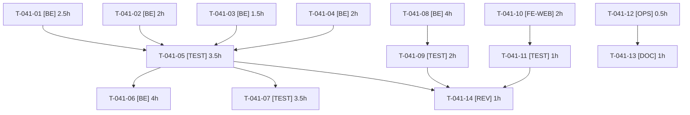

# Tâches — US-041 : Qualité des données et du reset

## Informations US

- **Epic** : EPIC-08
- **Persona** : Thibaut
- **Story Points** : 5
- **Sprint** : sprint-8-demo-et-durcissement
- **Dépendances** : US-033, US-034, US-036

## Résumé

En tant que Thibaut, je veux fiabiliser le chargement des données de démo et finaliser le suivi du reset et du coût, afin de que la démo reste propre, rapide à réinitialiser et dans le budget.

## Vue d'ensemble des tâches

| ID | Type | Tâche | Estimation | Dépend de | Statut |
|----|------|-------|------------|-----------|--------|
| T-041-01 | [BE] | S2-R3 — Lignes CSV au mauvais nombre de colonnes : échec explicite avec fichier et ligne | 2.5h | — | 🔲 |
| T-041-02 | [BE] | S2-R4 — Doublons de SKU entre fichiers : détection et échec explicite | 2h | — | 🔲 |
| T-041-03 | [BE] | S2-R5 — `attributes_json` invalide ou valeur non-chaîne : erreur explicite | 1.5h | — | 🔲 |
| T-041-04 | [BE] | S2-R6 — BOM UTF-8, en-tête non trimé, encodage invalide | 2h | — | 🔲 |
| T-041-05 | [TEST] | Tests R3 à R6 et non-régression : 210 produits identiques à avant | 3.5h | T-041-01, T-041-02, T-041-03, T-041-04 | 🔲 |
| T-041-06 | [BE] | S2-R7 — Réduire les ≈ 420 requêtes du reset d'au moins 50 % (sacrifiable) | 4h | T-041-05 | 🔲 |
| T-041-07 | [TEST] | S2-R8 à R10 — Vérifier source partagée des comptes, ordre des fixtures de même priorité, valeurs d'attribut non traduisibles ; acter par écrit (sacrifiable) | 3.5h | T-041-05 | 🔲 |
| T-041-08 | [BE] | S4-R3 — Prix « dès » calculé en lot sur les listes | 4h | — | 🔲 |
| T-041-09 | [TEST] | S4-R3 — Test : nombre de requêtes constant pour 5, 20 et 50 produits, valeurs inchangées | 2h | T-041-08 | 🔲 |
| T-041-10 | [FE-WEB] | T-033-05 — Bandeau « prochaine remise à zéro » à 03:00 Europe/Paris, FR/EN | 2h | — | 🔲 |
| T-041-11 | [TEST] | Test du bandeau : avant/après 03:00 et passage heure d'été/hiver (horloge injectée) | 1h | T-041-10 | 🔲 |
| T-041-12 | [OPS] | T-034-02 — Relevé du coût Railway après une semaine d'exploitation | 0.5h | — | 📅 calendaire |
| T-041-13 | [DOC] | Rapport de coût et mise à jour du suivi budget (US-034) | 1h | T-041-12 | 🔲 |
| T-041-14 | [REV] | Revue : jeux de données, requêtes, bandeau | 1h | T-041-05, T-041-09, T-041-11 | 🔲 |

**Total estimé : 30.5h**

---

## Détail des tâches

### T-041-01 — S2-R3 — Lignes CSV au mauvais nombre de colonnes : échec explicite avec fichier et ligne

- **Type** : [BE]
- **Estimation** : 2.5h
- **Dépend de** : —

**Description** :
Plus de TypeError ni de perte silencieuse.

**Fichiers (indicatifs)** :
- `src/DataFixtures/Csv/`

**Critères de validation** :
- [ ] Message « fichier:ligne » sur ligne mal formée
- [ ] Les 3 CSV valides chargent 210 produits

---

### T-041-02 — S2-R4 — Doublons de SKU entre fichiers : détection et échec explicite

- **Type** : [BE]
- **Estimation** : 2h
- **Dépend de** : —

**Description** :
Voir critères de validation.

**Fichiers (indicatifs)** :
- `src/DataFixtures/Csv/`

**Critères de validation** :
- [ ] Doublon inter-fichiers signalé avec les deux fichiers

---

### T-041-03 — S2-R5 — `attributes_json` invalide ou valeur non-chaîne : erreur explicite

- **Type** : [BE]
- **Estimation** : 1.5h
- **Dépend de** : —

**Description** :
Voir critères de validation.

**Fichiers (indicatifs)** :
- `src/DataFixtures/Csv/`

**Critères de validation** :
- [ ] JSON invalide et valeur non-chaîne rejetés avec fichier et ligne

---

### T-041-04 — S2-R6 — BOM UTF-8, en-tête non trimé, encodage invalide

- **Type** : [BE]
- **Estimation** : 2h
- **Dépend de** : —

**Description** :
BOM et espaces ignorés ; encodage invalide rejeté avec message clair.

**Fichiers (indicatifs)** :
- `src/DataFixtures/Csv/`

**Critères de validation** :
- [ ] CSV avec BOM lu
- [ ] Encodage invalide rejeté

---

### T-041-05 — Tests R3 à R6 et non-régression : 210 produits identiques à avant

- **Type** : [TEST]
- **Estimation** : 3.5h
- **Dépend de** : T-041-01, T-041-02, T-041-03, T-041-04

**Description** :
Voir critères de validation.

**Fichiers (indicatifs)** :
- `tests/Unit/DataFixtures/`
- `tests/Functional/FixturesTest.php`

**Critères de validation** :
- [ ] Chaque cas invalide produit l'erreur attendue
- [ ] Jeu de données final identique

---

### T-041-06 — S2-R7 — Réduire les ≈ 420 requêtes du reset d'au moins 50 % (sacrifiable)

- **Type** : [BE]
- **Estimation** : 4h
- **Dépend de** : T-041-05

**Description** :
Lots, flush groupé, désactivation des listeners inutiles au chargement.

**Fichiers (indicatifs)** :
- `src/DataFixtures/`
- `src/Reset/`

**Critères de validation** :
- [ ] Nombre de requêtes du reset divisé par 2 au moins
- [ ] Données identiques

---

### T-041-07 — S2-R8 à R10 — Vérifier source partagée des comptes, ordre des fixtures de même priorité, valeurs d'attribut non traduisibles ; acter par écrit (sacrifiable)

- **Type** : [TEST]
- **Estimation** : 3.5h
- **Dépend de** : T-041-05

**Description** :
Un test de vérification par constat ; correctif seulement si le test échoue.

**Fichiers (indicatifs)** :
- `tests/Functional/FixturesConsistencyTest.php`
- `sprints/sprint-8-demo-et-durcissement/review-findings.md`

**Critères de validation** :
- [ ] 3 tests verts ou correctif + test
- [ ] Statut écrit pour chacun

---

### T-041-08 — S4-R3 — Prix « dès » calculé en lot sur les listes

- **Type** : [BE]
- **Estimation** : 4h
- **Dépend de** : —

**Description** :
Une requête par page (indépendante du nombre de produits) ; mêmes valeurs qu'avant.

**Fichiers (indicatifs)** :
- `src/Twig/`
- `src/Repository/ProductPriceRepository.php`

**Critères de validation** :
- [ ] Valeurs identiques
- [ ] Requêtes constantes

---

### T-041-09 — S4-R3 — Test : nombre de requêtes constant pour 5, 20 et 50 produits, valeurs inchangées

- **Type** : [TEST]
- **Estimation** : 2h
- **Dépend de** : T-041-08

**Description** :
Voir critères de validation.

**Fichiers (indicatifs)** :
- `tests/Functional/ProductListQueryCountTest.php`

**Critères de validation** :
- [ ] Même nombre de requêtes quelle que soit la taille de la liste

---

### T-041-10 — T-033-05 — Bandeau « prochaine remise à zéro » à 03:00 Europe/Paris, FR/EN

- **Type** : [FE-WEB]
- **Estimation** : 2h
- **Dépend de** : —

**Description** :
Avant 03:00 : aujourd'hui 03:00 ; après : demain 03:00 ; changement d'heure géré.

**Fichiers (indicatifs)** :
- `templates/demo/_banner.html.twig`
- `src/Demo/NextResetProvider.php`
- `translations/`

**Critères de validation** :
- [ ] Texte rendu avec l'échéance correcte en FR et EN

---

### T-041-11 — Test du bandeau : avant/après 03:00 et passage heure d'été/hiver (horloge injectée)

- **Type** : [TEST]
- **Estimation** : 1h
- **Dépend de** : T-041-10

**Description** :
Voir critères de validation.

**Fichiers (indicatifs)** :
- `tests/Unit/Demo/NextResetProviderTest.php`

**Critères de validation** :
- [ ] 3 cas verts

---

### T-041-12 — T-034-02 — Relevé du coût Railway après une semaine d'exploitation

- **Type** : [OPS] — **calendaire — à partir du 2026-10-23** (action externe, accès Railway de l'utilisateur)
- **Estimation** : 0.5h
- **Dépend de** : —

**Description** :
Tâche **calendaire** : impossible avant le 2026-10-23 et nécessite l'accès Railway de l'utilisateur (action externe). Sans accès : reste ouverte avec la date prévue, jamais close sur une estimation.

**Fichiers (indicatifs)** :
- `Railway (externe)`

**Critères de validation** :
- [ ] Coût réel relevé à J+7 ou tâche reportée avec date

---

### T-041-13 — Rapport de coût et mise à jour du suivi budget (US-034)

- **Type** : [DOC]
- **Estimation** : 1h
- **Dépend de** : T-041-12

**Description** :
Voir critères de validation.

**Fichiers (indicatifs)** :
- `docs/`
- `sprints/sprint-8-demo-et-durcissement/review-findings.md`

**Critères de validation** :
- [ ] Coût réel comparé au plafond de 25 $/mois

---

### T-041-14 — Revue : jeux de données, requêtes, bandeau

- **Type** : [REV]
- **Estimation** : 1h
- **Dépend de** : T-041-05, T-041-09, T-041-11

**Description** :
Voir critères de validation.

**Fichiers (indicatifs)** :
- sans objet

**Critères de validation** :
- [ ] Aucun constat bloquant

---

## Graphe de dépendances

## Résumé

| Couche | Nb tâches | Heures |
|--------|-----------|--------|
| [BE] | 6 | 16h |
| [TEST] | 4 | 10h |
| [FE-WEB] | 1 | 2h |
| [OPS] | 1 | 0.5h |
| [DOC] | 1 | 1h |
| [REV] | 1 | 1h |
| **TOTAL** | **14** | **30.5h** |
