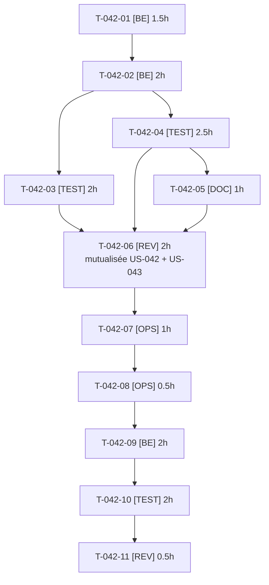

# Tâches — US-042 : Routes restreintes configurables dans channel-access

## Informations US

- **Epic** : EPIC-04
- **Persona** : Thibaut
- **Story Points** : 5
- **Sprint** : sprint-8-demo-et-durcissement
- **Dépendances** : US-019, US-020
- **Dépôt plugin** : `/Users/tmonier/Projects/sylius_plugins/sylius-channel-access-plugin`

## Résumé

En tant que Thibaut, je veux lister dans la configuration du plugin channel-access les routes et chemins refusés aux visiteurs sans accès aux prix, afin que la démo n'ait plus besoin de `RestrictPriceRoutesPass`.

## Vue d'ensemble des tâches

| ID | Type | Tâche | Estimation | Dépend de | Statut |
|----|------|-------|------------|-----------|--------|
| T-042-01 | [BE] | Plugin : options `restricted_routes` et `restricted_paths` dans `Configuration` (même validation que `exempt_*` : valeur vide ou non textuelle refusée, motif trop large refusé) | 1.5h | — | 🔲 |
| T-042-02 | [BE] | Plugin : fusion routes intégrées + configurées dans l'extension ; échec de compilation si une route est à la fois exemptée et restreinte (message nommant la route) | 2h | T-042-01 | 🔲 |
| T-042-03 | [TEST] | Plugin : tests unitaires de configuration et d'extension (défaut inchangé, fusion, valeur invalide, conflit) | 2h | T-042-02 | 🔲 |
| T-042-04 | [TEST] | Plugin : tests fonctionnels (route configurée refusée comme le panier, joker `prefix_*`, chemin d'API 401/403, visiteur avec accès non affecté) | 2.5h | T-042-02 | 🔲 |
| T-042-05 | [DOC] | Plugin : README (options, exemple devis/commande rapide/MCP), CHANGELOG 0.2.0 | 1h | T-042-04 | 🔲 |
| T-042-06 | [REV] | **Revue de sécurité mutualisée channel-access + b2b-mcp** (une passe, agent distinct de l'auteur) : deny-by-default, jokers, conflit exempt/restreint, absence de contournement ; fail closed, fuite de détail, en-têtes de cache, ordre des écouteurs, contournement par jeton (critères de T-043-08, fusionnée ici) | 2h | T-042-03, T-042-04, T-042-05, T-043-05, T-043-06, T-043-07 | 🔲 |
| T-042-07 | [OPS] | Plugin : CI verte (ECS, PHPStan, tests) sur la branche du plugin — push de branche = action externe, **GO utilisateur** | 1h | T-042-06 | 🔲 |
| T-042-08 | [OPS] | **GO utilisateur** : demande de publication, puis tag et release 0.2.0 (Packagist) — action externe | 0.5h | T-042-07 | 🔲 |
| T-042-09 | [BE] | Démo : déclarer `restricted_routes` et `restricted_paths` dans `config/packages`, supprimer `RestrictPriceRoutesPass` et son enregistrement, contrainte `^0.2` (mise à jour du lock après GO, sans install inutile) | 2h | T-042-08 | 🔲 |
| T-042-10 | [TEST] | Démo : non-régression `HardeningTest` et tests des routes restreintes (devis, commande rapide, MCP, prix dégressifs) pour visiteur, client en attente et client approuvé | 2h | T-042-09 | 🔲 |
| T-042-11 | [REV] | Démo : revue du retrait (régression de sécurité, doc de démo à jour) | 0.5h | T-042-10 | 🔲 |

**Total estimé : 17h** (revue de sécurité mutualisée avec US-043 : 2 h au lieu de 3 h)

---

## Détail des tâches

### T-042-01 — Plugin : options `restricted_routes` et `restricted_paths` dans `Configuration` (même validation que `exempt_*` : valeur vide ou non textuelle refusée, motif trop large refusé)

- **Type** : [BE]
- **Estimation** : 1.5h
- **Dépend de** : —

**Description** :
Réutiliser l'helper `patterns()` existant (DRY). Dépôt : `sylius-channel-access-plugin`.

**Fichiers (indicatifs)** :
- `src/DependencyInjection/Configuration.php`

**Critères de validation** :
- [ ] Les deux options existent, listes vides par défaut
- [ ] Valeur vide ou non textuelle : erreur nommant l'option

---

### T-042-02 — Plugin : fusion routes intégrées + configurées dans l'extension ; échec de compilation si une route est à la fois exemptée et restreinte (message nommant la route)

- **Type** : [BE]
- **Estimation** : 2h
- **Dépend de** : T-042-01

**Description** :
Remplace les `setParameter` figés (`RESTRICTED_ROUTES`, `RESTRICTED_PATHS`) par `array_unique([...intégrées, ...configurées])`. Sans option, comportement identique à 0.1.0.

**Fichiers (indicatifs)** :
- `src/DependencyInjection/TmonierSyliusChannelAccessExtension.php`

**Critères de validation** :
- [ ] Valeurs intégrées toujours présentes
- [ ] Conflit exempt/restreint détecté à la compilation

---

### T-042-03 — Plugin : tests unitaires de configuration et d'extension (défaut inchangé, fusion, valeur invalide, conflit)

- **Type** : [TEST]
- **Estimation** : 2h
- **Dépend de** : T-042-02

**Description** :
Tests de la configuration et de l'extension.

**Fichiers (indicatifs)** :
- `tests/Unit/DependencyInjection/`

**Critères de validation** :
- [ ] Défaut = routes de 0.1.0
- [ ] Erreurs explicites vérifiées

---

### T-042-04 — Plugin : tests fonctionnels (route configurée refusée comme le panier, joker `prefix_*`, chemin d'API 401/403, visiteur avec accès non affecté)

- **Type** : [TEST]
- **Estimation** : 2.5h
- **Dépend de** : T-042-02

**Description** :
Configuration de test de l'application de test du plugin (pas de vendor supplémentaire).

**Fichiers (indicatifs)** :
- `tests/Functional/`
- `tests/TestApplication/config/`

**Critères de validation** :
- [ ] Redirection vers la connexion pour la route configurée
- [ ] Chemin d'API refusé
- [ ] Visiteur autorisé non bloqué

---

### T-042-05 — Plugin : README (options, exemple devis/commande rapide/MCP), CHANGELOG 0.2.0

- **Type** : [DOC]
- **Estimation** : 1h
- **Dépend de** : T-042-04

**Description** :
Documenter la compatibilité ascendante.

**Fichiers (indicatifs)** :
- `README.md`
- `CHANGELOG.md`

**Critères de validation** :
- [ ] Exemple de configuration testé tel quel

---

### T-042-06 — Revue de sécurité mutualisée channel-access + b2b-mcp (une seule passe pour US-042 et US-043)

- **Type** : [REV]
- **Estimation** : 2h
- **Dépend de** : T-042-03, T-042-04, T-042-05, T-043-05, T-043-06, T-043-07

**Description** :
Arbitrage utilisateur du 2026-10-16 : une seule revue indépendante (agent distinct de l'auteur) couvre les deux plugins. Elle remplace T-042-06 et T-043-08 (fusionnée). Aucun constat critique ou majeur ouvert avant chaque demande de GO (DoD).

**Fichiers (indicatifs)** :
- sans objet

**Critères de validation** :
- [ ] Rapport de revue unique, constats traités pour les deux plugins
- [ ] channel-access : deny-by-default, jokers, conflit exempt/restreint, absence de contournement
- [ ] b2b-mcp : fail closed, absence de fuite de détail, en-têtes de cache, ordre des écouteurs, contournement par jeton

---

### T-042-07 — Plugin : CI verte (ECS, PHPStan, tests) sur la branche du plugin — push de branche = action externe, **GO utilisateur**

- **Type** : [OPS]
- **Estimation** : 1h
- **Dépend de** : T-042-06

**Description** :
Aucune installation locale ; la CI du dépôt fait foi.

**Fichiers (indicatifs)** :
- sans objet

**Critères de validation** :
- [ ] CI verte sur la branche du plugin

---

### T-042-08 — **GO utilisateur** : demande de publication, puis tag et release 0.2.0 (Packagist) — action externe

- **Type** : [OPS]
- **Estimation** : 0.5h
- **Dépend de** : T-042-07

**Description** :
Sans GO : plugin laissé en branche, `RestrictPriceRoutesPass` conservée (T-042-09 non exécutée, risque acté).

**Fichiers (indicatifs)** :
- sans objet

**Critères de validation** :
- [ ] GO explicite obtenu avant tout tag
- [ ] Release 0.2.0 publiée, ou décision de report écrite

---

### T-042-09 — Démo : déclarer `restricted_routes` et `restricted_paths` dans `config/packages`, supprimer `RestrictPriceRoutesPass` et son enregistrement, contrainte `^0.2` (mise à jour du lock après GO, sans install inutile)

- **Type** : [BE]
- **Estimation** : 2h
- **Dépend de** : T-042-08

**Description** :
Mêmes routes que `RestrictPriceRoutesPass::ROUTES` et `::PATHS`. Retrait seulement après publication.

**Fichiers (indicatifs)** :
- `config/packages/tmonier_channel_access.yaml`
- `src/DependencyInjection/Compiler/RestrictPriceRoutesPass.php (supprimé)`
- `src/Kernel.php`
- `composer.json`

**Critères de validation** :
- [ ] Aucune référence restante à la passe
- [ ] Mêmes paramètres compilés qu'avant

---

### T-042-10 — Démo : non-régression `HardeningTest` et tests des routes restreintes (devis, commande rapide, MCP, prix dégressifs) pour visiteur, client en attente et client approuvé

- **Type** : [TEST]
- **Estimation** : 2h
- **Dépend de** : T-042-09

**Description** :
Comparer les paramètres compilés avant/après.

**Fichiers (indicatifs)** :
- `tests/Functional/HardeningTest.php`

**Critères de validation** :
- [ ] Mêmes refus qu'avant le retrait
- [ ] Tests verts

---

### T-042-11 — Démo : revue du retrait (régression de sécurité, doc de démo à jour)

- **Type** : [REV]
- **Estimation** : 0.5h
- **Dépend de** : T-042-10

**Description** :
Mettre à jour la documentation de la démo qui mentionne la passe.

**Fichiers (indicatifs)** :
- `docs/`

**Critères de validation** :
- [ ] Aucun constat bloquant

---

## Graphe de dépendances

## Résumé

| Couche | Nb tâches | Heures |
|--------|-----------|--------|
| [BE] | 3 | 5.5h |
| [TEST] | 3 | 6.5h |
| [DOC] | 1 | 1h |
| [REV] | 2 | 2.5h |
| [OPS] | 2 | 1.5h |
| **TOTAL** | **11** | **17h** |
