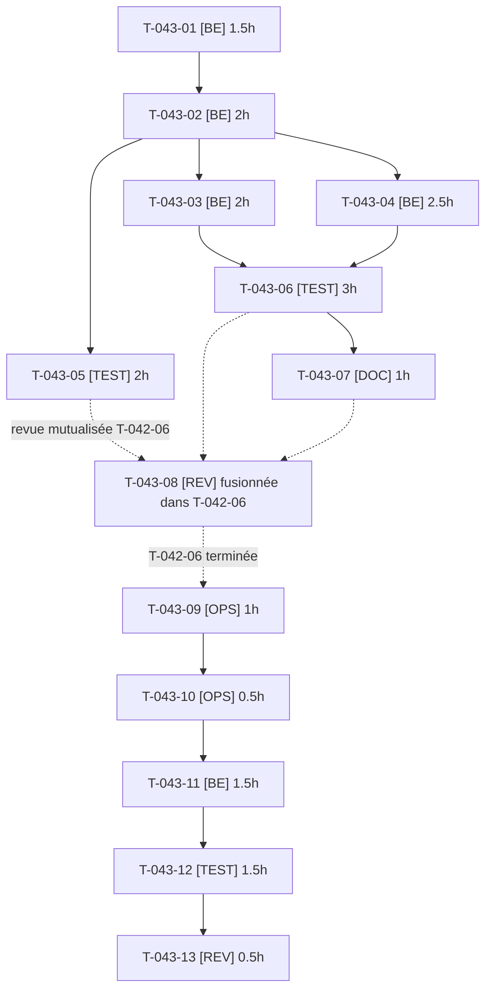

# Tâches — US-043 : Statut d'approbation dans le plugin b2b-mcp

## Informations US

- **Epic** : EPIC-07
- **Persona** : Thibaut
- **Story Points** : 5
- **Sprint** : sprint-8-demo-et-durcissement
- **Dépendances** : US-020
- **Dépôt plugin** : `/Users/tmonier/Projects/sylius_plugins/sylius-b2b-mcp-plugin`

## Résumé

En tant que Thibaut, je veux que le plugin b2b-mcp refuse le consentement OAuth et les appels `/_mcp` d'un client dont le compte n'est pas utilisable, afin que la démo n'ait plus besoin de `McpApprovalGuard`.

## Vue d'ensemble des tâches

| ID | Type | Tâche | Estimation | Dépend de | Statut |
|----|------|-------|------------|-----------|--------|
| T-043-01 | [BE] | Plugin : interface `AccountUsabilityCheckerInterface` (tag, méthode `check(CustomerInterface)` → résultat accepté/refusé avec motif), sans dépendance à registration-approval | 1.5h | — | 🔲 |
| T-043-02 | [BE] | Plugin : chaîne de vérificateurs (premier refus gagne et son motif est journalisé, exception = refus fail closed, erreur journalisée sans détail au client) | 2h | T-043-01 | 🔲 |
| T-043-03 | [BE] | Plugin : refuser le consentement OAuth et l'émission du code d'autorisation si le compte est refusé | 2h | T-043-02 | 🔲 |
| T-043-04 | [BE] | Plugin : refuser `/_mcp` (403 `access_denied`, `Cache-Control: private, no-store`, appel journalisé dans l'audit) après l'authentification MCP | 2.5h | T-043-02 | 🔲 |
| T-043-05 | [TEST] | Plugin : tests unitaires de la chaîne (utilisable, refus, exception fail closed, deux vérificateurs dont un refuse) | 2h | T-043-02 | 🔲 |
| T-043-06 | [TEST] | Plugin : tests fonctionnels (comportement inchangé sans vérificateur, consentement refusé, jeton existant 403 sans cache public + audit, exception) | 3h | T-043-03, T-043-04 | 🔲 |
| T-043-07 | [DOC] | Plugin : README (point d'extension, exemple de vérificateur), CHANGELOG, numéro de version mineure | 1h | T-043-06 | 🔲 |
| T-043-08 | [REV] | ~~Plugin : revue de sécurité indépendante~~ — **fusionnée dans T-042-06** (revue mutualisée channel-access + b2b-mcp ; critères conservés ci-dessous) | 0h | — | ➡️ fusionnée |
| T-043-09 | [OPS] | Plugin : CI verte (ECS, PHPStan, tests) sur la branche du plugin — push de branche = action externe, **GO utilisateur** | 1h | T-042-06 | 🔲 |
| T-043-10 | [OPS] | **GO utilisateur** : demande de publication, puis tag de la version mineure (Packagist) — action externe | 0.5h | T-043-09 | 🔲 |
| T-043-11 | [BE] | Démo : vérificateur de compte basé sur `VisitorApprovalInterface` (motif en attente/rejeté), supprimer `McpApprovalGuard`, contrainte de version du plugin | 1.5h | T-043-10 | 🔲 |
| T-043-12 | [TEST] | Démo : test d'un compte en attente et d'un compte rejeté sur `/_mcp` et au consentement, compte approuvé inchangé | 1.5h | T-043-11 | 🔲 |
| T-043-13 | [REV] | Démo : revue du retrait (régression de sécurité, guide MCP US-030 à jour) | 0.5h | T-043-12 | 🔲 |

**Total estimé : 19h** (13 tâches dont T-043-08 fusionnée dans T-042-06 : 12 tâches comptées)

---

## Détail des tâches

### T-043-01 — Plugin : interface `AccountUsabilityCheckerInterface` (tag, méthode `check(CustomerInterface)` → résultat accepté/refusé avec motif), sans dépendance à registration-approval

- **Type** : [BE]
- **Estimation** : 1.5h
- **Dépend de** : —

**Description** :
Interface unique, petite (ISP). Dépôt : `sylius-b2b-mcp-plugin`.

**Fichiers (indicatifs)** :
- `src/Security/AccountUsabilityCheckerInterface.php`
- `src/Security/AccountUsability.php`

**Critères de validation** :
- [ ] Interface taguée par autoconfiguration
- [ ] Aucune dépendance à registration-approval dans composer.json

---

### T-043-02 — Plugin : chaîne de vérificateurs (premier refus gagne et son motif est journalisé, exception = refus fail closed, erreur journalisée sans détail au client)

- **Type** : [BE]
- **Estimation** : 2h
- **Dépend de** : T-043-01

**Description** :
Un seul service partagé par le consentement et `/_mcp` (DRY).

**Fichiers (indicatifs)** :
- `src/Security/AccountUsabilityChain.php`
- `src/Resources/config/services.php`

**Critères de validation** :
- [ ] Sans vérificateur : compte utilisable
- [ ] Exception = refus

---

### T-043-03 — Plugin : refuser le consentement OAuth et l'émission du code d'autorisation si le compte est refusé

- **Type** : [BE]
- **Estimation** : 2h
- **Dépend de** : T-043-02

**Description** :
Brancher la chaîne dans l'écran de consentement et l'autorisation.

**Fichiers (indicatifs)** :
- `src/Controller/Shop/ConsentController.php`
- `src/Controller/OAuth/AuthorizeController.php`

**Critères de validation** :
- [ ] Aucun code d'autorisation émis pour un compte refusé

---

### T-043-04 — Plugin : refuser `/_mcp` (403 `access_denied`, `Cache-Control: private, no-store`, appel journalisé dans l'audit) après l'authentification MCP

- **Type** : [BE]
- **Estimation** : 2.5h
- **Dépend de** : T-043-02

**Description** :
Écouteur `kernel.request` après `McpAuthenticationListener`, via `McpEndpoint`.

**Fichiers (indicatifs)** :
- `src/Security/McpAccountUsabilityListener.php`
- `src/Audit/ToolCallLogger.php`

**Critères de validation** :
- [ ] Jeton émis avant le refus : 403
- [ ] Entrée d'audit présente

---

### T-043-05 — Plugin : tests unitaires de la chaîne (utilisable, refus, exception fail closed, deux vérificateurs dont un refuse)

- **Type** : [TEST]
- **Estimation** : 2h
- **Dépend de** : T-043-02

**Description** :
Pas de mock du comportement : vérificateurs de test réels.

**Fichiers (indicatifs)** :
- `tests/Unit/Security/AccountUsabilityChainTest.php`

**Critères de validation** :
- [ ] 4 cas verts

---

### T-043-06 — Plugin : tests fonctionnels (comportement inchangé sans vérificateur, consentement refusé, jeton existant 403 sans cache public + audit, exception)

- **Type** : [TEST]
- **Estimation** : 3h
- **Dépend de** : T-043-03, T-043-04

**Description** :
Étendre `OAuthFlowTest` et `B2bMcpTestTrait`.

**Fichiers (indicatifs)** :
- `tests/Functional/OAuthFlowTest.php`
- `tests/Functional/AccountUsabilityTest.php`

**Critères de validation** :
- [ ] Scénarios 1 à 4 du Gherkin couverts

---

### T-043-07 — Plugin : README (point d'extension, exemple de vérificateur), CHANGELOG, numéro de version mineure

- **Type** : [DOC]
- **Estimation** : 1h
- **Dépend de** : T-043-06

**Description** :
Version mineure proposée à l'utilisateur avec la demande de GO.

**Fichiers (indicatifs)** :
- `README.md`
- `CHANGELOG.md`

**Critères de validation** :
- [ ] Exemple de vérificateur documenté

---

### T-043-08 — Revue de sécurité du plugin b2b-mcp — fusionnée dans T-042-06 (revue mutualisée)

- **Type** : [REV]
- **Estimation** : 0h (portée par T-042-06, 2h pour les deux plugins)
- **Dépend de** : — (voir T-042-06, qui dépend de T-043-05, T-043-06 et T-043-07)

**Description** :
Arbitrage utilisateur du 2026-10-16 : revue unique pour US-042 et US-043. Aucun constat critique ou majeur ouvert avant la demande de GO. Critères repris dans T-042-06 : fail closed, fuite de détail, en-têtes de cache, ordre des écouteurs, contournement par jeton.

**Fichiers (indicatifs)** :
- sans objet

**Critères de validation** :
- [ ] Rapport de revue, constats traités

---

### T-043-09 — Plugin : CI verte (ECS, PHPStan, tests) sur la branche du plugin — push de branche = action externe, **GO utilisateur**

- **Type** : [OPS]
- **Estimation** : 1h
- **Dépend de** : T-042-06

**Description** :
Aucune installation locale.

**Fichiers (indicatifs)** :
- sans objet

**Critères de validation** :
- [ ] CI verte sur la branche du plugin

---

### T-043-10 — **GO utilisateur** : demande de publication, puis tag de la version mineure (Packagist) — action externe

- **Type** : [OPS]
- **Estimation** : 0.5h
- **Dépend de** : T-043-09

**Description** :
Sans GO : `McpApprovalGuard` conservé (T-043-11 non exécutée).

**Fichiers (indicatifs)** :
- sans objet

**Critères de validation** :
- [ ] GO explicite obtenu avant tout tag
- [ ] Version publiée, ou report écrit

---

### T-043-11 — Démo : vérificateur de compte basé sur `VisitorApprovalInterface` (motif en attente/rejeté), supprimer `McpApprovalGuard`, contrainte de version du plugin

- **Type** : [BE]
- **Estimation** : 1.5h
- **Dépend de** : T-043-10

**Description** :
Retrait seulement après publication.

**Fichiers (indicatifs)** :
- `src/Demo/Mcp/AccountApprovalChecker.php`
- `src/Demo/Mcp/McpApprovalGuard.php (supprimé)`
- `composer.json`

**Critères de validation** :
- [ ] Même refus qu'avant pour compte en attente ou rejeté

---

### T-043-12 — Démo : test d'un compte en attente et d'un compte rejeté sur `/_mcp` et au consentement, compte approuvé inchangé

- **Type** : [TEST]
- **Estimation** : 1.5h
- **Dépend de** : T-043-11

**Description** :
Reprendre les cas du test existant de `McpApprovalGuard`.

**Fichiers (indicatifs)** :
- `tests/Functional/Mcp/`

**Critères de validation** :
- [ ] Tests verts

---

### T-043-13 — Démo : revue du retrait (régression de sécurité, guide MCP US-030 à jour)

- **Type** : [REV]
- **Estimation** : 0.5h
- **Dépend de** : T-043-12

**Description** :
Le guide MCP décrit le comportement des comptes non approuvés.

**Fichiers (indicatifs)** :
- sans objet

**Critères de validation** :
- [ ] Aucun constat bloquant

---

## Graphe de dépendances

## Résumé

| Couche | Nb tâches | Heures |
|--------|-----------|--------|
| [BE] | 5 | 9.5h |
| [TEST] | 3 | 6.5h |
| [DOC] | 1 | 1h |
| [REV] | 1 (+ T-043-08 fusionnée) | 0.5h |
| [OPS] | 2 | 1.5h |
| **TOTAL** | **12** | **19h** |
