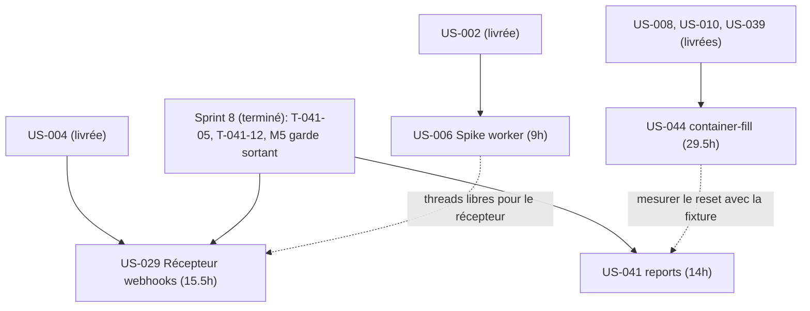
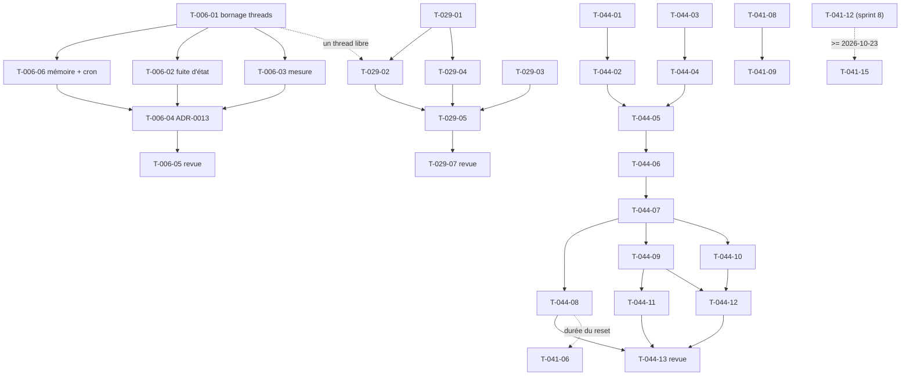

# Dépendances — Sprint 009 (Reports)

> **Arbitrage du 2026-10-16** : US-029 (récepteur de webhooks, 15,5 h) est reportée au sprint 10. Ses tâches restent ci-dessous pour mémoire, hors engagement du sprint 9.

## Entre stories et avec les sprints précédents

## Entre tâches (vue transversale)

## Chemin critique

US-044 : T-044-02 → T-044-05 → T-044-06 → T-044-07 → T-044-09 → T-044-12 → T-044-13 (≈ 18 h). Les autres stories sont indépendantes et parallélisables. Les ordres de priorité, en cas de dépassement de capacité, sont dans [tasks/README.md](./tasks/README.md).

## Ressources partagées

- Disque local ~3 Go : un seul build d'image pour US-006 (en CI), aucun autre rebuild.
- `docker/Caddyfile` : modifié par US-006 seulement.
- `src/Demo/Http/DemoGateListener.php` : modifié par US-029 seulement.
