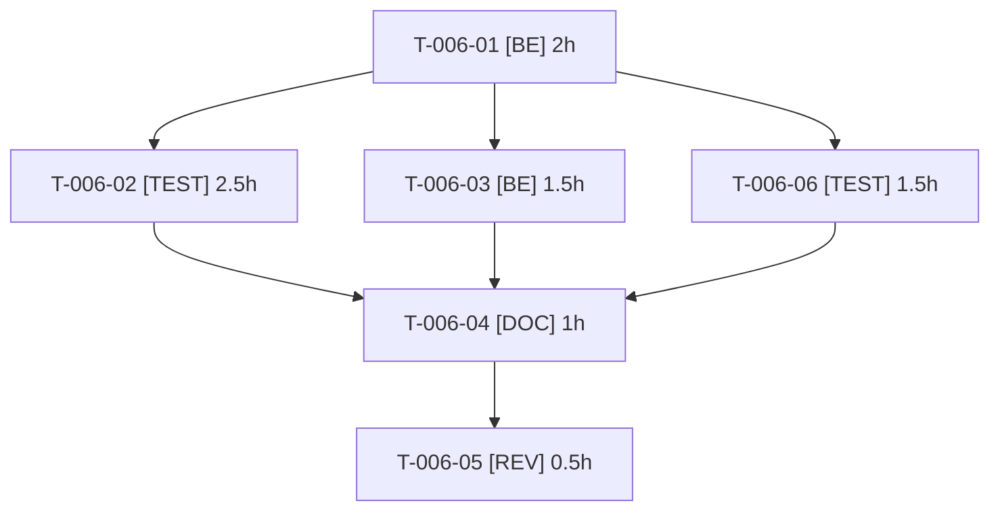

# Tâches — US-006 : Spike : mode worker FrankenPHP

## Informations US

- **Epic** : EPIC-01
- **Persona** : Thibaut
- **Story Points** : 2
- **Sprint** : sprint-9-reports
- **Dépendances** : US-002

## Résumé

En tant que Thibaut, je veux savoir si le mode worker FrankenPHP est sûr avec Sylius et les plugins, afin de gagner en performance sans fuite d'état.

## Vue d'ensemble des tâches

| ID | Type | Tâche | Estimation | Dépend de | Statut |
|----|------|-------|------------|-----------|--------|
| T-006-01 | [BE] | Activer le mode worker en local (Caddyfile, variables FrankenPHP) derrière un drapeau, avec threads bornés (`num_threads`, `max_threads`, nombre de workers) | 2h | — | ✅ |
| T-006-02 | [TEST] | Test de fuite d'état en mode worker : requêtes alternées entre comptes, canaux, locales et badges | 2.5h | T-006-01 | ✅ |
| T-006-03 | [BE] | Mesurer le gain : latence p50/p95 sur 5 pages types, classique contre worker | 1.5h | T-006-01 | ✅ |
| T-006-06 | [TEST] | Mémoire sous charge : RSS du conteneur (FrankenPHP borné + processus de supercronic) en classique et en worker | 1.5h | T-006-01 | ✅ |
| T-006-04 | [DOC] | ADR-0013 : mode retenu (worker ou classique), bornage des threads et inventaire des services à état | 1h | T-006-02, T-006-03, T-006-06 | ✅ |
| T-006-05 | [REV] | Revue du spike (méthode de mesure, couverture du test de fuite) | 0.5h | T-006-04 | 🔲 |

**Total estimé : 9h** (6 tâches ; 7h au sprint 8, +0.5h bornage des threads, +1.5h mémoire avec le cron)

> Mise à jour au Planning Part 2 du sprint 9 : le `docker/Caddyfile` actuel n'a aucun `num_threads`/`max_threads` (risque OOM sur Railway Hobby, constat R5 du sprint 1, jamais traité). Le spike doit le borner et mesurer la mémoire avec `supercronic` (lancé par `docker/entrypoint.sh` à côté de FrankenPHP : ~15 tâches `php bin/console` dont `tmonier:webhook:dispatch` chaque minute, qui sont des processus CLI et ne sont pas concernés par le mode worker mais consomment de la RAM).

---

## Détail des tâches

### T-006-01 — Activer le mode worker en local (Caddyfile, variables FrankenPHP) derrière un drapeau

- **Type** : [BE]
- **Estimation** : 2h
- **Dépend de** : —

**Description** :
Profil `worker` (`FRANKENPHP_WORKER=1`) sans changer le mode par défaut. Borner dans le bloc global `frankenphp {}` du Caddyfile `num_threads` et `max_threads` (valeurs pilotées par variables d'environnement, défaut prudent pour Railway Hobby), et le nombre de workers (`worker { num }`) en mode worker, en gardant au moins un thread libre pour les requêtes internes (récepteur de webhooks d'US-029). Aucun build d'image sur le poste (disque) : image existante ou CI ; regrouper les essais en un seul build CI.

**Fichiers (indicatifs)** :
- `docker/Caddyfile`
- `docker/entrypoint.sh`
- `compose.yaml`

**Critères de validation** :
- [ ] Le démarrage en mode worker est reproductible par une seule variable
- [ ] Le mode classique reste le défaut
- [ ] Threads et workers bornés par variables, valeurs documentées

---

### T-006-02 — Test de fuite d'état en mode worker : requêtes alternées entre comptes, canaux, locales et badges

- **Type** : [TEST]
- **Estimation** : 2.5h
- **Dépend de** : T-006-01

**Description** :
Script de fumée enchaînant sur le même worker : visiteur A (panier, canal, locale en_US, cookie `demo_badges`), visiteur B anonyme, compte B2B. Détecte toute donnée de A visible pour B (panier, canal, utilisateur, locale, badges, jeton CSRF). Inventorier aussi les services de la démo à état entre requêtes : `OutboundGuardHttpClient` (`ResetInterface`), `RateLimitSubscriber`, `InternalRequestToken`, `HostAllowList` (immuable), listeners de `src/Demo/Http/`.

**Fichiers (indicatifs)** :
- `tests/Smoke/WorkerStateLeakTest.php (ou script bin/)`

**Critères de validation** :
- [ ] Aucune donnée d'une requête visible dans la suivante
- [ ] Le test échoue si on injecte volontairement un service à état (témoin)

---

### T-006-03 — Mesurer le gain : latence p50/p95 sur 5 pages types, classique contre worker

- **Type** : [BE]
- **Estimation** : 1.5h
- **Dépend de** : T-006-01

**Description** :
Mesure reproductible (même machine, même jeu de données, échauffement exclu) sur accueil, liste, fiche, panier, compte.

**Fichiers (indicatifs)** :
- `bin/bench-worker.sh`
- `var/bench/ (non versionné)`

**Critères de validation** :
- [ ] Tableau p50/p95 classique/worker pour 5 pages
- [ ] Méthode documentée et rejouable

---

### T-006-06 — Mémoire sous charge : RSS avec threads bornés et cron

- **Type** : [TEST]
- **Estimation** : 1.5h
- **Dépend de** : T-006-01

**Description** :
Mesurer la mémoire résidente du conteneur en mode classique puis worker, sous la même charge que T-006-03, **pendant** l'exécution des tâches de `docker/crontab` (`tmonier:webhook:dispatch` chaque minute, `tmonier:feeds:generate --stale` toutes les 15 minutes) lancées par supercronic. Vérifier que le total reste sous le plafond du service Railway et que le reset de 03:00 (`app:demo:reset`, `memory_limit=1G` au chargement initial) ne dépasse pas la marge.

**Fichiers (indicatifs)** :
- `bin/bench-worker.sh`
- `var/bench/ (non versionné)`

**Critères de validation** :
- [ ] RSS maximal relevé en classique et en worker, cron actif
- [ ] Valeurs de `num_threads`/`max_threads` retenues justifiées par la mesure

---

### T-006-04 — ADR-0013 : mode retenu (worker ou classique) et inventaire des services à état

- **Type** : [DOC]
- **Estimation** : 1h
- **Dépend de** : T-006-02, T-006-03, T-006-06

**Description** :
Décision argumentée par le gain mesuré, la mémoire (T-006-06) et le résultat du test de fuite ; bornage des threads retenu ; liste des services à état éventuels ; repli : mode classique.

**Fichiers (indicatifs)** :
- `docs/adr/0013-mode-worker-frankenphp.md`

**Critères de validation** :
- [ ] ADR au statut Accepté avec le mode retenu
- [ ] Gain chiffré cité

---

### T-006-05 — Revue du spike (méthode de mesure, couverture du test de fuite)

- **Type** : [REV]
- **Estimation** : 0.5h
- **Dépend de** : T-006-04

**Description** :
Relecture indépendante.

**Fichiers (indicatifs)** :
- `docs/adr/0013-mode-worker-frankenphp.md`

**Critères de validation** :
- [ ] Méthode de mesure jugée valide
- [ ] Cas de fuite manquants consignés

---

## Graphe de dépendances

## Résumé

| Couche | Nb tâches | Heures |
|--------|-----------|--------|
| [BE] | 2 | 3.5h |
| [TEST] | 2 | 4h |
| [DOC] | 1 | 1h |
| [REV] | 1 | 0.5h |
| **TOTAL** | **6** | **9h** |
